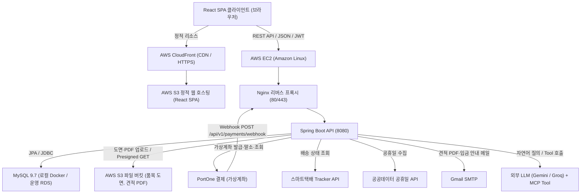
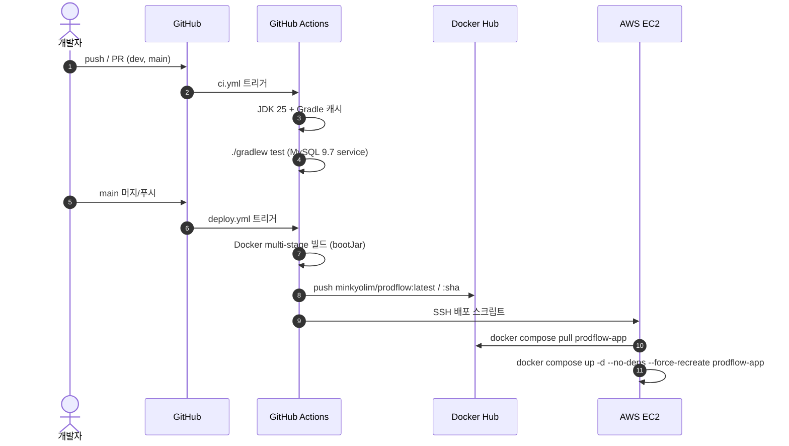
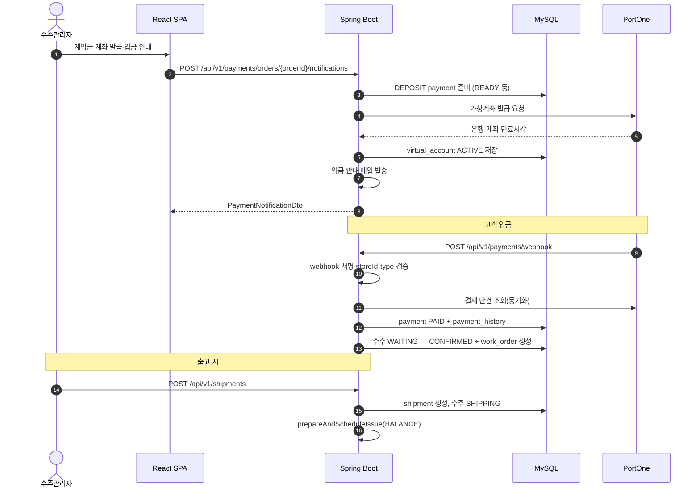
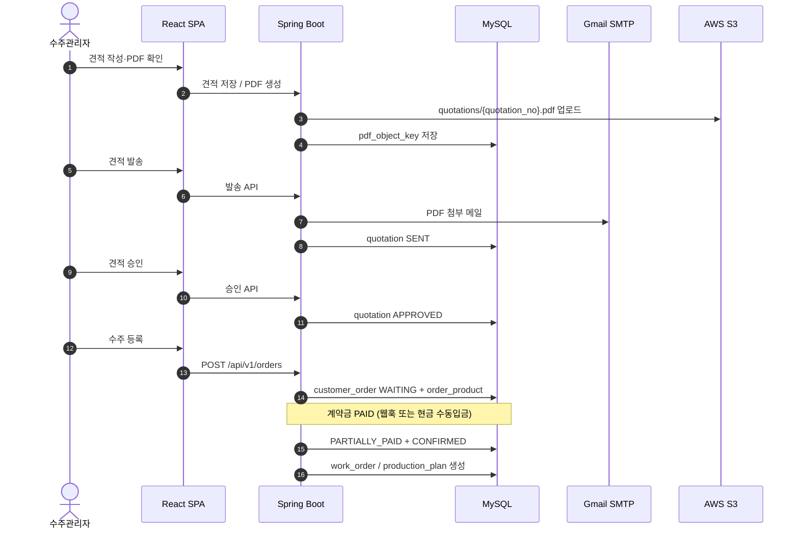
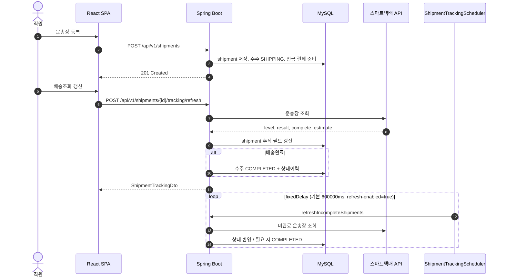
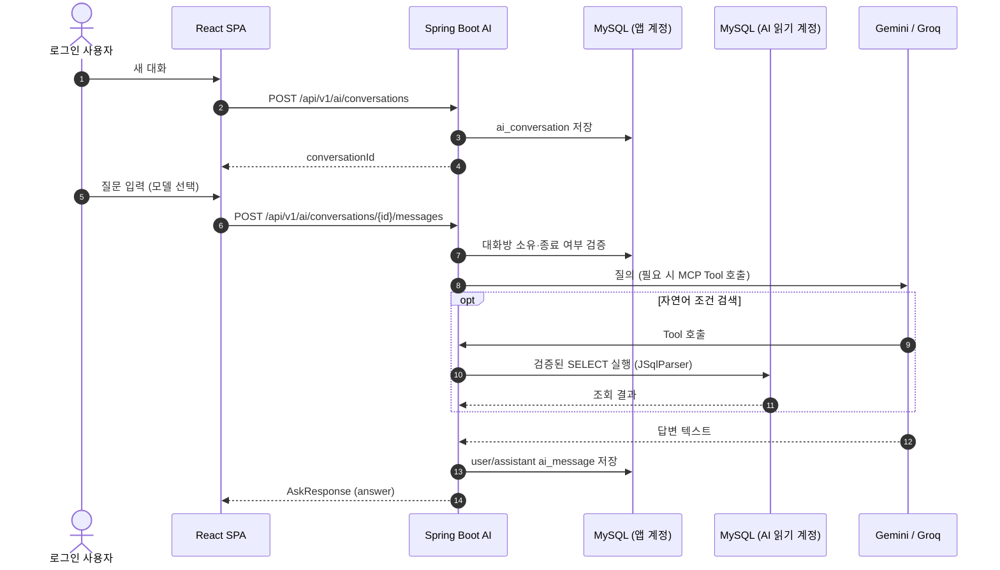
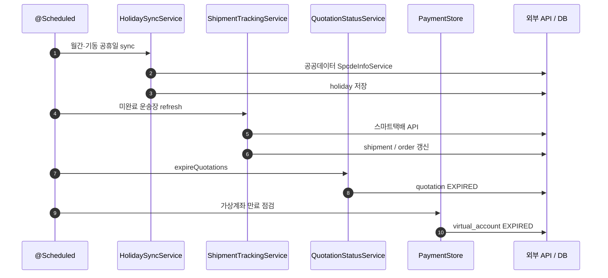

# 1. 시스템 아키텍처 설계서 (PRODFLOW)

## 목차
- [1.1 시스템 아키텍처 개요](#11-시스템-아키텍처-개요)
- [1.2 AWS 클라우드 및 컨테이너 인프라 아키텍처](#12-aws-클라우드-및-컨테이너-인프라-아키텍처)
- [1.3 GitHub Actions 기반 CI/CD 배포 자동화 파이프라인](#13-github-actions-기반-cicd-배포-자동화-파이프라인)
- [1.4 핵심 비즈니스 데이터 흐름도](#14-핵심-비즈니스-데이터-흐름도)

---

## 1.1 시스템 아키텍처 개요

PRODFLOW는 휴대폰 케이스 수주·생산·배송·입금을 관리하는 B2B 백오피스다. 프론트엔드(React SPA)와 백엔드(Spring Boot)가 분리된 계층형 RESTful API 구조를 사용한다.

백엔드는 Spring Boot 4.1.1 / Java 25, Spring Data JPA, Spring Security(JWT), Spring Mail, AWS SDK(S3), Spring AI(Gemini·Groq·MCP)를 사용한다. 외부 연동은 PortOne(가상계좌), 스마트택배(Sweet Tracker 배송조회), 공공데이터 공휴일 API, Gmail SMTP다.

로컬 개발은 Docker Compose로 MySQL 9.7을 띄우고, 운영은 EC2의 Docker Compose로 앱·Nginx를 기동한다. CI는 `main`/`dev` push·PR에서 테스트, CD는 `main` 푸시 시 Docker Hub 이미지 빌드 후 EC2에 `prodflow-app`을 재기동한다.

QueryDSL·Spring Batch는 사용하지 않는다. 주기 작업은 `@EnableScheduling` + `@Scheduled`다.

주요 기술 스택:
- Backend: Spring Boot 4.1.1, Java 25, Spring Data JPA, Spring Security, Validation, Mail, springdoc OpenAPI
- AI: Spring AI BOM 2.0.2 (Google GenAI, OpenAI 호환 Groq), MCP Server/Client, JSqlParser
- Infra/연동: MySQL 9.7, AWS S3 (SDK 2.31.x), PortOne, 스마트택배, OpenPDF, Apache POI
- 인증: JWT(JJWT) + RBAC (`SUPER_ADMIN`, `ORDER_MANAGER` 등)
- 사용하지 않음: QueryDSL, Spring Batch, SSE 스트리밍 챗봇

---

## 1.2 AWS 클라우드 및 컨테이너 인프라 아키텍처

### 1.2.1 프론트엔드 호스팅 및 CDN (AWS S3 + CloudFront)
- Vite/React SPA 빌드 산출물을 S3 정적 호스팅 버킷에 배포한다.
- CloudFront로 HTTPS·캐싱을 처리한다.
- SPA 라우팅을 위해 CloudFront 사용자 정의 오류 응답으로 403/404 시 `/index.html`을 200으로 반환하도록 구성한다.
- 백엔드 CORS 허용 Origin 기본값: `http://localhost:3000`, `http://localhost:5173`, `https://www.prodflow.site` (`AUTH_ALLOWED_ORIGINS`)

### 1.2.2 백엔드 컨테이너 (AWS EC2 + Docker Compose)
- EC2에 Docker Engine / Compose로 앱을 기동한다.
- 운영 배포 이미지: Docker Hub `minkyolim/prodflow:latest` 및 `minkyolim/prodflow:{github.sha}`
- Dockerfile: multi-stage (`eclipse-temurin:25-jdk-alpine` 빌드 → `25-jre-alpine` 런타임), `bootJar -x test`, 비루트 사용자로 `java -jar app.jar`, 포트 8080
- Nginx가 80/443을 받아 Spring Boot(8080)로 리버스 프록시한다. Let's Encrypt 인증서는 Certbot 볼륨으로 관리하는 구성을 사용한다.
- 로컬 `docker-compose.yaml`은 MySQL(`prodflow-db`, mysql:9.7)을 제공하며, 앱/Nginx 서비스 정의는 운영용으로 주석 처리된 형태를 포함한다.
- CD 배포 경로: EC2 `/home/ec2-user/prodflow`에서 `docker compose pull/up`으로 `prodflow-app`만 재기동한다.

### 1.2.3 데이터베이스 (MySQL 9.7)
- 로컬: Docker Compose MySQL 9.7, 포트 3306, 볼륨 `mysql-data`, TZ `Asia/Seoul`
- CI: GitHub Actions `services.mysql` (mysql:9.7)로 테스트 DB 제공
- 운영: 기획·문서 기준 RDS(MySQL). 앱 DataSource는 `.env`의 `MYSQL_*`로 연결한다.
- AI 자연어 조회는 별도 읽기 계정(`AI_DB_USERNAME` / `AI_DB_PASSWORD`) DataSource를 사용하는 read-only 풀이다.

### 1.2.4 파일 스토리지 (AWS S3)
- 품목 도면: Multipart 업로드 후 객체 키 `products/{productId}/{uuid}_{fileName}`로 저장한다.
- 현재 도면 조회 시 Presigned GET URL(만료 10분)을 발급한다. 응답에 `objectKey`는 노출하지 않는다.
- 견적 PDF: 객체 키 `quotations/{quotation_no}.pdf`로 저장하고, `quotation.pdf_object_key`에 키를 기록한다. 미리보기용 Presigned URL을 제공한다.
- 리전 기본값: `ap-northeast-2` (`AWS_REGION`)

---

## 1.3 GitHub Actions 기반 CI/CD 배포 자동화 파이프라인

### 1.3.1 CI (`ci.yml`)
- 트리거: `main`/`dev` push, `main`/`dev` pull_request
- Runner: `ubuntu-latest`, TZ `Asia/Seoul`
- MySQL 9.7 서비스 컨테이너 + Temurin JDK 25 + Gradle 캐시
- `./gradlew test --no-daemon --info --stacktrace --scan`
- Secrets로 DB/JWT/AWS/Mail/Holiday/Shipment/AI 키를 주입
- 테스트 시 `SHIPMENT_TRACKING_REFRESH_ENABLED=false`로 배송 주기 조회 스케줄러를 끈다

### 1.3.2 CD (`deploy.yml`)
- 트리거: `main` push (또는 `workflow_dispatch`), `github.ref == refs/heads/main`일 때만 실행
- concurrency group `prodflow-production`, `cancel-in-progress: false`
- Docker Hub 로그인 → Buildx → 이미지 빌드·푸시 (`minkyolim/prodflow:latest`, `minkyolim/prodflow:{sha}`)
- SSH(`appleboy/ssh-action`)로 EC2 `ec2-user` 접속 후:
  - `cd /home/ec2-user/prodflow`
  - `docker compose config -q`
  - `docker compose pull prodflow-app`
  - `docker compose up -d --no-deps --force-recreate prodflow-app`
  - `docker compose ps`

---

## 1.4 핵심 비즈니스 데이터 흐름도

### 1.4.1 계약금 가상계좌 발급 및 PortOne 입금 웹훅
수주(`WAITING`) 등록 후 계약금은 총액의 50%(원 단위 내림, `PaymentAmountPolicy`)다. 가상계좌 발급·메일 안내는 `POST /api/v1/payments/orders/{orderId}/notifications` 등으로 `prepareAndScheduleIssue(DEPOSIT)`를 탄다. 입금 확정은 PortOne 웹훅이며, 서명 검증 후 `POST /api/v1/payments/webhook`이 처리한다(Security `permitAll`). 계약금 `PAID` 최초 확정 시 수주를 `CONFIRMED`(생산대기)로 바꾸고 작업지시를 생성한다. 출고(운송장 등록) 시 `prepareAndScheduleIssue(BALANCE)`로 잔금 결제건을 준비한다.

### 1.4.2 견적 승인 → 수주 → 작업지시 연계
승인된 견적으로 수주를 만들고, 계약금 입금 후 `CONFIRMED`에서 작업지시·생산계획이 생성되는 흐름이다.

### 1.4.3 배송 등록·조회 갱신·완료
출고대기 수주에 운송장을 등록하고, 스마트택배 API(`info.sweettracker.co.kr`)로 상태를 갱신한다. 배송완료 시 수주를 `COMPLETED`로 바꾼다. 동일 갱신 로직을 `ShipmentTrackingScheduler`가 주기적으로 수행한다(기본 `fixedDelay` 10분, `SHIPMENT_TRACKING_REFRESH_ENABLED`).

### 1.4.4 AI 업무 질의 (대화 저장 + LLM / MCP)
대화방을 만들고 질문을 보내면 Gemini(3.1 Flash-Lite, 2.5 Flash-Lite) 또는 Groq GPT-OSS 20B가 응답한다. DB 조회형 질문은 MCP Tool·읽기 전용 DataSource로 실행할 수 있다. 메시지 API는 단발 JSON 응답이며 SSE 스트리밍은 사용하지 않는다.

### 1.4.5 스케줄러 기반 주기 작업
Spring Batch가 아니라 `@Scheduled` 컴포넌트로 주기 작업을 수행한다.

| 컴포넌트 | 역할 | 제어 |
| --- | --- | --- |
| HolidayScheduler | 매월 1일 00:00(KST) 올해·내년 공휴일 수집 | `holiday.scheduling.enabled` / `HOLIDAY_SCHEDULING_ENABLED` |
| HolidayInitializer | 기동 시 올해·내년 공휴일 수집 | `holiday.initialization.enabled` / `HOLIDAY_INITIALIZATION_ENABLED` |
| ShipmentTrackingScheduler | 미완료 운송장 주기 조회 (기본 10분) | `shipment.tracking.refresh-enabled` / `SHIPMENT_TRACKING_REFRESH_ENABLED` |
| QuotationExpirationScheduler | 자정·기동 시 만료 견적 처리 | `quotation.expiration.enabled` (미설정 시 true) |
| OrderNotificationScheduler | 자정 납기 임박·지연 알림 생성 | 항상 활성 |
| PaymentStore | 가상계좌 만료 상태 점검 (기본 60초) | `payment.virtual-account-expire-check-ms` |

