# PRODFLOW 데이터베이스 모델링 및 ERD 명세서

## 목차

1. ERD 다이어그램
2. 테이블 상세 명세서

---

## 1. ERD 다이어그램

```mermaid
erDiagram
  %% UNIQUE quotation_item(quotation_id, product_id)
  %% UNIQUE order_product(customer_order_id, product_id)
  %% UNIQUE production_plan(work_order_id, plan_date)
  %% UNIQUE payment(order_id, payment_type)
  %% UNIQUE shipment(carrier_code, tracking_number)
  %% UNIQUE ai_message(ai_conversation_id, sequence_no)
  code_group ||--o{ common_code : "code_group_id"
  user ||--o| refresh_token : "user_id"
  user ||--o{ client : "user_id"
  order_product ||--o{ work_order : "order_product_id"
  line ||--o{ work_order : "line_id"
  user |o--o{ work_order : "user_id"
  common_code ||--o{ work_order : "common_code_id"
  work_order ||--o{ production_plan : "work_order_id"
  order_product ||--o{ production_plan : "order_product_id"
  work_order |o--o{ work_order_history : "work_order_id"
  line ||--o{ work_order_history : "previous_line_id"
  line |o--o{ work_order_history : "new_line_id"
  user |o--o{ work_order_history : "previous_user_id"
  user |o--o{ work_order_history : "new_user_id"
  user ||--o{ work_order_history : "changed_by"
  common_code ||--o{ product : "device_code"
  product ||--o{ product_drawing : "product_id"
  quotation ||--o| customer_order : "quotation_id"
  client ||--o{ customer_order : "client_id"
  user ||--o{ customer_order : "user_id"
  common_code ||--o{ customer_order : "status_code"
  customer_order ||--o{ order_product : "customer_order_id"
  product ||--o{ order_product : "product_id"
  client ||--o{ quotation : "client_id"
  user ||--o{ quotation : "user_id"
  quotation ||--o{ quotation_item : "quotation_id"
  product ||--o{ quotation_item : "product_id"
  user |o--o{ status_history : "user_id"
  customer_order ||--o{ payment : "order_id"
  payment ||--o{ virtual_account : "payment_id"
  payment ||--o| payment_history : "payment_id"
  virtual_account |o--o{ payment_history : "virtual_account_id"
  customer_order ||..o| shipment : "order_id (논리 참조)"
  carrier ||--o{ shipment : "carrier_code"
  line ||--o{ line_capacity_log : "line_id"
  user ||--o{ line_capacity_log : "user_id"
  customer_order |o--o{ order_notification : "customer_order_id"
  user ||--o{ order_notification : "target_id"
  line |o--o{ line_notification : "line_id"
  user ||--o{ line_notification : "target_id"
  customer_order |o--o{ client_noti_log : "customer_order_id"
  quotation |o--o{ client_noti_log : "quotation_id"
  user ||--o{ client_noti_log : "sent_by"
  customer_order ||--o{ payment_notification_request : "order_id"
  user ||--o{ payment_notification_request : "user_id"
  user ||--o{ ai_conversation : "user_id"
  ai_conversation ||--o{ ai_message : "ai_conversation_id"

  code_group {
      bigint id PK
      varchar group_code UK
      varchar group_name
  }

  common_code {
      bigint id PK
      bigint code_group_id FK
      varchar code
      varchar name
      int sort_order
      varchar status
  }

  user {
      bigint id PK
      varchar password
      varchar name
      varchar email UK
      varchar phone
      varchar role
      varchar status
      datetime last_login_at
      datetime created_at
      datetime updated_at
      varchar created_by
      varchar updated_by
      datetime deleted_at
      boolean must_change_password
  }

  refresh_token {
      bigint id PK
      bigint user_id FK,UK
      varchar token_hash UK
      datetime expires_at
      datetime created_at
  }

  client {
      bigint id PK
      varchar company
      varchar employee
      varchar email
      varchar phone
      varchar zipcode
      varchar road_address
      varchar detail_address
      bigint user_id FK
      datetime created_at
      datetime updated_at
      varchar created_by
      varchar updated_by
  }

  work_order {
      bigint id PK
      varchar work_no UK
      bigint order_product_id FK
      bigint line_id FK
      bigint user_id FK
      int quantity
      date work_order_date
      date planned_start_date
      date planned_end_date
      date completed_at
      bigint common_code_id FK
      text note
      datetime created_at
      datetime updated_at
      varchar created_by
      varchar updated_by
  }

  production_plan {
      bigint id PK
      bigint work_order_id FK
      bigint order_product_id FK
      date plan_date
      int quantity
      datetime created_at
      datetime updated_at
      varchar created_by
      varchar updated_by
  }

  work_order_history {
      bigint id PK
      bigint work_order_id FK
      bigint previous_line_id FK
      bigint new_line_id FK
      bigint previous_user_id FK
      bigint new_user_id FK
      bigint changed_by FK
      text change_reason
      datetime changed_at
      varchar work_no
  }

  product {
      bigint id PK
      varchar model_code UK
      varchar product_name
      bigint device_code FK
      varchar product_description
      bigint current_price
      varchar status
      datetime created_at
      datetime updated_at
      varchar created_by
      varchar updated_by
  }

  product_drawing {
      bigint id PK
      bigint product_id FK
      varchar object_key
      varchar file_name
      datetime created_at
      datetime updated_at
      varchar created_by
      varchar updated_by
      datetime replaced_at
  }

  customer_order {
      bigint id PK
      varchar order_no UK
      bigint quotation_id FK,UK
      bigint client_id FK
      varchar contact_name
      varchar email
      varchar phone
      varchar address
      bigint user_id FK
      date requested_due_date
      date estimated_due_date
      date planned_start_date
      date planned_end_date
      date end_date
      date deposit_due_date
      varchar shipping_address
      varchar receiver_name
      varchar receiver_phone
      varchar notify_channel
      varchar memo
      bigint status_code FK
      varchar confirmation_status
      boolean vat_included
      varchar payment_status
      bigint total_amount
      datetime created_at
      datetime updated_at
      varchar created_by
      varchar updated_by
  }

  order_product {
      bigint id PK
      bigint customer_order_id FK
      bigint product_id FK
      varchar product_name
      int quantity
      bigint unit_price
      datetime created_at
      datetime updated_at
      varchar created_by
      varchar updated_by
  }

  quotation {
      bigint id PK
      varchar quotation_no UK
      varchar pdf_object_key
      bigint client_id FK
      varchar client_name
      varchar client_email
      varchar client_phone
      varchar client_address
      bigint user_id FK
      date requested_due_date
      date estimated_due_date
      date planned_start_date
      date planned_end_date
      varchar status
      date valid_until
      boolean vat_included
      bigint total_amount
      datetime created_at
      datetime updated_at
      varchar created_by
      varchar updated_by
  }

  quotation_item {
      bigint id PK
      bigint quotation_id FK
      bigint product_id FK
      varchar product_name
      varchar device_name
      int quantity
      bigint unit_price
      bigint line_amount
      datetime created_at
  }

  status_history {
      bigint id PK
      varchar entity
      bigint entity_id
      varchar from_status
      varchar to_status
      bigint user_id FK
      varchar user_name
      varchar note
      datetime created_at
  }

  payment {
      bigint id PK
      bigint order_id FK
      varchar payment_method
      varchar portone_payment_id
      varchar payment_type
      bigint amount
      varchar status
      datetime created_at
      varchar created_by
      datetime reissue_due_at
      datetime reissue_closed_at
      datetime updated_at
      varchar updated_by
  }

  virtual_account {
      bigint id PK
      bigint payment_id FK
      varchar bank
      varchar account_number
      varchar status
      varchar account_name
      datetime expires_at
      varchar portone_payment_id
      datetime created_at
      datetime updated_at
      varchar created_by
      varchar updated_by
  }

  payment_history {
      bigint id PK
      bigint payment_id FK,UK
      bigint virtual_account_id FK
      varchar transaction_id UK
      datetime paid_at
      datetime created_at
      datetime webhook_remote_updated_at
      varchar last_webhook_type
  }

  payment_notification_request {
      varchar id PK
      bigint order_id FK
      bigint user_id FK
      varchar kind
      varchar status
      varchar message
      datetime created_at
      datetime updated_at
      varchar created_by
      varchar updated_by
  }

  carrier {
      varchar code PK
      varchar name
      varchar international
  }

  shipment {
      bigint id PK
      bigint order_id UK
      varchar carrier_code FK
      varchar tracking_number
      int level
      varchar result
      boolean complete
      varchar estimate
      datetime started_at
      datetime delivered_at
  }

  line {
      bigint id PK
      varchar line_name UK
      int production_capacity
      varchar status
      datetime created_at
      datetime updated_at
      varchar created_by
      varchar updated_by
  }

  line_capacity_log {
      bigint id PK
      bigint line_id FK
      int before_capacity
      int after_capacity
      varchar reason
      bigint user_id FK
      datetime changed_at
  }

  order_notification {
      bigint id PK
      bigint customer_order_id FK
      bigint target_id FK
      varchar notification_type
      varchar message
      datetime read_at
      datetime created_at
  }

  line_notification {
      bigint id PK
      bigint line_id FK
      bigint target_id FK
      varchar notification_type
      varchar message
      datetime read_at
      datetime created_at
  }

  client_noti_log {
      bigint id PK
      bigint customer_order_id FK
      varchar kind
      varchar channel
      varchar recipient
      bigint quotation_id FK
      varchar status
      datetime sent_at
      bigint sent_by FK
      varchar error_message
  }

  ai_conversation {
      bigint id PK
      bigint user_id FK
      varchar title
      boolean title_edited
      boolean is_closed
      datetime created_at
      datetime updated_at
      varchar created_by
      varchar updated_by
      datetime closed_at
  }

  ai_message {
      bigint id PK
      bigint ai_conversation_id FK
      int sequence_no
      varchar role
      text content
      text generated_sql
      datetime created_at
      longtext result_json
  }

  holiday {
      bigint id PK
      date holiday_date UK
      varchar name
      datetime created_at
  }
```

## 2. 테이블 상세 명세서

### 2.1 code_group

| 컬럼명        | 데이터 타입       | 제약 조건              | 설명                  |
|------------|--------------|--------------------|---------------------|
| id         | BIGINT       | PK, AUTO_INCREMENT | 묶음 번호               |
| group_code | VARCHAR(255) | NOT NULL, UNIQUE   | 코드 그룹 식별값           |
| group_name | VARCHAR(255) | NOT NULL           | 화면 이름. 기종, 수주 진행 상태 |

### 2.2 common_code

| 컬럼명           | 데이터 타입       | 제약 조건                        | 설명                                      |
|---------------|--------------|------------------------------|-----------------------------------------|
| id            | BIGINT       | PK, AUTO_INCREMENT           | 코드 번호. 품목과 수주가 이 번호를 저장                 |
| code_group_id | BIGINT       | FK → code_group.id, NOT NULL | 어느 묶음인지                                 |
| code          | VARCHAR(255) | NOT NULL                     | 프로그램이 저장하는 값. 예: `WAITING`, `CONFIRMED` |
| name          | VARCHAR(255) | NOT NULL                     | 화면에 보이는 이름. 예: 대기, 생산대기                 |
| sort_order    | INT          | NOT NULL                     | 목록에 나오는 순서                              |
| status        | VARCHAR(255) | NOT NULL                     | `ACTIVE`면 선택 가능. `INACTIVE`면 목록에서 숨김    |

### 2.3 user (직원 테이블)

| 컬럼명                  | 데이터 타입       | 제약 조건                      | 설명                                                                                                      |
|----------------------|--------------|----------------------------|---------------------------------------------------------------------------------------------------------|
| id                   | BIGINT       | PK, AUTO_INCREMENT         | 사용자 고유 식별자                                                                                              |
| password             | VARCHAR(255) | NOT NULL                   | BCrypt 암호화 비밀번호                                                                                         |
| name                 | VARCHAR(255) | NOT NULL                   | 사용자 이름                                                                                                  |
| email                | VARCHAR(255) | NOT NULL, UNIQUE           | 사용자 이메일                                                                                                 |
| phone                | VARCHAR(255) | NOT NULL                   | 사용자 연락처                                                                                                 |
| role                 | VARCHAR(255) | NOT NULL                   | 사용자 권한. SUPER_ADMIN(최고관리자), ORDER_MANAGER(수주관리자), PRODUCTION_MANAGER(생산현장관리자), INQUIRY_MANAGER(업무조회담당자) |
| status               | VARCHAR(255) | NOT NULL, DEFAULT (ACTIVE) | 계정 상태. ACTIVE(활성, 로그인 및 업무 수행 가능), INACTIVE(비활성, 로그인 및 업무 배정 제한), DELETED(삭제, 계정관리 목록에서 제외)             |
| last_login_at        | DATETIME     | NULL                       | 마지막 로그인 일시                                                                                              |
| created_at           | DATETIME     | NOT NULL                   | 계정 생성 일시                                                                                                |
| updated_at           | DATETIME     | NOT NULL                   | 계정 정보 마지막 수정 일시                                                                                         |
| created_by           | VARCHAR(255) | NULL                       | 계정을 생성한 사용자 이름. 인증 정보가 없으면 SYSTEM                                                                       |
| updated_by           | VARCHAR(255) | NULL                       | 계정 정보를 마지막으로 수정한 사용자 이름. 인증 정보가 없으면 SYSTEM                                                              |
| deleted_at           | DATETIME     | NULL                       | 계정 소프트 삭제 일시. 삭제되지 않은 계정은 NULL                                                                          |
| must_change_password | BOOLEAN      | NOT NULL, DEFAULT (TRUE)   | 최초 비밀번호 변경 필요 여부. TRUE(비밀번호 변경 필요), FALSE(비밀번호 변경 완료 또는 불필요)                                            |

- 계정은 소프트 삭제하며 DELETED 행과 과거 참조를 유지한다.

### 2.4 refresh_token (리프레시 토큰 관리 테이블)

| 컬럼명        | 데이터 타입       | 제약 조건                          | 설명                           |
|------------|--------------|--------------------------------|------------------------------|
| id         | BIGINT       | PK, AUTO_INCREMENT             | Refresh Token 고유 ID          |
| user_id    | BIGINT       | FK → user.id, UNIQUE, NOT NULL | 토큰을 발급받은 사용자 ID (User.id)    |
| token_hash | VARCHAR(255) | NOT NULL, UNIQUE               | Refresh Token 원문 대신 저장하는 해시값 |
| expires_at | DATETIME     | NOT NULL                       | Refresh Token 만료 일시          |
| created_at | DATETIME     | NOT NULL                       | Refresh Token 발급 일시          |

### 2.5 client (거래처 테이블)

| 컬럼명            | 데이터 타입       | 제약 조건                        | 설명                |
|----------------|--------------|------------------------------|-------------------|
| id             | BIGINT       | PK, AUTO_INCREMENT           | 거래처 고유 ID         |
| company        | VARCHAR(255) | NOT NULL                     | 거래처 회사 이름         |
| employee       | VARCHAR(50)  | NOT NULL                     | 거래처 대표자 또는 담당자 이름 |
| email          | VARCHAR(100) | NOT NULL                     | 거래처 이메일           |
| phone          | VARCHAR(50)  | NOT NULL                     | 거래처 연락처           |
| zipcode        | VARCHAR(10)  | NOT NULL                     | 우편번호              |
| road_address   | VARCHAR(100) | NOT NULL                     | 도로명 주소            |
| detail_address | VARCHAR(100) | NOT NULL                     | 상세 주소             |
| user_id        | BIGINT       | NOT NULL, FK → user.id, NULL | 수주 관리자 ID         |
| created_at     | DATETIME     | NOT NULL                     | 거래처 생성 일시         |
| updated_at     | DATETIME     | NOT NULL                     | 거래처 수정 일시         |
| created_by     | VARCHAR(255) | NULL                         | 생성한 사용자           |
| updated_by     | VARCHAR(255) | NULL                         | 수정한 사용자           |

- 주소는 Address 임베디드 객체를 물리 컬럼 3개로 저장한다.
- 누적 수주량·거래액·최근 수주일은 조회 집계값이며 저장 컬럼이 아니다.

### 2.6 work_order (작업지시서)

| 컬럼명                | 데이터 타입       | 제약 조건                            | 설명                             |
|--------------------|--------------|----------------------------------|--------------------------------|
| id                 | BIGINT       | PK, AUTO_INCREMENT               | 작업지시서 고유 식별자                   |
| work_no            | VARCHAR(255) | NOT NULL, UNIQUE                 | 작업지시 번호                        |
| order_product_id   | BIGINT       | FK → order_product.id, NOT NULL  | 수주 품목 ID                       |
| line_id            | BIGINT       | FK → line.id, NOT NULL           | 담당 생산 라인 ID                    |
| user_id            | BIGINT       | FK → user.id, NULL               | 생산 담당자                         |
| quantity           | INT          | NOT NULL                         | 라인에 배정된 수량                     |
| work_order_date    | DATE         | NOT NULL, DEFAULT (CURRENT_DATE) | 작업 지시일                         |
| planned_start_date | DATE         | NOT NULL                         | 작업 시작 예정일                      |
| planned_end_date   | DATE         | NOT NULL                         | 작업 완료 예정일                      |
| completed_at       | DATE         | NULL                             | 포장 전환 시 기록한 작업 완료 날짜           |
| common_code_id     | BIGINT       | FK → common_code.id, NOT NULL    | 작업 상태 코드. WORK_ORDER_STATUS 그룹 |
| note               | TEXT         | NULL                             | 작업 내용 작성 (품목, 수량)              |
| created_at         | DATETIME     | NOT NULL                         | 작업지시서 생성 일시                    |
| updated_at         | DATETIME     | NOT NULL                         | 작업지시서 수정 일시                    |
| created_by         | VARCHAR(255) | NULL                             | 작업지시서 생성 직원                    |
| updated_by         | VARCHAR(255) | NULL                             | 작업지시서 수정 직원                    |

- 작업지시 한 건은 수주 품목 하나와 라인 하나에 대응한다. 생산 담당자는 미배정일 수 있다.
- 상태 코드: PREPARE, PRODUCE, PACK, PACK_DONE, SUSPEND, HALT.
- completed_at은 포장 전환 기록이며 설비에서 수집한 실적 시각이 아니다.

**작업 지시 상태 (status_code)**

일시 정지(작업) -> 생산 보류(수주)
생산 중지(작업)-> 생산 대기(수주)
취소(수주) -> 생산중지(작업)

| 코드          | 화면 표시 | 설명                  |
|-------------|-------|---------------------|
| `PREPARE`   | 준비    | 작업 배정 후 생산 시작 대기    |
| `PRODUCE`   | 생산    | 담당자가 생산 진행으로 변경     |
| `PACK`      | 포장    | 담당자가 작업 완료 처리       |
| `PACK_DONE` | 포장완료  | 담당자가 작업 완료 처리       |
| `SUSPEND`   | 일시 정지 | 해당 작업지시서의 작업을 일시 중단 |
| `HALT`      | 생산 중지 | 작업 진행을 중단한 상태       |

### 2.7 production_plan (날짜별 생산 계획)

| 컬럼명              | 데이터 타입       | 제약 조건                           | 설명             |
|------------------|--------------|---------------------------------|----------------|
| id               | BIGINT       | PK, AUTO_INCREMENT              | 생산 계획 ID       |
| work_order_id    | BIGINT       | FK → work_order.id, NOT NULL    | 작업지시서 ID       |
| order_product_id | BIGINT       | FK → order_product.id, NOT NULL | 생산 대상 수주 품목 ID |
| plan_date        | DATE         | NOT NULL                        | 생산 예정일         |
| quantity         | INT          | NOT NULL                        | 해당 날짜의 계획 수량   |
| created_at       | DATETIME     | NOT NULL                        | 생성 일시          |
| updated_at       | DATETIME     | NOT NULL                        | 수정 일시          |
| created_by       | VARCHAR(255) | NULL                            | 생성한 사용자        |
| updated_by       | VARCHAR(255) | NULL                            | 수정한 사용자        |

- `UNIQUE(work_order_id, plan_date)`
- 라인은 work_order.line_id를 통해 참조한다.
- 작업지시의 날짜별 계획 수량이며 실제 생산 실적을 저장하지 않는다.

### 2.8 work_order_history (작업지시서 변경 이력)

| 컬럼명              | 데이터 타입       | 제약 조건                    | 설명                     |
|------------------|--------------|--------------------------|------------------------|
| id               | BIGINT       | PK, AUTO_INCREMENT       | 변경 이력 ID               |
| work_order_id    | BIGINT       | FK → work_order.id, NULL | 원본 작업지시. 통합 시 참조 해제 가능 |
| work_no          | VARCHAR(255) | NULL                     | 원본 작업지시 번호 스냅샷         |
| previous_line_id | BIGINT       | FK → line.id, NOT NULL   | 변경 전 생산 라인             |
| new_line_id      | BIGINT       | FK → line.id, NOT NULL   | 변경 후 생산 라인             |
| previous_user_id | BIGINT       | FK → user.id, NULL       | 변경 전 담당자               |
| new_user_id      | BIGINT       | FK → user.id, NULL       | 변경 후 담당자               |
| changed_by       | BIGINT       | FK → user.id, NOT NULL   | 변경 처리자(담당직원 id)        |
| change_reason    | TEXT         | NULL                     | 변경 사유                  |
| changed_at       | DATETIME     | NOT NULL                 | 변경 일시                  |

- 작업지시 통합 시 FK를 해제해도 work_no로 원본 번호를 보존한다.
- 변경 전·후 라인은 필수이며 담당자는 NULL일 수 있다.

### 2.9 product (품목)

| 컬럼명                 | 데이터 타입       | 제약 조건                         | 설명                                      |
|---------------------|--------------|-------------------------------|-----------------------------------------|
| id                  | BIGINT       | PK, AUTO_INCREMENT            | 품목고유 식별자                                |
| model_code          | VARCHAR(255) | UNIQUE, NOT NULL              | 모델코드                                    |
| product_name        | VARCHAR(255) | NOT NULL                      | 제품명(헬로키티케이스)                            |
| device_code         | BIGINT       | FK → common_code.id, NOT NULL | 기종 코드. DEVICE 그룹                        |
| product_description | VARCHAR(255) | NULL                          | 제품 설명                                   |
| current_price       | BIGINT       | NOT NULL                      | 기준 단가                                   |
| status              | VARCHAR(255) | NOT NULL                      | `AVAILABLE`(생산가능), `DISCONTINUED`(생산중단) |
| created_at          | DATETIME     | NOT NULL                      | 등록시각                                    |
| updated_at          | DATETIME     | NOT NULL                      | 수정시각                                    |
| created_by          | VARCHAR(255) | NULL                          | 생성한 사용자                                 |
| updated_by          | VARCHAR(255) | NULL                          | 수정한 사용자                                 |

- 애플리케이션 초기값: status=AVAILABLE.

### 2.10 product_drawing (도면)

| 컬럼명         | 데이터 타입       | 제약 조건                     | 설명                         |
|-------------|--------------|---------------------------|----------------------------|
| id          | BIGINT       | PK, AUTO_INCREMENT        | 도면 한 개의 식별자                |
| product_id  | BIGINT       | FK → product.id, NOT NULL | 어떤 제품의 도면인지                |
| object_key  | VARCHAR(255) | NOT NULL                  | S3 객체 키                    |
| file_name   | VARCHAR(255) | NOT NULL                  | 올린 파일 이름                   |
| created_at  | DATETIME     | NOT NULL                  | 도면 등록 시각                   |
| updated_at  | DATETIME     | NOT NULL                  | 수정 일시                      |
| created_by  | VARCHAR(255) | NULL                      | 생성한 사용자                    |
| updated_by  | VARCHAR(255) | NULL                      | 수정한 사용자                    |
| replaced_at | DATETIME     | NULL                      | 다른 파일로 바꾼 시각. 현재 도면이면 NULL |

- replaced_at이 NULL인 행이 현재 도면이며 이전 도면 이력을 보존한다.

### 2.11 customer_order (수주)

| 컬럼명                 | 데이터 타입       | 제약 조건                               | 설명                                         |
|---------------------|--------------|-------------------------------------|--------------------------------------------|
| id                  | BIGINT       | PK, AUTO_INCREMENT                  | 수주 고유 식별자                                  |
| order_no            | VARCHAR(255) | NOT NULL, UNIQUE                    | 수주번호. 예: PF-2026-001                       |
| quotation_id        | BIGINT       | FK → quotation.id, UNIQUE, NOT NULL | 수주 생성의 근거가 된 견적서 ID. 취소 수주를 포함해 견적당 최대 한 건 |
| client_id           | BIGINT       | FK → client.id, NOT NULL            | 거래처 ID                                     |
| contact_name        | VARCHAR(255) | NOT NULL                            | 거래처 측 담당자 이름                               |
| email               | VARCHAR(255) | NOT NULL                            | 거래처 이메일                                    |
| phone               | VARCHAR(255) | NOT NULL                            | 거래처 연락처                                    |
| address             | VARCHAR(255) | NOT NULL                            | 거래처 주소                                     |
| user_id             | BIGINT       | FK → user.id, NOT NULL              | 이 수주를 등록한 직원. 수주 관리자                       |
| requested_due_date  | DATE         | NOT NULL                            | 희망 납기일. 견적의 희망 납기를 가져오고 등록 후 변경하지 않음       |
| estimated_due_date  | DATE         | NOT NULL                            | 등록 시 확정한 납기일                               |
| planned_start_date  | DATE         | NOT NULL                            | 생산 시작 예정일                                  |
| planned_end_date    | DATE         | NOT NULL                            | 생산 완료 예정일                                  |
| end_date            | DATE         | NULL                                | 실제 생산 완료일                                  |
| deposit_due_date    | DATE         | NOT NULL                            | 계약금 마감일. 등록일+3일                            |
| shipping_address    | VARCHAR(255) | NOT NULL                            | 배송지                                        |
| receiver_name       | VARCHAR(255) | NOT NULL                            | 배송 수신자 이름                                  |
| receiver_phone      | VARCHAR(255) | NOT NULL                            | 배송 수신 연락처                                  |
| notify_channel      | VARCHAR(10)  | NOT NULL                            | 배송 알림 채널. SMS, EMAIL                       |
| memo                | VARCHAR(255) | NULL                                | 업무 메모                                      |
| status_code         | BIGINT       | FK → common_code.id, NOT NULL       | 수주 진행 상태 코드. ORDER_STATUS 그룹               |
| confirmation_status | VARCHAR(30)  | NOT NULL                            | 확정 상태. PENDING, CONFIRMED, CANCELLED       |
| vat_included        | BOOLEAN      | NOT NULL                            | 단가의 VAT 포함 여부. 원본 견적에서 복사                  |
| payment_status      | VARCHAR(30)  | NOT NULL                            | 입금 상태. UNPAID, PARTIALLY_PAID, PAID        |
| total_amount        | BIGINT       | NOT NULL                            | 수주 총액(원), 품목별 금액의 합.                       |
| created_at          | DATETIME     | NOT NULL                            | 등록된 시각                                     |
| updated_at          | DATETIME     | NOT NULL                            | 수정된 시각                                     |
| created_by          | VARCHAR(255) | NULL                                | 생성한 사용자                                    |
| updated_by          | VARCHAR(255) | NULL                                | 수정한 사용자                                    |

- 취소 수주를 포함해 견적당 수주 최대 한 건이다.
- 거래처 연락처·주소는 등록 당시 스냅샷이며 기준정보 변경과 분리한다.
- 수주 진행 상태, 확정 상태, 입금 상태는 각각 별도 값이다.
- 품목별 수량 100개 이상·견적 수량 이하 검증은 등록 서비스 규칙이며 DB CHECK가 아니다.
- 상태 코드: WAITING, CONFIRMED, IN_PRODUCTION, PACKING, READY_TO_SHIP, SHIPPING, COMPLETED, ON_HOLD, CANCELLED.

---

### 2.12 order_product (수주받은 품목)

| 컬럼명               | 데이터 타입       | 제약 조건                            | 설명            |
|-------------------|--------------|----------------------------------|---------------|
| id                | BIGINT       | PK, AUTO_INCREMENT               | 수주받은 품목 식별자   |
| customer_order_id | BIGINT       | FK → customer_order.id, NOT NULL | 수주 ID         |
| product_id        | BIGINT       | FK → product.id, NOT NULL        | 품목 ID         |
| product_name      | VARCHAR(255) | NOT NULL                         | 등록 당시 제품명 스냅샷 |
| quantity          | INT          | NOT NULL                         | 수주 품목 수량      |
| unit_price        | BIGINT       | NOT NULL                         | 단가            |
| created_at        | DATETIME     | NOT NULL                         | 등록된 시각        |
| updated_at        | DATETIME     | NOT NULL                         | 수정 일시         |
| created_by        | VARCHAR(255) | NULL                             | 생성한 사용자       |
| updated_by        | VARCHAR(255) | NULL                             | 수정한 사용자       |

- `UNIQUE(customer_order_id, product_id)`
- 제품명·단가는 계약 당시 값으로 보존한다.
- 품목 금액은 quantity × unit_price에 수주의 VAT 정책을 적용해 계산하며 별도 컬럼으로 저장하지 않는다.

### 2.13 quotation (견적서)

| 컬럼명                | 데이터 타입       | 제약 조건                    | 설명                                                                             |
|--------------------|--------------|--------------------------|--------------------------------------------------------------------------------|
| id                 | BIGINT       | PK, AUTO_INCREMENT       | 견적서 고유 ID                                                                      |
| quotation_no       | VARCHAR(255) | UNIQUE, NOT NULL         | 견적번호                                                                           |
| pdf_object_key     | VARCHAR(255) | NULL                     | 발행 PDF의 S3 객체 키. 미준비·무효화 시 NULL                                                |
| client_id          | BIGINT       | FK → client.id, NOT NULL | 거래처 ID                                                                         |
| client_name        | VARCHAR(255) | NOT NULL                 | 거래처 측 담당자 이름                                                                   |
| client_email       | VARCHAR(255) | NOT NULL                 | 거래처 이메일                                                                        |
| client_phone       | VARCHAR(255) | NOT NULL                 | 거래처 연락처                                                                        |
| client_address     | VARCHAR(255) | NOT NULL                 | 거래처 주소                                                                         |
| user_id            | BIGINT       | FK → user.id, NOT NULL   | 이 견적서를 작성한 직원 id                                                               |
| requested_due_date | DATE         | NOT NULL                 | 고객 희망 납기일                                                                      |
| estimated_due_date | DATE         | NOT NULL                 | 견적 작성 또는 재산정 시 계산한 납기일                                                         |
| planned_start_date | DATE         | NOT NULL                 | 생산 시작 예정일                                                                      |
| planned_end_date   | DATE         | NOT NULL                 | 생산 완료 예정일                                                                      |
| status             | VARCHAR(30)  | NOT NULL                 | DRAFT(초안), SENT(발송 확정), APPROVED(승인), REJECTED(거절), CANCELLED(취소), EXPIRED(만료) |
| valid_until        | DATE         | NOT NULL                 | 견적 승인 유효기한                                                                     |
| vat_included       | BOOLEAN      | NOT NULL                 | 견적 전체 단가의 VAT 포함 여부                                                            |
| total_amount       | BIGINT       | NOT NULL                 | VAT를 반영한 견적 품목 금액의 합계                                                          |
| created_at         | DATETIME     | NOT NULL                 | 작성 시각                                                                          |
| updated_at         | DATETIME     | NOT NULL                 | 수정 시각                                                                          |
| created_by         | VARCHAR(255) | NULL                     | 생성한 사용자                                                                        |
| updated_by         | VARCHAR(255) | NULL                     | 수정한 사용자                                                                        |

- 견적의 거래처 정보는 작성 당시 스냅샷으로 보존한다.
- 총액은 VAT가 반영된 quotation_item.line_amount의 합계이다.
- 납기·생산 예정일은 견적 계산값이며 생산 예약 데이터가 아니다.

### 2.14 quotation_item (견적 품목)

| 컬럼명          | 데이터 타입       | 제약 조건                       | 설명                   |
|--------------|--------------|-----------------------------|----------------------|
| id           | BIGINT       | PK, AUTO_INCREMENT          | 견적 품목 ID             |
| quotation_id | BIGINT       | FK → quotation.id, NOT NULL | 견적서 ID               |
| product_id   | BIGINT       | FK → product.id, NOT NULL   | 생산 품목 ID             |
| product_name | VARCHAR(255) | NOT NULL                    | 견적 발행 시점의 제품명 스냅샷    |
| device_name  | VARCHAR(255) | NOT NULL                    | 견적 발행 시점의 기종명 스냅샷    |
| quantity     | INT          | NOT NULL                    | 견적 수량. 최소 100개 이상    |
| unit_price   | BIGINT       | NOT NULL                    | 견적 단가                |
| line_amount  | BIGINT       | NOT NULL                    | 견적 VAT 정책을 반영한 품목 금액 |
| created_at   | DATETIME     | NOT NULL                    | 등록 시각                |

- `UNIQUE(quotation_id, product_id)`
- 제품명·기종명·단가·품목 금액은 견적 당시 값으로 보존한다.
- 최소 수량 100개·단가 0원 이상은 애플리케이션 검증 규칙이다.

### 2.15 status_history (수주/작업지시/라인 상태 변경 이력)

| 컬럼명         | 데이터 타입       | 제약 조건              | 설명                                      |
|-------------|--------------|--------------------|-----------------------------------------|
| id          | BIGINT       | PK, AUTO_INCREMENT | 이력 고유 ID                                |
| entity      | VARCHAR(255) | NOT NULL           | ORDER, WORK_ORDER, LINE                 |
| entity_id   | BIGINT       | NOT NULL           | entity에 해당하는 대상 ID. 다형 참조이며 DB FK 없음    |
| from_status | VARCHAR(255) | NOT NULL           | 이전 상태. 등록 첫 이력은 NONE                    |
| to_status   | VARCHAR(255) | NOT NULL           | 이후 상태. 단가·입금처럼 상태만 그대로면 from_status와 같음 |
| user_id     | BIGINT       | FK → user.id, NULL | 처리 직원. 시스템 처리 시 NULL 가능                 |
| user_name   | VARCHAR(255) | NOT NULL           | 처리자 이름. 웹훅이면 `SYSTEM`                   |
| note        | VARCHAR(255) | NULL               | 입금 금액, 선금 확인, 중지·취소의 사유, 배송지 변경 등       |
| created_at  | DATETIME     | NOT NULL           | 처리 시각                                   |

- entity와 entity_id로 대상을 식별하며 각 대상 테이블에 대한 DB FK는 두지 않는다.
- 처리자 이름은 이력 당시 값으로 보존한다.

### 2.16 payment (결제)

| 컬럼명                | 데이터 타입       | 제약 조건                            | 설명                                                                                                                                                                                                                                                                                                                              |
|--------------------|--------------|----------------------------------|---------------------------------------------------------------------------------------------------------------------------------------------------------------------------------------------------------------------------------------------------------------------------------------------------------------------------------|
| id                 | BIGINT       | PK, AUTO_INCREMENT               | 결제 고유 식별자                                                                                                                                                                                                                                                                                                                       |
| order_id           | BIGINT       | FK → customer_order.id, NOT NULL | 해당 결제가 속한 수주 ID (customer_order.id)                                                                                                                                                                                                                                                                                             |
| payment_method     | VARCHAR(255) | NOT NULL, DEFAULT (VA)           | 결제 방식. VA(가상계좌 자동 입금), MD(수동 입금 처리)                                                                                                                                                                                                                                                                                             |
| portone_payment_id | VARCHAR(255) | NOT NULL                         | ProdFlow에서 생성하는 PortOne 연동용 결제 고유 식별자                                                                                                                                                                                                                                                                                           |
| payment_type       | VARCHAR(255) | NOT NULL                         | 결제 구분. DEPOSIT(계약금), BALANCE(잔금)                                                                                                                                                                                                                                                                                                |
| amount             | BIGINT       | NOT NULL                         | 해당 결제 건에서 납부받아야 하는 금액                                                                                                                                                                                                                                                                                                           |
| status             | VARCHAR(255) | NOT NULL, DEFAULT (READY)        | 결제 진행 상태. READY(결제 준비), WAITING(입금 대기), PAID(입금 완료), FAILED(결제 실패), CANCELLED(결제 취소), REQUESTED(발급 요청 중), ISSUE_UNCERTAIN(발급 확인 필요), REISSUE_CLOSING(재발급 이전 계좌 말소 확인 중), ORDER_CANCEL_CLOSING(수주 취소에 따른 가상계좌 말소 확인 중), PENDING(처리 대기), PAY_PENDING(승인 대기), VIRTUAL_ACCOUNT_ISSUED(가상계좌 발급 완료 및 입금 대기), PARTIAL_CANCELLED(부분 취소) |
| reissue_due_at     | DATETIME     | NULL                             | 가상계좌 재발급 요청 시 새로 지정하는 입금기한                                                                                                                                                                                                                                                                                                      |
| reissue_closed_at  | DATETIME     | NULL                             | 기존 가상계좌의 말소 완료가 확인된 일시                                                                                                                                                                                                                                                                                                          |
| created_at         | DATETIME     | NOT NULL                         | 결제 건 생성 일시                                                                                                                                                                                                                                                                                                                      |
| updated_at         | DATETIME     | NOT NULL                         | 결제 건 마지막 수정 일시                                                                                                                                                                                                                                                                                                                  |
| created_by         | VARCHAR(255) | NULL                             | 결제 건을 생성한 사용자 이름. 인증 정보가 없으면 SYSTEM                                                                                                                                                                                                                                                                                             |
| updated_by         | VARCHAR(255) | NULL                             | 결제 건을 마지막으로 수정한 사용자 이름. 인증 정보가 없으면 SYSTEM                                                                                                                                                                                                                                                                                       |

- `UNIQUE(order_id, payment_type)`
- 동일 수주의 결제 유형(DEPOSIT, BALANCE)당 최대 한 건이다.
- 애플리케이션 초기값: payment_method=VA, status=READY.

### 2.17 virtual_account(가상계좌)

| 컬럼명                | 데이터 타입       | 제약 조건                       | 설명                                                                                                                                                                                                        |
|--------------------|--------------|-----------------------------|-----------------------------------------------------------------------------------------------------------------------------------------------------------------------------------------------------------|
| id                 | BIGINT       | PK, AUTO_INCREMENT          | 가상계좌 고유 식별자                                                                                                                                                                                               |
| payment_id         | BIGINT       | FK → payment.id, NOT NULL   | 해당 가상계좌가 속한 결제 건 ID (payment.id)                                                                                                                                                                          |
| bank               | VARCHAR(255) | NOT NULL                    | 가상계좌 발급 은행. KOOKMIN(KB국민은행), SHINHAN(신한은행), WOORI(우리은행), HANA(하나은행), NONGHYUP(NH농협은행), IBK(IBK기업은행), BUSAN(부산은행), KYONGNAM(경남은행), KWANGJU(광주은행), DAEGU(iM뱅크/대구은행), SUHYUP(Sh수협은행), KFCC(새마을금고), POST(우체국) |
| portone_payment_id | VARCHAR(255) | NULL                        | 가상계좌 발급 당시 사용한 PortOne 결제 식별자. 재발급 이전 결제 ID 추적에 사용                                                                                                                                                        |
| account_number     | VARCHAR(255) | NOT NULL                    | PG 및 은행에서 발급한 가상계좌 번호                                                                                                                                                                                     |
| status             | VARCHAR(255) | NOT NULL,  DEFAULT (ACTIVE) | 가상계좌 상태. ACTIVE(입금 가능), EXPIRED(입금기한 만료), CANCELLED(계좌 말소 또는 취소), USED(입금 완료로 사용된 계좌)                                                                                                                     |
| account_name       | VARCHAR(255) | NULL                        | 가상계좌 예금주명                                                                                                                                                                                                 |
| expires_at         | DATETIME     | NOT NULL                    | 해당 가상계좌의 입금 가능 만료 일시                                                                                                                                                                                      |
| created_at         | DATETIME     | NOT NULL                    | 가상계좌 발급 정보 생성 일시                                                                                                                                                                                          |
| updated_at         | DATETIME     | NOT NULL                    | 가상계좌 정보 마지막 수정 일시                                                                                                                                                                                         |
| created_by         | VARCHAR(255) | NULL                        | 가상계좌 정보를 생성한 사용자 이름. 인증 정보가 없으면 SYSTEM                                                                                                                                                                    |
| updated_by         | VARCHAR(255) | NULL                        | 가상계좌 정보를 마지막으로 수정한 사용자 이름. 인증 정보가 없으면 SYSTEM                                                                                                                                                              |

- 은행은 PG 숫자 코드가 아닌 Bank Enum 이름으로 저장한다.
- 재발급 이전 계좌와 발급 당시 외부 결제 ID를 보존한다.
- 애플리케이션 초기값: status=ACTIVE.

### 2.18 payment_history (입금내역)

| 컬럼명                       | 데이터 타입       | 제약 조건                             | 설명                                                      |
|---------------------------|--------------|-----------------------------------|---------------------------------------------------------|
| id                        | BIGINT       | PK, AUTO_INCREMENT                | 입금 내역 고유 식별자                                            |
| payment_id                | BIGINT       | FK → payment.id, NOT NULL, UNIQUE | 해당 입금 내역이 속한 결제 건 ID (payment.id)                       |
| virtual_account_id        | BIGINT       | FK → virtual_account.id, NULL     | 입금에 사용된 가상계좌 ID (virtual_account.id). 수동 입금의 경우 NULL 가능 |
| transaction_id            | VARCHAR(255) | NULL, UNIQUE                      | PortOne에서 생성한 실제 결제 시도 또는 거래 식별자                        |
| paid_at                   | DATETIME     | NOT NULL                          | 실제 입금 완료 일시                                             |
| created_at                | DATETIME     | NOT NULL                          | 입금 내역이 DB에 저장된 일시                                       |
| webhook_remote_updated_at | DATETIME     | NULL                              | PortOne에서 전달한 결제 정보의 최종 갱신 일시                           |
| last_webhook_type         | VARCHAR(255) | NULL                              | 마지막으로 기록한 PortOne 웹훅 이벤트 유형                             |

- 결제당 입금 이력은 최대 한 건이다. 외부 거래 식별자는 NULL 허용·UNIQUE이다.

### 2.19 payment_notification_request (결제 발송 이력)

| 컬럼명        | 데이터 타입       | 제약 조건                            | 설명                                                                            |
|------------|--------------|----------------------------------|-------------------------------------------------------------------------------|
| id         | VARCHAR(36)  | PK                               | 발송 요청 UUID. 계약금은 클라이언트, 출고는 서버에서 생성                                           |
| order_id   | BIGINT       | FK → customer_order.id, NOT NULL | 대상 수주                                                                         |
| user_id    | BIGINT       | FK → user.id, NOT NULL           | 요청 직원                                                                         |
| kind       | VARCHAR(20)  | NOT NULL, DEFAULT DEPOSIT        | 요청 종류. DEPOSIT(계약금), SHIPMENT(출고)                                             |
| status     | VARCHAR(20)  | NOT NULL                         | PROCESSING, SENDING, SENT, FAILED, ISSUE_UNCERTAIN, MAIL_SENT, SEND_UNCERTAIN |
| message    | VARCHAR(500) | NOT NULL                         | 사용자에게 표시할 처리 결과                                                               |
| created_at | DATETIME     | NOT NULL                         | 생성 일시                                                                         |
| updated_at | DATETIME     | NOT NULL                         | 수정 일시                                                                         |
| created_by | VARCHAR(255) | NULL                             | 생성자                                                                           |
| updated_by | VARCHAR(255) | NULL                             | 수정자                                                                           |

- 동일 UUID는 동일 발송 요청을 식별한다. 계약금·출고 요청은 kind로 구분한다. 확정된 발송 결과 이력은 client_noti_log에 별도 저장한다.
- 인덱스: idx_payment_notification_order_updated(order_id, updated_at).

### 2.20 carrier(택배사)

| 컬럼명           | 데이터 타입       | 제약 조건    | 설명                               |
|---------------|--------------|----------|----------------------------------|
| code          | VARCHAR(255) | PK       | 조회할 때 보내는 택배사 코드 ex) cj 대한통운은 04 |
| name          | VARCHAR(255) | NOT NULL | 택배사 이름                           |
| international | VARCHAR(1)   | NULL     | 국제택배 여부                          |

### 2.21 shipment(운송장)

| 컬럼명             | 데이터 타입       | 제약 조건                       | 설명                                                        |
|-----------------|--------------|-----------------------------|-----------------------------------------------------------|
| id              | BIGINT       | PK, AUTO_INCREMENT          | 운송장 고유 식별자                                                |
| order_id        | BIGINT       | NOT NULL, UNIQUE            | 대상 수주 ID. 논리 참조이며 JPA DB FK 선언 없음                         |
| carrier_code    | VARCHAR(255) | FK → carrier.code, NOT NULL | 택배사 코드 ex)04                                              |
| tracking_number | VARCHAR(255) | NOT NULL                    | 운송장 번호                                                    |
| level           | INT          | NULL                        | 현재 진행단계 0 기록 없음 1 배송준비중 2 집화완료 3 배송중 4 지점도착 5 배송출발 6 배송완료 |
| result          | VARCHAR(1)   | NULL                        | 조회결과. Y 또는 N                                              |
| complete        | BOOLEAN      | NULL                        | 배송 완료 여부                                                  |
| estimate        | VARCHAR(255) | NULL                        | 배송예정시간                                                    |
| started_at      | DATETIME     | NULL                        | 출고 확정 시각. 계좌·메일 준비 중에는 NULL                               |
| delivered_at    | DATETIME     | NULL                        | 배송이 완료된 시각                                                |

- `UNIQUE(carrier_code, tracking_number)`
- 수주당 운송장은 최대 한 건이다. started_at이 NULL이면 출고 준비 중이며 배송조회 대상에서 제외한다.
- order_id는 논리적 수주 참조이며 현재 엔티티는 단순 ID로 저장한다.

### 2.22 line(라인 테이블)

| 컬럼명                 | 데이터 타입       | 제약 조건              | 설명                                                             |
|---------------------|--------------|--------------------|----------------------------------------------------------------|
| id                  | BIGINT       | PK, AUTO_INCREMENT | 생산라인 식별자                                                       |
| line_name           | VARCHAR(255) | NOT NULL, UNIQUE   | 생산라인명                                                          |
| production_capacity | INT          | NOT NULL           | 라인의 일일 생산 가능 수량                                                |
| status              | VARCHAR(255) | NOT NULL           | AVAILABLE(가동 가능), RUNNING(가동 중), MAINTENANCE(점검 중), BROKEN(고장) |
| created_at          | DATETIME     | NOT NULL           | 생산라인 도입 일시                                                     |
| updated_at          | DATETIME     | NOT NULL           | 수정 일시                                                          |
| created_by          | VARCHAR(255) | NULL               | 등록한 직원                                                         |
| updated_by          | VARCHAR(255) | NULL               | 변경한 직원                                                         |

- 애플리케이션 초기값: status=AVAILABLE.

### **2.23 line_capacity_log (라인 일일 생산량 변경 이력)**

| 컬럼명             | 데이터 타입       | 제약 조건                  | 설명                           |
|-----------------|--------------|------------------------|------------------------------|
| id              | BIGINT       | PK, AUTO_INCREMENT     | 이력 고유 식별자                    |
| line_id         | BIGINT       | FK → line.id, NOT NULL | 생산라인 ID (`line.id`)          |
| before_capacity | INT          | NOT NULL               | 변경 전 일일 생산량                  |
| after_capacity  | INT          | NOT NULL               | 변경 후 일일 생산량                  |
| reason          | VARCHAR(255) | NOT NULL               | 변경 사유. 설비 증설, 인원 감소, 일부 고장 등 |
| user_id         | BIGINT       | FK → user.id, NOT NULL | 변경한 직원 ID (`user.id`)        |
| changed_at      | DATETIME     | NOT NULL               | 변경 시각                        |

### 2.24 order_notification (대시보드 알림 : 납기)

| 컬럼명               | 데이터 타입       | 제약 조건                        | 설명                                              |
|-------------------|--------------|------------------------------|-------------------------------------------------|
| id                | BIGINT       | PK, AUTO_INCREMENT           | 알림 고유 식별자                                       |
| customer_order_id | BIGINT       | FK → customer_order.id, NULL | 관련 수주 ID                                        |
| target_id         | BIGINT       | FK → user.id, NOT NULL       | 알림 수신 직원                                        |
| notification_type | VARCHAR(255) | NOT NULL                     | DELIVERY_IMMINENT 납기 임박, DELIVERY_DELAYED 납기 지연 |
| message           | VARCHAR(500) | NOT NULL                     | 알림 내용                                           |
| read_at           | DATETIME     | NULL                         | 읽은 시각                                           |
| created_at        | DATETIME     | NOT NULL                     | 알림 발송 시각                                        |

### 2.25 line_notification (대시보드 알림 : 생산 라인 상태)

| 컬럼명               | 데이터 타입       | 제약 조건                  | 설명                                              |
|-------------------|--------------|------------------------|-------------------------------------------------|
| id                | BIGINT       | PK, AUTO_INCREMENT     | 알림 고유 식별자                                       |
| line_id           | BIGINT       | FK → line.id, NULL     | 라인 ID                                           |
| target_id         | BIGINT       | FK → user.id, NOT NULL | 알림 수신 직원                                        |
| notification_type | VARCHAR(255) | NOT NULL               | AVAILABLE(가동 가능), MAINTENANCE(점검 중), BROKEN(고장) |
| message           | VARCHAR(500) | NOT NULL               | 알림 내용                                           |
| read_at           | DATETIME     | NULL                   | 읽은 시각                                           |
| created_at        | DATETIME     | NOT NULL               | 알림 발송 시각                                        |

### 2.26 client_noti_log(거래처 발송 이력)

| 컬럼명               | 데이터 타입       | 제약 조건                        | 설명                                                         |
|-------------------|--------------|------------------------------|------------------------------------------------------------|
| id                | BIGINT       | PK, AUTO_INCREMENT           | 발송 고유 식별자                                                  |
| customer_order_id | BIGINT       | FK → customer_order.id, NULL | 수주 ID (customer_order.id)                                  |
| kind              | VARCHAR(20)  | NOT NULL                     | 발송 종류. QUOTATION(견적서), DEPOSIT(계약금 가상계좌), BALANCE(잔금 가상계좌) |
| channel           | VARCHAR(10)  | NOT NULL                     | 발송 채널. SMS 또는 EMAIL                                        |
| recipient         | VARCHAR(100) | NOT NULL                     | 실제로 보낸 전화번호 또는 이메일                                         |
| quotation_id      | BIGINT       | FK → quotation.id, NULL      | 견적 ID. kind가 QUOTATION일 때만 값                               |
| status            | VARCHAR(20)  | NOT NULL                     | 발송 결과. SENT(성공), FAILED(실패)                                |
| sent_at           | DATETIME     | NOT NULL                     | 보낸 시각                                                      |
| sent_by           | BIGINT       | FK → user.id, NOT NULL       | 보낸 직원 ID (user.id)                                         |
| error_message     | VARCHAR(255) | NULL                         | 실패 사유. SENT이면 비움                                           |

### 2.27 ai_conversation (ai 대화방)

| 컬럼명          | 데이터 타입       | 제약 조건                   | 설명          |
|--------------|--------------|-------------------------|-------------|
| id           | BIGINT       | PK, AUTO_INCREMENT      | 대화방 고유 식별자  |
| user_id      | BIGINT       | FK → user.id, NOT NULL  | 대화한 회원 ID   |
| title        | VARCHAR(255) | NULL                    | 대화방 제목      |
| title_edited | BOOLEAN      | NOT NULL, DEFAULT FALSE | 제목 수동 수정 여부 |
| is_closed    | BOOLEAN      | NOT NULL, DEFAULT FALSE | 대화방 종료 여부   |
| created_at   | DATETIME     | NOT NULL                | 대화방 생성 일시   |
| updated_at   | DATETIME     | NOT NULL                | 마지막 대화 일시   |
| created_by   | VARCHAR(255) | NULL                    | 생성한 사용자     |
| updated_by   | VARCHAR(255) | NULL                    | 수정한 사용자     |
| closed_at    | DATETIME     | NULL                    | 대화방 종료 일시   |

### 2.28 ai_message (ai대화 메시지)

| 컬럼명                | 데이터 타입       | 제약 조건                                                | 설명                          |
|--------------------|--------------|------------------------------------------------------|-----------------------------|
| id                 | BIGINT       | PK, AUTO_INCREMENT                                   | 메시지 고유 식별자                  |
| ai_conversation_id | BIGINT       | FK → ai_conversation.id, NOT NULL, ON DELETE CASCADE | 대화방 ID                      |
| sequence_no        | INT          | NOT NULL                                             | 대화방 내 메세지 순서                |
| role               | VARCHAR(255) | NOT NULL                                             | 메시지 발신자 구분 ASSISTANT / USER |
| content            | TEXT         | NOT NULL                                             | 질문 또는 AI 응답 내용              |
| result_json        | LONGTEXT     | NULL                                                 | MCP 조회 결과. 표·차트 데이터         |
| generated_sql      | TEXT         | NULL                                                 | AI가 생성한 SQL 쿼리문             |
| created_at         | DATETIME     | NOT NULL                                             | 메시지 생성 일시                   |

- `UNIQUE(ai_conversation_id, sequence_no)`

### 2.29 holiday (휴일)

| 컬럼명          | 데이터 타입       | 제약 조건                                  | 설명                                |
|--------------|--------------|----------------------------------------|-----------------------------------|
| id           | BIGINT       | PK, AUTO_INCREMENT                     | 휴일 ID                             |
| holiday_date | DATE         | NOT NULL, UNIQUE                       | 외부 API의 공휴일 날짜. 주말과 겹친 공휴일도 저장한다. |
| name         | VARCHAR(255) | NOT NULL                               | 휴일 이름. 예: 설날, 추석, 삼일절 대체          |
| created_at   | DATETIME     | NOT NULL, DEFAULT CURRENT_TIMESTAMP(6) | 등록 일시                             |

- 일반 주말은 저장하지 않으며 주말과 겹친 공휴일은 저장한다.