# PRODFLOW 데이터베이스 모델링 및 ERD 명세서

## 목차

- [1. ERD 다이어그램](#1-erd-다이어그램)
- [2. 테이블 상세 명세서](#2-테이블-상세-명세서)

---

## 1. ERD 다이어그램

PRODFLOW의 핵심 엔티티 간 관계도이며, 직원·인증, 거래처, 품목·기종, 수주·견적·작업지시·생산라인, 결제·가상계좌, 배송·알림, AI 대화 테이블 간의 외래키(FK) 연관관계를 도식화한다.

```mermaid
erDiagram
    code_group ||--o{ common_code : "1:N 코드"
    common_code ||--o{ product : "1:N 기종"
    common_code ||--o{ order : "1:N 수주상태"
    
    user ||--o{ refresh_token : "1:N 관계"
    user ||--o{ client : "1:N 담당"
    user ||--o{ order : "1:N 등록"
    user ||--o{ quotes : "1:N 발행"
    user ||--o{ work_order : "1:N 담당"
    user ||--o{ work_order_line_change_history : "1:N 관계"
    user |o--o{ status_history : "1:N 처리"
    user ||--o{ line_capacity_log : "1:N 변경"
    user |o--o{ notification : "1:N 발신"
    user ||--o{ notification : "1:N 수신"
    user ||--o{ client_noti_log : "1:N 발송"
    user ||--o{ ai_conversation : "1:N 대화"
	
    client ||--o{ order : "1:N 관계"
    product ||--o{ product_drawing : "1:N 도면"
    product ||--o{ order_product : "1:N 수주품목"
    product ||--o{ quotes_item : "1:N 견적품목"
	
    order ||--|{ order_product : "1:N 품목"
    order ||--o{ quotes : "1:N 견적"
    order ||--o{ work_order: "1:N 관계"
    order ||--o{ payment : "1:N 결제건"
    order ||--o| shipment : "1:0..1 운송장"
    order ||--o| notification : "1:N 관계"
    order ||--o{ client_noti_log : "1:N 발송"
  
    order_product ||--|{ work_order_product: "1:N 관계"
    quotes ||--o{ quotes_item : "1:N 품목"
    quotes |o--o{ client_noti_log : "견적발송"
	
    line ||--o{ work_order : "1:N 작업지시"
    line ||--o{ line_capacity_log : "1:N 생산량이력"
    work_order ||--|{ work_order_product: "1:N 관계"
    work_order ||--o{ work_order_line_change_history : "1:N 관계"
    work_order ||--o{ notification : "1:N 알림"
  
    payment ||--o{ virtual_account : "1:N 가상계좌"
    payment ||--o| payment_history : "1:N 입금내역"
    virtual_account ||--o{ payment_history : "1:N 입금"
    carrier ||--o{ shipment : "1:N 운송장"
    ai_conversation ||--o{ ai_message : "1:N 메시지"

    code_group {
        bigint id PK "묶음 번호"
        varchar group_code "묶음 코드. DEVICE 또는 ORDER_STATUS"
        varchar group_name "화면 이름. 기종, 수주 진행 상태"
    }

    common_code {
        bigint id PK "코드 번호. 품목과 수주가 이 번호를 저장"
        bigint code_group_id FK "어느 묶음인지"
        varchar code "프로그램이 저장하는 값. 예: WAITING, CONFIRMED"
        varchar name "화면에 보이는 이름. 예: 대기, 생산대기"
        int sort_order "목록에 나오는 순서"
        varchar status "ACTIVE면 선택 가능. INACTIVE면 목록에서 숨김"
    }
	
    user {
        bigint id PK "사용자 고유 ID"
        varchar password "BCrypt 암호화 비밀번호"
        varchar name "사용자 이름"
        varchar email UK "사용자 이메일"
        varchar phone "사용 연락처"
        varchar role "사용자 권한 역할"
        varchar status "사용자 계정 상태"
        datetime last_login_at "마지막 로그인 일시"
        datetime created_at "생성 일시"
        datetime updated_at "수정 일시"
        datetime deleted_at "삭제 일시"
    }
	
    refresh_token {
        bigint id PK "Refresh Token 고유 ID"
        bigint user_id FK "사용자 고유 ID"
        varchar token_hash UK "Refresh Token 해시값"
        datetime expires_at "토큰 만료 일시"
        datetime created_at "토큰 생성 일시"
    }
	
    client {
        bigint id PK "거래처 고유 ID"
        varchar company "거래처 회사 이름"
        varchar employee "거래처 직원 이름"
        varchar email "거래처 이메일"
        varchar phone "거래처 연락처"
        Address address "거래처 주소"
        bigint user_id FK "수주 관리자 ID"
        datetime created_at "생성 일시"
        datetime updated_at "수정 일시"
    }

    product {
        bigint id PK "품목 고유 ID"
        varchar model_code UK "모델 코드"
        varchar product_name "제품명"
        bigint device_code FK "기종 코드 common_code.id, 묶음은 DEVICE"
        varchar product_description "제품 설명"
        bigint current_price "기준 단가"
        varchar status "생산가능, 생산중단"
        datetime created_at "등록 시각"
        datetime updated_at "수정 시각"
    }
	
    product_drawing {
        bigint id PK "도면 한 개의 ID"
        bigint product_id FK "품목 ID"
        varchar object_key "S3 객체 키"
        varchar file_name "올린 파일 이름"
        datetime created_at "도면 등록 시각"
        datetime replaced_at "다른 파일로 바꾼 시각. 현재 도면이면 비움"
    }
  
    order {
        bigint id PK "수주 고유 ID"
        varchar order_no UK "수주번호. 예: PF-2026-001"
        bigint client_id FK "거래처 ID"
        varchar employee "거래처 대표자 이름"
        varchar email "거래처 이메일"
        varchar phone "거래처 연락처"
        varchar address "거래처 주소"
        bigint user_id FK "이 수주를 등록한 직원"
        datetime requested_due_date "납기일"
        datetime planned_start_date "생산 시작 예정일"
        datetime planned_end_date "생산 완료 예정일"
        varchar shipping_address "배송지"
        varchar receiver_phone "배송 수신 연락처"
        varchar notify_channel "SMS 또는 EMAIL"
        varchar memo "업무 메모"
        bigint status_code FK "수주 상태 코드 ID. common_code.id, 묶음은 ORDER_STATUS"
        boolean vat_included "TRUE면 VAT 포함, FALSE면 별도 10%"
        int total_amount "수주 총액"
        int covered_quantity "작업지시 수량. 선금 전이면 0"
        int produced_quantity "생산 완료 수량"
        datetime completed_at "배송 완료 시각. COMPLETED일 때만"
        datetime created_at "등록 시각"
        datetime updated_at "수정 시각"
    }
  
    order_product {
        bigint id PK "수주받은 품목 고유 ID"
        bigint order_id FK "수주 ID"
        bigint product_id FK "품목 ID"
        int quantity "수량 1 이상"
        int unit_price "단가(원)"
        boolean vat_included "TRUE=VAT 포함, FALSE=별도 10%"
        datetime created_at "등록된 시각"
    }
  
    quotes {
        bigint id PK "견적서 ID"
        bigint order_id FK "수주 ID. 다시 만들면 새 행"
        date deposit_due_date "계약금 입금 마감일"
        date planned_start_date "발행 시점 생산 시작 예정일"
        date planned_end_date "발행 시점 생산 완료 예정일"
        date requested_due_date "발행 시점 희망 납기일"
        varchar shipping_address "발행 시점 배송지"
        bigint created_by FK "만든 직원"
        datetime created_at "발행 시각"
	}
	
    quotes_item {
        bigint id PK "견적 품목 ID"
        bigint quotes_id FK "견적서 ID"
        bigint product_id FK "품목 ID"
        varchar product_name "발행 시점 제품명"
        varchar device_name "발행 시점 기종"
        int quantity "발행 시점 수량"
        int unit_price "발행 시점 단가"
        boolean vat_included "발행 시점 VAT 포함 여부"
        int line_amount "발행 시점 줄 금액"
        datetime created_at "등록 시각"
    }
	
    work_order {
        bigint id PK "작업지시서 고유 식별자"
        bigint order_id FK "수주 ID"
        bigint line_id FK "배정된 라인 ID"
        bigint user_id FK "담당자"
        int total_quantity "이 작업지시서의 총 생산량"
        varchar work_no UK "작업지시 번호"
        date work_order_date "작업지시일"
        date work_start_date "작업 시작 예정일"
        date work_end_date "작업 완료 예정일"
        varchar status "작업 상태(대기, 진행중, 완료, 중지, 취소)"
        text working_content "작업 내용"
        datetime created_at "등록된 시각"
        datetime updated_at "수정된 시각"
    }
	
    work_order_line_change_history {
        bigint id PK "라인 변경 이력 ID"
        bigint work_order_id FK "작업지시 ID"
        bigint user_id FK "담당 직원 ID"
        int before_line "변경 전 라인. 첫 등록이면 비움"
        int after_line "변경 후 라인 또는 처음 배정한 라인"
        varchar note "라인 변경 사유"
        datetime created_at "등록 일시"
    }
	
    work_order_product {
        bigint id "지시가 맡은 품목 고유 ID"
        bigint work_order_id FK "작업지시서 고유 ID"
        bigint order_product_id FK "수주 품목 고유 ID"
        int quantity "이 지시의 해당 품목 수량"
        datetime created_at "생성 일시"
    }
    
    status_history {
        bigint id PK "이력 고유 ID"
        varchar entity "ORDER, WORK_ORDER, LINE"
        bigint entity_id "수주 ID, 작업지시 ID, 라인 ID"
        varchar from_status "이전 상태. 첫 이력은 NONE"
        varchar to_status "이후 상태"
        bigint user_id FK "처리한 직원. PG 웹훅이면 비움"
        varchar user_name "처리자 이름. 웹훅이면 SYSTEM"
        varchar note "입금 금액, 사유, 배송지 변경 등"
        datetime created_at "처리 시각"
    }
	
    payment {
        bigint id PK "결제건 고유 식별자"
        bigint order_id FK "해당 결제건이 속한 수주 ID"
        varchar portone_payment_id UK "ProdFlow에서 생성하는 PortOne 연동용 결제 고유 ID"
        varchar payment_type "DEPOSIT(계약금), BALANCE(잔금)"
        decimal amount "납부받아야 하는 금액"
        varchar status "READY, WAITING, PAID, FAILED, CANCELLED"
        datetime created_at "결제건 생성 일시"
    }
    
    virtual_account {
        bigint id PK "가상계좌 고유 식별자"
        bigint payment_id FK "연결된 결제건 ID"
        varchar bank_code "가상계좌 발급 은행 코드"
        varchar account_number "발급된 가상계좌 번호"
        varchar status "ACTIVE, EXPIRED, CANCELLED"
        varchar account_name "가상계좌 예금주명"
        datetime expires_at "가상계좌 입금 가능 만료 일시"
    }
	
    payment_history {
        bigint id PK "입금 내역 ID"
        bigint payment_id FK,UK "결제 건 ID"
        bigint virtual_account_id FK "가상계좌 ID"
        varchar transaction_id UK "PortOne 거래 식별값"
        datetime recived_at "실제 입금 완료 일시"
        datetime created_at "입금내역 저장 일시"
    }
    
    carrier {
        varchar code PK "택배사 코드"
        varchar name "택배사 이름"
        varchar international "국제 택배 여부"
    }
	
    shipment {
        bigint id PK "운송장 ID"
        bigint order_id UK,FK "수주 ID"
        varchar carrier_code FK "택배사 코드"
        varchar tracking_number "운송장 번호"
        int level "현재 진행단계"
        varchar result "조회 결과"
        tinyint complete "배송 완료 여부"
        varchar estimate "배송 예정 시간"
        datetime started_at "배송 시작 시각"
        datetime delivered_at "배송 완료 시각"
    }
    
    line {
        bigint id PK "생산라인 고유 식별자"
        varchar line_name UK "생산라인명"
        int production_capacity "하루에 생산가능수량"
        varchar status "라인상태(가동가능, 가동중, 점검, 고장)"
        date introduced_date "생산라인 도입일"
        datetime updated_at "수정된 시각"
    }
	
    line_capacity_log{
        bigint id PK "라인 생산 이력 로그 ID"
        bigint line_id FK "생산라인 ID"
        int before_capacity "변경 전 하루 생산량"
        int after_capacity "변경 후 하루 생산량"
        varchar reason "변경 사유"
        bigint user_id FK "담당자 ID"
        datetime changed_at "변경 일시"
    }
		
    notification  {
        bigint id PK "알림 고유 식별자"
        bigint order_id FK "관련 수주 ID"
        bigint work_order_id FK "작업지시서 ID"
        bigint sender_id FK "발신자 ID"
        bigint recipent_id FK "수신자 ID"
        VARCHAR notification_type "알림 타입(납기 임박, 납기 지연)"
        VARCHAR message "알림 내용"
        VARCHAR send_status "알림 발송 상태(PENDING, SUCCESS, FAILED)"
        BOOLEAN is_read "읽음 여부"
        DATETIME sent_at "알림 발송 일시"
        DATETIME read_at "읽은 시간"
        DATETIME created_at "알림 생성 일시"	
    }
    
    client_noti_log {
        bigint id PK "발송 ID"
        bigint order_id FK "수주 ID"
        varchar kind "QUOTE 견적서, BALANCE 잔금"
        varchar channel "SMS 또는 EMAIL"
        varchar recipient "보낸 전화번호 또는 이메일"
        bigint quotation_id FK "견적 ID. QUOTE일 때만"
        varchar status "SENT 성공, FAILED 실패"
        datetime sent_at "보낸 시각"
        bigint sent_by FK "보낸 직원 ID"
        varchar error_message "실패 사유. 성공이면 비움"
    }
    
    ai_conversation {
        bigint id PK "AI 대화방 ID"
        bigint user_id FK "사용자 ID"
        varchar title "대화제목"
        BOOLEAN is_closed "대화방 종료 여부"
        datetime created_at "생성 일시"
        datetime updated_at "수정 일시"
        datetime closed_at "대화방 종료 일시"	
    }
	
    ai_message {
        bigint id PK "AI 메시지 ID"
        bigint conversation_id FK "AI 대화방 ID"
        int sequence_no "대화방 내 메세지 순서"
        varchar role "ASSISTANT / USER 작성 주체"
        text content "질문 및 답변"
        varchar intent "검색 의도"
        TEXT generated_sql "AI가 생성한 SQL 쿼리문"
        datetime created_at "생성 일시"
    }
```

> `notification`의 `sender_id` / `recipient_id`는 모두 `user`를 참조한다.

---

## 2. 테이블 상세 명세서

### 2.1 code_group (코드 묶음)

| 컬럼명        | 데이터 타입       | 제약 조건              | 설명                                |
|------------|--------------|--------------------|-----------------------------------|
| id         | BIGINT       | PK, AUTO_INCREMENT | 묶음 번호                             |
| group_code | VARCHAR(255) | NOT NULL, UNIQUE   | 묶음 코드. `DEVICE` 또는 `ORDER_STATUS` |
| group_name | VARCHAR(255) | NOT NULL           | 화면 이름. 기종, 수주 진행 상태               |

### 2.2 common_code (공통 코드)

| 컬럼명           | 데이터 타입       | 제약 조건                        | 설명                                      |
|---------------|--------------|------------------------------|-----------------------------------------|
| id            | BIGINT       | PK, AUTO_INCREMENT           | 코드 번호. 품목과 수주가 이 번호를 저장                 |
| code_group_id | BIGINT       | FK → code_group.id, NOT NULL | 어느 묶음인지                                 |
| code          | VARCHAR(255) | NOT NULL                     | 프로그램이 저장하는 값. 예: `WAITING`, `CONFIRMED` |
| name          | VARCHAR(255) | NOT NULL                     | 화면에 보이는 이름. 예: 대기, 생산대기                 |
| sort_order    | INT          | NOT NULL                     | 목록에 나오는 순서                              |
| status        | VARCHAR(255) | NOT NULL                     | `ACTIVE`면 선택 가능. `INACTIVE`면 목록에서 숨김    |

- UNIQUE(`code_group_id`, `code`)

### 2.3 user (직원 테이블)

| 컬럼명           | 데이터 타입       | 제약 조건                                                           | 설명                                                                                                                 |
|---------------|--------------|-----------------------------------------------------------------|--------------------------------------------------------------------------------------------------------------------|
| id            | BIGINT       | PK, AUTO_INCREMENT                                              | 사용자 고유 ID                                                                                                          |
| password      | VARCHAR(255) | NOT NULL                                                        | BCrypt 암호화 비밀번호                                                                                                    |
| name          | VARCHAR(255) | NOT NULL                                                        | 사용자 이름                                                                                                             |
| email         | VARCHAR(255) | NOT NULL, UNIQUE                                                | 이메일 (로그인 ID)                                                                                                       |
| phone         | VARCHAR(255) | NOT NULL                                                        | 연락처                                                                                                                |
| role          | VARCHAR(255) | NOT NULL                                                        | 사용자 권한 역할. `SUPER_ADMIN`(최고관리자), `ORDER_MANAGER`(수주관리자), `PRODUCTION_MANAGER`(생산현장관리자), `INQUIRY_MANAGER`(업무조회담당자) |
| status        | VARCHAR(255) | NOT NULL, DEFAULT 'ACTIVE'                                      | 계정 상태(활성화, 비활성화)                                                                                                   |
| last_login_at | DATETIME     | NULL                                                            | 마지막 로그인 일시                                                                                                         |
| created_at    | DATETIME     | NOT NULL, DEFAULT CURRENT_TIMESTAMP                             | 생성일시                                                                                                               |
| updated_at    | DATETIME     | NOT NULL, DEFAULT CURRENT_TIMESTAMP ON UPDATE CURRENT_TIMESTAMP | 수정일시                                                                                                               |
| deleted_at    | DATETIME     | NULL                                                            | 삭제 일시                                                                                                              |

### 2.4 refresh_token (리프레시 토큰 관리 테이블)

| 컬럼명        | 데이터 타입       | 제약 조건                               | 설명                           |
|------------|--------------|-------------------------------------|------------------------------|
| id         | BIGINT       | PK, AUTO_INCREMENT                  | Refresh Token 고유 ID          |
| user_id    | BIGINT       | FK → user.id, UNIQUE, NOT NULL      | 토큰을 발급받은 사용자 ID (사용자당 1개)    |
| token_hash | VARCHAR(255) | NOT NULL, UNIQUE                    | Refresh Token 원문 대신 저장하는 해시값 |
| expires_at | DATETIME     | NOT NULL                            | Refresh Token 만료 일시          |
| created_at | DATETIME     | NOT NULL, DEFAULT CURRENT_TIMESTAMP | Refresh Token 발급 일시          |

### 2.5 client (거래처 테이블)

| 컬럼명        | 데이터 타입       | 제약 조건                                                 | 설명         |
|------------|--------------|-------------------------------------------------------|------------|
| id         | BIGINT       | PK, AUTO_INCREMENT                                    | 거래처 고유 ID  |
| company    | VARCHAR(255) | NOT NULL                                              | 거래처 회사 이름  |
| employee   | VARCHAR(255) | NOT NULL                                              | 거래처 대표자 이름 |
| email      | VARCHAR(255) | NOT NULL                                              | 거래처 이메일    |
| phone      | VARCHAR(255) | NOT NULL                                              | 거래처 연락처    |
| address    | Address      | NOT NULL                                              | 거래처 주소     |
| user_id    | BIGINT       | FK → user.id, NOT NULL                                | 수주 관리자 ID  |
| created_at | DATETIME     | DEFAULT CURRENT_TIMESTAMP                             | 계정 생성 일시   |
| updated_at | DATETIME     | DEFAULT CURRENT_TIMESTAMP ON UPDATE CURRENT_TIMESTAMP | 계정 수정 일시   |

누적 수주량, 누적 거래액, 최근 수주일은 컬럼으로 두지 않고 수주 조회 결과로 계산한다.

### 2.6 work_order (작업지시서)

| 컬럼명             | 데이터 타입       | 제약 조건                                                 | 설명                                                                                                                                     |
|-----------------|--------------|-------------------------------------------------------|----------------------------------------------------------------------------------------------------------------------------------------|
| id              | BIGINT       | PK, AUTO_INCREMENT                                    | 작업지시서 고유 식별자                                                                                                                           |
| order_id        | BIGINT       | FK → order.id, NOT NULL                               | 수주 ID                                                                                                                                  |
| line_id         | BIGINT       | FK → line.id, NOT NULL                                | 담당 라인 ID                                                                                                                               |
| user_id         | BIGINT       | FK → user.id, NOT NULL                                | 담당자                                                                                                                                    |
| total_quantity  | INT          | NOT NULL                                              | 총 생산량                                                                                                                                  |
| work_no         | VARCHAR(255) | NOT NULL, UNIQUE                                      | 작업 지시 번호                                                                                                                               |
| work_order_date | DATE         | NOT NULL, DEFAULT CURRENT_DATE                        | 작업 지시일                                                                                                                                 |
| work_start_date | DATE         | NOT NULL                                              | 작업 시작 예정일                                                                                                                              |
| work_end_date   | DATE         | NOT NULL                                              | 작업 완료 예정일                                                                                                                              |
| status          | VARCHAR(255) | NOT NULL, DEFAULT 'READY'                             | 생산 작업 상태. `READY`(작업 대기), `IN_PRODUCTION`(진행중), `PAUSED`(작업 중지), `COMPLETED`(작업 완료), `CANCELLED`(작업 취소). 포장·출고·배송은 `order.status_code` |
| working_content | TEXT         | NULL                                                  | 작업 내용                                                                                                                                  |
| created_at      | DATETIME     | DEFAULT CURRENT_TIMESTAMP                             | 작업지시서 생성 일시                                                                                                                            |
| updated_at      | DATETIME     | DEFAULT CURRENT_TIMESTAMP ON UPDATE CURRENT_TIMESTAMP | 작업지시서 수정 일시                                                                                                                            |

### 2.7 work_order_line_change_history (작업지시서 라인 변경 이력)

| 컬럼명           | 데이터 타입       | 제약 조건                        | 설명                   |
|---------------|--------------|------------------------------|----------------------|
| id            | BIGINT       | PK, AUTO_INCREMENT           | 라인 변경 이력 고유 ID       |
| work_order_id | BIGINT       | FK → work_order.id, NOT NULL | 작업지시 ID              |
| user_id       | BIGINT       | FK → user.id, NOT NULL       | 담당 직원 ID             |
| before_line   | INT          | NULL                         | 변경 전 라인. 첫 등록이면 비움   |
| after_line    | INT          | NOT NULL                     | 변경 후 라인 또는 처음 배정한 라인 |
| note          | VARCHAR(255) | NOT NULL                     | 라인 변경 사유             |
| created_at    | DATETIME     | NOT NULL                     | 등록 일시                |

### 2.8 work_order_product (이 지시가 맡은 품목)

| 컬럼명              | 데이터 타입   | 제약 조건                           | 설명                      |
|------------------|----------|---------------------------------|-------------------------|
| id               | BIGINT   | PK, AUTO_INCREMENT              | 지시가 맡은 품목 고유 ID         |
| work_order_id    | BIGINT   | FK → work_order.id, NOT NULL    | 작업지시 ID                 |
| order_product_id | BIGINT   | FK → order_product.id, NOT NULL | 배정된 수주 품목 ID            |
| quantity         | INT      | NOT NULL                        | 이 지시에 있는 해당 품목 수량. 1 이상 |
| created_at       | DATETIME | NOT NULL                        | 등록 일시                   |

- UNIQUE(`work_order_id`, `order_product_id`)

### 2.9 product (품목)

| 컬럼명                 | 데이터 타입       | 제약 조건                                                           | 설명                     |
|---------------------|--------------|-----------------------------------------------------------------|------------------------|
| id                  | BIGINT       | PK, AUTO_INCREMENT                                              | 품목 고유 식별자              |
| model_code          | VARCHAR(255) | NOT NULL, UNIQUE                                                | 모델 코드                  |
| product_name        | VARCHAR(255) | NOT NULL                                                        | 제품명                    |
| device_code         | BIGINT       | FK → common_code.id, NOT NULL                                   | 기종 코드 ID. 묶음은 `DEVICE` |
| product_description | VARCHAR(255) | NULL                                                            | 제품 설명                  |
| current_price       | BIGINT       | NOT NULL                                                        | 기준 단가                  |
| status              | VARCHAR(255) | NOT NULL, DEFAULT '생산가능'                                        | 생산가능, 생산중단             |
| created_at          | DATETIME     | NOT NULL, DEFAULT CURRENT_TIMESTAMP                             | 등록 시각                  |
| updated_at          | DATETIME     | NOT NULL, DEFAULT CURRENT_TIMESTAMP ON UPDATE CURRENT_TIMESTAMP | 수정 시각                  |

### 2.10 product_drawing (도면)

| 컬럼명         | 데이터 타입       | 제약 조건                               | 설명                         |
|-------------|--------------|-------------------------------------|----------------------------|
| id          | BIGINT       | PK, AUTO_INCREMENT                  | 도면 한 개의 식별자                |
| product_id  | BIGINT       | FK → product.id, NOT NULL           | 어떤 제품의 도면인지                |
| object_key  | VARCHAR(255) | NOT NULL                            | S3 객체 키                    |
| file_name   | VARCHAR(255) | NOT NULL                            | 올린 파일 이름                   |
| created_at  | DATETIME     | NOT NULL, DEFAULT CURRENT_TIMESTAMP | 도면 등록 시각                   |
| replaced_at | DATETIME     | NULL                                | 다른 파일로 바꾼 시각. 현재 도면이면 NULL |

### 2.11 order (수주)

| 컬럼명                | 데이터 타입       | 제약 조건                         | 설명                              |
|--------------------|--------------|-------------------------------|---------------------------------|
| id                 | BIGINT       | PK, AUTO_INCREMENT            | 수주 고유 식별자                       |
| order_no           | VARCHAR(255) | NOT NULL, UNIQUE              | 수주번호. 예: PF-2026-001            |
| client_id          | BIGINT       | FK → client.id, NOT NULL      | 거래처 ID                          |
| employee           | VARCHAR(255) | NOT NULL                      | 거래처 대표자 이름                      |
| email              | VARCHAR(255) | NOT NULL                      | 거래처 이메일                         |
| phone              | VARCHAR(255) | NOT NULL                      | 거래처 연락처                         |
| address            | VARCHAR(255) | NOT NULL                      | 거래처 주소                          |
| user_id            | BIGINT       | FK → user.id, NOT NULL        | 이 수주를 등록한 직원                    |
| requested_due_date | DATETIME     | NOT NULL                      | 납기일                             |
| planned_start_date | DATETIME     | NOT NULL                      | 생산 시작 예정일                       |
| planned_end_date   | DATETIME     | NOT NULL                      | 생산 완료 예정일                       |
| shipping_address   | VARCHAR(255) | NOT NULL                      | 배송지                             |
| receiver_phone     | VARCHAR(255) | NOT NULL                      | 배송 수신 연락처                       |
| notify_channel     | VARCHAR(255) | NOT NULL                      | `SMS` 또는 `EMAIL`                |
| memo               | VARCHAR(255) | NULL                          | 업무 메모                           |
| status_code        | BIGINT       | FK → common_code.id, NOT NULL | 수주 상태 코드 ID. 묶음은 `ORDER_STATUS` |
| vat_included       | BOOLEAN      | NOT NULL                      | `TRUE`면 VAT 포함, `FALSE`면 별도 10% |
| total_amount       | INT          | NOT NULL                      | 수주 총액. 품목별 금액의 합                |
| covered_quantity   | INT          | NOT NULL, DEFAULT 0           | 작업지시 수량. 선금 전이면 0               |
| produced_quantity  | INT          | NOT NULL, DEFAULT 0           | 생산 완료 수량. 완료 전이면 0              |
| completed_at       | DATETIME     | NULL                          | 배송 완료 시각. `COMPLETED`일 때만       |
| created_at         | DATETIME     | NOT NULL                      | 등록 시각                           |
| updated_at         | DATETIME     | NOT NULL                      | 수정 시각                           |

화면의 수주 등록 상태(예정 / 확정)는 `status`로 계산한다.

- `WAITING`(대기) : 수주 등록 후 선금 전. - 예정
- `CONFIRMED`(생산대기) : 선금(총액 50%) 확인 이후. - 확정

입금 결제 상태는 `payment` 테이블을 JOIN하여 조회한다.

- `payment.payment_type`: 계약금(`DEPOSIT`), 잔금(`BALANCE`)
- `payment.status`: `PAID`이면 입금, 그 외는 미입금

택배사·운송장 정보는 `shipment` 테이블에서 관리한다. (`carrier`, `tracking_no`는 order에 두지 않음)

수주 진행 상태는 `WAITING`(대기), `CONFIRMED`(생산대기), `IN_PRODUCTION`(생산중), `PACKING`(포장중), `READY_TO_SHIP`(출고대기), `SHIPPING`(
배송중), `COMPLETED`(완료), `ON_HOLD`(생산보류), `CANCELLED`(취소)로 되어있다.

### 2.12 order_product (수주받은 품목)

| 컬럼명          | 데이터 타입   | 제약 조건                     | 설명                              |
|--------------|----------|---------------------------|---------------------------------|
| id           | BIGINT   | PK, AUTO_INCREMENT        | 수주받은 품목 식별자                     |
| order_id     | BIGINT   | FK → order.id, NOT NULL   | 수주 ID                           |
| product_id   | BIGINT   | FK → product.id, NOT NULL | 품목 ID                           |
| quantity     | INT      | NOT NULL                  | 수량. 1 이상                        |
| unit_price   | INT      | NOT NULL                  | 단가                              |
| vat_included | BOOLEAN  | NOT NULL                  | `TRUE`면 VAT 포함, `FALSE`면 별도 10% |
| created_at   | DATETIME | NOT NULL                  | 등록 시각                           |

- UNIQUE(`order_id`, `product_id`)

### 2.13 quotes (견적서)

| 컬럼명                | 데이터 타입       | 제약 조건                   | 설명                |
|--------------------|--------------|-------------------------|-------------------|
| id                 | BIGINT       | PK, AUTO_INCREMENT      | 견적서 식별자           |
| order_id           | BIGINT       | FK → order.id, NOT NULL | 수주 ID. 다시 만들면 새 행 |
| deposit_due_date   | DATE         | NOT NULL                | 발행 시점 계약금 입금 마감일  |
| planned_start_date | DATE         | NOT NULL                | 발행 시점 생산 시작 예정일   |
| planned_end_date   | DATE         | NOT NULL                | 발행 시점 생산 완료 예정일   |
| requested_due_date | DATE         | NOT NULL                | 발행 시점 희망 납기일      |
| shipping_address   | VARCHAR(255) | NOT NULL                | 발행 시점 배송지         |
| created_by         | BIGINT       | FK → user.id, NOT NULL  | 만든 직원             |
| created_at         | DATETIME     | NOT NULL                | 발행 시각             |

### 2.14 quotes_item (견적 품목)

| 컬럼명          | 데이터 타입       | 제약 조건                     | 설명              |
|--------------|--------------|---------------------------|-----------------|
| id           | BIGINT       | PK, AUTO_INCREMENT        | 견적 품목 식별자       |
| quotes_id    | BIGINT       | FK → quotes.id, NOT NULL  | 견적서 ID          |
| product_id   | BIGINT       | FK → product.id, NOT NULL | 품목 ID           |
| product_name | VARCHAR(255) | NOT NULL                  | 발행 시점 제품명       |
| device_name  | VARCHAR(255) | NOT NULL                  | 발행 시점 기종        |
| quantity     | INT          | NOT NULL                  | 발행 시점 수량        |
| unit_price   | INT          | NOT NULL                  | 발행 시점 단가        |
| vat_included | BOOLEAN      | NOT NULL                  | 발행 시점 VAT 포함 여부 |
| line_amount  | INT          | NOT NULL                  | 발행 시점 줄 금액      |
| created_at   | DATETIME     | NOT NULL                  | 등록 시각           |

### 2.15 status_history (수주/작업지시/라인 상태 변경 이력)

| 컬럼명         | 데이터 타입       | 제약 조건              | 설명                            |
|-------------|--------------|--------------------|-------------------------------|
| id          | BIGINT       | PK, AUTO_INCREMENT | 이력 고유 ID                      |
| entity      | VARCHAR(255) | NOT NULL           | `ORDER`, `WORK_ORDER`, `LINE` |
| entity_id   | BIGINT       | NOT NULL           | 수주 ID, 작업지시 ID, 라인 ID         |
| from_status | VARCHAR(255) | NOT NULL           | 이전 상태. 첫 이력은 `NONE`           |
| to_status   | VARCHAR(255) | NOT NULL           | 이후 상태                         |
| user_id     | BIGINT       | FK → user.id, NULL | 처리한 직원. PG 웹훅·시스템은 NULL       |
| user_name   | VARCHAR(255) | NOT NULL           | 처리자 이름. 웹훅이면 `SYSTEM`         |
| note        | VARCHAR(255) | NULL               | 입금 금액, 사유, 배송지 변경 등           |
| created_at  | DATETIME     | NOT NULL           | 처리 시각                         |

`entity`와 `entity_id`로 대상을 구분한다. 수주, 작업지시, 라인으로 가는 외래키 컬럼은 없다.

### 2.16 payment (결제)

| 컬럼명                | 데이터 타입        | 제약 조건                               | 설명                                                                              |
|--------------------|---------------|-------------------------------------|---------------------------------------------------------------------------------|
| id                 | BIGINT        | PK, AUTO_INCREMENT                  | 결제 고유 식별자                                                                       |
| order_id           | BIGINT        | FK → order.id, NOT NULL             | 해당 결제가 속한 수주 ID                                                                 |
| portone_payment_id | VARCHAR(255)  | NOT NULL, UNIQUE                    | PortOne 연동용 결제 고유 ID                                                            |
| payment_type       | VARCHAR(255)  | NOT NULL                            | `DEPOSIT`(계약금), `BALANCE`(잔금)                                                   |
| amount             | DECIMAL(15,2) | NOT NULL                            | 납부받아야 하는 금액                                                                     |
| status             | VARCHAR(255)  | NOT NULL, DEFAULT 'READY'           | `READY`(결제건 생성), `WAITING`(대기), `PAID`(입금완료), `FAILED`(결제실패), `CANCELLED`(결제취소) |
| created_at         | DATETIME      | NOT NULL, DEFAULT CURRENT_TIMESTAMP | 결제 건 생성 일시                                                                      |

- UNIQUE(`order_id`, `payment_type`)

### 2.17 virtual_account (가상계좌)

| 컬럼명            | 데이터 타입       | 제약 조건                      | 설명                                           |
|----------------|--------------|----------------------------|----------------------------------------------|
| id             | BIGINT       | PK, AUTO_INCREMENT         | 가상계좌 고유 식별자                                  |
| payment_id     | BIGINT       | FK → payment.id, NOT NULL  | 결제 건 ID                                      |
| bank_code      | VARCHAR(255) | NOT NULL                   | 발급 은행 코드                                     |
| account_number | VARCHAR(255) | NOT NULL                   | 가상계좌 번호                                      |
| status         | VARCHAR(255) | NOT NULL, DEFAULT 'ACTIVE' | `ACTIVE`(정상), `EXPIRED`(만료), `CANCELLED`(취소) |
| account_name   | VARCHAR(255) | NULL                       | 가상계좌 예금주명                                    |
| expires_at     | DATETIME     | NOT NULL                   | 입금 가능 만료 일시                                  |

### 2.18 payment_history (입금내역)

| 컬럼명                | 데이터 타입       | 제약 조건                               | 설명                           |
|--------------------|--------------|-------------------------------------|------------------------------|
| id                 | BIGINT       | PK, AUTO_INCREMENT                  | 입금 내역 ID                     |
| payment_id         | BIGINT       | FK → payment.id, UNIQUE, NOT NULL   | 결제 건 ID. 결제 한 건당 입금내역은 최대 1개 |
| virtual_account_id | BIGINT       | FK → virtual_account.id, NOT NULL   | 가상계좌 ID                      |
| transaction_id     | VARCHAR(255) | UNIQUE                              | PortOne 거래 식별값               |
| recived_at         | DATETIME     | NOT NULL                            | 실제 입금 완료 일시                  |
| created_at         | DATETIME     | NOT NULL, DEFAULT CURRENT_TIMESTAMP | 입금내역 저장 일시                   |

### 2.19 carrier (택배사)

| 컬럼명           | 데이터 타입       | 제약 조건    | 설명                    |
|---------------|--------------|----------|-----------------------|
| code          | VARCHAR(255) | PK       | 택배사 코드. 예: CJ대한통운은 04 |
| name          | VARCHAR(255) | NOT NULL | 택배사 이름                |
| international | VARCHAR(1)   | NULL     | 국제 택배 여부              |

### 2.20 shipment (운송장)

| 컬럼명             | 데이터 타입       | 제약 조건                           | 설명                                                               |
|-----------------|--------------|---------------------------------|------------------------------------------------------------------|
| id              | BIGINT       | PK, AUTO_INCREMENT              | 운송장 고유 식별자                                                       |
| order_id        | BIGINT       | FK → order.id, UNIQUE, NOT NULL | 수주 ID. 수주당 운송장 1개                                                |
| carrier_code    | VARCHAR(255) | FK → carrier.code, NOT NULL     | 택배사 코드                                                           |
| tracking_number | VARCHAR(255) | NOT NULL                        | 운송장 번호                                                           |
| level           | INT          | NULL                            | 현재 진행단계. 0 기록 없음, 1 배송준비중, 2 집화완료, 3 배송중, 4 지점도착, 5 배송출발, 6 배송완료 |
| result          | VARCHAR(1)   | NULL                            | 조회 결과. Y 또는 N                                                    |
| complete        | TINYINT      | NULL                            | 배송 완료 여부                                                         |
| estimate        | VARCHAR(255) | NULL                            | 배송 예정 시간                                                         |
| started_at      | DATETIME     | NULL                            | 배송 시작 시각                                                         |
| delivered_at    | DATETIME     | NULL                            | 배송 완료 시각                                                         |

- UNIQUE(`carrier_code`, `tracking_number`)

### 2.21 line (생산라인)

| 컬럼명                 | 데이터 타입       | 제약 조건                                                           | 설명                  |
|---------------------|--------------|-----------------------------------------------------------------|---------------------|
| id                  | BIGINT       | PK, AUTO_INCREMENT                                              | 생산라인 식별자            |
| line_name           | VARCHAR(255) | NOT NULL, UNIQUE                                                | 생산라인명               |
| production_capacity | INT          | NOT NULL                                                        | 일일 생산 가능 수량. 0 이상   |
| status              | VARCHAR(255) | NOT NULL, DEFAULT '가동 가능'                                       | 가동 가능, 가동 중, 점검, 고장 |
| updated_at          | DATETIME     | NOT NULL, DEFAULT CURRENT_TIMESTAMP ON UPDATE CURRENT_TIMESTAMP | 수정 일시               |
| introduced_date     | DATE         | NOT NULL                                                        | 생산라인 도입일            |

### 2.22 line_capacity_log (라인 일일 생산량 변경 이력)

| 컬럼명             | 데이터 타입       | 제약 조건                  | 설명          |
|-----------------|--------------|------------------------|-------------|
| id              | BIGINT       | PK, AUTO_INCREMENT     | 이력 고유 식별자   |
| line_id         | BIGINT       | FK → line.id, NOT NULL | 생산라인 ID     |
| before_capacity | INT          | NOT NULL               | 변경 전 일일 생산량 |
| after_capacity  | INT          | NOT NULL               | 변경 후 일일 생산량 |
| reason          | VARCHAR(255) | NOT NULL               | 변경 사유       |
| user_id         | BIGINT       | FK → user.id, NOT NULL | 변경한 직원 ID   |
| changed_at      | DATETIME     | NOT NULL               | 변경 시각       |

### 2.23 notification (대시보드 알림)

| 컬럼명               | 데이터 타입       | 제약 조건                        | 설명                             |
|-------------------|--------------|------------------------------|--------------------------------|
| id                | BIGINT       | PK, AUTO_INCREMENT           | 알림 고유 식별자                      |
| order_id          | BIGINT       | FK → order.id, NOT NULL      | 관련 수주 ID                       |
| work_order_id     | BIGINT       | FK → work_order.id, NOT NULL | 관련 작업지시서 ID                    |
| sender_id         | BIGINT       | FK → user.id, NULL           | 발신자 ID                         |
| recipent_id       | BIGINT       | FK → user.id, NOT NULL       | 수신자 ID                         |
| notification_type | VARCHAR(255) | NOT NULL                     | 납기 임박, 납기 지연                   |
| message           | VARCHAR(500) | NOT NULL                     | 알림 내용                          |
| send_status       | VARCHAR(255) | NOT NULL                     | `PENDING`, `SUCCESS`, `FAILED` |
| is_read           | BOOLEAN      | NOT NULL, DEFAULT FALSE      | 읽음 여부                          |
| sent_at           | DATETIME     | NULL                         | 발송 시간                          |
| read_at           | DATETIME     | NULL                         | 읽은 시간                          |
| created_at        | DATETIME     | NOT NULL                     | 알림 생성 일시                       |

### 2.24 client_noti_log (거래처 발송 이력)

| 컬럼명           | 데이터 타입       | 제약 조건                   | 설명                                        |
|---------------|--------------|-------------------------|-------------------------------------------|
| id            | BIGINT       | PK, AUTO_INCREMENT      | 발송 고유 식별자                                 |
| order_id      | BIGINT       | FK → order.id, NOT NULL | 수주 ID                                     |
| kind          | VARCHAR(20)  | NOT NULL                | `QUOTE`(견적서·계약금 가상계좌), `BALANCE`(잔금 가상계좌) |
| channel       | VARCHAR(10)  | NOT NULL                | `SMS` 또는 `EMAIL`                          |
| recipient     | VARCHAR(100) | NOT NULL                | 실제로 보낸 전화번호 또는 이메일                        |
| quotation_id  | BIGINT       | FK → quotes.id, NULL    | 견적 ID. `QUOTE`일 때만                        |
| status        | VARCHAR(20)  | NOT NULL                | `SENT`(성공), `FAILED`(실패)                  |
| sent_at       | DATETIME     | NOT NULL                | 보낸 시각                                     |
| sent_by       | BIGINT       | FK → user.id, NOT NULL  | 보낸 직원 ID                                  |
| error_message | VARCHAR(255) | NULL                    | 실패 사유. 성공이면 비움                            |

### 2.25 ai_conversation (AI 대화방)

| 컬럼명        | 데이터 타입       | 제약 조건                   | 설명         |
|------------|--------------|-------------------------|------------|
| id         | BIGINT       | PK, AUTO_INCREMENT      | 대화방 고유 식별자 |
| user_id    | BIGINT       | FK → user.id, NOT NULL  | 대화한 회원 ID  |
| title      | VARCHAR(255) | NULL                    | 대화방 제목     |
| is_closed  | BOOLEAN      | NOT NULL, DEFAULT FALSE | 대화방 종료 여부  |
| created_at | DATETIME     | NOT NULL                | 대화방 생성 일시  |
| updated_at | DATETIME     | NOT NULL                | 마지막 대화 일시  |
| closed_at  | DATETIME     | NULL                    | 대화방 종료 일시  |

### 2.26 ai_message (AI 대화 메시지)

| 컬럼명             | 데이터 타입       | 제약 조건                             | 설명                        |
|-----------------|--------------|-----------------------------------|---------------------------|
| id              | BIGINT       | PK, AUTO_INCREMENT                | 메시지 고유 식별자                |
| conversation_id | BIGINT       | FK → ai_conversation.id, NOT NULL | 대화방 ID                    |
| sequence_no     | INT          | NOT NULL                          | 대화방 내 메시지 순서              |
| role            | VARCHAR(255) | NOT NULL                          | `USER`, `ASSISTANT`       |
| content         | TEXT         | NOT NULL                          | 질문 또는 AI 응답               |
| intent          | VARCHAR(255) | NULL                              | 검색 의도. 예: `SEARCH_UNPAID` |
| generated_sql   | TEXT         | NULL                              | AI가 생성한 SQL               |
| created_at      | DATETIME     | NOT NULL                          | 메시지 생성 일시                 |
