# PRODFLOW 데이터베이스 모델링 및 ERD 명세서

## 목차

- [1. ERD 다이어그램](#1-erd-다이어그램)
- [2. 테이블 상세 명세서](#2-테이블-상세-명세서)

---

## 1. ERD 다이어그램

PRODFLOW의 핵심 엔티티 간 관계도이며, 직원·인증, 거래처, 품목, 수주·작업지시·생산라인, 결제·가상계좌, 배송·알림, AI 대화 테이블 간의 외래키(FK) 연관관계를 도식화한다.

```mermaid
erDiagram
    users ||--o{ refresh_token: "1:N"
    users ||--o{ attendance: "1:N"
    users ||--o{ client_detail: "1:N"
    users ||--o{ ai_conversation: "1:N"
    users ||--o{ status_history: "1:N"
    client ||--|| client_detail: "1:1"
    client ||--o{ orders: "1:N"
    product ||--o{ order_product: "1:N"
    product ||--o{ product_histories: "1:N"
    product ||--o{ product_drawing: "1:N"
    product ||--o{ work_order_product: "1:N"
    orders ||--|{ order_product: "1:N"
    orders ||--|{ order_allocations: "1:N"
    orders ||--o{ work_order: "1:N"
    orders ||--o| shipment: "1:0-1"
    orders ||--o{ payment: "1:N"
    orders ||--o{ risk_alert: "1:N"
    line ||--o{ work_order: "1:N"
    work_order ||--|{ work_order_product: "1:N"
    carrier ||--o{ shipment: "1:N"
    shipment ||--o{ shipment_message: "1:N"
    payment ||--o| virtual_account: "1:0-1"
    payment ||--o{ payment_histories: "1:N"
    ai_conversation ||--o{ ai_message: "1:N"

    users {
        bigint id PK "사용자 고유 ID"
        varchar login_id UK "로그인 ID"
        varchar password "BCrypt 암호화 비밀번호"
        varchar name "사용자 이름"
        varchar email UK "사용자 이메일"
        varchar phone UK "사용자 연락처"
        varchar role "사용자 권한 역할"
        varchar status "계정 상태"
        datetime last_login_at "마지막 로그인 일시"
        datetime created_at "생성 일시"
        datetime updated_at "수정 일시"
        datetime deleted_at "삭제 일시"
    }

    refresh_token {
        bigint id PK "Refresh Token 고유 ID"
        bigint user_id FK "사용자 고유 ID"
        varchar token_hash UK "Refresh Token 해시값"
        datetime expires_at "토큰 만료 일시"
        datetime revoked_at "토큰 무효화 일시"
        datetime created_at "토큰 생성 일시"
    }

    attendance {
        bigint id PK "출퇴근 기록 ID"
        bigint user_id FK "직원 ID"
        datetime started_at "출근 시각"
        datetime ended_at "퇴근 시각"
    }

    client {
        bigint id PK "거래처 고유 ID"
        varchar company "거래처 회사 이름"
        varchar employee "거래처 직원 이름"
        varchar email "거래처 이메일"
        varchar phone "거래처 연락처"
        int total_order "누적 수주량"
        int total_amount "누적 거래액"
        datetime recent_ordered_at "최근 수주 일자"
        datetime created_at "생성 일시"
        datetime updated_at "수정 일시"
    }

    client_detail {
        bigint id PK "거래처 고유 ID"
        varchar address "거래처 주소"
        bigint user_id FK "담당 직원 ID"
    }

    work_order {
        bigint id PK "작업지시서 ID"
        bigint order_id FK "수주 ID"
        bigint line_id FK "담당 라인 ID"
        varchar work_no UK "작업 지시 번호"
        varchar supervisor "담당자"
        date work_order_date "작업 지시일"
        date work_start_date "작업 시작 예정일"
        date work_end_date "작업 완료 예정일"
        varchar status "작업 상태"
        varchar production_stage "생산 진행 현황"
        varchar working_content "작업 내용"
        varchar working_conditions "작업 조건"
        datetime created_at "생성 일시"
        datetime updated_at "수정 일시"
    }

    work_order_product {
        bigint id PK "지시 품목 ID"
        bigint work_order_id FK "작업지시 ID"
        bigint product_id FK "생산 품목 ID"
        int quantity "해당 품목 수량"
        datetime created_at "등록 일시"
    }

    product {
        bigint id PK "품목 고유 ID"
        varchar model_code UK "모델 코드"
        varchar product_name "제품명"
        varchar device_name "기종"
        varchar product_description "제품 설명"
        int current_price "기준 단가"
        varchar status "생산가능 또는 생산중단"
        datetime created_at "등록 시각"
        datetime updated_at "수정 시각"
    }

    product_drawing {
        bigint id PK "도면 ID"
        bigint product_id FK "품목 ID"
        varchar object_key UK "S3 객체 키"
        varchar file_name "PDF 파일 이름"
        datetime created_at "도면 등록 시각"
    }

    product_histories {
        bigint id PK "단가 변경 ID"
        bigint product_id FK "품목 ID"
        int previous_price "변경 전 단가"
        int new_price "변경 후 단가"
        datetime created_at "변경 시각"
    }

    orders {
        bigint id PK "수주 고유 ID"
        varchar order_no UK "수주번호"
        bigint client_id FK "거래처 ID"
        datetime requested_due_date "납기일"
        datetime planned_start_date "생산 시작 예정일"
        datetime planned_end_date "생산 완료 예정일"
        varchar shipping_address "배송지"
        varchar receiver_phone "배송 수신 연락처"
        varchar notify_channel "SMS 또는 EMAIL"
        varchar memo "업무 메모"
        varchar status "수주 진행 상태"
        varchar payment_status "UNPAID PARTIAL PAID"
        int total_amount "품목 금액 합"
        int covered_quantity "작업지시 수량"
        int produced_quantity "생산 완료 수량"
        datetime completed_at "배송 완료 시각"
        datetime created_at "등록 시각"
        datetime updated_at "수정 시각"
    }

    order_product {
        bigint id PK "수주 품목 ID"
        bigint order_id FK "수주 ID"
        bigint product_id FK "품목 ID"
        int quantity "수량"
        int unit_price "단가"
        int vat_included "VAT 포함 여부"
        datetime created_at "등록 시각"
    }

    order_allocations {
        bigint id PK "일별 생산 계획 ID"
        bigint order_id FK "수주 ID"
        datetime work_date "생산 계획일"
        int quantity "해당일 생산 계획 수량"
    }

    status_history {
        bigint id PK "이력 ID"
        varchar entity "ORDER 또는 WORK_ORDER"
        bigint entity_id "대상 ID"
        varchar from_status "이전 상태"
        varchar to_status "이후 상태"
        bigint user_id FK "처리자 ID"
        varchar user_name "처리자 이름"
        varchar note "비고"
        datetime created_at "처리 시각"
    }

    payment {
        bigint id PK "결제건 ID"
        bigint order_id FK "수주 ID"
        varchar payment_id UK "PortOne 연동 결제 ID"
        varchar payment_type "DEPOSIT 또는 BALANCE"
        float amount "납부 금액"
        varchar status "결제 진행 상태"
        datetime created_at "생성 일시"
    }

    virtual_account {
        bigint id PK "가상계좌 ID"
        bigint payment_id FK "결제건 ID"
        varchar bank_code "은행 코드"
        varchar account_number "가상계좌 번호"
        varchar account_name "예금주명"
        varchar status "ACTIVE EXPIRED CANCELLED"
        datetime expires_at "입금 만료 일시"
    }

    payment_histories {
        bigint id PK "입금내역 ID"
        bigint payment_id FK "결제건 ID"
        varchar transaction_id UK "PortOne 거래 식별값"
        float received_amount "실제 입금 금액"
        datetime received_at "입금 완료 일시"
        datetime created_at "저장 일시"
    }

    carrier {
        varchar code PK "택배사 코드"
        varchar name "택배사 이름"
        varchar international "국제 택배 여부"
    }

    shipment {
        bigint id PK "운송장 ID"
        bigint order_id UK "수주 ID"
        varchar carrier_code FK "택배사 코드"
        varchar tracking_number "운송장 번호"
        int level "현재 진행단계"
        varchar result "조회 결과"
        int complete "배송 완료 여부"
        varchar estimate "배송 예정 시간"
        datetime started_at "배송 시작 시각"
        datetime delivered_at "배송 완료 시각"
    }

    shipment_message {
        bigint id PK "발송 ID"
        bigint shipment_id FK "운송장 ID"
        varchar message_type "출발 또는 완료"
        varchar phone_number "수신 전화번호"
        varchar status "성공 또는 실패"
        varchar failure_reason "실패 사유"
        datetime sent_at "발송 시각"
    }

    line {
        bigint id PK "생산라인 ID"
        varchar line_name UK "생산라인명"
        int production_capacity "일일 생산가능수량"
        varchar status "라인 상태"
        date introduced_date "도입일"
        datetime updated_at "수정 시각"
    }

    risk_alert {
        bigint id PK "알림 ID"
        bigint order_id FK "대상 수주 ID"
        varchar alert_type "알림 타입"
        varchar message "알림 내용"
        varchar send_status "발송 상태"
        datetime sent_at "발송 일시"
        datetime created_at "생성 일시"
    }

    ai_conversation {
        bigint id PK "AI 대화방 ID"
        bigint user_id FK "사용자 ID"
        varchar title "대화 제목"
        datetime created_at "생성 일시"
        datetime updated_at "수정 일시"
    }

    ai_message {
        bigint id PK "AI 메시지 ID"
        bigint conversation_id FK "대화방 ID"
        varchar role "AI 또는 USER"
        varchar content "질문 및 답변"
        varchar intent "검색 의도"
        datetime created_at "생성 일시"
    }
```

---

## 2. 테이블 상세 명세서

### 2.1 user (직원 테이블)

| 컬럼명 | 데이터 타입 | 제약 조건 | 설명 |
| --- | --- | --- | --- |
| id | BIGINT | PK, AUTO_INCREMENT | 사용자 고유 ID |
| login_id | VARCHAR(50) | NOT NULL, UNIQUE | 로그인 ID |
| password | VARCHAR(255) | NOT NULL | BCrypt 암호화 비밀번호 |
| name | VARCHAR(50) | NOT NULL | 사용자 이름 |
| email | VARCHAR(100) | NOT NULL, UNIQUE | 이메일 |
| phone | VARCHAR(20) | NOT NULL, UNIQUE | 연락처 |
| role | VARCHAR(30) | NOT NULL | 사용자 권한 역할. `SUPER_ADMIN`(최고관리자), `ORDER_MANAGER`(수주관리자), `PRODUCTION_MANAGER`(생산현장관리자), `INQUIRY_MANAGER`(업무조회담당자) |
| status | VARCHAR(20) | NOT NULL, DEFAULT 'ACTIVE' | 계정 상태(활성화, 비활성화) |
| last_login_at | DATETIME | NULL | 마지막 로그인 일시 |
| created_at | DATETIME | NOT NULL, DEFAULT CURRENT_TIMESTAMP | 생성일시 |
| updated_at | DATETIME | NOT NULL, DEFAULT CURRENT_TIMESTAMP ON UPDATE CURRENT_TIMESTAMP | 수정일시 |
| deleted_at | DATETIME | NULL | 삭제 일시 |

### 2.2 refresh_token (리프레시 토큰 관리 테이블)

| 컬럼명 | 데이터 타입 | 제약 조건 | 설명 |
| --- | --- | --- | --- |
| id | BIGINT | PK, AUTO_INCREMENT | Refresh Token 고유 ID |
| user_id | BIGINT | FK → user.id, NOT NULL | 토큰을 발급받은 사용자 ID |
| token_hash | VARCHAR(255) | NOT NULL, UNIQUE | Refresh Token 원문 대신 저장하는 해시값 |
| expires_at | DATETIME | NOT NULL | Refresh Token 만료 일시 |
| revoked_at | DATETIME | NULL | 로그아웃·재발급 등으로 토큰을 무효화한 일시 |
| created_at | DATETIME | NOT NULL, DEFAULT CURRENT_TIMESTAMP | Refresh Token 발급 일시 |

### 2.3 attendance (현장 담당자 직원 출퇴근)

작업지시서에 현장 담당자 자동 배정 시 출근 중인 직원 중에서 업무가 적은 직원에게 배정한다.

| 컬럼명 | 데이터 타입 | 제약 조건 | 설명 |
| --- | --- | --- | --- |
| id | BIGINT | PK, AUTO_INCREMENT | 출퇴근 기록 ID |
| user_id | BIGINT | FK → user.id, NOT NULL | 직원 ID |
| started_at | DATETIME | NOT NULL | 출근 시각 |
| ended_at | DATETIME | NULL | 퇴근 시각. 출근 중이면 NULL |

### 2.4 client (거래처 테이블)

| 컬럼명 | 데이터 타입 | 제약 조건 | 설명 |
| --- | --- | --- | --- |
| id | BIGINT | PK, AUTO_INCREMENT | 거래처 고유 ID |
| company | VARCHAR(100) | NOT NULL | 거래처 회사 이름 |
| employee | VARCHAR(50) | NOT NULL | 거래처 직원 이름 |
| email | VARCHAR(100) | NOT NULL | 거래처 이메일 |
| phone | VARCHAR(50) | NOT NULL | 거래처 연락처 |
| total_order | INT | NOT NULL, DEFAULT 0 | 누적 수주량 |
| total_amount | INT | NOT NULL, DEFAULT 0 | 누적 거래액 |
| recent_ordered_at | DATETIME | NULL | 최근 수주 날짜 |
| created_at | DATETIME | DEFAULT CURRENT_TIMESTAMP | 계정 생성 일시 |
| updated_at | DATETIME | DEFAULT CURRENT_TIMESTAMP ON UPDATE CURRENT_TIMESTAMP | 계정 수정 일시 |

### 2.5 client_detail (거래처 상세 테이블)

| 컬럼명 | 데이터 타입 | 제약 조건 | 설명 |
| --- | --- | --- | --- |
| id | BIGINT | PK, FK → client.id | 거래처 고유 ID (1:1) |
| address | VARCHAR(255) | NOT NULL | 거래처 주소 (주소 API 연동 Address 객체 값) |
| user_id | BIGINT | FK → user.id, NOT NULL | 담당 직원 ID |

### 2.6 work_order (작업지시서)

| 컬럼명 | 데이터 타입 | 제약 조건 | 설명 |
| --- | --- | --- | --- |
| id | BIGINT | PK, AUTO_INCREMENT | 작업지시서 고유 식별자 |
| order_id | BIGINT | FK → order.id, NOT NULL | 수주 ID |
| line_id | BIGINT | FK → line.id, NOT NULL | 담당 라인 ID |
| work_no | VARCHAR(50) | NOT NULL, UNIQUE | 작업 지시 번호 |
| supervisor | VARCHAR(10) | NOT NULL | 담당자 |
| work_order_date | DATE | NOT NULL, DEFAULT (CURRENT_DATE) | 작업 지시일 |
| work_start_date | DATE | NOT NULL | 작업 시작 예정일 |
| work_end_date | DATE | NOT NULL | 작업 완료 예정일 |
| status | VARCHAR(20) | NOT NULL, DEFAULT '작업 대기' | 작업 상태 (작업 대기, 진행중, 작업 중지, 작업 완료, 작업 취소) |
| production_stage | VARCHAR(20) | NOT NULL, DEFAULT '준비' | 생산 진행 현황 (준비, 생산, 포장, 포장 완료) |
| working_content | TEXT | NULL | 작업 내용 작성 (품목, 수량) |
| working_conditions | TEXT | NULL | 작업 조건 작성 |
| created_at | DATETIME | DEFAULT CURRENT_TIMESTAMP | 작업지시서 생성 일시 |
| updated_at | DATETIME | DEFAULT CURRENT_TIMESTAMP ON UPDATE CURRENT_TIMESTAMP | 작업지시서 수정 일시 |

### 2.7 work_order_product (작업지시 품목)

이 지시가 맡은 품목을 저장한다.

| 컬럼명 | 데이터 타입 | 제약 조건 | 설명 |
| --- | --- | --- | --- |
| id | BIGINT | PK, AUTO_INCREMENT | 지시가 맡은 품목 고유 ID |
| work_order_id | BIGINT | FK → work_order.id, NOT NULL | 작업지시 ID |
| product_id | BIGINT | FK → product.id, NOT NULL | 해당 작업지시에 배정된 생산 품목 |
| quantity | INT | NOT NULL, CHECK (quantity > 0) | 이 지시에 있는 해당 품목 수량 |
| created_at | DATETIME | NOT NULL | 등록된 일시 |

- UNIQUE(`work_order_id`, `product_id`)

### 2.8 product (품목)

| 컬럼명 | 데이터 타입 | 제약 조건 | 설명 |
| --- | --- | --- | --- |
| id | BIGINT | PK, AUTO_INCREMENT | 품목 고유 식별자 |
| model_code | VARCHAR(50) | NOT NULL, UNIQUE | 모델코드 |
| product_name | VARCHAR(100) | NOT NULL | 제품명 (예: 헬로키티케이스) |
| device_name | VARCHAR(50) | NOT NULL | 기종 (예: 아이폰, 갤럭시) |
| product_description | VARCHAR(500) | NULL | 제품 설명 |
| current_price | INT | NOT NULL | 기준 단가 |
| status | VARCHAR(20) | NOT NULL, DEFAULT '생산가능' | 생산가능, 생산중단 여부 |
| created_at | DATETIME | NOT NULL, DEFAULT CURRENT_TIMESTAMP | 등록시각 |
| updated_at | DATETIME | NOT NULL, DEFAULT CURRENT_TIMESTAMP ON UPDATE CURRENT_TIMESTAMP | 수정시각 |

### 2.9 product_drawing (도면)

| 컬럼명 | 데이터 타입 | 제약 조건 | 설명 |
| --- | --- | --- | --- |
| id | BIGINT | PK, AUTO_INCREMENT | 도면 한 개의 ID |
| product_id | BIGINT | FK → product.id, NOT NULL | 어떤 제품의 도면인지 |
| object_key | VARCHAR(1024) | NOT NULL, UNIQUE | S3 객체 키 |
| file_name | VARCHAR(255) | NOT NULL | 올린 PDF 파일 이름 |
| created_at | DATETIME | NOT NULL, DEFAULT CURRENT_TIMESTAMP | 도면 등록 시각 |

### 2.10 product_histories (제품 가격 기록)

| 컬럼명 | 데이터 타입 | 제약 조건 | 설명 |
| --- | --- | --- | --- |
| id | BIGINT | PK, AUTO_INCREMENT | 변경 한 건의 고유 식별자 |
| product_id | BIGINT | FK → product.id, NOT NULL | 어떤 품목의 단가가 바뀌는지 |
| previous_price | INT | NOT NULL | 바꾸기 전 `current_price` |
| new_price | INT | NOT NULL | 바꾼 후 단가 |
| created_at | DATETIME | NOT NULL, DEFAULT CURRENT_TIMESTAMP | 단가를 바꾼 시각 |

### 2.11 order (수주)

| 컬럼명 | 데이터 타입 | 제약 조건 | 설명 |
| --- | --- | --- | --- |
| id | BIGINT | PK, AUTO_INCREMENT | 수주 고유 식별자 |
| order_no | VARCHAR(20) | NOT NULL, UNIQUE | 수주번호. 예: `PF-2026-001` |
| client_id | BIGINT | FK → client.id, NOT NULL | 거래처 ID |
| requested_due_date | DATETIME | NOT NULL | 납기일 |
| planned_start_date | DATETIME | NOT NULL | 생산 시작 예정일 |
| planned_end_date | DATETIME | NOT NULL | 생산 완료 예정일 |
| shipping_address | VARCHAR(255) | NOT NULL | 배송지. 주소 검색으로 고른 값만 |
| receiver_phone | VARCHAR(20) | NOT NULL | 배송 수신 연락처 |
| notify_channel | VARCHAR(10) | NOT NULL | `SMS` 또는 `EMAIL` |
| memo | VARCHAR(200) | NULL | 업무 메모 |
| status | VARCHAR(20) | NOT NULL | 수주 진행 상태. `WAITING`(대기), `CONFIRMED`(생산대기), `IN_PRODUCTION`(생산중), `PACKING`(포장중), `PACKED`(포장완료), `SHIPPING`(배송중), `COMPLETED`(완료), `ON_HOLD`(생산보류), `CANCELLED`(취소) |
| payment_status | VARCHAR(20) | NOT NULL | 입금 결제 상태. `UNPAID` / `PARTIAL` / `PAID`. 수주 `status`와 별개 |
| total_amount | INT | NOT NULL | 수주 총액(원). 품목별 금액의 합. 선금 = 총액의 50% |
| covered_quantity | INT | NOT NULL, DEFAULT 0 | 작업지시 수량. 선금 전이면 0. 선금 확인 후에는 품목 수량 합과 같음 |
| produced_quantity | INT | NOT NULL, DEFAULT 0 | 생산 완료 수량. 완료 전이면 0. 완료면 작업지시 수량과 같음 |
| completed_at | DATETIME | NULL | 배송 완료 시각. `COMPLETED`일 때만 |
| created_at | DATETIME | NOT NULL | 등록된 시각 |
| updated_at | DATETIME | NOT NULL | 수정된 시각 |

`status`는 수주 진행 상태만 저장한다. 화면의 수주 등록 상태(예정 / 확정)는 `status`로 계산한다.

- 예정: 수주 등록 후 선금 전. `WAITING`(대기)
- 확정: 선금(총액 50%) 확인 이후. `CONFIRMED`(생산대기)

택배사·운송장 정보는 `shipment` 테이블에서 관리한다. (`carrier`, `tracking_no`는 order에 두지 않음)

### 2.12 order_product (수주받은 품목)

| 컬럼명 | 데이터 타입 | 제약 조건 | 설명 |
| --- | --- | --- | --- |
| id | BIGINT | PK, AUTO_INCREMENT | 수주받은 품목 식별자 |
| order_id | BIGINT | FK → order.id, NOT NULL | 수주 ID |
| product_id | BIGINT | FK → product.id, NOT NULL | 품목 ID |
| quantity | INT | NOT NULL, CHECK (quantity >= 1) | 수량, 1 이상 |
| unit_price | INT | NOT NULL | 단가 |
| vat_included | BOOLEAN | NOT NULL | `TRUE`이면 VAT 포함 (`quantity × unit_price`), `FALSE`이면 별도 10% (`round(quantity × unit_price × 1.1)`) |
| created_at | DATETIME | NOT NULL | 등록된 시각 |

- UNIQUE(`order_id`, `product_id`)
- 포함(`vat_included = TRUE`): 단가에 이미 세금이 들어 있음. 줄 금액 = `quantity × unit_price`
- 별도(`vat_included = FALSE`): 단가는 공급가. 줄 금액 = `round(quantity × unit_price × 1.1)`
- 수주 총액: 품목별 금액의 합. 선금 = 총액의 50%

### 2.13 order_allocations (일별 생산 계획)

한 수주를 만들기 위해, 공장 하루 용량에서 날짜별로 몇 개씩 생산할지 적어 둔 계획 테이블이다.

| 컬럼명 | 데이터 타입 | 제약 조건 | 설명 |
| --- | --- | --- | --- |
| id | BIGINT | PK, AUTO_INCREMENT | 일별 생산 계획 식별자 |
| order_id | BIGINT | FK → order.id, NOT NULL | 수주 ID |
| work_date | DATETIME | NOT NULL | 생산 계획일 (주말·휴일 제외) |
| quantity | INT | NOT NULL | 해당일 생산 계획 수량 |

- UNIQUE(`order_id`, `work_date`)
- 한 수주(`order_id`)의 `quantity` 합 = 해당 수주 `order_product.quantity` 합
- 가장 이른 `work_date` = `order.planned_start_date`, 가장 늦은 날 = `order.planned_end_date`

### 2.14 status_history (수주/작업지시 상태 변경 이력)

| 컬럼명 | 데이터 타입 | 제약 조건 | 설명 |
| --- | --- | --- | --- |
| id | BIGINT | PK, AUTO_INCREMENT | 이력 고유 ID |
| entity | VARCHAR(20) | NOT NULL | `ORDER` 또는 `WORK_ORDER` |
| entity_id | BIGINT | NOT NULL | 수주 ID 또는 작업지시 ID |
| from_status | VARCHAR(20) | NOT NULL | 이전 상태. 등록 첫 이력은 `NONE` |
| to_status | VARCHAR(20) | NOT NULL | 이후 상태. 단가·입금처럼 상태만 그대로면 `from_status`와 같음 |
| user_id | BIGINT | FK → user.id, NULL | 처리한 직원 ID(상태 변경 이벤트 버튼을 누른 직원). PG 웹훅·시스템은 `NULL` |
| user_name | VARCHAR(50) | NOT NULL | 처리자 이름. 웹훅이면 `SYSTEM` |
| note | VARCHAR(255) | NULL | 입금 금액, 선금 확인, 중지·취소 사유, 배송지 변경 등 |
| created_at | DATETIME | NOT NULL | 처리 시각 |

### 2.15 payment (결제)

| 컬럼명 | 데이터 타입 | 제약 조건 | 설명 |
| --- | --- | --- | --- |
| id | BIGINT | PK, AUTO_INCREMENT | 결제 고유 식별자 |
| order_id | BIGINT | FK → order.id, NOT NULL | 해당 결제가 속한 수주 ID |
| payment_id | VARCHAR(100) | NOT NULL, UNIQUE | ProdFlow에서 생성하는 PortOne 연동용 결제 고유 ID |
| payment_type | VARCHAR(20) | NOT NULL | 결제 구분 (`DEPOSIT`(계약금), `BALANCE`(잔금)) |
| amount | DECIMAL(15,2) | NOT NULL | 해당 결제 건에서 납부받아야 하는 금액 |
| status | VARCHAR(20) | NOT NULL, DEFAULT 'READY' | 결제 진행 상태. `READY`(결제건생성), `WAITING`(대기), `PAID`(입금완료), `FAILED`(결제실패), `CANCELLED`(결제취소) |
| created_at | DATETIME | NOT NULL, DEFAULT CURRENT_TIMESTAMP | 결제 건 생성 일시 |

### 2.16 virtual_account (가상계좌)

| 컬럼명 | 데이터 타입 | 제약 조건 | 설명 |
| --- | --- | --- | --- |
| id | BIGINT | PK, AUTO_INCREMENT | 가상계좌 고유 식별자 |
| payment_id | BIGINT | FK → payment.id, UNIQUE, NOT NULL | 결제건 ID (`payment.id`) |
| bank_code | VARCHAR(30) | NOT NULL | PG에서 전달받은 발급 은행 코드 |
| account_number | VARCHAR(50) | NOT NULL | 토스페이먼츠/은행에서 발급된 가상계좌 번호 |
| status | VARCHAR(20) | NOT NULL, DEFAULT 'ACTIVE' | 가상계좌 사용 상태. `ACTIVE`(입금가능), `EXPIRED`(기한만료), `CANCELLED`(사용취소) |
| account_name | VARCHAR(100) | NULL | 가상계좌 예금주명 |
| expires_at | DATETIME | NOT NULL | 해당 가상계좌의 입금 가능 만료 일시 |

### 2.17 payment_histories (입금내역)

| 컬럼명 | 데이터 타입 | 제약 조건 | 설명 |
| --- | --- | --- | --- |
| id | BIGINT | PK, AUTO_INCREMENT | 입금 내역 ID |
| payment_id | BIGINT | FK → payment.id, NOT NULL | 결제건 ID (`payment.id`) |
| transaction_id | VARCHAR(100) | UNIQUE | PortOne에서 생성된 실제 결제 시도/거래 식별값 |
| received_amount | DECIMAL(15,2) | NOT NULL | 실제 입금 금액 |
| received_at | DATETIME | NOT NULL | 실제 입금 완료 일시 |
| created_at | DATETIME | NOT NULL, DEFAULT CURRENT_TIMESTAMP | 입금내역 DB 저장 일시 |

### 2.18 carrier (택배사)

| 컬럼명 | 데이터 타입 | 제약 조건 | 설명 |
| --- | --- | --- | --- |
| code | VARCHAR(50) | PK | 조회할 때 보내는 택배사 코드. 예: CJ대한통운 `04` |
| name | VARCHAR(50) | NOT NULL | 택배사 이름 |
| international | VARCHAR(1) | NULL | 국제택배 여부 |

### 2.19 shipment (운송장)

| 컬럼명 | 데이터 타입 | 제약 조건 | 설명 |
| --- | --- | --- | --- |
| id | BIGINT | PK, AUTO_INCREMENT | 운송장 고유 식별자 |
| order_id | BIGINT | UK, FK → order.id, NOT NULL | 어느 수주의 택배인지 |
| carrier_code | VARCHAR(50) | FK → carrier.code, NOT NULL | 택배사 코드. 예: `04` |
| tracking_number | VARCHAR(50) | NOT NULL | 운송장 번호 |
| level | INT | NULL | 현재 진행단계. 0 기록 없음, 1 배송준비중, 2 집화완료, 3 배송중, 4 지점도착, 5 배송출발, 6 배송완료 |
| result | VARCHAR(1) | NULL | 조회결과. `Y` 또는 `N` |
| complete | TINYINT | NULL | 배송완료 여부 |
| estimate | VARCHAR(50) | NULL | 배송예정시간 |
| started_at | DATETIME | NULL | 배송이 시작된 시각 |
| delivered_at | DATETIME | NULL | 배송이 완료된 시각 |

- UNIQUE(`carrier_code`, `tracking_number`)

### 2.20 shipment_message (배송 문자)

| 컬럼명 | 데이터 타입 | 제약 조건 | 설명 |
| --- | --- | --- | --- |
| id | BIGINT | PK, AUTO_INCREMENT | 발송 한 건의 ID |
| shipment_id | BIGINT | FK → shipment.id, NOT NULL | 어느 운송장 때문에 보냈는지 |
| message_type | VARCHAR(20) | NOT NULL | 출발, 완료 |
| phone_number | VARCHAR(20) | NOT NULL | 실제로 보낸 전화번호 |
| status | VARCHAR(20) | NOT NULL | 성공, 실패 |
| failure_reason | VARCHAR(255) | NOT NULL | 실패했을 때 사유. 성공이면 빈 문자열 |
| sent_at | DATETIME | NOT NULL, DEFAULT CURRENT_TIMESTAMP | 문자를 보낸 시각 |

### 2.21 line (라인 테이블)

| 컬럼명 | 데이터 타입 | 제약 조건 | 설명 |
| --- | --- | --- | --- |
| id | BIGINT | PK, AUTO_INCREMENT | 생산라인 식별자 |
| line_name | VARCHAR(50) | NOT NULL, UNIQUE | 생산라인명 |
| production_capacity | INT | NOT NULL, CHECK (production_capacity >= 0) | 일일 생산 가능 수량 |
| status | VARCHAR(20) | NOT NULL, DEFAULT '가동 가능' | 라인 상태 (가동 가능, 가동 중, 점검, 고장) |
| updated_at | DATETIME | NOT NULL, DEFAULT CURRENT_TIMESTAMP ON UPDATE CURRENT_TIMESTAMP | 수정 일시 |
| introduced_date | DATE | NOT NULL, DEFAULT (CURRENT_DATE) | 생산라인 도입일 |

### 2.22 risk_alert (대시보드 알림)

| 컬럼명 | 데이터 타입 | 제약 조건 | 설명 |
| --- | --- | --- | --- |
| id | BIGINT | PK, AUTO_INCREMENT | 알림 고유 식별자 |
| order_id | BIGINT | FK → order.id, NOT NULL | 납기 위험 대상 수주 ID |
| alert_type | VARCHAR(30) | NOT NULL | 납기 임박 / 납기 지연 |
| message | VARCHAR(500) | NOT NULL | 알림 내용 |
| send_status | VARCHAR(20) | NOT NULL | 발송 대기 / 성공 / 실패 |
| sent_at | DATETIME | NULL | 알림 발송 일시 |
| created_at | DATETIME | NOT NULL | 알림 생성 일시 |

### 2.23 ai_conversation (AI 채팅방)

| 컬럼명 | 데이터 타입 | 제약 조건 | 설명 |
| --- | --- | --- | --- |
| id | BIGINT | PK, AUTO_INCREMENT | 채팅방 고유 식별자 |
| user_id | BIGINT | FK → user.id, NOT NULL | 대화한 회원 ID |
| title | VARCHAR(200) | NULL | 채팅방 제목 |
| created_at | DATETIME | NOT NULL | 대화방 생성 일시 |
| updated_at | DATETIME | NOT NULL | 마지막 대화 일시 |

### 2.24 ai_message (AI 대화 메시지)

`ai_conversation`과 `ai_message`는 1:N 관계이다.

| 컬럼명 | 데이터 타입 | 제약 조건 | 설명 |
| --- | --- | --- | --- |
| id | BIGINT | PK, AUTO_INCREMENT | 메시지 고유 식별자 |
| conversation_id | BIGINT | FK → ai_conversation.id, NOT NULL | 대화방 ID |
| role | VARCHAR(20) | NOT NULL | 메시지 발신자 구분. `AI` / `USER` |
| content | TEXT | NOT NULL | 질문 또는 AI 응답 내용 |
| intent | VARCHAR(50) | NULL | 검색 의도 (예: `SEARCH_UNPAID` 미입금 조회) |
| created_at | DATETIME | NOT NULL | 메시지 생성 일시 |
