# PRODFLOW 데이터베이스 모델링 및 ERD 명세서

## 목차

- [1. ERD 다이어그램](#1-erd-다이어그램)
- [2. 테이블 상세 명세서](#2-테이블-상세-명세서)

---

## 1. ERD 다이어그램

```mermaid
erDiagram
  %% 복합 UNIQUE는 개별 컬럼의 UK가 아니므로 아래 주석으로만 표시함.
  %% UNIQUE order_product(customer_order_id, product_id)
  %% UNIQUE production_plan(work_order_id, plan_date)
  %% UNIQUE quotation_production_plan_daily(quotation_production_plan_id, plan_date)
  %% UNIQUE shipment(carrier_code, tracking_number)
  %% UNIQUE ai_message(conversation_id, sequence_no)

  code_group ||--o{ common_code : "code_group_id"
  user ||--o| refresh_token : "user_id"
  user ||--o{ client : "user_id"
  order_product ||--o{ work_order : "order_product_id"
  line ||--o{ work_order : "line_id"
  user ||--o{ work_order : "user_id"
  common_code ||--o{ work_order : "status_code"
  work_order ||--o{ production_plan : "work_order_id"
  line ||--o{ production_plan : "line_id"
  work_order ||--o{ work_order_history : "work_order_id"
  line |o--o{ work_order_history : "previous_line_id"
  line |o--o{ work_order_history : "new_line_id"
  user |o--o{ work_order_history : "previous_user_id"
  user |o--o{ work_order_history : "new_user_id"
  user ||--o{ work_order_history : "changed_by"
  common_code ||--o{ product : "device_code"
  product ||--o{ product_drawing : "product_id"
  quotation ||--o{ customer_order : "quotation_id"
  client ||--o{ customer_order : "client_id"
  user ||--o{ customer_order : "user_id"
  common_code ||--o{ customer_order : "status_code"
  customer_order ||--o{ order_product : "customer_order_id"
  product ||--o{ order_product : "product_id"
  client ||--o{ quotation : "client_id"
  user ||--o{ quotation : "user_id"
  quotation ||--o{ quotation_item : "quotation_id"
  product ||--o{ quotation_item : "product_id"
  quotation ||--o{ quotation_production_plan : "quotation_id"
  quotation_item ||--o{ quotation_production_plan : "quotation_item_id"
  line ||--o{ quotation_production_plan : "line_id"
  quotation_production_plan ||--o{ quotation_production_plan_daily : "quotation_production_plan_id"
  user |o--o{ status_history : "user_id"
  customer_order ||--o{ payment : "customer_order_id"
  payment ||--o{ virtual_account : "payment_id"
  payment ||--o| payment_history : "payment_id"
  virtual_account ||--o{ payment_history : "virtual_account_id"
  customer_order ||--o| shipment : "customer_order_id"
  carrier ||--o{ shipment : "carrier_code"
  line ||--o{ line_capacity_log : "line_id"
  user ||--o{ line_capacity_log : "user_id"
  customer_order |o--o{ order_notification : "customer_order_id"
  line |o--o{ line_notification : "line_id"
  customer_order |o--o{ client_noti_log : "customer_order_id"
  quotation |o--o{ client_noti_log : "quotation_id"
  user ||--o{ client_noti_log : "sent_by"
  user ||--o{ ai_conversation : "user_id"
  ai_conversation ||--o{ ai_message : "conversation_id"

  code_group {
      bigint id PK "묶음 번호"
      varchar group_code "묶음 코드. DEVICE ,ORDER_STATUS, WORK_ORDER_STATUS"
      varchar group_name "화면 이름. 기종, 수주 진행 상태"
  }

  common_code {
      bigint id PK "코드 번호. 품목과 수주가 이 번호를 저장"
      bigint code_group_id FK "어느 묶음인지"
      varchar code "프로그램이 저장하는 값. 예: WAITING, CONFIRMED"
      varchar name "화면에 보이는 이름. 예: 대기, 생산대기"
      int sort_order "목록에 나오는 순서"
      varchar status "ACTIVE면 선택 가능. INACTIVE면 목록에서 숨김"
  }

  user {
      bigint id PK "사용자 고유 ID"
      varchar password "BCrypt 암호화 비밀번호"
      varchar name "사용자 이름"
      varchar email UK "이메일"
      varchar phone "연락처"
      varchar role "사용자 권한 역할. SUPER_ADMIN(최고관리자), ORDER_MANAGER(수주관리자), PRODUCTION_MANAGER(생산현장관리자), INQUIRY_MANAGER(업무조회담당자)"
      varchar status "계정 상태(ACTIVE(활성화), INACTIVE(비활성화), DELETED(삭제))"
      datetime last_login_at "마지막 로그인 일시"
      datetime created_at "생성일시"
      datetime updated_at "수정일시"
      datetime deleted_at "삭제 일시"
      boolean must_change_password "비밀번호 변경 필요 여부"
  }

  refresh_token {
      bigint id PK "Refresh Token 고유 ID"
      bigint user_id FK,UK "토큰을 발급받은 사용자 ID (User.id)"
      varchar token_hash UK "Refresh Token 원문 대신 저장하는 해시값"
      datetime expires_at "Refresh Token 만료 일시"
      datetime created_at "Refresh Token 발급 일시"
  }

  client {
      bigint id PK "거래처 고유 ID"
      varchar company "거래처 회사 이름, 입력 받음"
      varchar employee "거래처 대표자 이름, 입력 받음"
      varchar email "거래처 이메일, 입력 받음"
      varchar phone "거래처 연락처, 입력 받음"
      address address "거래처 주소, 입력 받음"
      bigint user_id FK "수주 관리자 ID"
      datetime created_at "계정 생성 일시"
      datetime updated_at "계정 수정 일시"
  }

  work_order {
      bigint id PK "작업지시서 고유 식별자"
      varchar work_order_no UK "작업 지시 번호 (WO-001)"
      bigint order_product_id FK "수주 품목 ID"
      bigint line_id FK "담당 생산 라인 ID"
      bigint user_id FK "생산 담당자"
      int quantity "라인에 배정된 수량 1:1 관계"
      date work_order_date "작업 지시일"
      date planned_start_date "작업 시작 예정일"
      date planned_end_date "작업 완료 예정일"
      date completedAt "작업 완료 날짜"
      bigint status_code FK "이 라인 지시의 생산 작업 상태 (생산대기, 생산중, 포장중, 출고대기, 일시 정지, 취소)"
      text note "작업 내용 작성 (품목, 수량)"
      datetime created_at "작업지시서 생성 일시"
      datetime updated_at "작업지시서 수정 일시"
  }

  production_plan {
      bigint id PK "생산 계획 ID"
      bigint work_order_id FK "작업지시서 ID"
      bigint line_id FK "실제 생산 예정 라인 ID"
      date plan_date "생산 예정일"
      int planned_quantity "해당 날짜의 계획 수량"
      datetime created_at "생성 일시"
      datetime updated_at "수정 일시"
  }

  work_order_history {
      bigint id PK "PK"
      bigint work_order_id FK "작업지시서 ID"
      bigint previous_line_id FK "변경 전 생산 라인"
      bigint new_line_id FK "변경 후 생산 라인"
      bigint previous_user_id FK "변경 전 담당자"
      bigint new_user_id FK "변경 후 담당자"
      bigint changed_by FK "변경 처리자(담당직원 id)"
      text change_reason "변경 사유"
      datetime changed_at "변경 일시"
  }

  product {
      bigint id PK "품목고유 식별자"
      varchar model_code UK "모델코드"
      varchar product_name "제품명(헬로키티케이스)"
      bigint device_code FK "select * from code where id = device_code 기종 코드 ID. common_code.id, code_group은 DEVICE"
      varchar product_description "제품 설명"
      bigint current_price "기준 단가"
      varchar status "생산가능, 생산중단 여부"
      datetime created_at "등록시각"
      datetime updated_at "수정시각"
  }

  product_drawing {
      bigint id PK "도면 한 개의 식별자"
      bigint product_id FK "어떤 제품의 도면인지"
      varchar object_key "S3 객체 키"
      varchar file_name "올린 파일 이름"
      datetime created_at "도면 등록 시각"
      datetime replaced_at "다른 파일로 바꾼 시각 현재 도면이면 NULL"
  }

  customer_order {
      bigint id PK "수주 고유 식별자"
      varchar order_no UK "수주번호. 예: PF-2026-001"
      bigint quotation_id FK "수주 생성의 근거가 된 견적서 ID"
      bigint client_id FK "거래처 ID"
      varchar contact_name "거래처 대표자 이름, 입력 받음"
      varchar email "거래처 이메일, 입력 받음"
      varchar phone "거래처 연락처, 입력 받음"
      varchar address "거래처 주소, 입력 받음"
      bigint user_id FK "이 수주를 등록한 직원. 수주 관리자"
      datetime requested_due_date "희망 납기일"
      datetime estimated_due_date "예상 납기일"
      datetime planned_start_date "생산 시작 예정일"
      datetime planned_end_date "생산 완료 예정일"
      varchar shipping_address "배송지"
      varchar receiver_phone "배송 수신 연락처"
      varchar notify_channel "SMS 또는 EMAIL"
      varchar memo "업무 메모"
      bigint status_code FK "select * from code where id = status_code 수주 상태 코드 ID. common_code.id, code_group은 ORDER_STATUS"
      varchar confirmation_status "수주 확정 상태: PENDING(예정), CONFIRMED(확정), CANCELLED(취소)"
      boolean vat_included "TRUE이면 VAT 포함 (quantity × unit_price), FALSE이면 별도 10%(round(quantity × unit_price × 1.1))"
      int total_amount "수주 총액(원), 품목별 금액의 합."
      datetime created_at "등록된 시각"
      datetime updated_at "수정된 시각"
  }

  order_product {
      bigint id PK "수주받은 품목 식별자"
      bigint customer_order_id FK "수주 ID"
      bigint product_id FK "품목 ID"
      varchar product_name "수주받은 생산품목의 제품명(계약 당시 제품명을 보존하기 위해 테이블에 명시)"
      int quantity "품목당 수량, 1이상"
      int unit_price "단가"
      boolean vat_included "TRUE이면 VAT 포함 (quantity × unit_price), FALSE이면 별도 10%(round(quantity × unit_price × 1.1))"
      datetime created_at "등록된 시각"
  }

  quotation {
      bigint id PK "견적서 고유 ID"
      varchar quotation_no UK "견적번호"
      bigint client_id FK "거래처 ID"
      bigint user_id FK "이 견적서를 작성한 직원 id"
      date requested_due_date "고객 희망 납기일"
      date estimated_due_date "임시 생산 계획을 기반으로 계산한 예상 납기일"
      varchar status "SENT(발송 완료), APPROVED(완료), REJECTED(거절), CANCELLED(취소), EXPIRED(만료)"
      datetime valid_until "견적 유효기간"
      datetime created_at "작성 시각"
      datetime updated_at "수정 시각"
  }

  quotation_item {
      bigint id PK "견적 품목 ID"
      bigint quotation_id FK "견적서 ID"
      bigint product_id FK "생산 품목 ID"
      varchar product_name "견적 발행 시점의 제품명 스냅샷"
      varchar device_name "견적 발행 시점의 기종명 스냅샷"
      int quantity "견적 수량"
      bigint unit_price "견적 단가"
      boolean vat_included "VAT 포함 여부"
      bigint line_amount "견적 발행 시점의 품목별 금액"
      datetime created_at "등록 시각"
  }

  quotation_production_plan {
      bigint id PK "임시 생산 계획 ID"
      bigint quotation_id FK "견적서 ID"
      bigint quotation_item_id FK "견적 품목 ID"
      bigint line_id FK "예상 배정 생산 라인 ID"
      int planned_quantity "해당 라인에 배정한 예상 생산 수량"
      date planned_start_date "예상 생산 시작일"
      date planned_end_date "예상 생산 완료일"
      varchar status "임시 계획 상태"
      datetime created_at "생성 시각"
      datetime updated_at "수정 시각"
  }

  quotation_production_plan_daily {
      bigint id PK "일자별 임시 계획 ID"
      bigint quotation_production_plan_id FK "임시 생산 계획 ID"
      date plan_date "예상 생산일"
      int planned_quantity "해당 날짜의 예상 생산량"
      datetime created_at "생성 시각"
      datetime updated_at "수정 시각"
  }

  status_history {
      bigint id PK "이력 고유 ID"
      varchar entity "ORDER, WORK_ORDER, LINE"
      bigint entity_id "수주 ID, 작업지시 ID, 라인 ID"
      varchar from_status "이전 상태. 등록 첫 이력은 NONE"
      varchar to_status "이후 상태. 단가·입금처럼 상태만 그대로면 from_status와 같음"
      bigint user_id FK "처리한 직원 ID(상태 변경 이벤트 버튼을 누른 직원). PG 웹훅·시스템은 NULL"
      varchar user_name "처리자 이름. 웹훅이면 SYSTEM"
      varchar note "입금 금액, 선금 확인, 중지·취소의 사유, 배송지 변경 등"
      datetime created_at "처리 시각"
  }

  payment {
      bigint id PK "결제 고유 식별자"
      bigint customer_order_id FK "해당 결제가 속한 수주 ID"
      varchar portone_payment_id UK "ProdFlow에서 생성하는 PortOne 연동용 결제 고유 ID"
      varchar payment_type "결제 구분 (DEPOSIT(계약금), BALANCE(잔금))"
      decimal amount "해당 결제 건에서 납부받아야 하는 금액 (DECIMAL(15,2))"
      varchar status "결제 진행 상태 READY(결제건생성),WAITING(대기),PAID(입금완료),FAILED(결제실패),CANCELLED(결제취소)"
      datetime created_at "결제 건 생성 일시"
  }

  virtual_account {
      bigint id PK "가상계좌 고유 식별자"
      bigint payment_id FK "결제건 ID(Payment.id)"
      varchar bank_code "PG에서 전달받은 발급 은행 코드"
      varchar account_number "토스페이먼츠/은행에서 발급된 가상계좌 번호"
      varchar status "가상계좌 사용 상태,ACTIVE(정상),EXPIRED(만료),CANCELLED(취소)"
      varchar account_name "가상계좌 예금주명"
      datetime expires_at "해당 가상계좌의 입금 가능 만료 일시"
  }

  payment_history {
      bigint id PK "입금 내역 ID"
      bigint payment_id FK,UK "결제건 ID(Payment.id)"
      bigint virtual_account_id FK "가상계좌 ID(VirtualAccount.id)"
      varchar transaction_id UK "PortOne에서 생성된 실제 결제 시도/거래 식별값"
      datetime recived_at "실제 입금 완료 일시"
      datetime created_at "입금내역 DB 저장 일시"
  }

  carrier {
      varchar code PK "조회할 때 보내는 택배사 코드 ex) cj 대한통운은 04"
      varchar name "택배사 이름"
      varchar international "국제택배 여부"
  }

  shipment {
      bigint id PK "운송장 고유 식별자"
      bigint customer_order_id FK,UK "어느 수주의 택배인지"
      varchar carrier_code FK "택배사 코드 ex)04"
      varchar tracking_number "운송장 번호"
      int level "현재 진행단계 0 기록 없음 1 배송준비중 2 집화완료 3 배송중 4 지점도착 5 배송출발 6 배송완료"
      varchar result "조회결과. Y 또는 N"
      tinyint complete "배송완료 여부"
      varchar estimate "배송예정시간"
      datetime started_at "배송이 시작된 시각"
      datetime delivered_at "배송이 완료된 시각"
  }

  line {
      bigint id PK "생산라인 식별자"
      varchar line_name UK "생산라인명"
      int production_capacity "일일 생산 가능 수량"
      varchar status "라인 상태 (가동 가능, 가동 중, 점검, 고장)"
      datetime updated_at "수정 일시"
      date introduced_date "생산라인 도입"
  }

  line_capacity_log {
      bigint id PK "이력 고유 식별자"
      bigint line_id FK "생산라인 ID (line.id)"
      int before_capacity "변경 전 일일 생산량"
      int after_capacity "변경 후 일일 생산량"
      varchar reason "변경 사유. 설비 증설, 인원 감소, 일부 고장 등"
      bigint user_id FK "변경한 직원 ID (user.id)"
      datetime changed_at "변경 시각"
  }

  order_notification {
      bigint id PK "알림 고유 식별자"
      bigint customer_order_id FK "관련 수주 ID"
      varchar notification_type "납기 임박 / 납기 지연"
      varchar message "알림 내용"
      datetime created_at "알림 발송 시각"
  }

  line_notification {
      bigint id PK "알림 고유 식별자"
      bigint line_id FK "라인 ID"
      varchar notification_type "라인 고장 / 라인 점검 중 / 라인 점검완료"
      varchar message "알림 내용"
      datetime created_at "알림 발송 시각"
  }

  client_noti_log {
      bigint id PK "발송 고유 식별자"
      bigint customer_order_id FK "수주 ID (customer_order.id)"
      varchar kind "발송 종류. QUOTATION(견적서), 계약금 가상계좌, BALANCE(잔금 가상계좌)"
      varchar channel "발송 채널. SMS 또는 EMAIL"
      varchar recipient "실제로 보낸 전화번호 또는 이메일"
      bigint quotation_id FK "견적 ID. kind가 QUOTE일 때만 값"
      varchar status "발송 결과. SENT(성공), FAILED(실패)"
      datetime sent_at "보낸 시각"
      bigint sent_by FK "보낸 직원 ID (user.id)"
      varchar error_message "실패 사유. SENT이면 비움"
  }

  ai_conversation {
      bigint id PK "대화방 고유 식별자"
      bigint user_id FK "대화한 회원 ID"
      varchar title "대화방 제목"
      boolean title_edited "대화방 제목 수정 여부"
      boolean is_closed "대화방 종료 여부"
      datetime created_at "대화방 생성 일시"
      datetime updated_at "마지막 대화 일시"
      datetime closed_at "대화방 종료 일시"
  }

  ai_message {
      bigint id PK "메시지 고유 식별자"
      bigint conversation_id FK "대화방 ID"
      int sequence_no "대화방 내 메세지 순서"
      varchar role "메시지 발신자 구분 ASSISTANT / USER"
      text content "질문 또는 AI 응답 내용"
      varchar intent "검색 의도 (예: SEARCH_UNPAID) 미입금 조회"
      text generated_sql "AI가 생성한 SQL 쿼리문"
      datetime created_at "메시지 생성 일시"
  }
```

## 2. 테이블 상세 명세서

### 2.1 code_group

| 컬럼명        | 데이터 타입       | 제약 조건              | 설명                                                   |
|------------|--------------|--------------------|------------------------------------------------------|
| id         | BIGINT       | PK, AUTO_INCREMENT | 묶음 번호                                                |
| group_code | VARCHAR(255) | NOT NULL           | 묶음 코드. `DEVICE`, `ORDER_STATUS`, `WORK_ORDER_STATUS` |
| group_name | VARCHAR(255) | NOT NULL           | 화면 이름. 기종, 수주 진행 상태                                  |

### 2.2 common_code

| 컬럼명           | 데이터 타입       | 제약 조건              | 설명                                      |
|---------------|--------------|--------------------|-----------------------------------------|
| id            | BIGINT       | PK, AUTO_INCREMENT | 코드 번호. 품목과 수주가 이 번호를 저장                 |
| code_group_id | BIGINT       | FK, NOT NULL       | 어느 묶음인지                                 |
| code          | VARCHAR(255) | NOT NULL           | 프로그램이 저장하는 값. 예: `WAITING`, `CONFIRMED` |
| name          | VARCHAR(255) | NOT NULL           | 화면에 보이는 이름. 예: 대기, 생산대기                 |
| sort_order    | INT          | NOT NULL           | 목록에 나오는 순서                              |
| status        | VARCHAR(255) | NOT NULL           | `ACTIVE`면 선택 가능. `INACTIVE`면 목록에서 숨김    |

### 2.3 user (직원 테이블)

| 컬럼명                  | 데이터 타입        | 제약 조건                                                           | 설명                                                                                                         |
|----------------------|---------------|-----------------------------------------------------------------|------------------------------------------------------------------------------------------------------------|
| id                   | BIGINT        | PK, AUTO_INCREMENT                                              | 사용자 고유 ID                                                                                                  |
| password             | VARCHAR(255)  | NOT NULL                                                        | BCrypt 암호화 비밀번호                                                                                            |
| name                 | VARCHAR(255)  | NOT NULL                                                        | 사용자 이름                                                                                                     |
| email                | VARCHAR(255)  | NOT NULL, UNIQUE                                                | 이메일                                                                                                        |
| phone                | VARCHAR(255)	 | NOT NULL                                                        | 연락처                                                                                                        |
| role                 | VARCHAR(255)  | NOT NULL                                                        | 사용자 권한 역할. SUPER_ADMIN(최고관리자), ORDER_MANAGER(수주관리자), PRODUCTION_MANAGER(생산현장관리자), INQUIRY_MANAGER(업무조회담당자) |
| status               | VARCHAR(255)	 | NOT NULL, DEFAULT ACTIVE                                        | 계정 상태(ACTIVE(활성화), INACTIVE(비활성화), DELETED(삭제))                                                            |
| last_login_at        | DATETIME      | -                                                               | 마지막 로그인 일시                                                                                                 |
| created_at           | DATETIME      | NOT NULL, DEFAULT CURRENT_TIMESTAMP                             | 생성일시                                                                                                       |
| updated_at           | DATETIME      | NOT NULL, DEFAULT CURRENT_TIMESTAMP ON UPDATE CURRENT_TIMESTAMP | 수정일시                                                                                                       |
| deleted_at           | DATETIME      | -                                                               | 삭제 일시                                                                                                      |
| must_change_password | BOOLEAN       | NOT NULL, DEFAULT TRUE                                          | 비밀번호 변경 필요 여부                                                                                              |

### 2.4 refresh_token (리프레시 토큰 관리 테이블)

| 컬럼명        | 데이터 타입       | 제약 조건                               | 설명                           |
|------------|--------------|-------------------------------------|------------------------------|
| id         | BIGINT       | PK, AUTO_INCREMENT                  | Refresh Token 고유 ID          |
| user_id    | BIGINT       | FK, UNIQUE,  NOT NULL               | 토큰을 발급받은 사용자 ID (User.id)    |
| token_hash | VARCHAR(255) | NOT NULL, UNIQUE                    | Refresh Token 원문 대신 저장하는 해시값 |
| expires_at | DATETIME     | NOT NULL                            | Refresh Token 만료 일시          |
| created_at | DATETIME     | NOT NULL, DEFAULT CURRENT_TIMESTAMP | Refresh Token 발급 일시          |

### 2.5 client (거래처 테이블)

| 컬럼명        | 데이터 타입       | 제약 조건                                                  | 설명                |
|------------|--------------|--------------------------------------------------------|-------------------|
| id         | BIGINT       | PK, AUTO_INCREMENT                                     | 거래처 고유 ID         |
| company    | VARCHAR(255) | NOT NULL                                               | 거래처 회사 이름, 입력 받음  |
| employee   | VARCHAR(255) | NOT NULL                                               | 거래처 대표자 이름, 입력 받음 |
| email      | VARCHAR(255) | NOT NULL                                               | 거래처 이메일, 입력 받음    |
| phone      | VARCHAR(255) | NOT NULL                                               | 거래처 연락처, 입력 받음    |
| address    | Address      | NOT NULL                                               | 거래처 주소, 입력 받음     |
| user_id    | BIGINT       | NOT NULL, FK                                           | 수주 관리자 ID         |
| created_at | DATETIME     | DEFAULT CURRENT_TIMESTAMP                              | 계정 생성 일시          |
| updated_at | DATETIME     | DEFAULT CURRENT_TIMESTAMP, ON UPDATE CURRENT_TIMESTAMP | 계정 수정 일시          |

- total_order(누적 수주량), total_amount(누적 거래액), recent_ordered_at(최근 수주 날짜)은 쿼리로 가져옴

### 2.6  work_order (작업지시서)

| 컬럼명                | 데이터 타입       | 제약 조건                                                  | 설명                                                                           |
|--------------------|--------------|--------------------------------------------------------|------------------------------------------------------------------------------|
| id                 | BIGINT       | PK, AUTO_INCREMENT                                     | 작업지시서 고유 식별자                                                                 |
| work_order_no      | VARCHAR(255) | NOT NULL, UNIQUE                                       | 작업 지시 번호 (WO-001)                                                            |
| order_product_id   | BIGINT       | FK, NOT NULL                                           | 수주 품목 ID                                                                     |
| line_id            | BIGINT       | FK, NOT NULL                                           | 담당 생산 라인 ID                                                                  |
| user_id            | BIGINT       | FK, NOT NULL                                           | 생산 담당자                                                                       |
| quantity           | INT          | NOT NULL                                               | 라인에 배정된 수량                                                                   |
| work_order_date    | DATE         | NOT NULL, DEFAULT  (CURRENT_DATE)                      | 작업 지시일                                                                       |
| planned_start_date | DATE         | DATE, NOT NULL                                         | 작업 시작 예정일                                                                    |
| planned_end_date   | DATE         | DATE, NOT NULL                                         | 작업 완료 예정일                                                                    |
| status_code        | BIGINT       | FK→common_code.id, NOT NULL                            | 이 라인 지시의 생산 작업 상태('PREPARE','PRODUCE','PACK','PACK_DONE', 'SUSPEND', 'HALT') |
| note               | TEXT         |                                                        | 작업 내용 작성 (품목, 수량)                                                            |
| created_at         | DATETIME     | DEFAULT CURRENT_TIMESTAMP                              | 작업지시서 생성 일시                                                                  |
| updated_at         | DATETIME     | DEFAULT CURRENT_TIMESTAMP, ON UPDATE CURRENT_TIMESTAMP | 작업지시서 수정 일시                                                                  |

**작업 지시 상태 (status_code)**

| 코드              | 화면 표시 | 의미   | 설명                  |
|-----------------|-------|------|---------------------|
| `CONFIRMED`     | 생산대기  | 작업대기 | 작업 배정 후 생산 시작 대기    |
| `IN_PRODUCTION` | 생산중   | 생산중  | 담당자가 생산 진행으로 변경     |
| `PACKING`       | 포장중   | 작업완료 | 담당자가 작업 완료 처리       |
| `READY_TO_SHIP` | 출고대기  | 작업완료 | 담당자가 작업 완료 처리       |
| `PAUSED`        | 일시 정지 | 작업중지 | 해당 작업지시서의 작업을 일시 중단 |
| `CANCELLED`     | 취소    | 작업취소 | 작업지시서 취소            |

### 2.7 production_plan (날짜별 생산 계획)

| 컬럼명              | 타입 예시    | 제약조건               | 설명             |
|------------------|----------|--------------------|----------------|
| id               | BIGINT   | PK, AUTO_INCREMENT | 생산 계획 ID       |
| work_order_id    | BIGINT   | FK, NOT NULL       | 작업지시서 ID       |
| line_id          | BIGINT   | FK, NOT NULL       | 실제 생산 예정 라인 ID |
| plan_date        | DATE     | NOT NULL           | 생산 예정일         |
| planned_quantity | INT      | NOT NULL           | 해당 날짜의 계획 수량   |
| created_at       | DATETIME | NOT NULL           | 생성 일시          |
| updated_at       | DATETIME | NOT NULL           | 수정 일시          |

- `UNIQUE(work_order_id, plan_date)`
- 생산 라인의 날짜별 생산 능력과 다른 작업의 예약량을 비교해 **생산 가능 여부를 판단**하는 기능은 `production_plan`의 계획 수량을 바탕으로 별도 검증 로직을 구현

### 2.8 work_order_history (작업지시서 변경 이력)

| 컬럼명              | 타입 예시    | 설명              |
|------------------|----------|-----------------|
| id               | BIGINT   | PK              |
| work_order_id    | BIGINT   | 작업지시서 ID        |
| previous_line_id | BIGINT   | 변경 전 생산 라인      |
| new_line_id      | BIGINT   | 변경 후 생산 라인      |
| previous_user_id | BIGINT   | 변경 전 담당자        |
| new_user_id      | BIGINT   | 변경 후 담당자        |
| changed_by       | BIGINT   | 변경 처리자(담당직원 id) |
| change_reason    | TEXT     | 변경 사유           |
| changed_at       | DATETIME | 변경 일시           |

- 변경되지 않은 컬럼은 `null`
- 현장 담당자가 a 작업지시에 대한 라인을 처음 등록 했을때
    - 1, 작업지시 id, null, 2번라인, 등록 일시
- 2번 라인 고장 시
    - 2, 작업지시 id, 2번라인, 3번라인, 등록일시(2→3번 옮긴 일시)

### 2.9  product (품목)

| 컬럼명                 | 데이터 타입       | 제약 조건                                                           | 설명                                                                                      |
|---------------------|--------------|-----------------------------------------------------------------|-----------------------------------------------------------------------------------------|
| id                  | BIGINT       | PK,  AUTO_INCREMENT                                             | 품목고유 식별자                                                                                |
| model_code          | VARCHAR(255) | UK, NOT NULL                                                    | 모델코드                                                                                    |
| product_name        | VARCHAR(255) | NOT NULL                                                        | 제품명(헬로키티케이스)                                                                            |
| device_code         | BIGINT       | FK→ common_code.id, NOT NULL                                    | select * from code where id = device_code. 기종 코드 ID. common_code.id, code_group은 DEVICE |
| product_description | VARCHAR(255) |                                                                 | 제품 설명                                                                                   |
| current_price       | BIGINT       | NOT NULL                                                        | 기준 단가                                                                                   |
| status              | VARCHAR(255) | NOT NULL, DEFAULT ’생산가능’                                        | 생산가능, 생산중단 여부                                                                           |
| created_at          | DATETIME     | NOT NULL, DEFAULT CURRENT_TIMESTAMP                             | 등록시각                                                                                    |
| updated_at          | DATETIME     | NOT NULL, DEFAULT CURRENT_TIMESTAMP ON UPDATE CURRENT_TIMESTAMP | 수정시각                                                                                    |

### 2.10 product_drawing (도면)

| 컬럼명         | 데이터 타입       | 제약 조건                               | 설명                         |
|-------------|--------------|-------------------------------------|----------------------------|
| id          | BIGINT       | PK,  AUTO_INCREMENT                 | 도면 한 개의 식별자                |
| product_id  | BIGINT       | FK→product.id, NOT NULL             | 어떤 제품의 도면인지                |
| object_key  | VARCHAR(255) | NOT NULL                            | S3 객체 키                    |
| file_name   | VARCHAR(255) | NOT NULL                            | 올린 파일 이름                   |
| created_at  | DATETIME     | NOT NULL, DEFAULT CURRENT_TIMESTAMP | 도면 등록 시각                   |
| replaced_at | DATETIME     | NULL                                | 다른 파일로 바꾼 시각. 현재 도면이면 NULL |

### 2.11 customer_order (수주)

| 컬럼명                 | 데이터 타입       | 제약 조건                        | 설명                                                                                               |
|---------------------|--------------|------------------------------|--------------------------------------------------------------------------------------------------|
| id                  | BIGINT       | PK, AUTO_INCREMENT           | 수주 고유 식별자                                                                                        |
| order_no            | VARCHAR(255) | UK, NOT NULL, UNIQUE         | 수주번호. 예: PF-2026-001                                                                             |
| quotation_id        | BIGINT       | FK, NOT NULL                 | 수주 생성의 근거가 된 견적서 ID                                                                              |
| client_id           | BIGINT       | FK, NOT NULL                 | 거래처 ID                                                                                           |
| contact_name        | VARCHAR(255) | NOT NULL                     | 거래처 대표자 이름, 입력 받음                                                                                |
| email               | VARCHAR(255) | NOT NULL                     | 거래처 이메일, 입력 받음                                                                                   |
| phone               | VARCHAR(255) | NOT NULL                     | 거래처 연락처, 입력 받음                                                                                   |
| address             | VARCHAR(255) | NOT NULL                     | 거래처 주소, 입력 받음                                                                                    |
| user_id             | BIGINT       | FK, NOT NULL                 | 이 수주를 등록한 직원. 수주 관리자                                                                             |
| requested_due_date  | DATETIME     | NOT NULL                     | 희망 납기일. 견적의 희망 납기를 가져오고 등록 후 변경하지 않음                                                             |
| estimated_due_date  | DATETIME     | NOT NULL                     | 예상 납기일. 등록 시 견적 값을 가져오고, 생산 예정일이 바뀌면 다시 계산                                                       |
| planned_start_date  | DATETIME     | NOT NULL                     | 생산 시작 예정일                                                                                        |
| planned_end_date    | DATETIME     | NOT NULL                     | 생산 완료 예정일                                                                                        |
| shipping_address    | VARCHAR(255) | NOT NULL                     | 배송지                                                                                              |
| receiver_phone      | VARCHAR(255) | NOT NULL                     | 배송 수신 연락처                                                                                        |
| notify_channel      | VARCHAR(255) | NOT NULL                     | SMS 또는 EMAIL                                                                                     |
| memo                | VARCHAR(255) | NULL                         | 업무 메모                                                                                            |
| status_code         | BIGINT       | FK→ common_code.id, NOT NULL | select * from code where id = status_code. 수주 상태 코드 ID. common_code.id, code_group은 ORDER_STATUS |
| confirmation_status | VARCHAR(255) | NOT NULL                     | 수주 확정 상태: `PENDING`(예정), `CONFIRMED`(확정), `CANCELLED`(취소)                                        |
| vat_included        | BOOLEAN      | NOT NULL                     | `TRUE`이면 VAT 포함 (`quantity × unit_price)`, `FALSE`이면 별도 10%(round(quantity × unit_price × 1.1))  |
| total_amount        | INT          | NOT NULL                     | 수주 총액(원), 품목별 금액의 합.                                                                             |
| created_at          | DATETIME     | NOT NULL                     | 등록된 시각                                                                                           |
| updated_at          | DATETIME     | NOT NULL                     | 수정된 시각                                                                                           |

- 수주 확정 상태(예정 / 확정)는 `confirmation_status`로 계산한다.
- 입금 결제 상태는 `payment` 테이블을 JOIN하여 조회한다.
    - `payment.payment_type`: 계약금(`DEPOSIT`), 잔금(`BALANCE`)
    - `payment.status`: `PAID`이면 입금, 그 외는 미입금
- 택배사·운송장 정보는 `shipment` 테이블에서 관리한다. (`carrier`, `tracking_no`는 order에 두지 않음)
- 수주 진행 상태는 `WAITING`(대기), `CONFIRMED`(생산대기), `IN_PRODUCTION`(생산중), `PACKING`(포장중), `READY_TO_SHIP`(출고대기), `SHIPPING`(
  배송중), `COMPLETED`(완료), `ON_HOLD`(생산보류), `CANCELLED`(취소)로 되어있다.

### 2.12 order_product (수주받은 품목)

| 컬럼명               | 데이터 타입       | 제약 조건              | 설명                                                                                              |
|-------------------|--------------|--------------------|-------------------------------------------------------------------------------------------------|
| id                | BIGINT       | PK, AUTO_INCREMENT | 수주받은 품목 식별자                                                                                     |
| customer_order_id | BIGINT       | FK, NOT NULL       | 수주 ID                                                                                           |
| product_id        | BIGINT       | FK, NOT NULL       | 품목 ID                                                                                           |
| product_name      | VARCHAR(255) | NOT NULL           | 수주받은 생산품목의 제품명(계약 당시 제품명을 보존하기 위해 테이블에 명시)                                                      |
| quantity          | INT          | NOT NULL           | 품목당 수량, 1이상                                                                                     |
| unit_price        | INT          | NOT NULL           | 단가                                                                                              |
| vat_included      | BOOLEAN      | NOT NULL           | `TRUE`이면 VAT 포함 (`quantity × unit_price)`, `FALSE`이면 별도 10%(round(quantity × unit_price × 1.1)) |
| created_at        | DATETIME     | NOT NULL           | 등록된 시각                                                                                          |

- `UNIQUE (customer_order_id, product_id)`
- 포함(`vat_included = 1`): 단가에 이미 세금이 들어 있음. 줄 금액 = `quantity × unit_price`
- 별도(`vat_included = 0`): 단가는 공급가. 줄 금액 = `round(quantity × unit_price × 1.1)`
- 수주 총액: 품목별 금액의 합. / 선금 = 총액의 50%.

### 2.13 quotation (견적서)

| 컬럼명                | 데이터 타입       | 제약 조건                                                           | 설명                                                                  |
|--------------------|--------------|-----------------------------------------------------------------|---------------------------------------------------------------------|
| id                 | BIGINT       | PK, AUTO_INCREMENT                                              | 견적서 고유 ID                                                           |
| quotation_no       | VARCHAR(255) | UNIQUE, NOT NULL                                                | 견적번호                                                                |
| client_id          | BIGINT       | FK, NOT NULL                                                    | 거래처 ID                                                              |
| user_id            | BIGINT       | FK, NOT NULL                                                    | 이 견적서를 작성한 직원 id                                                    |
| requested_due_date | DATE         | NOT NULL                                                        | 고객 희망 납기일                                                           |
| estimated_due_date | DATE         | NULL                                                            | 임시 생산 계획을 기반으로 계산한 예상 납기일                                           |
| status             | VARCHAR(30)  | NOT NULL                                                        | SENT(발송 완료), APPROVED(완료), REJECTED(거절), CANCELLED(취소), EXPIRED(만료) |
| valid_until        | DATETIME     | NOT NULL                                                        | 이 단가로 승인할 수 있는 기한. 발행일+14일, 짧은 경우는 발행일+7일. 납기·생산 시작일과 무관            |
| created_at         | DATETIME     | NOT NULL, DEFAULT CURRENT_TIMESTAMP                             | 작성 시각                                                               |
| updated_at         | DATETIME     | NOT NULL, DEFAULT CURRENT_TIMESTAMP ON UPDATE CURRENT_TIMESTAMP | 수정 시각                                                               |

- `valid_until`은 발행일부터 이 단가와 조건으로 견적을 승인할 수 있는 기한이다. 기본은 발행일+14일, 짧은 경우는 발행일+7일이다. 희망 납기일, 예상 납기일, 생산 시작 예정일, 계약금 입금 기한과
  무관하다.
- 만료 배치는 `SENT`이면서 `valid_until`이 지난 견적만 `EXPIRED`로 바꾼다. 그때 임시 계획의 `ACTIVE`도 `EXPIRED`로 바꾼다. `APPROVED`는 날짜가 지나도 만료로 바꾸지
  않는다.
- 만료된 견적은 승인하거나 수주로 등록하지 않는다. 단가와 납기를 다시 잡아 견적서를 새로 보낸다.
- 유효기간 안에 승인된 견적은 그 단가가 확정된다. 이후 납기를 조율해도 견적 행은 고치지 않는다.
- 견적 재산정은 `SENT`에서만 한다. `requested_due_date`, `estimated_due_date`, 임시 계획만 바뀌고 단가, 수량, 유효기간, 상태는 유지한다. 기존 계획은
  `RECALCULATED`로 남긴다.
- 수주 확정 이후의 일정 변경은 작업지시의 예정일과 `production_plan`이 바뀌고, 수주 전체 기간이 움직이면 `customer_order`의 생산 예정일도 바뀐다. 이미 승인한 견적서는 다시 고치지
  않는다.

### 2.14 quotation_item (견적 품목)

| 컬럼명          | 데이터 타입       | 제약 조건                               | 설명                |
|--------------|--------------|-------------------------------------|-------------------|
| id           | BIGINT       | PK, AUTO_INCREMENT                  | 견적 품목 ID          |
| quotation_id | BIGINT       | FK, NOT NULL                        | 견적서 ID            |
| product_id   | BIGINT       | FK, NOT NULL                        | 생산 품목 ID          |
| product_name | VARCHAR(255) | NOT NULL                            | 견적 발행 시점의 제품명 스냅샷 |
| device_name  | VARCHAR(255) | NOT NULL                            | 견적 발행 시점의 기종명 스냅샷 |
| quantity     | INT          | NOT NULL                            | 견적 수량             |
| unit_price   | BIGINT       | NOT NULL                            | 견적 단가             |
| vat_included | BOOLEAN      | NOT NULL                            | VAT 포함 여부         |
| line_amount  | BIGINT       | NOT NULL                            | 견적 발행 시점의 품목별 금액  |
| created_at   | DATETIME     | NOT NULL, DEFAULT CURRENT_TIMESTAMP | 등록 시각             |

### 2.15 quotation_production_plan (견적 임시 생산 계획)

| 컬럼명                | 데이터 타입      | 제약 조건                                                           | 설명                  |
|--------------------|-------------|-----------------------------------------------------------------|---------------------|
| id                 | BIGINT      | PK, AUTO_INCREMENT                                              | 임시 생산 계획 ID         |
| quotation_id       | BIGINT      | FK, NOT NULL                                                    | 견적서 ID              |
| quotation_item_id  | BIGINT      | FK, NOT NULL                                                    | 견적 품목 ID            |
| line_id            | BIGINT      | FK, NOT NULL                                                    | 예상 배정 생산 라인 ID      |
| planned_quantity   | INT         | NOT NULL                                                        | 해당 라인에 배정한 예상 생산 수량 |
| planned_start_date | DATE        | NOT NULL                                                        | 예상 생산 시작일           |
| planned_end_date   | DATE        | NOT NULL                                                        | 예상 생산 완료일           |
| status             | VARCHAR(30) | NOT NULL, DEFAULT 'ACTIVE'                                      | 임시 계획 상태            |
| created_at         | DATETIME    | NOT NULL, DEFAULT CURRENT_TIMESTAMP                             | 생성 시각               |
| updated_at         | DATETIME    | NOT NULL, DEFAULT CURRENT_TIMESTAMP ON UPDATE CURRENT_TIMESTAMP | 수정 시각               |

- 상태 예시
    - `ACTIVE`: 현재 유효한 임시 계획
    - `RECALCULATED`: 재계산으로 대체된 계획
    - `CANCELLED`: 견적 취소 등에 따른 계획 취소
    - `EXPIRED`: 견적 유효기간 만료에 따른 계획 만료
- 임시 계획을 재계산할 때 새로운 계획을 생성하고 기존 계획을 `RECALCULATED`로 변경
- 견적 품목 하나가 여러 라인으로 나뉘면 여러 임시 계획을 생성할 수 있음.
- 임시 계획은 실제 생산 라인을 확정 예약하는 데이터가 아님. 다른 견적의 임시 계획은 공장 생산량을 차지하지 않는다.
- 계획 수량의 합계가 해당 견적 품목 수량과 일치하는지 검증 필요.

### 2.16 quotation_production_plan_daily (견적 임시 일자별 생산 계획)

| 컬럼명                          | 데이터 타입   | 제약 조건                                                           | 설명            |
|------------------------------|----------|-----------------------------------------------------------------|---------------|
| id                           | BIGINT   | PK, AUTO_INCREMENT                                              | 일자별 임시 계획 ID  |
| quotation_production_plan_id | BIGINT   | FK, NOT NULL                                                    | 임시 생산 계획 ID   |
| plan_date                    | DATE     | NOT NULL                                                        | 예상 생산일        |
| planned_quantity             | INT      | NOT NULL                                                        | 해당 날짜의 예상 생산량 |
| created_at                   | DATETIME | NOT NULL, DEFAULT CURRENT_TIMESTAMP                             | 생성 시각         |
| updated_at                   | DATETIME | NOT NULL, DEFAULT CURRENT_TIMESTAMP ON UPDATE CURRENT_TIMESTAMP | 수정 시각         |

- `UNIQUE(quotation_production_plan_id, plan_date)`
- 예시

  | 임시 계획 ID | 생산 라인 | 생산 예정일 | 예상 생산량 |
              | --- | --- | --- | --- |
  | 1 | A라인 | 2026-10-27 | 1,000 |
  | 1 | A라인 | 2026-10-28 | 1,000 |
  | 2 | B라인 | 2026-10-27 | 500 |

- 기존 확정 작업의 날짜별 생산량과 비교해 각 라인의 잔여 생산 능력을 계산하는 데 활용.

### 2.17 status_history (수주/작업지시/라인 상태 변경 이력)

| 컬럼명         | 데이터 타입       | 제약 조건              | 설명                                                |
|-------------|--------------|--------------------|---------------------------------------------------|
| id          | BIGINT       | PK, AUTO_INCREMENT | 이력 고유 ID                                          |
| entity      | VARCHAR(255) | NOT NULL           | ORDER, WORK_ORDER, LINE                           |
| entity_id   | BIGINT       | NOT NULL           | 수주 ID, 작업지시 ID, 라인 ID                             |
| from_status | VARCHAR(255) | NOT NULL           | 이전 상태. 등록 첫 이력은 NONE                              |
| to_status   | VARCHAR(255) | NOT NULL           | 이후 상태. 단가·입금처럼 상태만 그대로면 from_status와 같음           |
| user_id     | BIGINT       | FK, NULL           | 처리한 직원 ID(상태 변경 이벤트 버튼을 누른 직원). PG 웹훅·시스템은 `NULL` |
| user_name   | VARCHAR(255) | NOT NULL           | 처리자 이름. 웹훅이면 `SYSTEM`                             |
| note        | VARCHAR(255) | NULL               | 입금 금액, 선금 확인, 중지·취소의 사유, 배송지 변경 등                 |
| created_at  | DATETIME     | NOT NULL           | 처리 시각                                             |

### 2.18 payment (결제)

| 컬럼명                | 데이터 타입        | 제약 조건                               | 설명                                                                             |
|--------------------|---------------|-------------------------------------|--------------------------------------------------------------------------------|
| id                 | BIGINT        | PK, AUTO_INCREMENT                  | 결제 고유 식별자                                                                      |
| customer_order_id  | BIGINT        | FK, NOT NULL                        | 해당 결제가 속한 수주 ID                                                                |
| portone_payment_id | VARCHAR(255)  | NOT NULL, UNIQUE                    | ProdFlow에서 생성하는 PortOne 연동용 결제 고유 ID                                           |
| payment_type       | VARCHAR(255)  | NOT NULL                            | 결제 구분 (DEPOSIT(계약금), BALANCE(잔금))                                              |
| amount             | DECIMAL(15,2) | NOT NULL                            | 해당 결제 건에서 납부받아야 하는 금액                                                          |
| status             | VARCHAR(255)  | NOT NULL, DEFAULT READY             | 결제 진행 상태. READY(결제건생성), WAITING(대기), PAID(입금완료), FAILED(결제실패), CANCELLED(결제취소) |
| created_at         | DATETIME      | NOT NULL, DEFAULT CURRENT_TIMESTAMP | 결제 건 생성 일시                                                                     |

- 결제 진행 상태
    - READY(결제건생성), WAITING(대기), PAID(입금완료), FAILED(결제실패), CANCELLED(결제취소)
- 결제 상태
    - UNPAID(미입금), PARTIALLY_PAID(부분결제), PAID(입금완료)

| payment_type(결제 구분) | status(결제 진행 상태) | 설명               | 결제 상태            | 화면 표시  |
|---------------------|------------------|------------------|------------------|--------|
| `DEPOSIT`           | 나머지 상태           | 계약금이 입금되지 않은 상태  | `UNPAID`         | 미입금    |
| `DEPOSIT`           | `PAID`           | 계약금이 입금된 상태      | `PARTIALLY_PAID` | 계약금 입금 |
| `BALANCE`           | 나머지 상태           | 잔여대금이 입금되지 않은 상태 | `PARTIALLY_PAID` | 계약금 입금 |
| `BALANCE`           | `PAID`           | 잔여금이 입금된 상태 = 완납 | `PAID`           | 전액 입금  |

### 2.19 virtual_account(가상계좌)

| 컬럼명            | 데이터 타입       | 제약 조건                    | 설명                                              |
|----------------|--------------|--------------------------|-------------------------------------------------|
| id             | BIGINT       | PK, AUTO_INCREMENT       | 가상계좌 고유 식별자                                     |
| payment_id     | BIGINT       | FK, NOT NULL             | 결제건 ID(Payment.id)                              |
| bank_code      | VARCHAR(255) | NOT NULL                 | PG에서 전달받은 발급 은행 코드                              |
| account_number | VARCHAR(255) | NOT NULL                 | 토스페이먼츠/은행에서 발급된 가상계좌 번호                         |
| status         | VARCHAR(255) | NOT NULL, DEFAULT ACTIVE | 가상계좌 사용 상태,ACTIVE(정상),EXPIRED(만료),CANCELLED(취소) |
| account_name   | VARCHAR(255) | -                        | 가상계좌 예금주명                                       |
| expires_at     | DATETIME     | NOT NULL                 | 해당 가상계좌의 입금 가능 만료 일시                            |

### 2.20 payment_history (입금내역)

| 컬럼명                | 데이터 타입       | 제약 조건                               | 설명                            |
|--------------------|--------------|-------------------------------------|-------------------------------|
| id                 | BIGINT       | PK, AUTO_INCREMENT                  | 입금 내역 ID                      |
| payment_id         | BIGINT       | FK, NOT NULL, UNIQUE                | 결제건 ID(Payment.id)            |
| virtual_account_id | BIGINT       | FK, NOT NULL                        | 가상계좌 ID(VirtualAccount.id)    |
| transaction_id     | VARCHAR(255) | UNIQUE                              | PortOne에서 생성된 실제 결제 시도/거래 식별값 |
| recived_at         | DATETIME     | NOT NULL                            | 실제 입금 완료 일시                   |
| created_at         | DATETIME     | NOT NULL, DEFAULT CURRENT_TIMESTAMP | 입금내역 DB 저장 일시                 |

### 2.21 carrier(택배사)

| 컬럼명           | 데이터 타입       | 제약 조건    | 설명                                |
|---------------|--------------|----------|-----------------------------------|
| code          | VARCHAR(255) | PK       | 조회할 때 보내는 택배사 코드. ex) cj 대한통운은 04 |
| name          | VARCHAR(255) | NOT NULL | 택배사 이름                            |
| international | VARCHAR(1)   |          | 국제택배 여부                           |

### 2.22 shipment(운송장)

| 컬럼명               | 데이터 타입       | 제약 조건                                | 설명                                                               |
|-------------------|--------------|--------------------------------------|------------------------------------------------------------------|
| id                | BIGINT       | PK, AUTO_INCREMENT                   | 운송장 고유 식별자                                                       |
| customer_order_id | BIGINT       | UK, FK → customer_order.id, NOT NULL | 어느 수주의 택배인지                                                      |
| carrier_code      | VARCHAR(255) | FK→ carrier.code, NOT NULL           | 택배사 코드 ex)04                                                     |
| tracking_number   | VARCHAR(255) | NOT NULL                             | 운송장 번호                                                           |
| level             | INT          |                                      | 현재 진행단계. 0 기록 없음, 1 배송준비중, 2 집화완료, 3 배송중, 4 지점도착, 5 배송출발, 6 배송완료 |
| result            | VARCHAR(1)   |                                      | 조회결과. Y 또는 N                                                     |
| complete          | TINYINT      |                                      | 배송완료 여부                                                          |
| estimate          | VARCHAR(255) |                                      | 배송예정시간                                                           |
| started_at        | DATETIME     |                                      | 배송이 시작된 시각                                                       |
| delivered_at      | DATETIME     |                                      | 배송이 완료된 시각                                                       |

- `UNIQUE(carrier_code, tracking_number)`

### 2.23 line(라인 테이블)

| 컬럼명                 | 데이터 타입       | 제약 조건                                                           | 설명                          |
|---------------------|--------------|-----------------------------------------------------------------|-----------------------------|
| id                  | BIGINT       | PK, AUTO_INCREMENT                                              | 생산라인 식별자                    |
| line_name           | VARCHAR(255) | NOT NULL, UNIQUE                                                | 생산라인명                       |
| production_capacity | INT          | NOT NULL, CHECK (production_capacity >= 0)                      | 일일 생산 가능 수량                 |
| status              | VARCHAR(255) | NOT NULL, DEFAULT '가동 가능'                                       | 라인 상태 (가동 가능, 가동 중, 점검, 고장) |
| updated_at          | DATETIME     | NOT NULL, DEFAULT CURRENT_TIMESTAMP ON UPDATE CURRENT_TIMESTAMP | 수정 일시                       |
| introduced_date     | DATE         | NOT NULL, DEFAULT CURRENT_TIMESTAMP                             | 생산라인 도입                     |

### **2.24 line_capacity_log (라인 일일 생산량 변경 이력)**

| **컬럼명**         | **데이터 타입**   | **제약 조건**          | **설명**                       |
|-----------------|--------------|--------------------|------------------------------|
| id              | BIGINT       | PK, AUTO_INCREMENT | 이력 고유 식별자                    |
| line_id         | BIGINT       | FK, NOT NULL       | 생산라인 ID (`line.id`)          |
| before_capacity | INT          | NOT NULL           | 변경 전 일일 생산량                  |
| after_capacity  | INT          | NOT NULL           | 변경 후 일일 생산량                  |
| reason          | VARCHAR(255) | NOT NULL           | 변경 사유. 설비 증설, 인원 감소, 일부 고장 등 |
| user_id         | BIGINT       | FK, NOT NULL       | 변경한 직원 ID (`user.id`)        |
| changed_at      | DATETIME     | NOT NULL           | 변경 시각                        |

### 2.25 order_notification (대시보드 알림 : 납기)

| 컬럼명               | 데이터 타입       | 제약 조건              | 설명            |
|-------------------|--------------|--------------------|---------------|
| id                | BIGINT       | PK, AUTO_INCREMENT | 알림 고유 식별자     |
| customer_order_id | BIGINT       | FK, NULL           | 관련 수주 ID      |
| notification_type | VARCHAR(255) | NOT NULL           | 납기 임박 / 납기 지연 |
| message           | VARCHAR(500) | NOT NULL           | 알림 내용         |
| created_at        | DATETIME     | NOTNULL            | 알림 발송 시각      |

### 2.26 line_notification (대시보드 알림 : 생산 라인 상태)

| 컬럼명               | 데이터 타입       | 제약 조건              | 설명                        |
|-------------------|--------------|--------------------|---------------------------|
| id                | BIGINT       | PK, AUTO_INCREMENT | 알림 고유 식별자                 |
| line_id           | BIGINT       | FK, NULL           | 라인 ID                     |
| notification_type | VARCHAR(255) | NOT NULL           | 라인 고장 / 라인 점검 중 / 라인 점검완료 |
| message           | VARCHAR(500) | NOT NULL           | 알림 내용                     |
| created_at        | DATETIME     | NOT NULL           | 알림 발송 시각                  |

### 2.27 client_noti_log(거래처 발송 이력)

| 컬럼명               | 데이터 타입       | 제약 조건              | 설명                                                |
|-------------------|--------------|--------------------|---------------------------------------------------|
| id                | BIGINT       | PK, AUTO_INCREMENT | 발송 고유 식별자                                         |
| customer_order_id | BIGINT       | FK, NULL           | 수주 ID (customer_order.id)                         |
| kind              | VARCHAR(20)  | NOT NULL           | 발송 종류. QUOTATION(견적서), 계약금 가상계좌, BALANCE(잔금 가상계좌) |
| channel           | VARCHAR(10)  | NOT NULL           | 발송 채널. SMS 또는 EMAIL                               |
| recipient         | VARCHAR(100) | NOT NULL           | 실제로 보낸 전화번호 또는 이메일                                |
| quotation_id      | BIGINT       | FK, NULL           | 견적 ID. kind가 QUOTE일 때만 값                          |
| status            | VARCHAR(20)  | NOT NULL           | 발송 결과. SENT(성공), FAILED(실패)                       |
| sent_at           | DATETIME     | NOT NULL           | 보낸 시각                                             |
| sent_by           | BIGINT       | FK, NOT NULL       | 보낸 직원 ID (user.id)                                |
| error_message     | VARCHAR(255) | NULL               | 실패 사유. SENT이면 비움                                  |

### 2.28 ai_conversation (ai 대화방)

| 컬럼명        | 데이터 타입       | 제약 조건                   | 설명         |
|------------|--------------|-------------------------|------------|
| id         | BIGINT       | PK, AUTO_INCREMENT      | 대화방 고유 식별자 |
| user_id    | BIGINT       | FK, NOT NULL            | 대화한 회원 ID  |
| title      | VARCHAR(255) | NULL                    | 대화방 제목     |
| is_closed  | BOOLEAN      | NOT NULL, DEFAULT FALSE | 대화방 종료 여부  |
| created_at | DATETIME     | NOT NULL                | 대화방 생성 일시  |
| updated_at | DATETIME     | NOTNULL                 | 마지막 대화 일시  |
| closed_at  | DATETIME     | NULL                    | 대화방 종료 일시  |

### 2.29 ai_message (ai대화 메시지)

| 컬럼명             | 데이터 타입       | 제약 조건              | 설명                          |
|-----------------|--------------|--------------------|-----------------------------|
| id              | BIGINT       | PK, AUTO_INCREMENT | 메시지 고유 식별자                  |
| conversation_id | BIGINT       | FK, NOT NULL       | 대화방 ID                      |
| sequence_no     | INT          | NOT NULL           | 대화방 내 메세지 순서                |
| role            | VARCHAR(255) | NOT NULL           | 메시지 발신자 구분 ASSISTANT / USER |
| content         | TEXT         | NOT NULL           | 질문 또는 AI 응답 내용              |
| generated_sql   | TEXT         | NULL               | AI가 생성한 SQL 쿼리문             |
| created_at      | DATETIME     | NOT NULL           | 메시지 생성 일시                   |

- `UNIQUE(conversation_id, sequence_no)`
