# 화면 설계서 (UI Wireframe)

## 1. 서비스 화면 구성 개요

ProdFlow는 생산시설의 수주, 생산, 입금, 포장, 출고, 배송 조회를 한 시스템에서 처리하는 내부 임직원 전용 SPA(Single Page Application)입니다. 외부 회원가입 화면은 없고, 로그인한
직원의 역할(최고 관리자 / 수주 관리자 / 생산 현장 관리자 / 업무 조회 담당자)에 따라 메뉴와 버튼이 다르게 보입니다.

### 1.1 주요 화면 목록

- 로그인 화면 (`/login`)
- 대시보드 화면 (`/dashboard`)
- 내 정보 화면 (`/me`)
- 계정 관리 화면 (`/admin/users`, `/admin/users/new`, `/admin/users/{userId}`)
- 거래처 관리 화면 (`/clients`, `/clients/new`, `/clients/{clientId}`)
- 생산품목 관리 화면 (`/products`, `/products/new`, `/products/{productId}`)
- 견적서 목록 화면 (`/quotations`)
- 견적서 등록 화면 (`/quotations/new`)
- 견적서 상세 화면 (`/quotations/{quotationId}`)
- 수주 목록 화면 (`/orders`)
- 수주 등록 화면 (`/orders/new?quotationId={quotationId}`)
- 수주 상세 화면 (`/orders/{customerOrderId}`)
- 입금 관리 화면 (`/payments`)
- 작업지시서 관리 화면 (`/work-orders`, `/work-orders/{workOrderId}`)
- 생산라인 관리 화면 (`/lines`, `/lines/new`, `/lines/{lineId}`)
- 생산 일정 캘린더 화면 (`/production/calendar`)
- 배송 관리 화면 (`/shipments`)
- AI 챗봇 화면 (`/ai`)

---

## 2. 로그인 화면**(`/login`)**

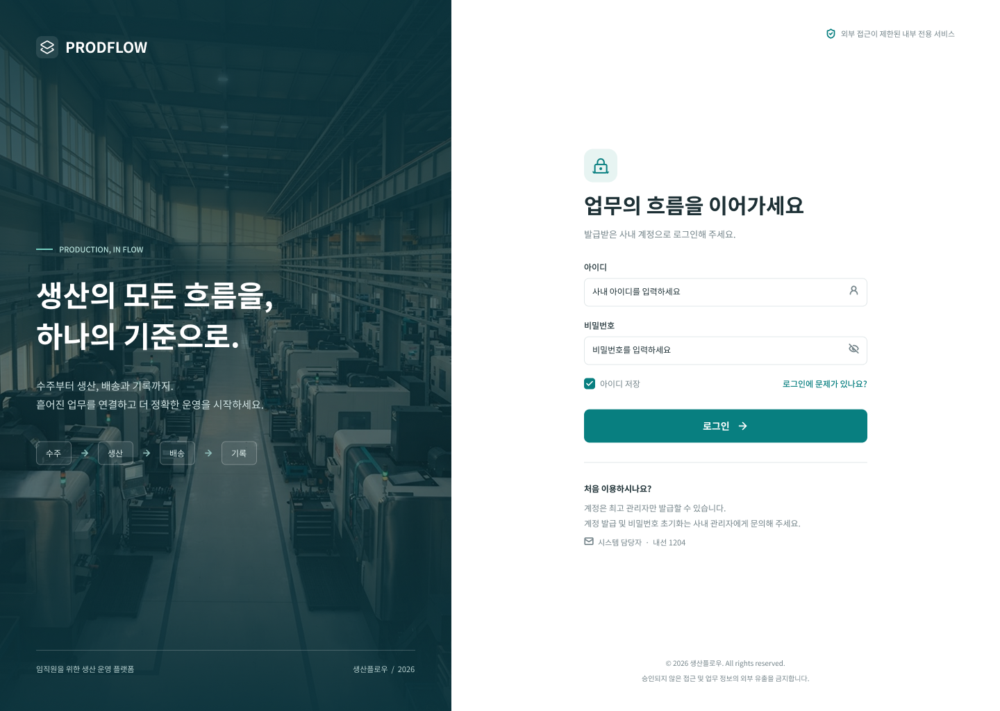

- **출력 데이터 항목 (Output Data):**
    - 서비스 로고 및 내부 전용 서비스 안내 문구
    - 아이디(이메일) 입력 필드
    - 비밀번호 입력 필드
    - 아이디 저장 체크박스
    - 로그인 버튼
    - 로그인 문제 안내 링크
    - 최초 이용자 안내 문구
    - 시스템 담당자 안내 정보
- **입력 데이터 및 검증 규칙 (Input Data & Validation):**
    - **아이디(이메일)**
        - 필수 입력
        - 발급된 사내 계정의 이메일 입력
        - 이메일 형식 검증
    - **비밀번호**
        - 필수 입력
        - 입력값은 마스킹하여 표시
        - 보기 아이콘을 통해 입력값 표시 여부 변경 가능
    - 이메일 또는 비밀번호가 일치하지 않으면 공통 오류 메시지 표시
    - 비활성(`INACTIVE`) 또는 삭제(`DELETED`) 상태의 계정은 로그인 불가
    - 활성(`ACTIVE`) 상태의 계정만 로그인 가능
    - 최초 임시 비밀번호 사용 여부에 따라 비밀번호 변경 필요 여부 확인
    - 새 비밀번호는 8~20자로 입력
    - 새 비밀번호와 비밀번호 확인 값이 일치해야 함
    - 기존 임시 비밀번호와 다른 비밀번호로 변경해야 함
- **화면 제어 및 동작 규칙 (Behavior Rules):**
    - 외부 회원가입 기능은 제공하지 않는다.
    - 계정은 최고 관리자가 계정 관리 화면에서 등록 및 발급한다.
    - 로그인 버튼 클릭 시 이메일과 비밀번호를 서버에서 검증한다.
    - 로그인 성공 시 Access Token은 응답 본문으로 반환하고 Refresh Token은 HttpOnly Cookie로 발급한다.
    - 로그인 성공 시 마지막 로그인 일시(`last_login_at`)를 갱신한다.
    - `mustChangePassword = TRUE`인 경우 최초 비밀번호 변경 화면으로 이동한다.
    - 최초 비밀번호 변경 전에는 일반 업무 API 접근을 제한한다.
    - `mustChangePassword = FALSE`인 경우 대시보드(`/dashboard`)로 이동한다.
    - 최초 비밀번호 변경은 `POST /api/v1/auth/change-password` API를 사용한다.
    - 비밀번호 변경 성공 시 기존 Refresh Token을 삭제하고 쿠키를 만료 처리하며, 다시 로그인하도록 안내한다.
    - 아이디 저장 체크 시 브라우저에 아이디를 저장하고 다음 로그인 화면에 표시한다.
    - Access Token 만료 시 Refresh Token 쿠키를 이용해 재발급한다.
    - Refresh Token 재발급 성공 시 새로운 Access Token을 반환하고 Refresh Token 쿠키를 갱신한다.
    - Refresh Token이 만료되거나 유효하지 않으면 로그인 화면으로 이동한다.
    - 로그인 문제 안내 링크 클릭 시 시스템 담당자 문의 안내를 제공한다.

### **2.1 비밀번호 변경 화면(`/change-password`)**

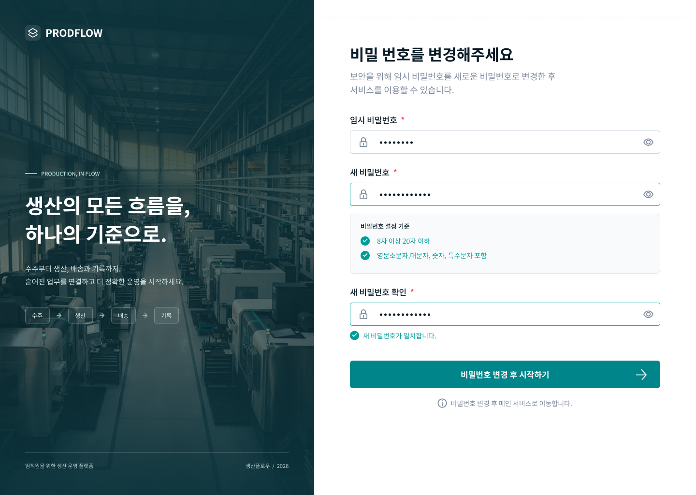

- **출력 데이터 항목 (Output Data)**
    - 비밀번호 변경 안내 문구
    - 임시 비밀번호 입력 필드
    - 새 비밀번호 입력 필드
    - 비밀번호 설정 기준 (8~20자)
    - 새 비밀번호 확인 입력 필드
    - 비밀번호 일치 여부 표시
    - 비밀번호 변경 버튼
- **입력 데이터 및 검증 규칙 (Input Data & Validation)**
    - **임시 비밀번호**
        - 필수 입력
        - 현재 계정에 발급된 임시 비밀번호 입력
        - 입력값 마스킹 처리
    - **새 비밀번호**
        - 필수 입력
        - 8자 이상 20자 이하
        - 기존 임시 비밀번호와 동일한 비밀번호 사용 불가
    - **새 비밀번호 확인**
        - 필수 입력
        - 새 비밀번호와 동일해야 함
    - 비밀번호 조건 및 일치 여부를 입력 중 표시한다.
- **화면 제어 및 동작 규칙 (Behavior Rules)**
    - 로그인 성공 후 `mustChangePassword = TRUE`인 사용자만 해당 화면으로 이동한다.
    - 비밀번호 변경 전까지 일반 업무 API 접근을 제한한다.
    - URL을 직접 입력해 다른 업무 화면에 접근하더라도 서버에서 접근을 제한한다.
    - 임시 비밀번호와 새 비밀번호를 서버에서 검증한다.
    - 모든 입력값이 유효하고 비밀번호 확인이 일치하면 변경 버튼을 활성화한다.
    - 비밀번호 변경 요청은 `POST /api/v1/auth/change-password` API를 사용한다.
    - 변경 성공 시 새 비밀번호를 암호화하여 저장하고 `mustChangePassword`를 `FALSE`로 변경한다.
    - 기존 Refresh Token을 삭제하고 쿠키를 만료 처리한다.
    - 변경 완료 후 로그인 화면으로 이동하며, 재로그인 성공 시 대시보드(`/dashboard`)로 이동한다.

## 3. 대시보드 화면 (`/dashboard`)

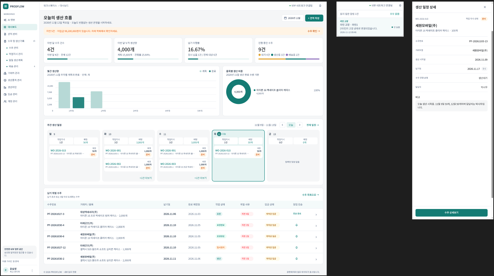

- 출력 데이터 항목 (Output Data):
    - 상단 안내 영역
        - 현재 날짜 및 기준 월
        - 지연 수주 및 미입금 등 주요 업무 안내 메시지
        - 전체 수주 확인 바로가기
    - 핵심 지표(KPI)
        - 이번 달 수주 건수 및 전월 대비 증감
        - 이번 달 누적 생산량 및 생산 계획 대비 진행률
        - 납기 이행률 및 납기 지연 건수
        - 진행 중인 수주 건수 및 상태별 건수
    - 생산량 통계
        - 조회 월 기준 주차별 생산 계획 수량 및 완료 수량
        - 생산 계획과 완료 수량을 구분하여 그래프로 표시
    - 품목별 생산
        - 조회 월 기준 품목별 생산 계획 수량 및 비중
        - 상위 품목의 제품명, 생산 수량 및 비율
    - 주간 생산 일정
        - 조회 주차 및 날짜별 생산 예정 수주
        - 작업지시 번호, 수주번호, 거래처명, 생산품목
        - 작업지시 수 및 생산 예정 수량
        - 해당 날짜의 생산 예정 수량 및 가용 생산량
        - 작업 상태 및 생산 일정 요약
    - 납기 위험 수주
        - 수주번호
        - 거래처명 및 생산품목
        - 납기일 및 위험 발생 기준일
        - 작업 상태
        - 위험 사유(납기 임박, 납기 지연, 기기 고장으로 인한 생산 일정 지연 등)
        - 입금 상태
        - 알림 전송 여부 및 알림 전송 기능
    - 알림 요약
        - 읽지 않은 알림 건수
        - 최근 알림 목록
        - 알림 유형 및 메시지
        - 관련 수주번호 및 거래처명
        - 발생 시각 및 읽음 여부
    - 사용자 정보
        - 로그인 사용자명 및 역할
        - 알림 확인 및 사용자 메뉴
- 화면 제어 및 동작 규칙 (Behavior Rules):
    - 모든 역할이 조회 가능.
    - 조회 기간 변경 시 핵심 지표, 생산량 통계 등 기간에 영향 받는 데이터가 갱신
    - 핵심 지표는 조회 기간과 집계 기준에 맞게 표시
    - 생산량은 작업지시 목표 수량 및 날짜별 생산계획 수량을 기준으로 집계하며, 화면에 집계 기준을 표시
    - 상태별 수주 현황 클릭시 해당 상태로 필터링 된 수주 목록으로 이동
    - 주간 생산 일정은 이전/다음 날짜 이동 및 오늘 기준 조회를 지원
    - 날짜별 생산 업무 카드 클릭시 선택한 수주의 생산 일정 상세 사이드 패널 표시
    - 날짜별 생산 업무 카드가 여러 건인 경우 더보기 기능을 통해 추가 일정을 확인
    - 납기 위험 수주 목록의 행 또는 상세보기 버튼 클릭 시 해당 수주의 상세 사이드 패널 표시
    - 납기 위험 수주 목록에서 선택한 수주와 생산 일정에서 선택한 수주가 동일한 경우 동일한 수주 상세 정보를 표시
    - 납기 위험 수주 목록의 알림 전송 기능 클릭 시 해당 수주 납기 알림을 전송
    - 알림 전송 시 해당 수주의 담당 직원에게 전달
    - 알림 아이콘 클릭 시 알림 드롭다운 표시
    - 알림 드롭다운에서 전체 및 읽지 않음 기준으로 알림 목록 조회
    - 전체 읽음 버튼 클릭시 해당 사용자의 읽지 않은 알림을 모두 읽음 상태로
    - 납기 위험 수주에서 수주 목록을 누르면 수주 목록 화면으로 이동
    - 사용자 역할에 따라 조회 가능한 데이터 범위와 실행 가능한 기능을 구분하며, 권한 없는 기능은 제한

### 3.1 대시보드 : 생산 일정 상세

- 출력 데이터 항목 (Output Data):
    - 헤더 영역
        - 생산 일정 상세 제목
        - 작업지시 번호
        - 작업지시 상태 및 뱃지
        - 닫기 버튼
    - 수주 및 생산 정보
        - 수주 번호
        - 거래처명
        - 생산품목
        - 생산 수량
        - 생산 시작 예정일
        - 납기일
        - 수주 진행 상태
        - 담당자
        - 비고
    - 하단 기능 영역
        - 수주 상세보기 버튼
- 화면 제어 및 동작 규칙 (Behavior Rules):
    - 패널 오픈 :
        - 대시보드 내 ‘이번 주 생산 일정’의 날짜별 업무 카드 클릭
        - ‘납기 위험 수주’ 목록의 행이나 상세보기 버튼 클릭
    - 선택한 수주의 정보를 우측 사이드 패널로 표시
    - 생산 일정에서 선택한 수주와 납기 위험 수주에서 선택한 수주는 동일한 상세 정보 구조를 사용
    - 패널 내부 스크롤을 통해 상세 정보 확인
    - 닫기 버튼 클릭시 사이드 패널을 닫음
    - 사이드 패널 외부 영역 클릭 또는 ESC 입력 시 패널 닫음
    - 다른 생산 일정 또는 납기 위험 수주를 선택하면 패널을 유지한 상태로 선택한 수주의 상세 정보로 변경
    - 수주 상세보기 버튼 클릭 시 해당 수주의 상세 화면으로 이동
    - 상세 정보는 조회 목적으로 제공하고 사이드 패널에서 수정 불가

#### 3.2 대시보드 알림 드롭다운

- 출력 데이터 항목 (Output Data):
    - 헤더 영역
        - 알림 제목
        - 읽지 않은 알림 건수
        - 전체 읽음 버튼
    - 알림 목록
        - 알림 유형
        - 알림 제목 및 메시지
        - 관련 수주번호 또는 생산라인 정보
        - 발생 시각
        - 읽음 여부
    - 알림 유형 및 내용 예시
        - 납기 임박 : 담당 수주의 납기일이 3일 남았을 경우 알림
        - 납기 지연 : 담당 수주의 납기일이 초과 되었을 때 알림
        - 생산라인 상태 변경 : 생산라인의 가동, 점검, 고장 등 상태 변경 알림
- 화면 제어 및 동작 규칙 (Behavior Rules):
    - 상단 알림 아이콘 클릭 시 드롭다운 표시
    - 드롭다운에서 전체 및 읽지 않음 필터를 선택하여 알림 목록 조회
    - 알림 목록은 로그인한 사용자의 수신 알림을 기준으로 표시
    - 알림 클릭 시 해당 알림은 읽음 상태 처리
    - 수주 관련 알림 클릭 시 해당 수주 정보로 이동
    - 전체 읽음 버튼 클릭 시 로그인 사용자의 미확인 알림을 모두 읽음 처리
    - 알림 읽음 처리 후 읽지 않은 알림 건수 갱신
    - 알림이 없는 경우 알림이 없다는 문구 표시
    - 다른 화면 영역을 클릭하거나 드롭다운 외부를 클릭하면 드롭다운을 닫음

## 4. 내 정보 화면 (`/me`)

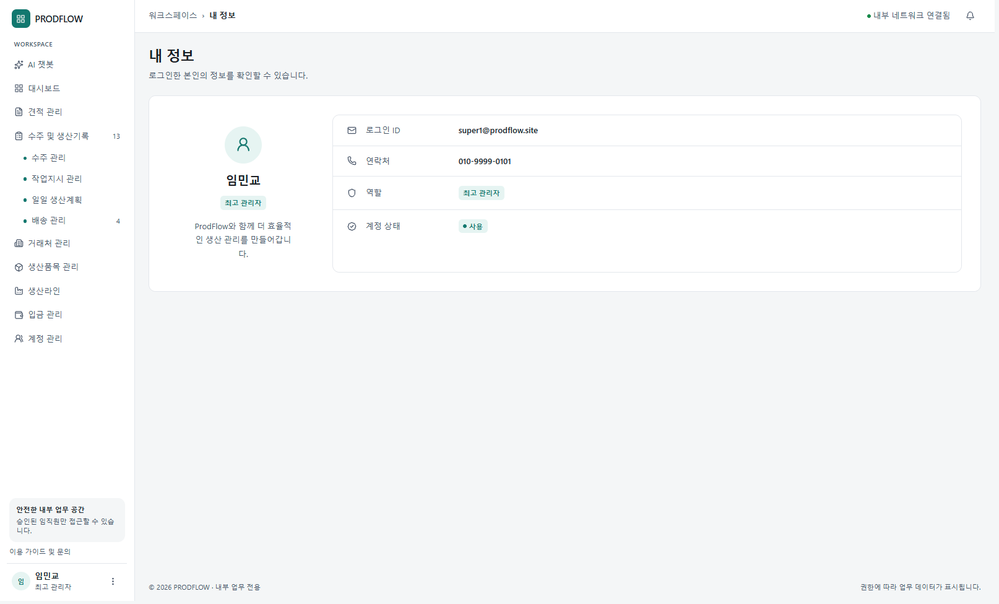

- 출력 데이터 항목 (Output Data):
    - 이름, 로그인 ID, 이메일, 연락처, 역할, 상태
- 화면 제어 및 동작 규칙 (Behavior Rules):
    - 로그인한 본인 정보만 조회.
    - 역할과 계정 상태는 본인이 수정할 수 없음.

## 5. 계정 관리 화면 (`/admin`)

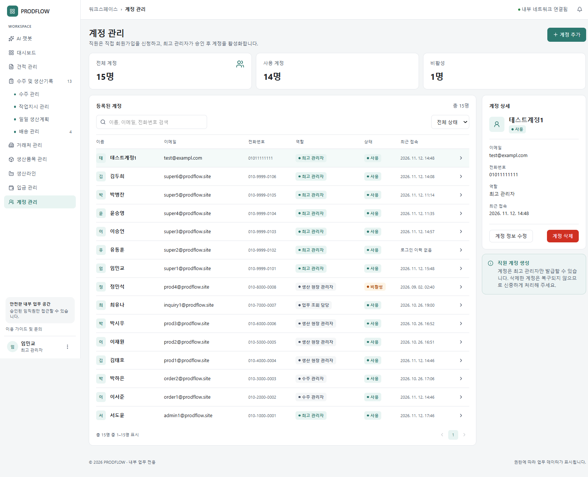

- **출력 데이터 항목 (Output Data):**
    - **계정 현황 요약 카드**
        - 전체 계정 수
        - 사용 계정 수 (`ACTIVE`)
        - 비활성 계정 수 (`INACTIVE`)
    - **등록된 계정 목록**
        - 이름
        - 이메일
        - 전화번호
        - 역할
        - 계정 상태
        - 최근 접속 일시
        - 전체 조회 건수
    - **계정 검색 및 필터 영역**
        - 이름, 이메일, 전화번호 검색
        - 계정 상태 필터 (전체 / 사용 / 비활성)
    - **선택한 계정 상세 정보**
        - 이름 및 계정 상태
        - 이메일
        - 전화번호
        - 역할
        - 최근 접속 일시
    - **계정 관리 버튼**
        - 계정 추가 버튼
        - 계정 정보 수정 버튼
        - 계정 삭제 버튼
    - **계정 추가 모달**
        - 이름, 이메일, 전화번호 입력
        - 역할 선택
        - 임시 비밀번호 생성 및 확인
    - **계정 수정 모달**
        - 이름, 이메일, 전화번호 수정
        - 역할 변경
        - 계정 상태 변경 (사용 / 비활성)
        - 임시 비밀번호 재발급
    - **페이지네이션**
        - 페이지당 표시 건수
        - 현재 페이지 및 페이지 이동 버튼
        - 전체 조회 건수
- **입력 데이터 및 검증 규칙 (Input Data & Validation):**
    - 검색어는 이름, 이메일, 전화번호를 기준으로 검색 가능
    - 검색어 앞뒤 공백 제거 및 최대 100자 제한
    - 검색 조건이 없으면 사용 및 비활성 계정 전체 조회
    - 상태 필터는 `ACTIVE`, `INACTIVE`만 허용
    - 삭제된 계정(`DELETED`)은 목록에서 제외
    - 계정 등록 시 이름, 이메일, 전화번호, 역할 필수 입력
    - 이메일 형식 및 중복 여부 확인
    - 임시 비밀번호는 12자리이며 영문 대문자, 소문자, 숫자, 특수문자를 각각 포함
    - 임시 비밀번호의 허용 특수문자는 `! @ # $ % & * ?`
    - 계정 수정 시 이메일 중복 여부 확인
    - 계정 상태는 `ACTIVE`, `INACTIVE`만 변경 가능
    - 임시 비밀번호 재발급 시 기존과 동일한 비밀번호 규칙 적용
    - 삭제된 계정은 수정할 수 없음
- **화면 제어 및 동작 규칙 (Behavior Rules)**
    - 최고 관리자(`SUPER_ADMIN`)만 계정 관리 화면에 접근할 수 있다.
    - 다른 역할의 사용자가 직접 URL로 접근하면 `403 Forbidden`을 반환한다.
    - 화면 진입 시 계정 현황 통계와 계정 목록 조회
    - 통계는 검색 및 필터 조건과 관계없이 전체 계정을 기준으로 집계하며 `DELETED` 계정은 제외
    - 계정 목록의 행 클릭 시 선택한 계정의 상세 정보를 우측 패널에 표시
    - 계정 추가 버튼 클릭 시 현재 `/admin/users` 화면 위에 등록 모달 표시
    - 계정 정보 수정 버튼 클릭 시 현재 화면 위에 수정 모달 표시
    - 모달을 표시하더라도 페이지 URL은 `/admin/users` 유지
    - 신규 계정 등록 시 프론트엔드에서 생성한 임시 비밀번호를 전달하고 서버에서 암호화하여 저장
    - 신규 계정은 `ACTIVE` 상태 및 `mustChangePassword = TRUE`로 생성
    - 임시 비밀번호 재발급 시 다음 로그인에서 비밀번호 변경 필요
    - 계정 상태는 사용(`ACTIVE`), 비활성(`INACTIVE`), 삭제(`DELETED`)로 관리
    - 비활성 계정은 로그인 및 서비스 접근 제한
    - 계정 삭제 시 실제 데이터를 삭제하지 않고 `DELETED` 상태로 변경하며 삭제 일시 기록
    - 삭제된 계정의 Refresh Token 제거
    - 삭제된 계정은 일반 목록에서 제외하며 화면에서 복구 기능 제공하지 않음
    - 이메일, 역할, 상태 또는 비밀번호 변경 시 기존 Refresh Token 폐기
    - 계정 추가, 수정, 삭제 완료 시 계정 목록과 현황 통계 갱신
    - 페이지 이동 및 표시 건수 변경 시 계정 목록 재조회

### 5.1 직원 계정 등록 모달

- **출력 데이터 항목 (Output Data):**
    - 직원 계정 등록 모달
        - 모달 제목 (직원 계정 등록)
        - 모달 닫기 버튼 (X)
    - 직원 기본 정보 입력 영역
        - 이름 입력 필드
        - 아이디(이메일) 입력 필드
        - 전화번호 입력 필드
    - 임시 비밀번호 발급 영역
        - 임시 비밀번호 표시 필드
        - 임시 비밀번호 발급 버튼
        - 비밀번호 발급 안내 문구
    - 역할 선택 영역
        - 최고 관리자 (`SUPER_ADMIN`)
        - 수주 관리자 (`ORDER_MANAGER`)
        - 생산 현장 관리자 (`PRODUCTION_MANAGER`)
        - 업무 조회 담당자 (`INQUIRY_MANAGER`)
    - 모달 하단 버튼
        - 닫기 버튼
        - 계정 등록 버튼
- **입력 데이터 및 검증 규칙 (Input Data & Validation):**
    - 이름
        - 필수 입력
    - 아이디(이메일)
        - 필수 입력
        - 이메일 형식 검증
        - 기존 계정과 중복 불가
    - 전화번호
        - 필수 입력
        - 전화번호 형식은 별도 백엔드 검증 없음
    - 임시 비밀번호
        - 필수 입력
        - 프론트엔드에서 자동 생성
    - 역할
        - 필수 선택
        - 정의된 사용자 역할 Enum만 허용
- **화면 제어 및 동작 규칙 (Behavior Rules):**
    - 계정 관리 화면의 `계정 추가` 버튼 클릭 시 등록 모달을 표시한다.
    - 최고 관리자(`SUPER_ADMIN`)만 계정을 등록할 수 있다.
    - 임시 비밀번호 발급 버튼 클릭 시 프론트엔드에서 비밀번호를 자동 생성한다.
    - 임시 비밀번호 미발급 시 계정 등록을 제한한다.
    - 계정 등록 API (`POST /api/v1/users`) 호출 시 입력값을 검증한다.
    - 임시 비밀번호는 서버에서 BCrypt 방식으로 암호화하여 저장한다.
    - 신규 계정은 `ACTIVE` 상태 및 `mustChangePassword = TRUE`로 생성한다.
    - 신규 사용자는 최초 로그인 후 반드시 비밀번호를 변경해야 한다.
    - 계정 등록 성공 시 모달을 닫고 계정 목록 및 현황 통계를 갱신한다.
    - 닫기 버튼 또는 X 버튼 클릭 시 입력 내용을 저장하지 않고 모달을 닫는다.

### 5.2 직원 계정 수정 모달

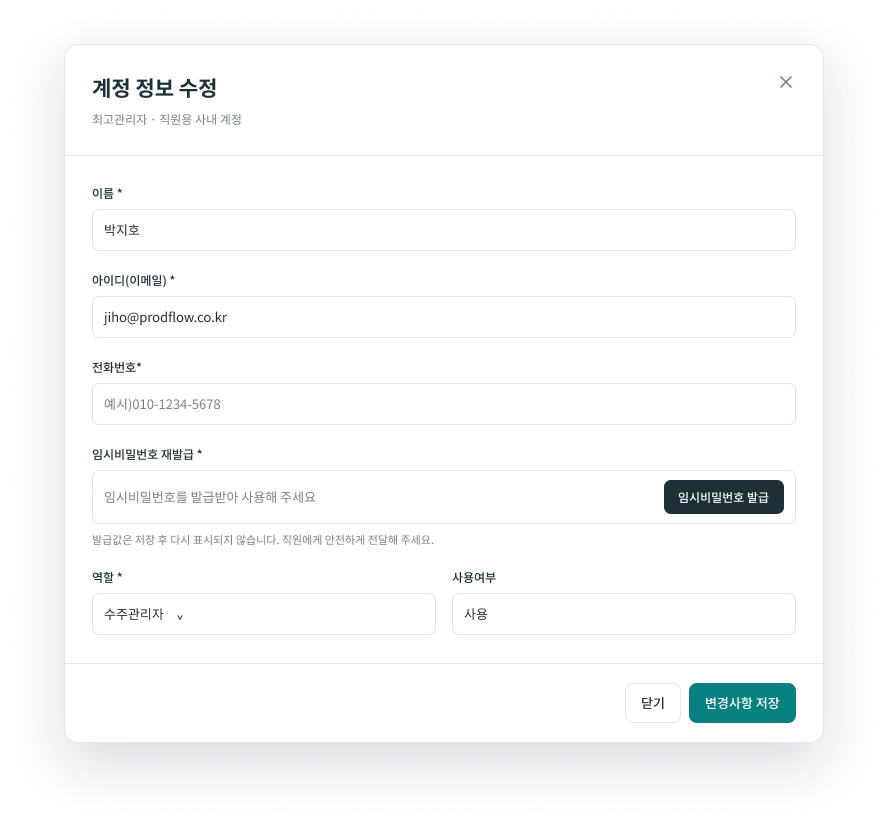

- 출력 및 입력 데이터 항목
    - 이름
    - 아이디(이메일)
    - 임시 비밀번호 재발급
    - 연락처
        - 필수 입력
    - 역할
    - 사용 여부
    - 계정 비활성화 버튼
    - 변경사항 저장 버튼
- 입력 데이터 및 검증 규칙 (Input Data & Validation)
    - 이름
        - 필수 입력
    - 아이디(이메일)
        - 필수 입력
        - 이메일 형식 검증
        - 다른 계정과 중복 불가
    - 연락처
        - 필수 입력
    - 역할
        - 필수 선택
    - 임시 비밀번호 재발급
        - 사용자가 비밀번호를 분실하거나 초기화가 필요한 경우 관리자에 의해 재발급
- 화면 제어 및 동작 규칙 (Behavior Rules)
    - 계정 관리 화면에서 계정을 선택한 후 계정 정보 수정 버튼 클릭 시 모달을 표시한다.
    - 기존 계정 정보를 조회하여 각 입력 필드의 초기값으로 표시한다.
    - 변경사항 저장 버튼 클릭 시 수정된 계정 정보를 저장한다.
    - 임시 비밀번호 재발급 버튼 클릭 시 새로운 임시 비밀번호를 생성한다.
    - 임시 비밀번호 재발급 시 기존 비밀번호는 더 이상 사용할 수 없다.
    - 비밀번호 재발급 후 해당 계정의 must_change_password 값을 TRUE로 변경한다.
    - 사용자는 새 임시 비밀번호로 로그인 후 비밀번호 변경 화면을 거쳐야 한다.
    - 계정 비활성화 버튼 클릭 시 계정을 삭제하지 않고 상태를 INACTIVE로 변경한다.
    - 비활성화된 계정은 로그인 및 서비스 접근이 차단된다.
    - 비활성 계정을 다시 사용할 경우 상태를 ACTIVE로 변경할 수 있다.
    - 닫기 버튼 또는 X 버튼 클릭 시 변경 내용을 저장하지 않고 모달을 닫는다.
    - 수정 완료 후 계정 목록과 우측 계정 상세 정보를 갱신한다.

## 6. 거래처 화면

### 6.1 거래처 목록 화면

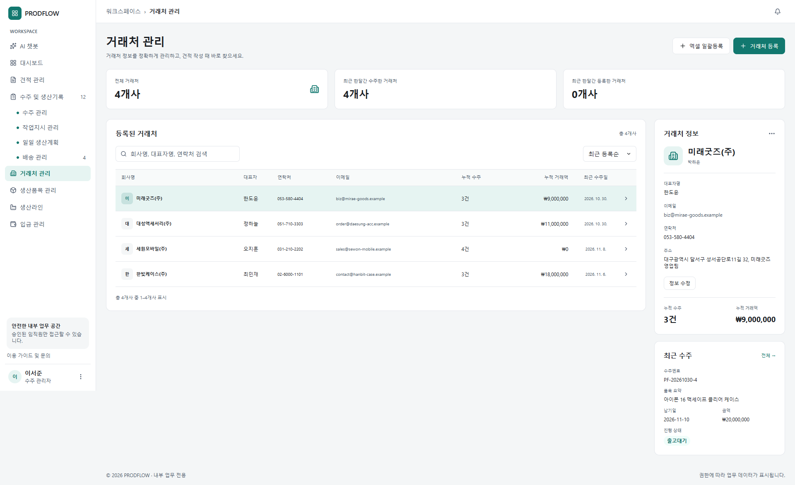

- 출력 데이터 항목 (Output Data):
    - 요약: 전체 거래처 수, 이번 달 거래 거래처 수, 이번 달 신규 등록 수
    - 거래처 목록: 회사명, 대표자, 연락처, 이메일, 누적 수주 건수, 누적 거래액, 최근 수주일
    - 거래처 정보: 회사명, 등록일, 대표자명, 이메일, 연락처, 주소, 누적 수주 건수·거래액
    - 최근 수주: 수주번호, 품목 요약, 납기일, 금액, 진행 상태
    - 검색 결과 건수 및 페이징
- 입력 데이터 및 검증 규칙 (Input Data & Validation):
    - 회사명, 담당자명, 연락처로 검색하며, 미입력 시 전체 목록 출력
    - 정렬 드롭다운 제공. 이미지 기준 선택값은 `최근 거래순`
    - 엑셀은 `.xlsx`만 허용하며, 양식과 연락처 형식을 검증하며, 거래처 중복 여부는 회사명만으로 판정
- 화면 제어 및 동작 규칙 (Behavior Rules):
    - 거래처 행 또는 `>` 클릭: 선택 행 강조 및 우측 거래처 정보·최근 수주 갱신
    - 거래처 등록 버튼: 등록 화면으로 이동
    - 정보 수정 버튼: 선택 거래처 수정 화면으로 이동
    - 최근 수주 `전체 →`: 해당 거래처로 필터링된 수주 목록으로 이동
    - 엑셀 일괄등록 버튼: 파일 선택 후 행별 검증. 주소 누락·연락처 형식 오류·기존 회사명 행은 건너뛰고 정상 행만 등록. 완료 후 저장 건수와 건너뛴 행을 안내하고 목록 갱신. 파일 자체를 읽을 수 없으면
      오류 안내
    - 검색·정렬·페이지 변경 시 조건에 맞는 목록 표시
    - 거래처 등록·수정·엑셀 일괄 등록은 수주 관리자와 최고 관리자만 버튼 노출
    - `⋯` 메뉴, 추가 정렬 항목 및 집계 기준은 별도 정의 필요

### 6.2 거래처 상세 화면

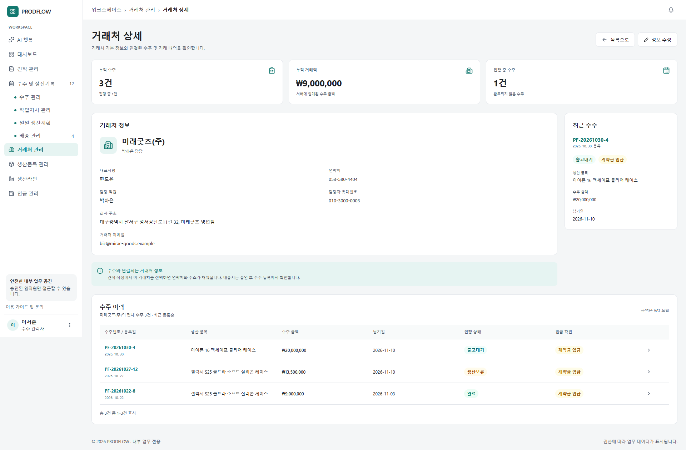

- 출력 데이터 항목 (Output Data):
    - 요약: 누적 수주 건수, 누적 거래액, 진행 중인 수주 건수
    - 거래처 정보: 거래처명, 등록일, 대표자명, 연락처, 회사 주소, 이메일, 담당 수주 관리자, 관리자 연락처
    - 최근 수주: 수주번호, 품목 요약, 진행 상태, 납기일, 수주 금액(VAT 포함), 입금 상태
    - 수주 이력: 수주번호·등록일, 생산 품목, 총 생산 수량, 수주 금액(VAT 포함), 납기일, 진행 상태, 입금 상태
    - 수주 이력 전체 건수 및 현재 표시 범위
- 화면 제어 및 동작 규칙 (Behavior Rules):
    - 목록으로 버튼: 거래처 목록 화면으로 이동
    - 정보 수정 버튼: 해당 거래처 정보 수정 화면으로 이동
    - 최근 수주 `상세 →`: 해당 수주 상세 화면으로 이동
    - 수주 이력의 수주번호 또는 `>` 클릭: 해당 수주 상세 화면으로 이동
    - 수주 이력은 최근 등록순으로 표시
    - 진행 상태와 입금 상태는 각각 별도 뱃지로 표시
    - 정보 수정 버튼은 수주 관리자와 최고 관리자만 노출

### 6.3 거래처 등록 페이지

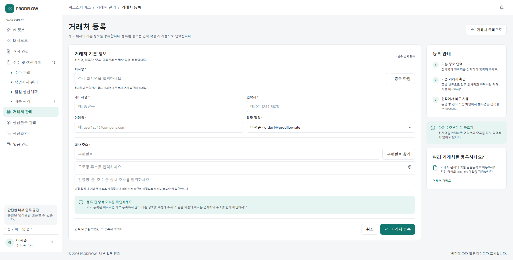

- 입력 데이터 및 검증 규칙 (Input Data & Validation):
    - 회사명, 대표자명, 연락처, 이메일, 우편번호, 도로명 주소, 상세주소: 필수 입력 영역
    - 거래처 담당자명 : 견적·수주 연락에 사용할 거래처 측 담당자 정보 입력. 내부 담당 수주 관리자와 구분
    - 연락처는 필수 입력이며 전화번호 형식을 검증한다.
- 화면 제어 및 동작 규칙 (Behavior Rules):
    - 거래처 목록으로 버튼: 거래처 리스트로 이동
    - 회사명 - 중복확인: 회사명 입력후 해당 회사명과 중복되는지 확인
    - 담당 직원 드롭박스: 수주 관리자만 리스트 출력
    - 우편번호 찾기로 우편번호와 도로명 주소를 선택하고, 상세 주소는 직접 입력한다.
    - 취소 버튼: 거래처 리스트 페이지로 이동
    - 거래처 등록 버튼: 거래처 정보 등록 후 거래처 리스트 이동

#### 6.3.1 거래처 수정 페이지

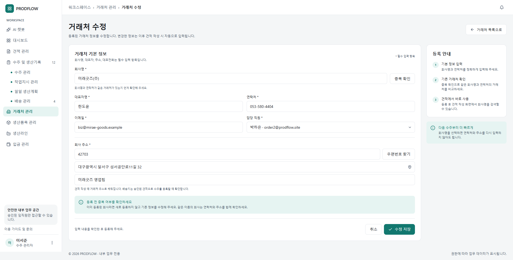

- 입력 데이터 및 검증 규칙 (Input Data & Validation):
    - 거래처 등록 페이지와 동일
    - 거래처 수정버튼을 누르면 해당 거래처의 정보가 필드를 채움
- 화면 제어 및 동작 규칙 (Behavior Rules):
    - 거래처 등록 페이지와 동일

## 7. 생산품목 화면

### 7.1 생산품목 목록 화면 (`/products` )

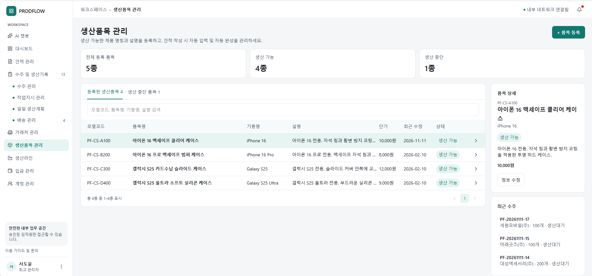
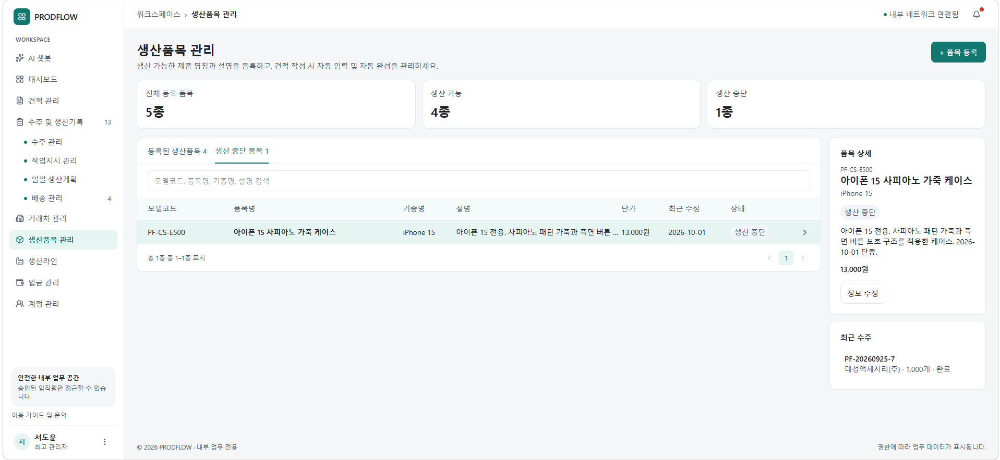

목록·우측 상세가 한 화면에서 동작하는 마스터–디테일 화면이다. 상태는 생산 가능(AVAILABLE) / 생산 중단(DISCONTINUED)만 사용한다.

- 출력 데이터 항목 (Output Data):
    - 요약: 전체·생산 가능·생산 중단 품목 수
    - 탭: 등록 생산품목 / 생산 중단 품목 (건수 표시)
    - 목록: 모델 코드, 품목명, 기종명, 설명, 기준 단가, 최근 수정일, 상태, `>`
    - 목록 하단: 표시 건수·페이징
    - 우측 상세: 품목명, 모델 코드, 기종명, 설명, 상태, 기준 단가, 도면 링크
    - 최근 수주: 수주번호, 거래처, 수량, 진행 상태, 납기일 (최근 3건)
- 입력 데이터 및 검증 규칙 (Input Data & Validation):
    - 검색: 모델 코드·품목명·기종명·설명. 공백이면 검색어 없음
    - 탭 상태(AVAILABLE/DISCONTINUED)로 필터. 검색어가 있으면 함께 적용
    - 페이징: 기본 page 0, size 10
- 화면 제어 및 동작 규칙 (Behavior Rules):
    - 행/`>` 클릭 → 우측 상세·도면·최근 수주 갱신
    - 품목 등록 → `/products/new` (수주 관리자·최고 관리자만)
    - 정보 수정 → 선택 품목 수정 화면 (동일 역할만)
    - 도면 링크 → 미리보기·다운로드. 없으면 “등록된 도면 없음”
    - 최근 수주 `전체 →` → 해당 품목 수주 목록 / 수주번호 → 수주 상세

### 7.2 생산품목 등록 화면 (`/products/new` )

생산 가능한 품목의 기본 정보를 등록하고, 수주 등록 시 사용할 기준 단가를 설정하는 화면이다.

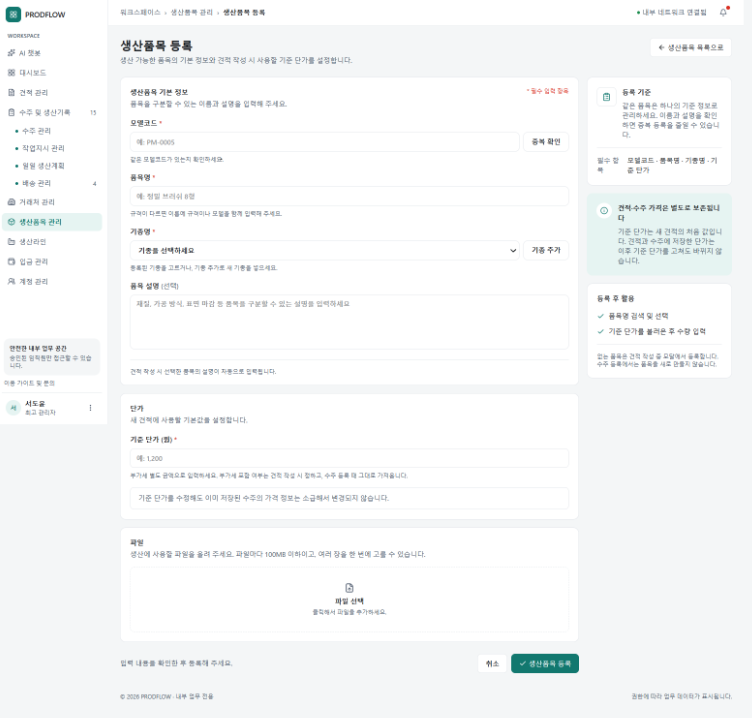

생산 가능한 품목의 기본 정보와 견적용 기준 단가를 등록한다. 등록 직후 상태는 생산 가능(AVAILABLE)이다.

- 출력 데이터 항목 (Output Data):
    - 상단: `워크스페이스 > 생산품목 관리 > 생산품목 등록`, 제목, `생산품목 목록으로`
    - 입력 폼: 모델코드, 품목명, 기종명(`기종 추가`), 품목 설명, 기준 단가, 파일
    - 기종 추가 모달: 기종명, 취소·추가
    - 오른쪽 안내: 필수 항목, 단가 보존, 견적 검색·단가 자동 입력
- 입력 데이터 및 검증 규칙 (Input Data & Validation):
    - 모델코드·품목명·기종명·기준 단가 필수. 설명·파일은 선택
    - 모델코드 `중복 확인`. 이미 있으면 등록 불가
    - 기종: 기존 선택 또는 `기종 추가`로 신규 입력 후 선택
    - 기준 단가: 0보다 큰 정수, 부가세 별도. 변경해도 기존 견적·수주 단가는 유지
    - 파일: 파일당 100MB 이하, 여러 장 가능
- 화면 제어 및 동작 규칙 (Behavior Rules):
    - 목록으로·취소 → `/products`
    - `기종 추가` → 모달에서 추가 후 목록 반영·선택. 취소·X는 저장 없이 닫기
    - `생산품목 등록` → 수주 관리자·최고 관리자만. 성공 시 AVAILABLE, 목록으로 이동
    - 파일은 등록 후 업로드. 화면에 파일명만 표시

### 7.3 생산품목 상세 화면 (`/products/{productId}` )

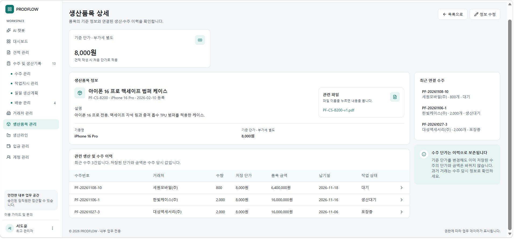

품목의 기준 정보와 연결된 수주 이력을 확인하는 화면이다.

- 출력 데이터 항목 (Output Data):
    - 요약: 기준 단가(부가세 별도), 견적 시 초기 단가 안내
    - 생산품목 정보: 품목명, 모델 코드, 기종명, 등록일, 설명, 기준 단가, 관련 파일(도면)
    - 최근 연결 수주: 수주번호, 거래처, 수량, 진행 상태 (최근 3건)
    - 관련 수주 이력: 수주번호, 거래처, 수량, 저장 단가, 품목 금액, 납기일, 작업 상태, `>`
    - 안내: 이력 단가·금액은 수주 당시 값. 기준 단가 변경해도 기존 수주는 유지
- 입력 데이터 및 검증 규칙 (Input Data & Validation):
    - 입력 폼 없음. 품목에 연결된 수주만 조회
    - 이력의 수량·저장 단가·품목 금액은 해당 품목 기준(`order_product.unit_price`)
- 화면 제어 및 동작 규칙 (Behavior Rules):
    - 목록으로 → `/products`
    - 정보 수정 → 수정 화면 (수주 관리자·최고 관리자만)
    - 관련 파일 → 미리보기·다운로드. 없으면 “등록된 파일 없음”
    - 최근 수주·이력의 수주번호/`>` → 수주 상세

## 8. 견적서 화면

### 8.1 견적서 목록 화면(`/quotations`)

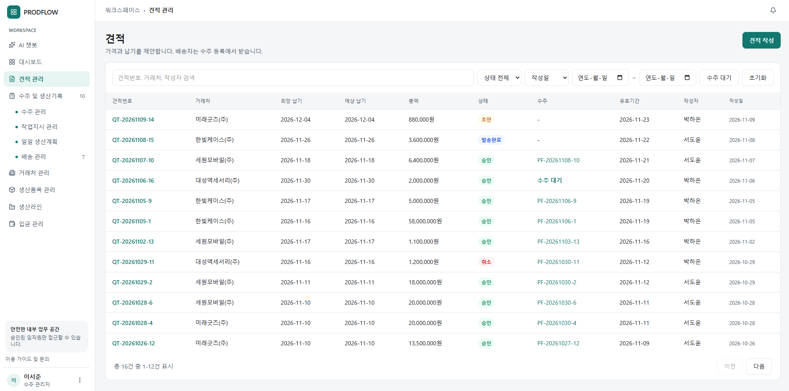

견적의 가격·납기·상태·수주 연결 여부를 조회한다. 한 페이지 12건이다.

- 출력 데이터 항목 (Output Data):
    - 상단:`워크스페이스 > 견적 관리`, 제목`견적`, 설명,`견적 작성`(수주 관리자·최고 관리자)
    - 필터: 견적번호·거래처·작성자 검색, 상태, 날짜 기준(작성일·희망 납기·예상 납기·유효기간), 시작일~종료일,`수주 대기`,`초기화`- 표: 견적번호, 거래처, 희망 납기, 예상 납기, 총액, 상태,
      수주, 유효기간, 작성자, 작성일
    - 상태: 초안·발송완료·승인·거절·취소·만료
    - 수주 칸: 수주번호 /`수주 대기`(승인·미등록)
    - 하단:`총 N건 중 a-b건 표시`,`이전`·`다음`
- 입력 데이터 및 검증 규칙 (Input Data & Validation):
    - 견적 본문은 저장하지 않음. 검색·필터만 입력
    - 상태 미선택 시 전체 조회
    - 날짜는 선택한 기준 날짜와 비교
    - `수주 대기`ON 시 상태는 승인으로 고정
- 화면 제어 및 동작 규칙 (Behavior Rules):
    - `견적 작성`→`/quotations/new`- 견적번호 → 견적 상세
    - 수주번호 → 수주 상세
    - `수주 대기`링크 → 권한 있으면 수주 등록(`/orders/new?quotationId={id}`)
    - `수주 대기`필터: 승인·수주 미등록만. 취소 수주 연결 견적 제외. 재진행은 새 견적
    - `/quotations?pending=1`→`수주 대기`필터 ON
    - 검색·필터·초기화 변경 시 1페이지
    - `초기화`→ 검색어·상태·날짜·`수주 대기`해제

### 8.2 견적서 등록 화면(`/quotations/new`)

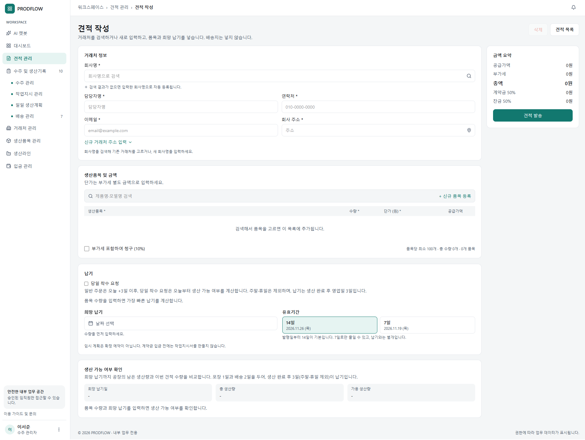

거래처·품목·희망 납기·유효기간을 입력해 견적을 발송한다. 배송지는 입력하지 않는다.

- 출력 데이터 항목 (Output Data):
    - 상단:`워크스페이스 > 견적 관리 > 견적 작성`, 제목, 설명,`삭제`,`견적 목록`- 거래처 정보: 회사명 검색, 담당자명, 연락처, 이메일, 회사 주소,`신규 거래처 주소 입력`- 생산품목 및 금액:
      제품명·모델명
      검색,
      `+ 신규 품목 등록`,
      표(
      생산품목·수량·단가·공급가격),
      `부가세 포함하여 청구(10%)`-
      납기:`당일 착수 요청`, 가장 빠른 납기, 희망 납기, 유효기간`14일`·`7일`- 생산 가능 여부 확인: 희망 납기일, 총 생산량, 가용 생산량
    - 오른쪽 금액 요약: 공급가액, 부가세, 총액, 계약금 50%, 잔금 50%,`견적 발송`
- 입력 데이터 및 검증 규칙 (Input Data & Validation):
    - 회사명: 기존 거래처 검색. 없으면 발송 시 신규 등록
    - 담당자명·연락처·이메일·회사 주소 필수. 신규는`신규 거래처 주소 입력`으로 우편번호·도로명·상세 입력
    - 품목 1개 이상. 동일 품목 중복 추가 불가. 수량 품목당 100개 이상. 단가는 품목 단가로 시작 후 수정 가능
    - 없는 품목은`신규 품목 등록`모달(모델코드·제품명·기종·설명·기준 단가)로 등록 후 줄 추가
    - 희망 납기: 오늘 이후·가장 빠른 납기 이후만. 유효기간: 발송일 기준 14일(기본)·7일
- 화면 제어 및 동작 규칙 (Behavior Rules):
    - 수주 관리자·최고 관리자만 접근
    - `견적 목록`→`/quotations`.`삭제`→ 저장된 초안만 삭제 후 목록 이동
    - 품목 검색 선택 → 표 추가. 행 X → 해당 줄 삭제
    - `당일 착수 요청`ON: 오늘부터 용량 계산. OFF: 오늘+3일 이후. 주말·휴일 제외
    - 수량·희망 납기 입력 시 생산 가능 여부·가장 빠른 납기 갱신. 다른 견적 임시 계획은 용량 미점유
    - `견적 발송`→ PDF 미리보기 후 발송. 성공 시 상태`SENT`. 단가는 유효기간 내만 승인 가능
    - 금액 요약은 넓은 화면에서 오른쪽에 고정

### 8.3 견적서 상세 화면(`/quotations/{quotationId}`)

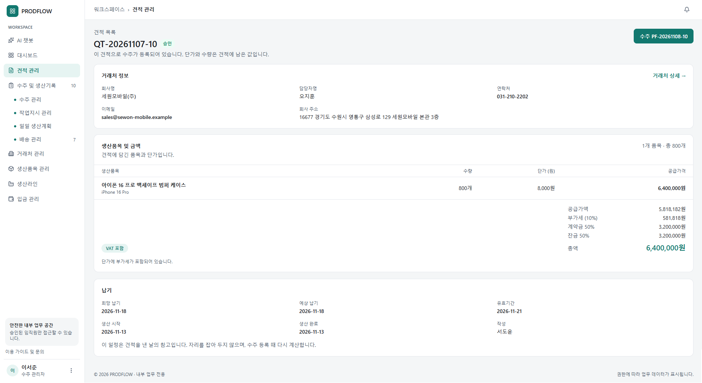

견적의 거래처·품목·금액·납기를 확인하고, 상태별 다음 작업으로 이동한다. 품목·단가·수량은 수정하지 않는다.

- 출력 데이터 항목 (Output Data):
    - 상단:`워크스페이스 > 견적 관리`,`견적 목록`, 견적번호, 상태, 상태 안내, 다음 작업 버튼
    - 거래처 정보: 회사명, 담당자명, 연락처, 이메일, 회사 주소,`거래처 상세 →`- 생산품목 및 금액: 품목 수·총 수량, 표(생산품목·수량·단가·공급가격), 공급가액, 부가세 10%, 계약금 50%,
      잔금 50%, 총액, VAT 포함/별도
    - 납기: 희망 납기, 예상 납기, 유효기간, 생산 시작, 생산 완료, 작성자, 참고 안내
- 입력 데이터 및 검증 규칙 (Input Data & Validation):
    - 품목·단가·수량 수정 불가
    - `납기 재산정`은 발송완료(`SENT`)·유효기간 내일 때만. 희망 납기만 다시 선택
    - 승인된 견적의 납기·단가·수량은 변경 불가
- 화면 제어 및 동작 규칙 (Behavior Rules):
    - 초안:`이어서 작성`,`초안 삭제`- 발송완료 + 수주 관리자·최고 관리자:`승인`,`거절`,`취소`,`납기 재산정`- 승인 + 수주 미등록:`수주 등록`→
      `/orders/new?quotationId={id}`- 승인 + 수주 등록됨:
      `수주 {수주번호}`→ 수주
      상세.`수주 등록`숨김
    - 만료:`새 견적 작성`. 거절·취소 견적으로는 수주 불가
    - 납기 재산정: 희망·예상 납기·생산 시작·완료만 갱신. 단가·수량·유효기간·상태 유지
    - 견적 일정은 공장 용량 미점유. 수주 등록 때 납기 재계산
    - 연결 수주 취소 시 원본 견적도`CANCELLED`. 재사용 불가, 새 견적 필요

## 9. 수주 화면

### 9.1 수주 목록 화면(`/orders`)

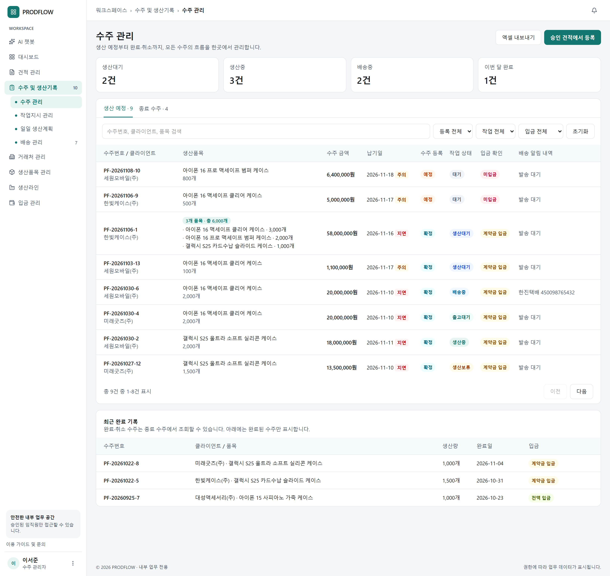

진행 중·종료 수주를 조회하고, 승인 견적에서 수주 등록으로 이동한다. 한 페이지 8건이다.

- 출력 데이터 항목 (Output Data):
    - 상단:`워크스페이스 > 수주 및 생산기록 > 수주 관리`, 제목`수주 관리`, 설명,`엑셀 내보내기`,`승인 견적에서 등록`(수주 관리자·최고 관리자)
    - 요약 카드: 생산대기, 생산중, 배송중, 이번 달 완료 건수
    - 탭:`생산 예정`,`종료 수주`- 필터: 수주번호·클라이언트·품목 검색, 등록(예정·확정·취소), 작업 상태, 입금,`초기화`- 표: 수주번호·클라이언트, 생산품목, 수주 금액, 납기일, 수주 등록, 작업
      상태, 입금 확인, 배송 알림 내역
    - 하단:`총 N건 중 a-b건 표시`,`이전`·`다음`- 최근 완료 기록: 수주번호, 클라이언트·품목, 생산량, 완료일, 입금. 최근 완료 3건
- 입력 데이터 및 검증 규칙 (Input Data & Validation):
    - 수주 본문은 저장하지 않음. 검색·필터만 입력
    - `생산 예정`: 완료·취소 제외.`종료 수주`: 완료·취소만
    - 등록 필터: 생산 예정은 예정·확정, 종료 수주는 확정·취소
    - 작업 상태 선택은 현재 탭에 맞는 상태만 표시
- 화면 제어 및 동작 규칙 (Behavior Rules):
    - 수주번호 → 수주 상세
    - `승인 견적에서 등록`→`/quotations?pending=1`(승인·수주 미등록만)
    - 납기 임박 →`주의`, 납기 경과 →`지연`- `엑셀 내보내기`→ 현재 검색·필터 조건 CSV
    - 검색·필터·탭·초기화 변경 시 1페이지
    - `초기화`→ 검색어·등록·작업·입금 해제
    - 최근 완료 기록은 완료만 표시. 취소는`종료 수주`탭에서 조회

### 9.2 수주 등록 화면(`/orders/new`)

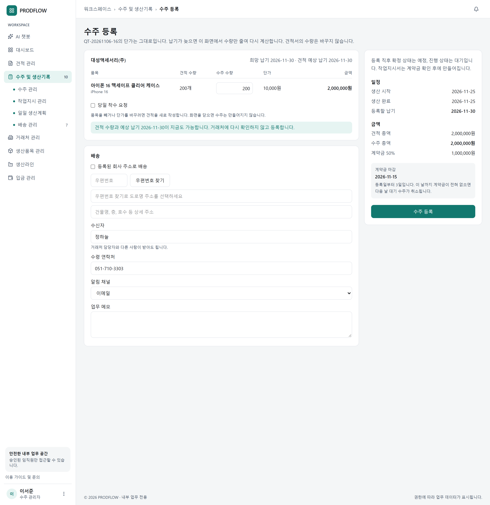

승인 견적의 단가는 유지하고, 수량·납기·배송을 확인한 뒤 수주를 등록한다. 계약금 마감은 입력하지 않는다.

- 출력 데이터 항목 (Output Data):
    - 상단:`워크스페이스 > 수주 및 생산기록 > 수주 등록`, 제목`수주 등록`, 견적번호·단가 유지 안내
    - 품목: 거래처명, 희망 납기·견적 예상 납기, 표(품목·견적 수량·수주 수량·단가·금액)
    - `당일 착수 요청`, 납기 가능 여부 안내, 필요 시`납기`선택·`가장 빠른 날로`- 배송:`등록된 회사 주소로 배송`, 우편번호·`우편번호 찾기`, 도로명·상세, 수신자, 수령 연락처, 알림 채널, 업무
      메모
    - 오른쪽: 등록 직후 상태 안내, 일정(생산 시작·완료·등록할 납기), 금액(견적 총액·수주 총액·계약금 50%), 계약금 마감,`수주 등록`
- 입력 데이터 및 검증 규칙 (Input Data & Validation):
    - 승인 견적만. 이미 수주 있으면 기존 수주 안내. 취소 수주 연결 견적은 재사용 불가
    - 품목 추가·삭제·단가 변경 불가. 수량만 1개 이상·견적 수량 이하로 감소 가능
    - 견적 예상 납기 가능하면 날짜 선택 없음. 불가능하면 가장 빠른 날 이후만 선택
    - 배송지·수신자·수령 연락처 필수. 회사 주소 체크 시 등록 주소 없으면 등록 불가
    - 계약금 마감: 일반 등록일+3일, 당일 착수면 오늘. 직접 선택 불가
    - 수량 감소·납기 변경·당일 착수 해제 시 거래처 동의 체크 필수
- 화면 제어 및 동작 규칙 (Behavior Rules):
    - 수주 관리자·최고 관리자만 접근. 화면 닫으면 수주 미생성
    - `등록된 회사 주소로 배송`ON → 주소 자동 채움·수정 불가. OFF → 직접 입력
    - `당일 착수 요청`ON → 오늘부터 용량·계약금 오늘 마감. OFF → 일반 일정
    - 등록 성공: 확정`예정`, 진행`대기`. 작업지시서는 계약금 확인 후 생성
    - 계약금 마감까지 미입금·대기면 다음 날 자동 취소. 원본 견적도`CANCELLED`

### 9.3 수주 상세 화면(`/orders/{customerOrderId}`)

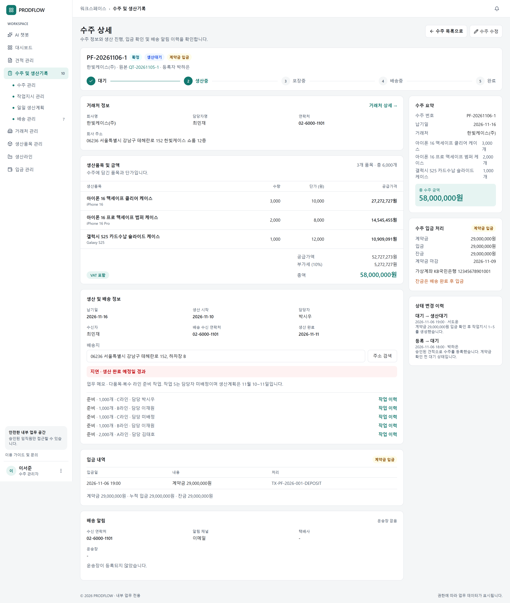

수주의 거래처·품목·납기·배송·입금·이력을 확인하고 다음 작업을 처리한다.

- 출력 데이터 항목 (Output Data):
    - 상단:`워크스페이스 > 수주 및 생산기록`, 제목`수주 상세`, 설명,`수주 목록으로`,`수주 수정`- 요약: 수주번호, 등록(예정·확정), 작업 상태, 입금 상태, 거래처, 원본 견적, 등록자
    - 진행 단계: 대기 → 생산중 → 포장중 → 배송중 → 완료
    - 거래처 정보: 회사명, 담당자명, 연락처, 회사 주소,`거래처 상세 →`- 생산품목 및 금액: 표(품목·수량·단가·공급가격), VAT 포함/별도, 공급가액·부가세·총액
    - 생산 및 배송 정보: 납기일, 생산 시작·완료, 담당자, 수신자, 배송 수신 연락처, 배송지, 지연·주의, 작업지시·`작업 이력`- 입금 내역: 입금일·내용·처리, 계약금·누적 입금·잔금
    - 배송 알림: 수신 연락처, 알림 채널, 택배사, 운송장,`배송조회`·출고·완료·취소 버튼
    - 오른쪽: 수주 요약, 수주 입금 처리(계약금·입금·잔금·마감·가상계좌·입금 금액), 상태 변경 이력
- 입력 데이터 및 검증 규칙 (Input Data & Validation):
    - 수량: 대기·생산대기·생산중·생산보류에서만 감소. 최소 1개, 이미 시작한 수량 미만 불가
    - 단가·품목 추가·삭제·수량 증가 불가. 필요 시 새 견적
    - 입금 금액: 양의 정수. 현금 계약금은 계약금 예정액과 동일
    - 출고: 출고대기에서 택배사·운송장 필수
    - 수주 취소: 미입금·대기만. 취소 사유 1~255자 필수
- 화면 제어 및 동작 규칙 (Behavior Rules):
    - `수주 수정`→ 품목 영역으로 스크롤. 별도 수정 화면 없음
    - 계약금 확인 시 등록`확정`, 작업지시 자동 생성. 담당자 없으면`미배정`- 미입금·대기:`가상계좌 발급 및 결제정보 발송`,`입금 처리`,`수주 취소`- 포장중 →`출고 대기`. 출고대기 →`출고`.
      배송중 →`배송 완료`. 운송장 있으면
      `배송조회`- 잔금은 배송 완료 후 입금. 상태
      변경은 이력, 입금은 입금 내역에
      기록
    - 수동 취소 시 원본 견적도`CANCELLED`. 재진행은 새 견적

## 10. 입금 관리 화면 (`/payments`)

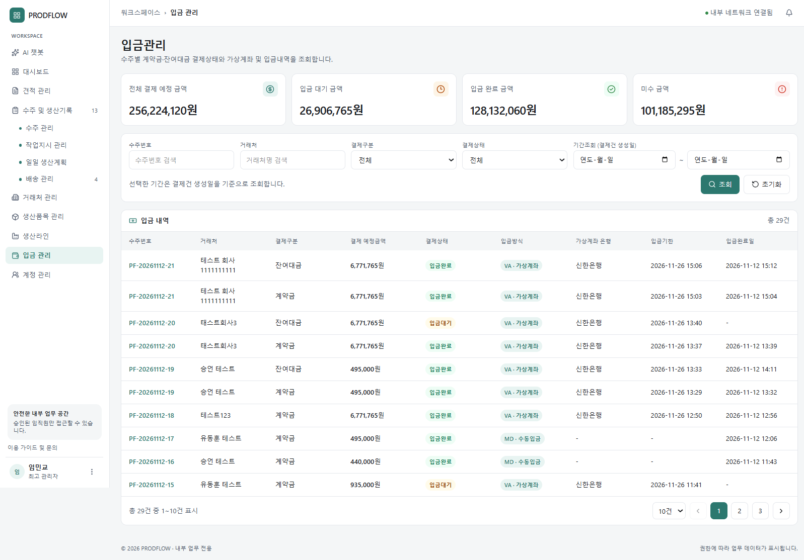

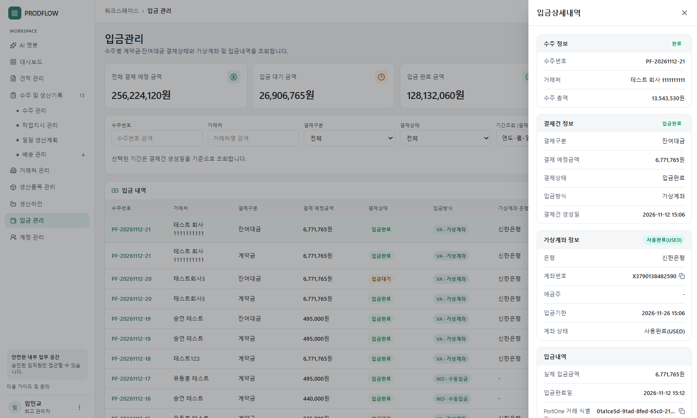
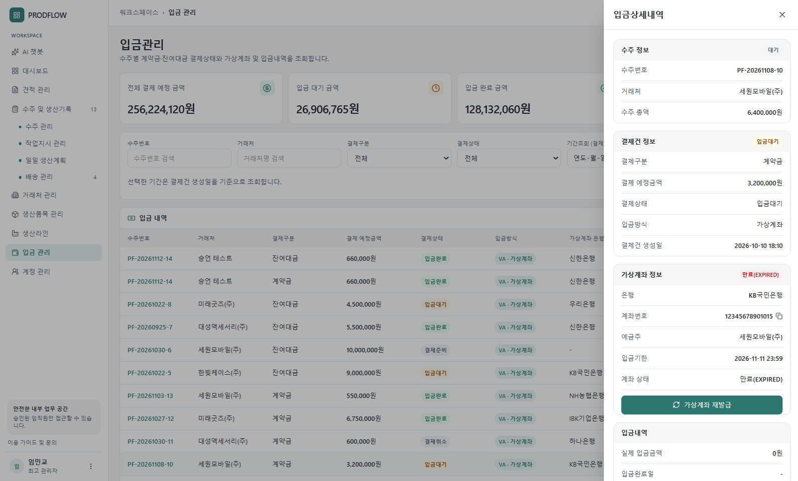

- **출력 데이터 항목 (Output Data):**
    - **입금 현황 요약 카드**
        - 전체 결제 예정 금액
        - 입금 대기 금액
        - 입금 완료 금액
        - 미수 금액
    - **검색 및 필터 영역**
        - 수주번호 및 거래처명 검색
        - 결제구분 필터 (전체 / 계약금 / 잔여대금)
        - 결제상태 필터 (전체 / 입금대기 / 입금완료 / 결제실패 / 입금취소 등)
        - 조회 기간 (시작일 / 종료일)
        - 조회 및 초기화 버튼
    - **입금 목록 테이블**
        - 수주번호, 거래처명, 결제구분
        - 결제 예정 금액, 결제상태, 입금방식
        - 가상계좌 은행 및 계좌번호
        - 입금기한, 입금완료일
        - 상세보기 버튼
    - **입금 상세내역 사이드 패널**
        - 수주 정보 (수주번호, 거래처, 수주 총액, 수주상태)
        - 결제 정보 (결제구분, 예정금액, 결제상태, 생성일, 입금방식)
        - 가상계좌 정보 (은행, 계좌번호, 예금주, 입금기한, 계좌상태)
        - 입금내역 (실제 입금일시, 거래 식별값)
        - 계좌번호 및 거래 식별값 복사 버튼
        - 가상계좌 재발급 및 상태 재동기화 버튼
    - **가상계좌 발급 이력**
        - 기존 및 신규 계좌정보
        - 계좌별 입금기한 및 상태
        - 이전 계좌 말소 여부
    - **페이지네이션**
        - 페이지당 표시 건수
        - 현재 페이지 및 페이지 이동 버튼
        - 전체 조회 건수
- **입력 데이터 및 검증 규칙 (Input Data & Validation):**
    - 수주번호 및 거래처명으로 검색 가능
    - 결제구분, 결제상태 및 결제건 생성일 기준으로 조회
    - 시작일은 종료일보다 늦을 수 없음
    - 검색 조건이 없으면 전체 결제건 조회
    - 가상계좌 재발급은 가상계좌 방식이며, 입금 이력이 없고 기존 계좌 및 PortOne 결제 ID가 존재하는 경우에만 허용
    - 재발급 가능 상태는 `WAITING`, `FAILED`, `CANCELLED`이며, 실제 요청 시 서버에서 추가 검증
    - 입금 완료된 결제 및 사용된 계좌는 재발급 불가
    - 기존 계좌의 말소가 확인된 후 새 가상계좌 발급
    - PortOne 응답 유실 시 기존 결제 ID로 상태를 재조회하여 중복 발급 방지
    - 수동 입금은 계약금 전액을 기준으로 처리하며, 활성 가상계좌가 있으면 말소 확인 전까지 제한
    - 동일 거래의 중복 입금 처리 방지
- **화면 제어 및 동작 규칙 (Behavior Rules):**
    - 입금관리 화면 진입 시 요약 카드와 입금 목록 조회
    - 조회 버튼 클릭 시 검색 조건 적용, 초기화 버튼 클릭 시 검색 조건 초기화
    - 상세보기 클릭 시 입금 상세내역 사이드 패널 표시
    - 가상계좌 상태는 `ACTIVE`, `EXPIRED`, `CANCELLED`, `USED`로 구분
    - 결제 상태가 재발급 가능한 경우 재발급 버튼 표시
    - 재발급 요청 시 확인창 표시 후 PortOne을 통해 기존 계좌 말소 및 신규 계좌 발급
    - 재발급 실패 시 오류 메시지 표시 및 기존 계좌 이력 유지
    - 발급 결과가 불확실한 경우 상태 재동기화 기능 제공
    - 상태 재동기화 시 기존 PortOne 결제 ID로 실제 결제 상태 확인
    - 웹훅으로 입금 완료가 확인되면 결제 상태를 `PAID`로 변경하고 입금내역 저장
    - 가상계좌 재발급 이력은 삭제하지 않고 별도 관리
    - 수동 입금 처리 시 입금내역 저장 및 수주 상태 갱신
    - 입금 상태 변경 후 입금 목록과 요약 카드 갱신
    - 페이지 이동 및 표시 건수 변경 시 목록 재조회

## 11. 작업지시서

### 11.1 작업지시서 관리 화면(`/work-orders`)

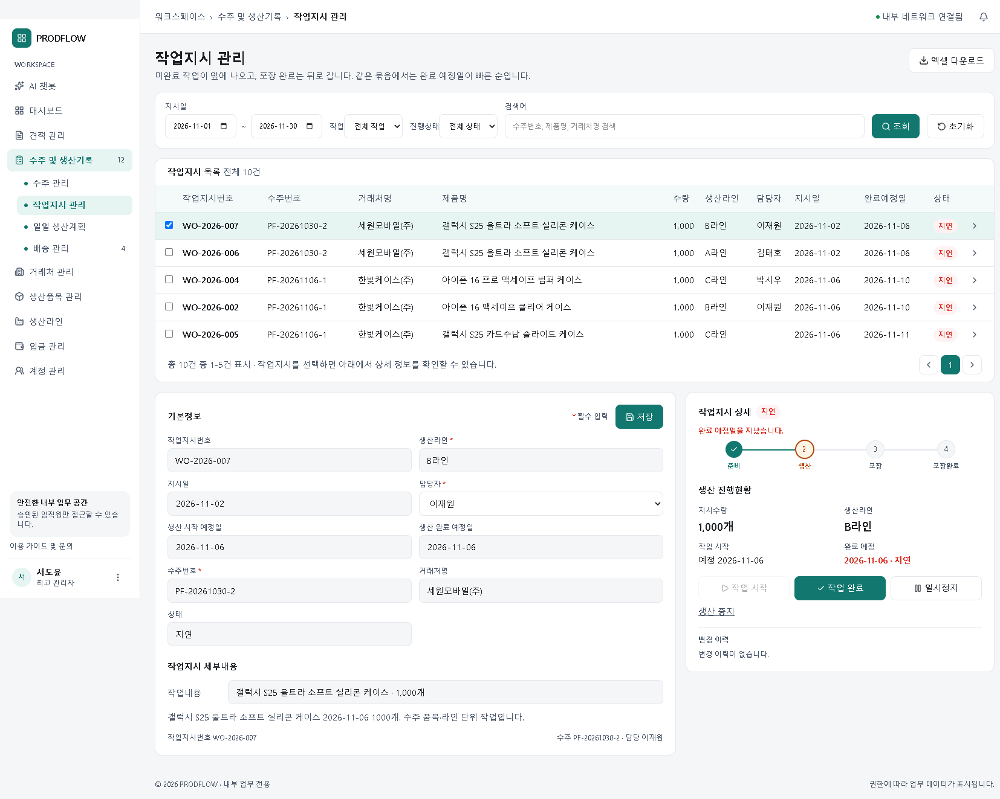

- **출력 데이터 항목 (Output Data):**
    - 작업지시서 목록: 작업지시 번호, 수주번호, 거래처명, 품목명, 수량, 생산라인, 담당자, 지시일, 완료 예정일, 작업 상태
    - 작업지시서 상세: 작업 기본 정보, 작업 내용, 생산라인 및 담당자 배정 정보, 생산 진행 현황
    - 변경 이력: 생산라인 및 담당자 변경 내역, 변경 사유, 처리자, 변경 일시
- **화면 제어 및 동작 규칙 (Behavior Rules):**
    - 모든 역할이 조회 가능하며, 생산 현장 관리자는 본인 담당 작업지시서만 조회한다.
    - 작업지시서 목록은 날짜, 작업 상태, 검색어로 필터링할 수 있으며, 미완료 작업을 우선 표시하고 페이지 단위로 조회한다.
    - 생산 시작·중지·일시정지·재개·포장·포장완료는 권한과 작업 상태에 따라 처리한다.
    - 작업지시서 생성 시 생산라인과 담당자를 자동 배정하며, 날짜별 생산계획을 생성한다.
    - 생산라인 및 담당자 변경은 권한과 배정 조건을 검증한 후 처리하고 변경 이력을 기록한다.
    - 생산라인의 점검·고장 발생 시 정책에 따라 작업지시서의 생산계획을 자동 재배치한다.
    - 작업 상태 변경에 따라 관련 수주 상태를 반영하고, 상태 변경 이력을 기록한다.
    - 작업지시서 한 장은 하나의 생산라인에 배정되며, 날짜별 계획 수량은 별도로 관리한다.
    - 실제 생산량은 수집하지 않으며, 생산 진행 현황은 작업 상태를 기준으로 표시한다.

## 12. 라인관리

### 12.1 생산라인 관리 화면(`/lines`)

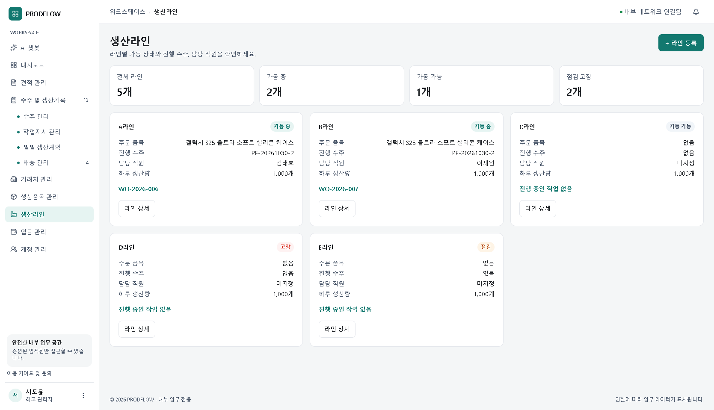

- **출력 데이터 항목 (Output Data):**
    - 전체 라인 현황: 전체 라인 수, 가동 중, 가동 가능, 점검·고장 수량
    - 라인별 현황 카드: 라인명, 상태(가동 가능/가동 중/점검/고장), 진행 수주 및 품목, 담당 직원, 일일 생산능력
    - 라인 상세: 라인 기본 정보, 도입일, 현재·예정 작업지시서, 생산계획 및 변경 이력
    - 등록·수정 폼: 라인명, 일일 생산능력, 도입일, 변경 사유
- **화면 제어 및 동작 규칙 (Behavior Rules):**
    - 모든 역할이 생산라인 현황과 상세 정보를 조회할 수 있다.
    - 라인 등록·정보 수정·상태 변경은 권한 매트릭스에 따라 처리한다.
    - 라인 상태는 가동 가능, 가동 중, 점검, 고장으로 구분한다.
    - 생산라인의 일일 생산능력 변경 시 기존 생산계획을 검증하고 변경 이력을 기록한다.
    - 점검·고장 발생 시 배정된 작업 상태를 확인하고 정책에 따라 생산계획을 재배치한다.
    - 점검·고장 라인은 신규 작업지시 배정 대상에서 제외한다.
    - 라인 상세 버튼을 통해 작업 현황 및 상세 정보를 조회한다.

### 12.2 생산 라인 등록 화면(`/lines/new)`

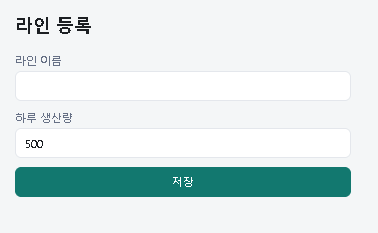

- **출력 데이터 항목 (Output Data):**
    - 라인 이름: 빈 값, 텍스트 입력
    - 하루 생산량: 초기값 500, 숫자 입력
    - 도입일: 날짜 입력
    - 저장 및 취소 버튼
- **화면 제어 및 동작 규칙 (Behavior Rules):**
    - 최고 관리자와 수주 관리자만 생산라인을 등록할 수 있다.
    - 라인 이름은 필수 입력 항목이며, 중복 등록할 수 없다.
    - 하루 생산량은 1 이상의 정수만 입력할 수 있다.
    - 신규 생산라인은 기본적으로 가동 가능(AVAILABLE) 상태로 등록한다.
    - 입력값 검증에 실패하면 오류 메시지를 표시하고 저장하지 않는다.
    - 저장에 성공하면 생산라인 목록을 갱신한다.

### 12.3 생산 라인 수정 화면(`/lines/{id}/edit)`

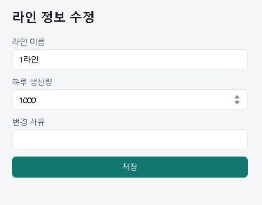

- **출력 데이터 항목 (Output Data):**
    - 라인 이름: 현재 이름, 텍스트 입력
    - 하루 생산량: 현재 수량, 숫자 입력
    - 변경 사유: 빈 값, 텍스트 입력
    - 저장 및 취소 버튼
- **화면 제어 및 동작 규칙 (Behavior Rules):**
    - 최고 관리자는 라인 이름과 하루 생산량을 수정할 수 있으며, 수주 관리자는 하루 생산량만 수정할 수 있다.
    - 라인 이름은 필수 입력 항목이며, 중복을 허용하지 않는다.
    - 하루 생산량은 1 이상의 정수만 입력할 수 있다.
    - 생산능력 변경 시 변경 사유를 필수로 입력한다.
    - 생산능력 변경 시 기존 생산계획을 검증하며, 변경이 불가능하면 오류 메시지를 표시한다.
    - 변경된 생산능력과 사유는 변경 이력에 기록한다.
    - 저장에 성공하면 생산라인 목록 및 상세 정보를 갱신한다.

### 12.4. 생산 라인 상세 화면 (`/lines/{id}`)

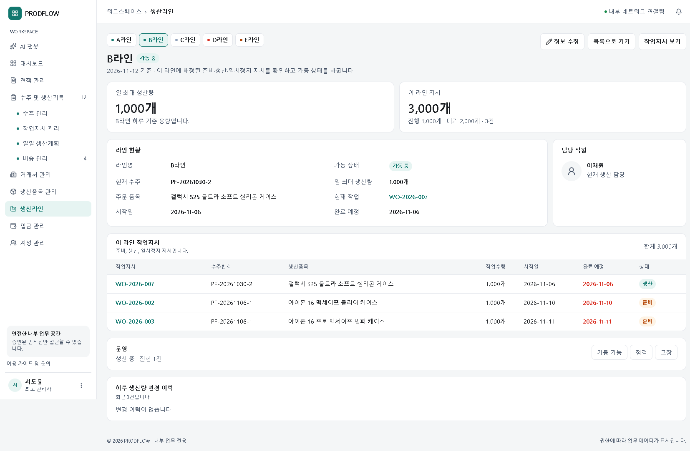

- **출력 데이터 항목 (Output Data):**
    - 라인 기본 정보: 라인명, 가동 상태, 일일 생산능력, 현재 수주 및 작업지시, 담당 직원
    - 작업지시 현황: 배정된 작업지시 목록, 작업 수량, 시작·완료 예정일, 작업 상태
    - 라인 상태 변경 버튼: 가동 가능, 점검, 고장
    - 생산능력 변경 이력: 변경 일시, 변경 전·후 생산능력, 변경 사유
- **화면 제어 및 동작 규칙 (Behavior Rules):**
    - 모든 역할이 생산라인 상세 정보와 변경 이력을 조회할 수 있다.
    - 최고 관리자는 라인명과 생산능력을 수정할 수 있으며, 수주 관리자는 생산능력만 수정할 수 있다.
    - 라인 상태 변경은 최고 관리자와 생산 현장 관리자가 처리한다.
    - 라인 상태 변경 시 작업 진행 상태를 검증하고, 필요한 경우 생산계획 재배치 정책을 적용한다.
    - 생산능력 변경 시 기존 생산계획을 검증하며 변경 사유를 기록한다.
    - 생산능력 변경 이력은 수정하거나 삭제할 수 없다.
    - 작업지시 번호를 선택하면 해당 작업지시서의 상세 화면으로 이동한다.

## 13. 캘린더

### 13.1 생산 일정 캘린더 화면(`/production/calendar`)

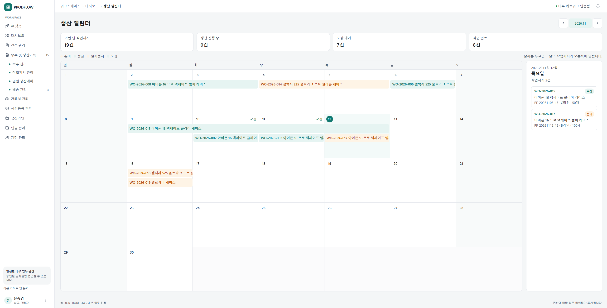

- 출력 데이터 항목 (Output Data):
    - 상단 요약: 이번 달 작업지시, 생산 진행 중, 포장 대기, 작업 완료 건수
    - 월간 생산 일정: 날짜별 작업지시 일정 막대 및 작업지시 번호, 생산품목명
    - 작업 상태: 준비, 생산, 일시정지, 포장 상태별 색상 구분
    - 날짜별 상세: 선택 날짜, 작업지시 건수, 작업지시 번호, 품목명, 수주번호, 생산라인, 생산 수량 및 작업 상태
    - 생산 가능 수량: 날짜별 생산 예정 수량 및 가용 생산량
- 화면 제어 및 동작 규칙 (Behavior Rules):
    - 모든 역할이 조회 가능
    - 최초 진입 시 현재 월의 생산 일정을 표시
    - 이전 달 및 다음 달 버튼 클릭 시 해당 월의 일정과 요약 정보를 갱신
    - 일정 막대 클릭 시 해당 작업지시의 상세 정보를 확인
    - 날짜 클릭 시 우측 영역에 해당 날짜의 작업지시 목록을 표시
    - 일정이 여러 건인 경우 추가 건수를 표시하고 전체 목록을 확인
    - 납기 지연이 예상되는 작업은 강조 색상으로 표시
    - 작업지시 일정 및 상태 변경 시 캘린더에 반영

## 14. 배송 관리 화면 (`/shipments`)

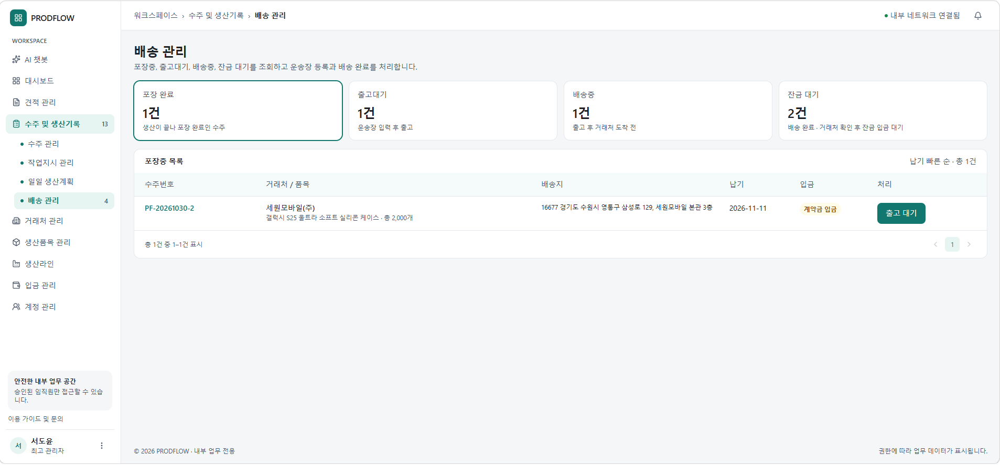

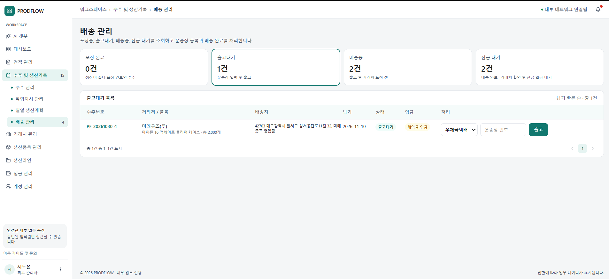

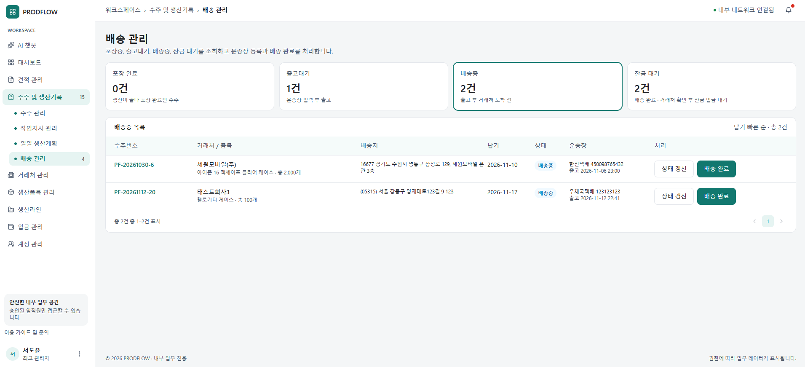

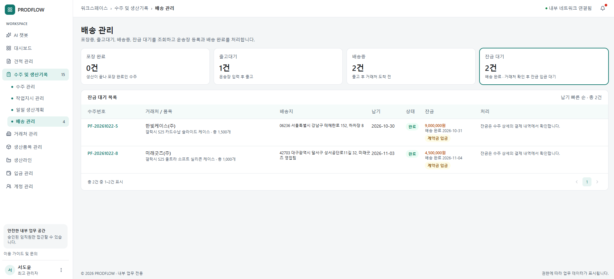

포장 완료부터 출고·배송 완료·잔금 확인까지 한 화면에서 처리한다. 탭은 PACKING / READY_TO_SHIP / SHIPPING / BALANCE, 목록은 납기 빠른 순·페이징이다.

- 출력 데이터 항목 (Output Data):
    - 상단: `워크스페이스 > 수주 및 생산기록 > 배송 관리`, 제목 `배송 관리`
    - 상태 카드 4개(건수): 포장 완료, 출고대기, 배송중, 잔금 대기
    - 공통 목록: 수주번호, 거래처/품목, 배송지, 납기 + `납기 빠른 순 · 총 N건`·페이징
    - 포장 완료: 입금 상태, `출고 대기` 버튼 (전부 PACK_DONE인 PACKING만)
    - 출고대기: 상태·입금, 택배사·운송장·`출고`
    - 배송중: 운송장(택배사·번호·출고 시각), `상태 갱신`·`배송 완료`
    - 잔금 대기: 상태(`완료`), 잔금, 입금은 수주 상세에서 확인. 없으면 `처리할 수주가 없습니다.`
- 입력 데이터 및 검증 규칙 (Input Data & Validation):
    - 출고대기에서만 택배사·운송장 입력. 둘 다 있어야 `출고` 활성
    - 운송장 숫자만, 택배사+운송장 중복 불가, 수주당 1건
- 화면 제어 및 동작 규칙 (Behavior Rules):
    - 카드 클릭 → 해당 탭 목록 표시
    - `출고 대기` → READY_TO_SHIP
    - `출고` → 운송장 저장·SHIPPING·잔금 준비·배송 시작 알림(실패해도 출고 유지)
    - `상태 갱신`/주기 조회 → 배송완료면 COMPLETED, 잔금 미입금이면 잔금 대기
    - `배송 완료` → 수동 완료 처리(동일)
    - 수주번호 → 수주 상세
    - 조회·출고·갱신·배송 완료는 모든 역할 가능

## 15. 일일 생산 계획

### 15.1  일일 생산 계획 화면(`/production-plans`)

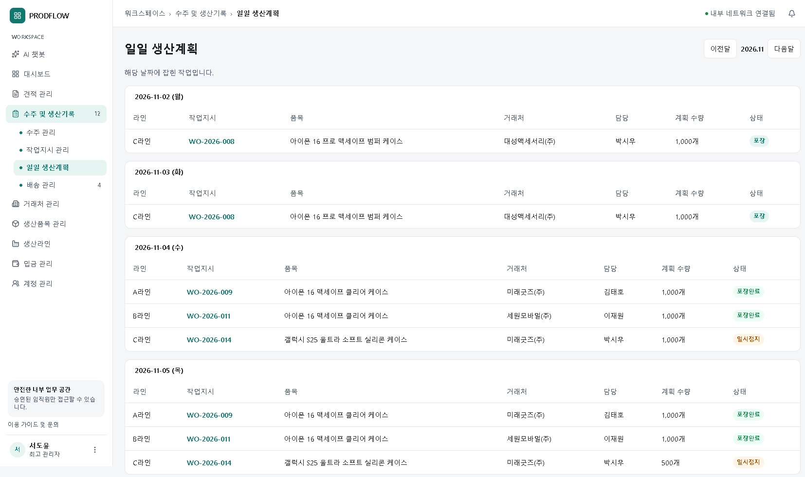

- **출력 데이터 항목 (Output Data):**
    - 월별 생산계획: 선택한 월의 날짜별 작업지시 및 생산계획 목록
    - 날짜별 계획 정보: 생산라인, 작업지시 번호, 품목명, 거래처명, 담당자, 계획 수량, 작업 상태
- **화면 제어 및 동작 규칙 (Behavior Rules):**
    - 모든 역할이 일일 생산계획을 조회할 수 있다.
    - 이전 달·다음 달 버튼으로 조회 월을 변경할 수 있다.
    - 생산계획은 날짜별로 구분하여 표시하며, 동일 날짜에 여러 작업지시서를 표시할 수 있다.
    - 작업지시 번호를 선택하면 해당 작업지시서 상세 화면으로 이동한다.
    - 생산계획은 작업지시서의 날짜별 계획 수량을 기준으로 표시한다.
    - 작업 상태는 현재 작업지시서 상태를 기준으로 표시하며, 실제 생산 실적을 의미하지 않는다.
    - 생산계획 변경은 작업지시 및 생산라인 관리 기능을 통해 반영한다.

## 16. AI

### **16.1 AI 챗봇 화면 (`/assistant`)**

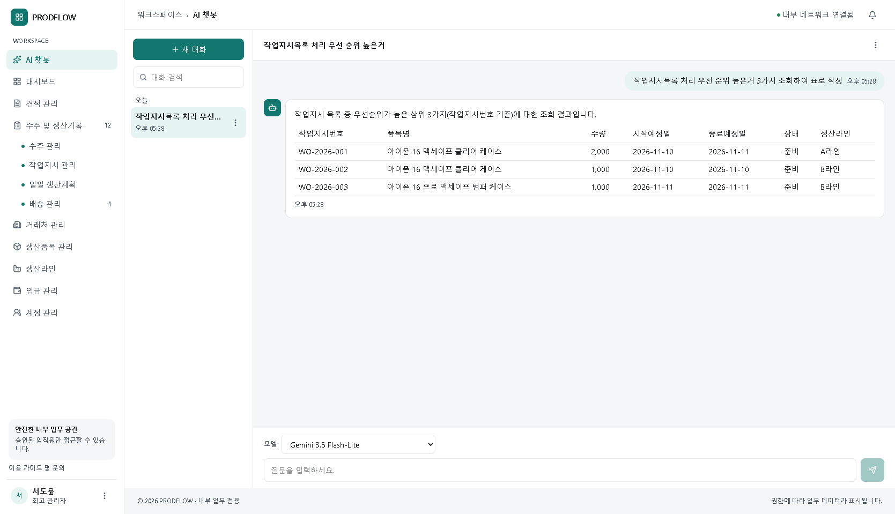

- **출력 데이터 항목 (Output Data):**
    - 대화 목록: 새 대화 버튼, 대화 검색, 대화 제목, 생성 시간, 대화 관리 메뉴
    - 대화 영역: 대화 제목, 사용자 질문, AI 답변, 데이터 조회 결과 표, 메시지 작성 시간
    - 질문 입력 영역: AI 모델 선택, 질문 입력창, 전송 버튼
- **화면 제어 및 동작 규칙 (Behavior Rules):**
    - 권한 매트릭스에 따라 AI 챗봇 접근 권한을 제한한다.
    - 사용자는 Gemini 및 Groq 모델을 선택하여 자연어로 업무 데이터를 조회할 수 있다.
    - AI는 사용자 질문을 분석하여 DB 데이터를 조회하고, 결과를 한국어 및 표 형식으로 제공한다.
    - AI는 조회와 분석만 수행하며 데이터 등록·수정·삭제는 지원하지 않는다.
    - 대화 내용과 조회 결과를 저장하여 이전 대화를 다시 확인할 수 있다.
    - 이전 대화 내용을 참고하여 연속적인 질문을 처리할 수 있다.
    - 대화방 생성·삭제·종료 기능을 제공하며, 종료된 대화는 기록을 유지하되 추가 질문을 제한한다.

---

## 17. 전체 화면 와이어프레임 배치와 흐름도

### 17.1 전체 화면 와이어프레임 배치도

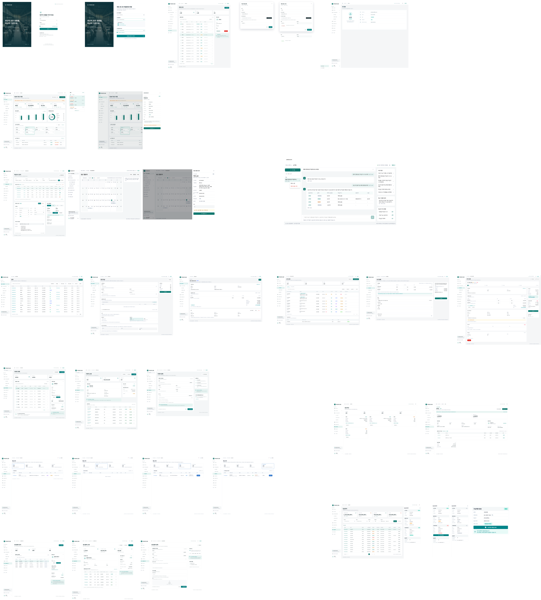

### 17.2 전체 화면 흐름도 및 내비게이션 구조

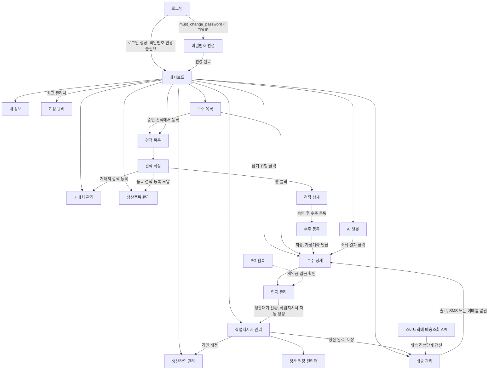
