# 화면 설계서 (UI Wireframe)

## 목차

- [화면 설계서 (UI Wireframe)](#화면-설계서-ui-wireframe)
- [1. 서비스 화면 구성 개요](#1-서비스-화면-구성-개요)
    - [1.1 주요 화면 목록](#11-주요-화면-목록)
- [2. 로그인 화면 (`/login`)](#2-로그인-화면login)
    - [2.1 최초 로그인 비밀번호 변경 화면 (`/change-password`)](#21-최초-로그인-비밀번호-변경-화면change-password)
- [3. 대시보드 화면 (`/dashboard`)](#3-대시보드-화면-dashboard)
    - [3.1 대시보드 : 생산 일정 상세](#31-대시보드-생산-일정-상세)
- [4. 내 정보 화면 (`/me`)](#4-내-정보-화면-me)
- [5. 계정 관리 화면](#5-계정-관리-화면)
    - [5.1 직원 계정 등록 모달](#51-직원-계정-등록-모달)
    - [5.2 직원 계정 수정 모달](#52-직원-계정-수정-모달)
- [6. 거래처 화면](#6-거래처-화면)
    - [6.1 거래처 목록 화면 (`/clients`)](#61-거래처-목록-화면-clients)
    - [6.2 거래처 상세 화면 (`/clients/{id}`)](#62-거래처-상세-화면-clientsid)
    - [6.3 거래처 등록 페이지 (`/clients/new`)](#63-거래처-등록-페이지-clientsnew)
- [7. 생산품목 화면](#7-생산품목-화면)
    - [7.1 생산품목 목록 화면 (`/products`)](#71-생산품목-목록-화면-products)
    - [7.2 생산품목 등록 화면 (`/products/new`)](#72-생산품목-등록-화면-productsnew)
    - [7.1 생산품목 상세 화면 (`/products/{productId}`)](#71-생산품목-상세-화면-productsproductid)
- [8. 견적서 화면](#8-견적서-화면)
    - [8.1 견적서 목록 화면 (`/quotations`)](#81-견적서-목록-화면quotations)
    - [8.2 견적서 등록 화면 (`/quotations/new`)](#82-견적서-등록-화면quotationsnew)
    - [8.3 견적서 상세 화면 (`/quotations/{quotationId}`)](#83-견적서-상세-화면quotationsquotationid)
- [9. 수주 화면](#9-수주-화면)
    - [9.1 수주 목록 화면 (`/orders`)](#91-수주-목록-화면orders)
    - [9.2 수주 등록 화면 (`/orders/new`)](#92-수주-등록-화면ordersnew)
    - [9.3 수주 상세 화면 (`/orders/{customerOrderId}`)](#93-수주-상세-화면orderscustomerorderid)
- [10. 입금 관리 화면 (`/payments`)](#10-입금-관리-화면-payments)
- [11. 작업지시서](#11-작업지시서)
    - [11.1 작업지시서 관리 화면 (`/work-orders`)](#111-작업지시서-관리-화면work-orders)
- [12. 라인관리](#12-라인관리)
    - [12.1 생산라인 관리 화면 (`/lines`)](#121-생산라인-관리-화면lines)
    - [12.2 생산 라인 등록 화면 (`/lines/new`)](#122-생산-라인-등록-화면linesnew)
    - [12.3 생산 라인 수정 화면 (`/lines/edit`)](#123-생산-라인-수정-화면linesedit)
    - [12.4 생산 라인 상세 화면 (`/lines/{id}`)](#124-생산-라인-상세-화면-linesid)
- [13. 캘린더](#13-캘린더)
    - [13.1 생산 일정 캘린더 화면 (`/production/calendar`)](#131-생산-일정-캘린더-화면productioncalendar)
- [14. 배송 관리 화면 (`/shipments`)](#14-배송-관리-화면-shipments)
- [15. AI](#15-ai)
    - [15.1 AI 챗봇 화면 (`/ai`)](#151-ai-챗봇-화면-ai)
- [16. 전체 화면 와이어프레임 배치와 흐름도](#16-전체-화면-와이어프레임-배치와-흐름도)
    - [16.1 전체 화면 와이어프레임 배치도](#161-전체-화면-와이어프레임-배치도)
    - [16.2 전체 화면 흐름도 및 내비게이션 구조](#162-전체-화면-흐름도-및-내비게이션-구조)

---

## 1. 서비스 화면 구성 개요

ProdFlow는 생산시설의 수주, 생산, 입금, 포장, 출고, 배송 조회를 한 시스템에서 처리하는 내부 임직원 전용 SPA(Single Page Application)입니다. 외부 회원가입 화면은 없고, 로그인한
직원의 역할(최고 관리자 / 수주 관리자 / 생산 현장 관리자 / 업무 조회 담당자)에 따라 메뉴와 버튼이 다르게 보입니다.

### 1.1 주요 화면 목록

- 로그인 화면 (`/login`)
- 대시보드 화면 (`/dashboard`)
- 내 정보 화면 (`/me`)
- 계정 관리 화면 (`/admin/users`, `/admin/users/new`, `/admin/users/{userId}`)
- 거래처 관리 화면 (`/clients`, `/clients/new`, `/clients/{clientId}`)
- 생산품목 관리 화면 (`/products`, `/products/new`, `/products/{productId}`)
- 견적서 목록 화면 (`/quotations`)
- 견적서 등록 화면 (`/quotations/new`)
- 견적서 상세 화면 (`/quotations/{quotationsId}`)
- 수주 목록 화면 (`/orders`)
- 수주 등록 화면 (`/orders/new`)
- 수주 상세 화면 (`/orders/{customerOrderId}`)
- 입금 관리 화면 (`/payments`)
- 작업지시서 관리 화면 (`/work-orders`, `/work-orders/{workOrderId}`)
- 생산라인 관리 화면 (`/lines`, `/lines/new`, `/lines/{lineId}`)
- 생산 일정 캘린더 화면 (`/production/calendar`)
- 배송 관리 화면 (`/shipments`)
- 통계 화면 (`/statistics`)
- AI 챗봇 화면 (`/ai`)

---

## 2. 로그인 화면**(`/login`)**

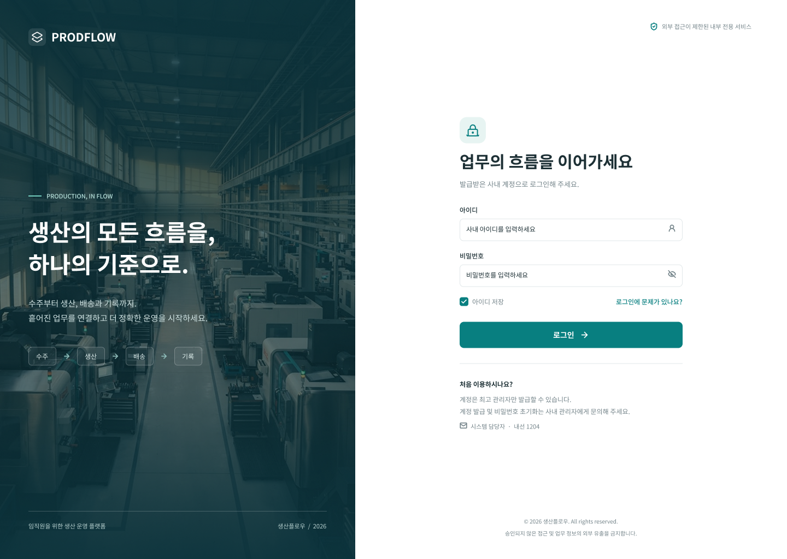

- 출력 데이터 항목 (Output Data)
    - 서비스 로고 및 내부 전용 서비스 안내 문구
    - 아이디 입력 필드
    - 비밀번호 입력 필드
    - 아이디 저장 체크박스
    - 로그인 버튼
    - 로그인 문제 안내 링크
    - 최초 이용자 안내 문구
    - 시스템 담당자 안내 정보
- 입력 데이터 및 검증 규칙 (Input Data & Validation)
    - 아이디
        - 필수 입력
        - 발급된 사내 계정의 아이디(이메일)를 입력
    - 비밀번호
        - 필수 입력
        - 입력값은 마스킹하여 표시
        - 보기 아이콘을 통해 입력값 표시 여부 변경 가능
    - 아이디 또는 비밀번호가 일치하지 않으면 로그인 실패 안내 메시지 표시
- 화면 제어 및 동작 규칙 (Behavior Rules)
    - 외부 회원가입 기능은 제공하지 않는다.
    - 계정은 최고 관리자가 계정 관리 화면에서 등록 및 발급한다.
    - 로그인 버튼 클릭 시 아이디와 비밀번호를 서버에서 검증한다.
    - 활성 상태(`ACTIVE`)의 계정만 로그인할 수 있다.
    - 비활성 또는 삭제 상태의 계정은 로그인할 수 없다.
    - 로그인 성공 시 Access Token과 Refresh Token을 발급한다.
    - Refresh Token은 HttpOnly Cookie로 전달한다.
    - 최초 발급된 임시 비밀번호를 사용하는 계정에서 `must_change_password = TRUE`인 경우 대시보드가 아닌 최초 로그인 비밀번호 변경 화면으로 이동한다.
    - `must_change_password = FALSE`인 경우 대시보드(`/dashboard`)로 이동한다.
    - 아이디 저장 체크 시 다음 로그인 화면에서 저장된 아이디를 표시한다.
    - Access Token 만료 시 Refresh Token을 이용해 재발급하며, 재발급에 실패하면 로그인 화면으로 이동한다.

### **2.1 최초 로그인 비밀번호 변경 화면(`/change-password`)**

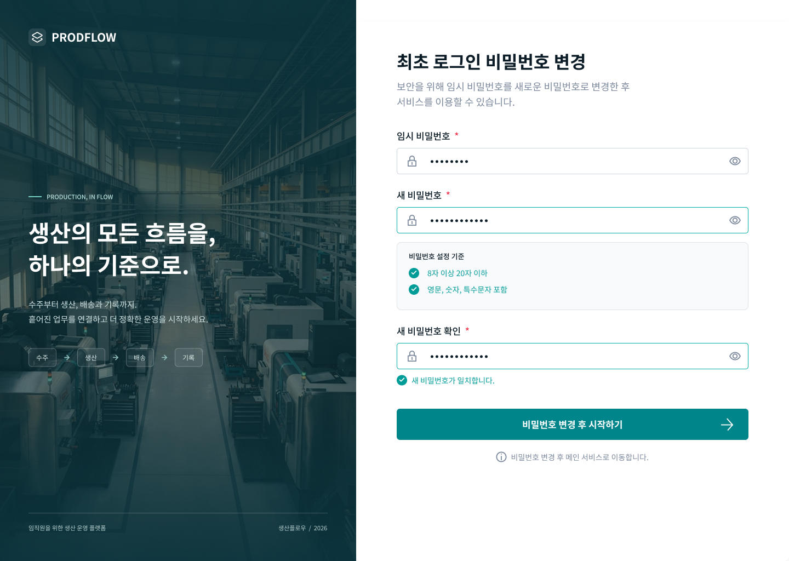

- 출력 데이터 항목 (Output Data)
    - 최초 로그인 비밀번호 변경 안내
    - 임시 비밀번호 입력 필드
    - 새 비밀번호 입력 필드
    - 비밀번호 설정 기준
    - 새 비밀번호 확인 입력 필드
    - 비밀번호 일치 여부
    - 비밀번호 변경 후 시작하기 버튼
- 입력 데이터 및 검증 규칙 (Input Data & Validation)
    - 임시 비밀번호
        - 현재 계정에 발급된 임시 비밀번호 입력
        - 입력값은 마스킹하여 표시
    - 새 비밀번호
        - 필수 입력
        - 8자 이상 20자 이하
        - 영문, 숫자, 특수문자를 포함
        - 기존 임시 비밀번호와 동일한 비밀번호는 사용할 수 없음
    - 새 비밀번호 확인
        - 필수 입력
        - 새 비밀번호와 동일해야 함
    - 비밀번호 조건 충족 여부를 입력 중 실시간으로 표시한다.
- 화면 제어 및 동작 규칙 (Behavior Rules)
    - 로그인 성공 후 `must_change_password = TRUE`인 사용자만 해당 화면으로 이동한다.
    - 비밀번호 변경 전까지 일반 업무 화면에 접근할 수 없다.
    - 사용자가 URL을 직접 입력하여 다른 업무 화면에 접근하더라도 서버에서 접근을 제한한다.
    - 입력한 임시 비밀번호가 현재 비밀번호와 일치하는지 확인한다.
    - 새 비밀번호가 설정 기준을 만족하고 비밀번호 확인값과 일치해야 변경 버튼을 활성화한다.
    - 비밀번호 변경 성공 시 암호화된 새 비밀번호를 저장한다.
    - 변경 완료 후 `must_change_password` 값을 `FALSE`로 변경한다.
    - 비밀번호 변경 완료 후 메인 대시보드(`/dashboard`)로 이동한다.

## 3. 대시보드 화면 (`/dashboard`)

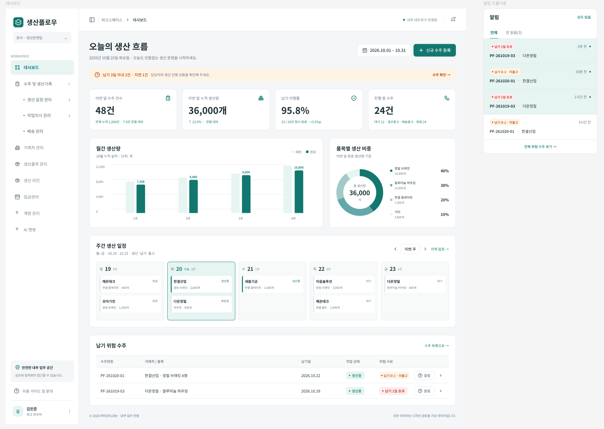

- 출력 데이터 항목 (Output Data):
    - 상태별 파이프라인 카드: 대기, 생산대기,생산중, 포장중, 포장완료, 배송중, 완료 건수
    - 핵심 지표: 기간 내 수주 건수, 누적 생산량, 납기 이행률, 생산 예정 및 진행 중 수주 건수
    - 생산량 통계 : 조회 기간 내 주차별 생산량 및 품목별 생산 비중
    - 주산 생산 일정 : 날짜별 생산 예정 수주, 거래처명, 생산품목, 생산 수량, 작업 상태, 해당 날짜의 가용 생산량
    - 납기 위험 목록: 수주번호, 거래처명, 생산품목, 납기일, 작업 상태, 위험 사유(납기 임박, 납기 지연, 생산 일정 지연 등)
    - 알림 요약 : 납기 임박 및 지연 관련 알림 목록, 알림 유형, 관련 수주번호, 거래처명 발생 시각, 읽음 여부
    - 사용자 정보 : 로그인 사용자명 및 역할
- 화면 제어 및 동작 규칙 (Behavior Rules):
    - 모든 역할이 조회 가능.
    - 조회 기간 변경 시 핵심 지표, 생산량 통계 등 기간에 영향 받는 데이터가 갱신
    - 상태별 파이프라인 카드 클릭 시 해당 상태로 필터링된 수주 목록으로 이동
    - 주간 생산 일정의 날짜별 생산 업무 카드 클릭 시 선택한 수주의 생산 일정 상세 사이드 패널 표시
    - 생산 일정 상세 사이드 패널에서 닫기 버튼 클릭 시 패널을 닫고 기존 대시보드 화면으로 복귀
    - 납기 위험 수주 목록의 행 또는 상세보기(>) 버튼 클릭시 해당 수주의 상세 사이드 패널 표시
    - 납기 위험 수주 목록에서 선택한 수주와 생산 일정에서 산택한 수주가 동일한 경우 동일한 수주 상세 정보 표시
    - 알림 아이콘 클릭 시 드롭다운 표시
    - 알림 드롭다운에서 전체 및 읽지 않음 필터를 선택하여 알림 목록 조회
    - 개발 알림 클릭 시 관련 수주의 상세 정보를 확인할 수 있고, 해당 알림을 읽음 상태로 처리
    - 전체 읽음 버튼 클릭시 해당 사용자의 읽지 않은 알림을 모두 읽음 상태로 처리
    - 전체 위험 수주 보기 클릭 시 납기 위험 수주 목록 화면으로 이동
    - 사용자 역할에 따라 조회 가능한 데이터 범위와 실행 가능한 기능을 구분하며, 권한 없는 기능은 제한

### 3.1 대시보드 : 생산 일정 상세

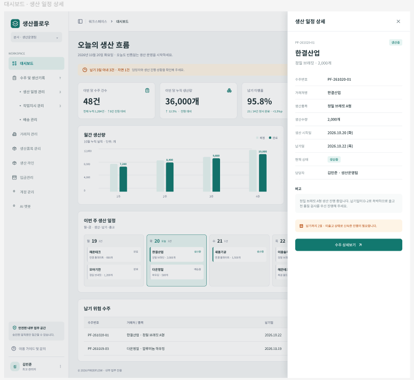

- 출력 데이터 항목 (Output Data):
    - 헤더 영역
        - 수주번호
        - 상태 뱃지
        - 거래처명 및 품목 요약
    - 상세 정보 필드
        - 수주 번호 : 해당 수주의 고유 관리 번호
        - 거래처명 : 발주처 명칭
        - 생산품목 : 세부 품목 정보
        - 생산 수량 : 총 생산 대상 수량
        - 생산 시작일 : 작업 착수 날짜 및 요일
        - 납기일 : 최종 납품 기한 및 요일
        - 현재 상태 : 공정 진행 상황
        - 담당자 : 업무 담당자 성명 및 소속 부서
- 화면 제어 및 동작 규칙 (Behavior Rules):
    - 패널 오픈 :
        - 대시보드 내 ‘이번 주 생산 일정’의 날짜별 업무 카드 클릭
        - ‘납기 위험 수주’ 목록의 행이나 상세보기 버튼 클릭
        - 동일한 수주 데이터가 연동된 상태로 화면 우측에 사이드 패널이 슬라이드 형태로 활성화

## 4. 내 정보 화면 (`/me`)

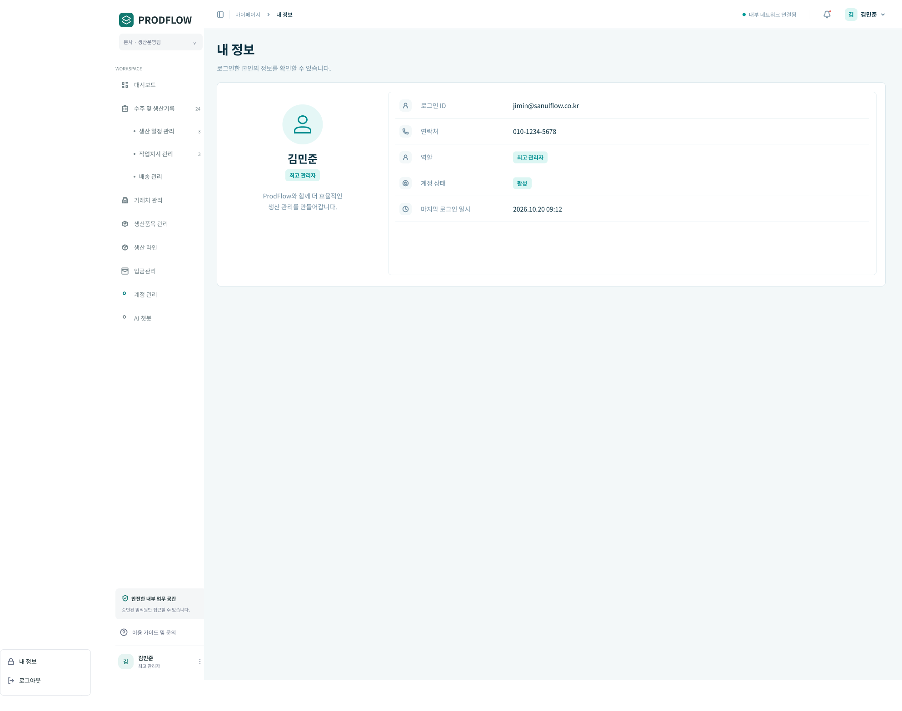

- 출력 데이터 항목 (Output Data):
    - 이름, 로그인 ID, 이메일, 연락처, 역할, 상태, 마지막 로그인 일시
- 화면 제어 및 동작 규칙 (Behavior Rules):
    - 로그인한 본인 정보만 조회.
    - 역할과 계정 상태는 본인이 수정할 수 없음.

## 5. 계정 관리 화면

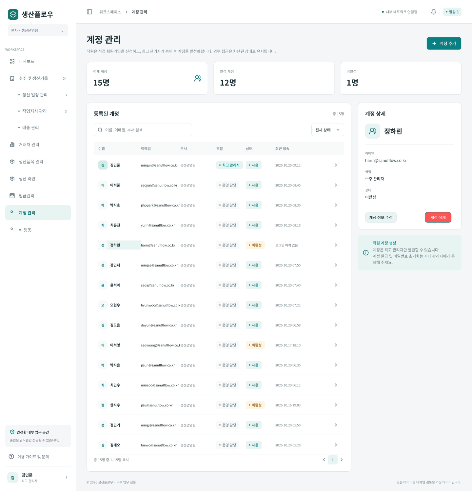

- 출력 데이터 항목 (Output Data)
    - 계정 현황 요약
        - 전체 계정 수
        - 사용 계정 수
        - 비활성 계정 수
    - 등록된 계정 목록
        - 이름
        - 이메일
        - 부서
        - 역할
        - 상태
        - 최근 접속 일시
    - 계정 검색 영역
        - 이름
        - 이메일
        - 부서 검색
    - 계정 상태 필터
        - 전체
        - 사용
        - 비활성
    - 선택한 계정 상세 정보
        - 이름
        - 이메일
        - 역할
        - 상태
    - 계정 추가 버튼
    - 계정 정보 수정 버튼
    - 계정 삭제 버튼
- 입력 데이터 및 검증 규칙 (Input Data & Validation)
    - 검색어가 없는 경우 전체 계정 목록을 조회한다.
    - 이름, 이메일, 부서를 기준으로 검색할 수 있다.
    - 상태 필터를 통해 전체, 사용, 비활성 계정을 구분하여 조회할 수 있다.
- 화면 제어 및 동작 규칙 (Behavior Rules)
    - 최고 관리자만 계정 관리 메뉴와 화면에 접근할 수 있다.
    - 다른 역할의 사용자가 직접 URL로 접근하면 403 응답을 반환한다.
    - 계정 목록의 행 또는 상세보기 버튼 클릭 시 선택한 계정의 상세 정보를 우측 영역에 표시한다.
    - 계정 추가 버튼 클릭 시 현재 `/admin/users` 화면 위에 직원 계정 등록 모달을 표시한다.
    - 계정 정보 수정 버튼 클릭 시 현재 `/admin/users` 화면 위에 계정 정보 수정 모달을 표시한다.
    - 모달을 표시하더라도 페이지 URL은 `/admin/users`를 유지한다.
    - 계정 상태는 사용(`ACTIVE`), 비활성(`INACTIVE`), 삭제(`DELETED`)로 관리한다.
    - 비활성 계정은 데이터를 삭제하지 않고 로그인 및 서비스 접근만 제한한다.
    - 삭제된 계정은 데이터베이스에서 실제 삭제하지 않고 `DELETED` 상태로 변경한다.
    - 삭제 상태의 계정은 일반 계정 목록에서 표시하지 않는다.
    - 계정 추가 또는 수정 완료 시 목록과 계정 현황 요약 정보를 다시 조회하여 화면을 갱신한다

### 5.1 직원 계정 등록 모달

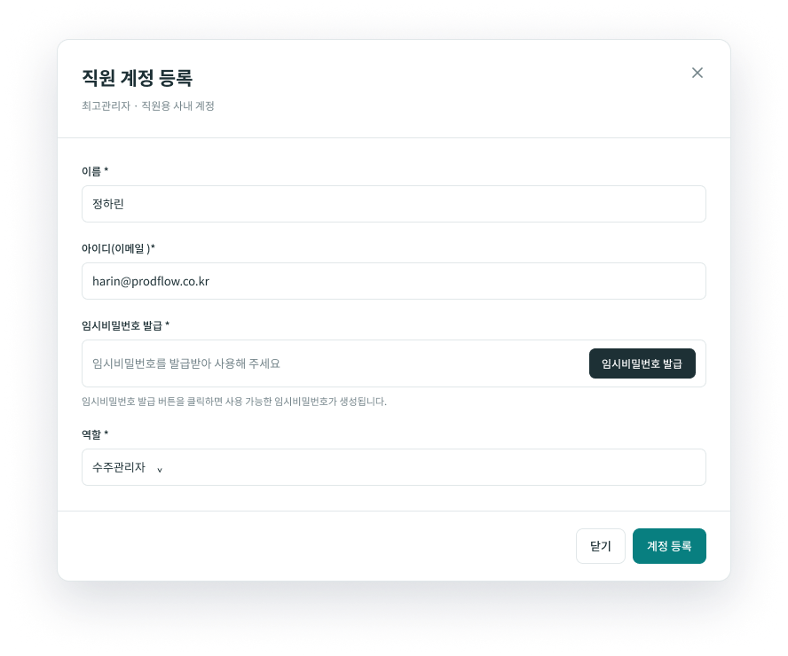

- 입력 데이터 및 검증 규칙 (Input Data & Validation)
    - 이름
        - 필수 입력
    - 아이디(이메일)
        - 필수 입력
        - 이메일 형식 검증
        - 기존 계정과 중복 불가
    - 임시 비밀번호
        - 필수
        - `임시비밀번호 발급` 버튼을 통해 시스템에서 자동 생성
    - 역할
        - 필수 선택
        - 최고 관리자
        - 수주 관리자
        - 생산 현장 관리자
        - 업무 조회 담당자
- 화면 제어 및 동작 규칙 (Behavior Rules)
    - 계정 관리 화면의 `계정 추가` 버튼 클릭 시 모달을 표시한다.
    - 최고 관리자만 계정을 등록할 수 있다.
    - 임시 비밀번호 발급 버튼 클릭 시 사용 가능한 임시 비밀번호를 자동 생성한다.
    - 임시 비밀번호가 발급되지 않은 상태에서는 계정을 등록할 수 없다.
    - 신규 계정의 기본 상태는 `ACTIVE`로 설정한다.
    - 신규 계정의 `must_change_password` 값은 `TRUE`로 설정한다.
    - 임시 비밀번호는 평문으로 저장하지 않고 암호화하여 저장한다.
    - 계정 등록 버튼 클릭 시 입력값을 검증한 후 계정을 생성한다.
    - 계정 등록 성공 시 모달을 닫고 계정 관리 목록을 갱신한다.
    - 신규 사용자는 발급받은 임시 비밀번호로 최초 로그인 후 반드시 새 비밀번호로 변경해야 한다.
    - 닫기 버튼 또는 X 버튼 클릭 시 입력 내용을 저장하지 않고 모달을 닫는다.

### 5.2 직원 계정 수정 모달

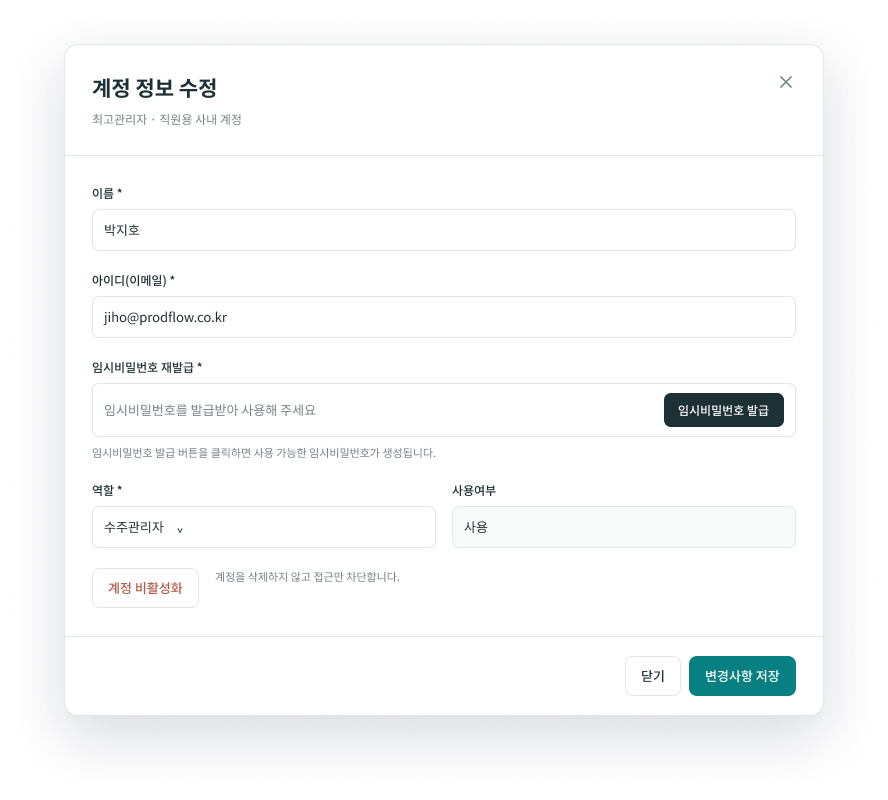

- 출력 및 입력 데이터 항목
    - 이름
    - 아이디(이메일)
    - 임시 비밀번호 재발급
    - 역할
    - 사용 여부
    - 계정 비활성화 버튼
    - 변경사항 저장 버튼
- 입력 데이터 및 검증 규칙 (Input Data & Validation)
    - 이름
        - 필수 입력
    - 아이디(이메일)
        - 필수 입력
        - 이메일 형식 검증
        - 다른 계정과 중복 불가
    - 역할
        - 필수 선택
    - 임시 비밀번호 재발급
        - 사용자가 비밀번호를 분실하거나 초기화가 필요한 경우 관리자에 의해 재발급
- 화면 제어 및 동작 규칙 (Behavior Rules)
    - 계정 관리 화면에서 계정을 선택한 후 계정 정보 수정 버튼 클릭 시 모달을 표시한다.
    - 기존 계정 정보를 조회하여 각 입력 필드의 초기값으로 표시한다.
    - 변경사항 저장 버튼 클릭 시 수정된 계정 정보를 저장한다.
    - 임시 비밀번호 재발급 버튼 클릭 시 새로운 임시 비밀번호를 생성한다.
    - 임시 비밀번호 재발급 시 기존 비밀번호는 더 이상 사용할 수 없다.
    - 비밀번호 재발급 후 해당 계정의 must_change_password 값을 TRUE로 변경한다.
    - 사용자는 새 임시 비밀번호로 로그인 후 비밀번호 변경 화면을 거쳐야 한다.
    - 계정 비활성화 버튼 클릭 시 계정을 삭제하지 않고 상태를 INACTIVE로 변경한다.
    - 비활성화된 계정은 로그인 및 서비스 접근이 차단된다.
    - 비활성 계정을 다시 사용할 경우 상태를 ACTIV로 변경할 수 있다.
    - 닫기 버튼 또는 X 버튼 클릭 시 변경 내용을 저장하지 않고 모달을 닫는다.
    - 수정 완료 후 계정 목록과 우측 계정 상세 정보를 갱신한다.

## 6. 거래처 화면

### 6.1 거래처 목록 화면 (`/clients`)

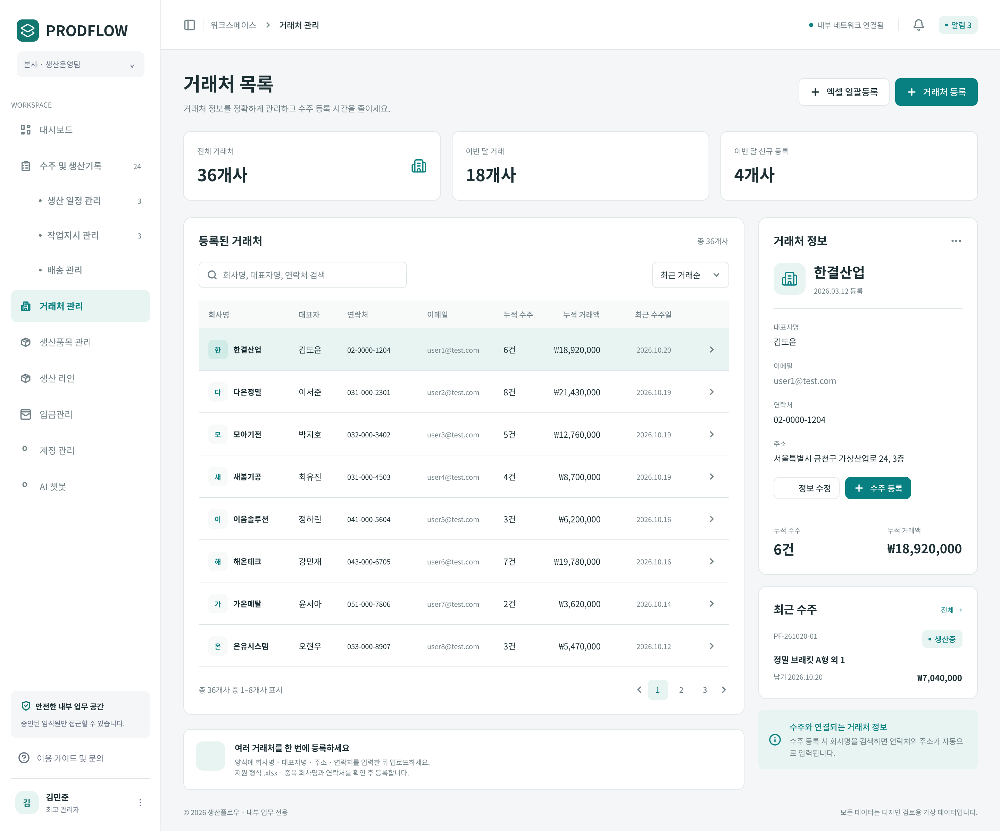

- 출력 데이터 항목 (Output Data):
    - 전체 거래처 수, 이번 달 거래처 계약 수, 이번 달 신규 거래처 수
    - 거래처 목록: 거래처명, 대표자, 연락처, 이메일, 누적 수주량, 누적 거래액, 최근 수주일
    - 거래처 정보 세션: 거래처명, 거래처 등록일, 대표자, 이메일, 연락처, 주소, 누적 수주량, 누적 거래액
    - 최근 수주 세션: 수주번호, 생산품목, 납기일, 수주 금액, 진행 상태
- 입력 데이터 및 검증 규칙 (Input Data & Validation):
    - 검색 영역
        - 아무 입력 없으면 리스트 전체 출력
        - 키워드 입력시 거래처명, 대표자, 연락처 칼럼을 탐색하여 해당 리스트 출력
- 화면 제어 및 동작 규칙 (Behavior Rules):
    - 거래처 리스트 `>` 버튼
    - 거래처 등록 버튼: 거래처 등록 페이지로 이동
    - 엑셀 일괄 등록 버튼: 파일 선택 다이얼로그를 엑셀 한정 확장자로 호출 후 엑셀 파일을 불러오면 파일 내용을 파싱
        - 성공적으로 파싱되면 거래처 정보 일괄 등록후 거래처 리스트 페이지 다시 호출
        - 실패하면 “형식이 잘못된 파일입니다.” 등의 팝업창을 띄움
    - 수주 등록 버튼: 수주 등록 페이지로 이동
    - 거래처 등록·수정·엑셀 일괄 등록·수주 등록은 수주 관리자, 최고 관리자만 버튼 노출.

### 6.2 거래처 상세 화면 (`/clients/{id}`)

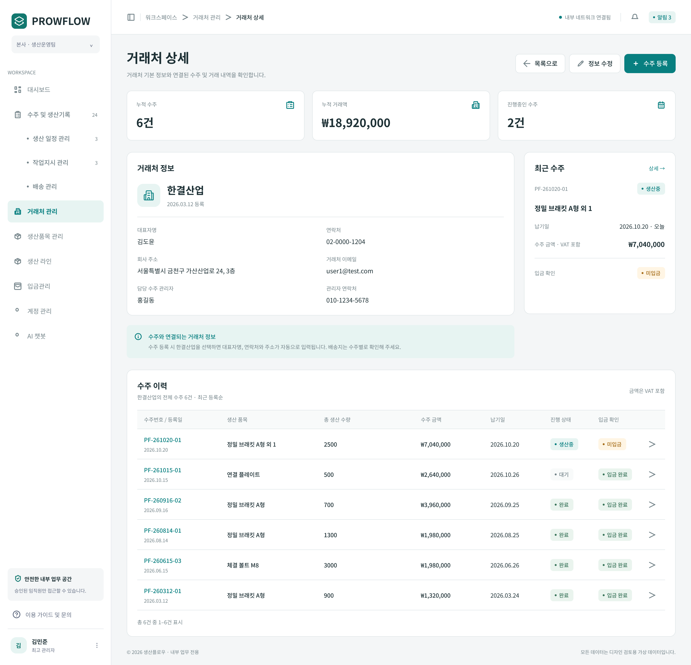

- 출력 데이터 항목 (Output Data):
    - 누적 수주 세션: 누적 수주, 생산중, 대기, 완료 수
    - 누적 거래액 세션: 누적 거래액
    - 진행중인 수주 세션: 진행중인 수주
    - 최근 수주: 수주번호, 수주물품, 수주 상태, 납기일, 수주금액, 입금 확인
    - 거래처 정보 세션: 거래처명, 거래처 등록일, 대표자명, 연락처, 회사주소, 이메일, 담당 수주 관리자, 관리자 연락처
    - 수주이력 세션: 수주번호/등록일, 수주물품, 수주 상태, 납기일, 수주금액, 입금 확인
- 화면 제어 및 동작 규칙 (Behavior Rules):
    - 목록으로 버튼: 거래처 리스트 페이지로 이동
    - 정보 수정 버튼: 거래처 정보 수정 페이지로 이동
    - 수주 등록 버튼: 수주 등록 페이지로 이동
    - 정보 수정·수주 등록 버튼은 수주 관리자, 최고 관리자만 버튼 노출

### 6.3 거래처 등록 페이지 (`/clients/new`)

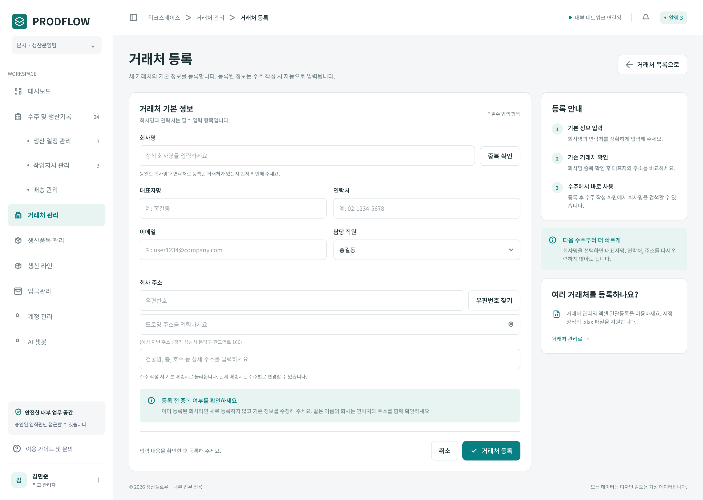

- 입력 데이터 및 검증 규칙 (Input Data & Validation):
    - 회사명, 대표자명, 연락처, 이메일: 필수 입력 영역
- 화면 제어 및 동작 규칙 (Behavior Rules):
    - 거래처 목록으로 버튼: 거래처 리스트로 이동
    - 회사명 - 중복확인: 회사명 입력후 해당 회사명과 중복되는지 확인
    - 담당 직원 드롭박스: 수주 관리자만 리스트 출력
    - 취소 버튼: 거래처 리스트 페이지로 이동
    - 거래처 등록 버튼: 거래처 정보 등록 후 거래처 리스트 이동

## 7. 생산품목 화면

### 7.1 생산품목 목록 화면 (`/products` )

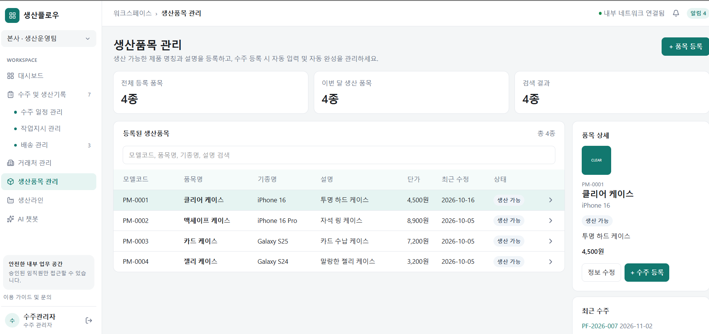

- 출력 데이터 항목 (Output Data):
    - 검색 영역: 품목명, 설명 검색창
    - 품목 목록: 모델 코드, 품목명, 제품명, 설명, 단가, 최근수정일, 상태
    - 등록·수정 폼: 모델 코드(중복 확인), 제품명, 기종, 제품 설명, 기준 단가, 첨부파일 업로드
    - 상세: 품목 정보, 관련 수주 이력
- 화면 제어 및 동작 규칙 (Behavior Rules):
    - 등록·수정·상태 변경은 수주 관리자, 최고 관리자만 버튼 노출.

### 7.2 생산품목 등록 화면 (`/products/new` )

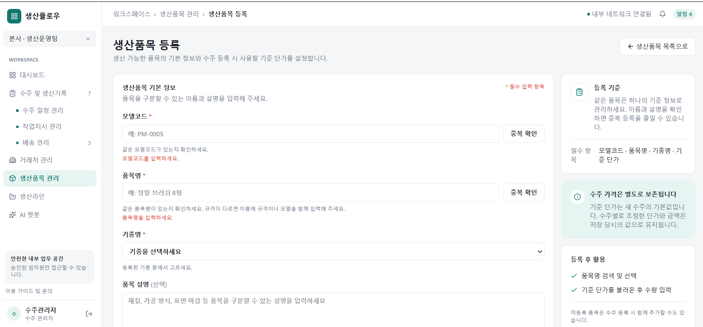

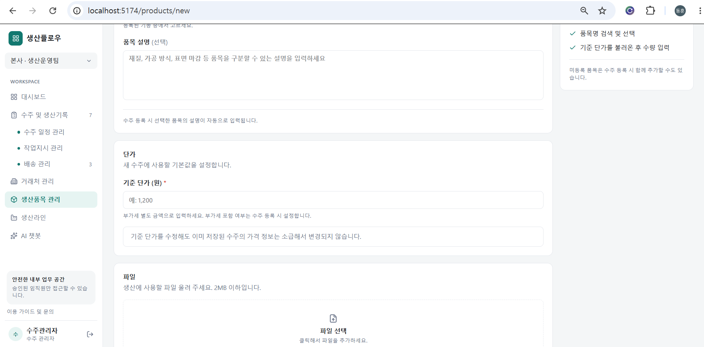

생산 가능한 품목의 기본 정보를 등록하고, 수주 등록 시 사용할 기준 단가를 설정하는 화면이다.

- 출력 데이터 항목 (Output Data):
    - 상단: 경로`워크스페이스 > 생산품목 관리 > 생산품목 등록`, 제목,`생산품목 목록으로`버튼
    - 입력 폼: 모델코드, 품목명, 기종명, 품목 설명, 기준 단가, 파일
    - 오른쪽 안내: 필수 항목, 수주 단가 보존 안내, 수주 등록에서 이 품목을 쓰는 방법
- 입력 데이터 및 검증 규칙 (Input Data & Validation):
    - 모델코드. 필수. 예:`PM-0005`.`중복 확인`으로 기존 모델코드와 비교하고, 이미 있으면 등록을 막는다.
    - 품목명. 필수. 예:`쉬폰 브라이트형`.
    - 기종명. 필수. 등록된 기종 목록에서만 선택한다.
    - 품목 설명. 선택. 재질, 가공 방식, 표면 마감처럼 품목을 구분하는 설명.
    - 기준 단가(원). 필수. 예:`1,200`. 0보다 큰 정수. 부가세 별도 금액이며, 부가세 포함 여부는 수주 등록 시 설정한다.
    - 파일. 선택. 생산에 사용할 파일. 2MB 이하.
- 화면 제어 및 동작 규칙 (Behavior Rules):
    - 등록 버튼은 수주 관리자, 최고 관리자에게만 보인다.
    - 등록 직후 상태는 생산가능이다. 이 화면에서 생산중단 품목을 만들지 않는다.
    - 파일은 S3에 올리고, 화면에는 파일 이름만 보여 준다. 저장 주소는 화면에 노출하지 않는다.
    - 기준 단가를 나중에 수정해도 이미 저장된 수주의 단가와 금액은 바뀌지 않는다.
    - 등록이 끝나면 생산품목 목록으로 이동한다.

### 7.3 생산품목 상세 화면 (`/products/{productId}` )

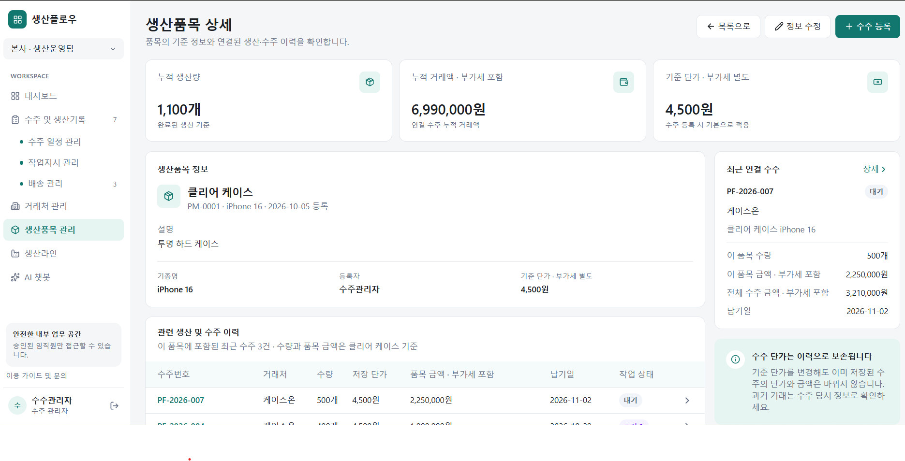

품목의 기준 정보와 연결된 생산·수주 이력을 확인하는 화면이다.

- 출력 데이터 항목 (Output Data):
    - 상단: 경로`워크스페이스 > 생산품목 관리 > 생산품목 상세`, 제목`생산품목 상세`, 버튼`목록으로`,`정보 수정`,`수주 등록`
    - 요약 카드: 누적 생산량(완료된 생산 수량, 예:`1,100개`), 누적 거래액(연결된 수주 누적, 부가세 포함), 기준 단가(수주 등록 시 기본 단가, 부가세 별도)
    - 생산품목 정보: 품목명, 모델코드, 기종명, 등록일, 품목 설명, 등록자, 기준 단가(부가세 별도)
    - 최근 연결 수주: 이 품목이 포함된 가장 최근 수주 1건. 수주번호, 진행 상태, 거래처, 품목명·기종, 이 품목 수량, 이 품목 금액(부가세 포함), 전체 수주 금액(부가세 포함), 납기일
    - 관련 생산 및 수주 이력: 수주번호, 거래처, 수량, 저장 단가, 품목 금액(부가세 포함), 납기일, 작업 상태. 수량·저장 단가·품목 금액은 이 품목 한 줄 기준
- 입력 데이터 및 검증 규칙 (Input Data & Validation):
    - 이 화면에는 입력 폼이 없다. 선택한 품목의 정보와 연결 수주만 조회한다.
    - 이력의 저장 단가는 수주 당시`order_product.unit_price`를 그대로 보여 준다.
- 화면 제어 및 동작 규칙 (Behavior Rules):
    - `목록으로`는 생산품목 목록으로 이동한다.
    - `정보 수정`과 상태 변경은 수주 관리자, 최고 관리자에게만 보인다.
    - `수주 등록`은 이 품목을 선택한 상태로 수주 등록 화면으로 이동한다. 생산가능 품목만 넘긴다.
    - 최근 연결 수주의`상세`, 이력의 수주번호를 누르면 해당 수주 상세로 이동한다.
    - 기준 단가를 바꿔도 이미 저장된 수주의 단가와 금액은 바뀌지 않는다.

## 8. 견적서 화면

### 8.1 견적서 목록 화면(`/quotations`)

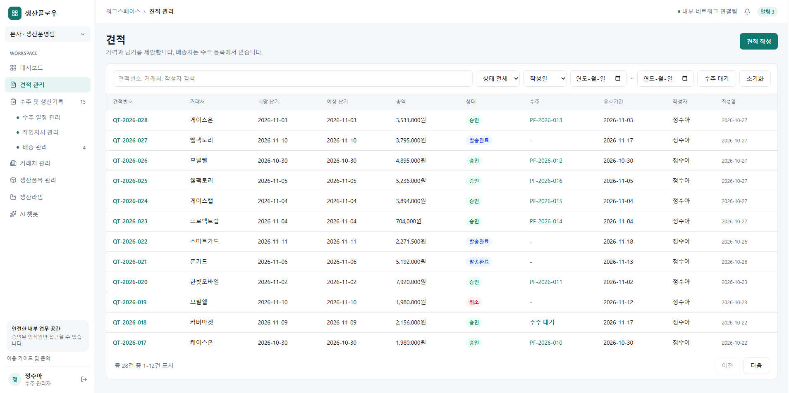

견적의 가격, 납기, 상태, 수주 연결 여부를 찾는 화면이다.

- 출력 데이터 항목 (Output Data):
    - 상단: 워크스페이스 > 견적 관리, 제목 `견적`, 설명, 버튼 `견적 작성`(수주 담당·최고 관리자).
    - 필터: 견적번호·거래처·작성자 검색, 상태, 날짜 기준(작성일·희망 납기·예상 납기·유효기간), 시작일~종료일, `수주 대기`, `초기화`.
    - 표: 견적번호, 거래처, 희망 납기, 예상 납기, 총액, 상태, 수주, 유효기간, 작성자, 작성일.
    - 하단: `총 N건 중 a-b건 표시`, `이전`·`다음`. 한 페이지 12건.
- 입력 데이터 및 검증 규칙 (Input Data & Validation):
    - 견적 내용은 저장하지 않는다. 검색어와 필터만 받는다.
    - 날짜는 선택한 기준(작성일, 희망 납기, 예상 납기, 유효기간)의 날짜와 비교한다.
- 화면 제어 및 동작 규칙 (Behavior Rules):
    - `견적 작성`은 `/quotations/new`로 이동한다.
    - 견적번호는 견적 상세로 이동한다.
    - 수주 칸에 수주번호가 있으면 수주 상세로 이동한다. 승인된 견적이고 수주가 없으면 `수주 대기`로 표시하고, 권한이 있으면 수주 등록으로 이동한다.
    - `수주 대기` 필터는 승인 상태이면서 취소되지 않은 수주가 없는 견적만 보여 준다. `/quotations?pending=1`로 열면 이 필터가 켜진다.
    - 검색, 필터, 초기화를 바꾸면 1페이지로 돌아간다.

### 8.2 견적서 등록 화면(`/quotations/new`)

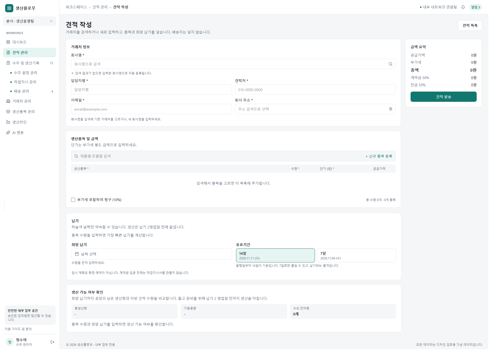

거래처, 품목, 희망 납기, 유효기간을 입력해 견적을 발송하는 화면이다. 배송지는 입력하지 않는다.

- 출력 데이터 항목 (Output Data):
    - 상단: 제목 `견적 작성`, 설명, 버튼 `견적 목록`.
    - 거래처 정보: 회사명 검색, 담당자명, 연락처, 이메일, 회사 주소.
    - 생산품목 및 금액: 제품명·모델명 검색, 품목 행(생산품목, 수량, 단가, 공급가격), 부가세 포함 여부, 금액 요약(공급가액, 부가세, 총액, 계약금 50%, 잔금 50%).
    - 납기: 가장 빠른 납기, 희망 납기 달력, 유효기간 `14일`·`7일`.
    - 생산 가능 여부: 월 생산량, 가용 용량, 수요 잔여량.
- 입력 데이터 및 검증 규칙 (Input Data & Validation):
    - 회사명은 등록된 거래처를 검색해 고른다. 검색 결과가 없으면 입력한 회사명으로 발송할 때 거래처가 만들어진다.
    - 담당자명, 연락처, 이메일, 주소는 선택한 거래처 값으로 채워지고, 발송 전에 고칠 수 있다. 네 항목 모두 필수다.
    - 품목을 고르면 행이 추가된다. 같은 품목은 한 번만 추가된다. 행의 X로 삭제한다. 품목이 없으면 발송할 수 없다.
    - 수량은 1개 이상이다. 단가는 품목 단가로 시작하고, 이 화면에서 바꿀 수 있다.
    - 희망 납기는 오늘 이후이면서 가장 빠른 납기 이후인 날만 고를 수 있다. 그보다 이른 날은 달력에서 선택할 수 없다.
    - 유효기간은 발송일부터 14일 또는 7일만 가능하다. 생산 시작일과 따로 정한다.
- 화면 제어 및 동작 규칙 (Behavior Rules):
    - 수주 담당과 최고 관리자만 들어온다.
    - 금액 요약은 넓은 화면에서 스크롤해도 오른쪽에 붙어 있다.
    - 희망 납기까지 수량을 만들 수 있으면 예상 납기는 희망 납기와 같다. 생산 완료는 출고 준비를 위해 납기보다 2영업일 앞이다.
    - 다른 견적의 임시 계획은 공장 생산량을 차지하지 않는다. 이미 등록된 수주만 차지한다.
    - `견적 발송` 후 상태는 발송이다. 이 단가는 유효기간 안에만 승인할 수 있다.

### 8.3 견적서 상세 화면(`/quotations/{quotationId}`)

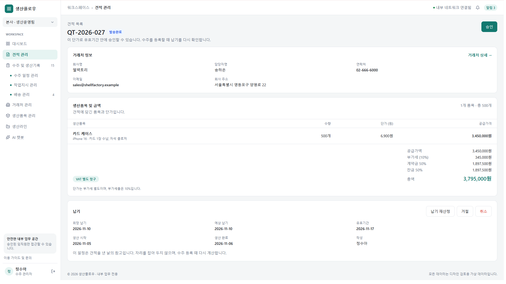

발송한 견적의 거래처, 품목, 금액, 납기를 보고 승인, 거절, 취소하거나 수주 등록으로 이동하는 화면이다.

- 출력 데이터 항목 (Output Data):
    - 상단: `견적 목록` 링크, 견적번호, 상태, 상태 안내 문장, 다음 작업 버튼.
    - 거래처 정보: 회사명, 담당자명, 연락처, 이메일, 회사 주소, `거래처 상세`.
    - 생산품목 및 금액: 품목 수, 총 수량, 생산품목, 수량, 단가, 공급가격, 공급가액, 부가세 10%, 계약금 50%, 잔금 50%, 총액, VAT 포함 또는 VAT 별도 청구.
    - 납기: 희망 납기, 예상 납기, 유효기간, 생산 시작, 생산 완료, 작성자. 예상 납기가 오늘이면 `오늘 납기`. 이전에 계산한 납기가 있으면 접어서 보여 준다.
- 입력 데이터 및 검증 규칙 (Input Data & Validation):
    - 품목, 단가, 수량은 이 화면에서 수정하지 않는다.
    - `납기 재산정`은 발송 상태에서만 희망 납기를 다시 고른다. 유효기간이 지난 발송 견적은 승인할 수 없다.
- 화면 제어 및 동작 규칙 (Behavior Rules):
    - 발송 상태이고 수주 담당 또는 최고 관리자이면 `승인`, `납기 재산정`, `거절`, `취소`가 보인다.
    - 승인 상태이고 수주가 없으면 `수주 등록`으로 `/orders/new?quotationId=`에 간다. 수주가 있으면 그 수주 상세로 간다.
    - 만료 상태이면 `새 견적 작성`만 가능하다. 거절·취소된 견적으로는 수주를 만들지 않는다.
    - 납기 재산정은 희망 납기, 예상 납기, 임시 생산 계획만 바꾼다. 단가, 수량, 유효기간, 상태는 그대로다.
    - 승인된 견적의 납기, 단가, 수량은 바꾸지 않는다.
    - 견적의 생산 계획은 공장 일정을 점유하지 않는다. 수주를 등록할 때 납기를 다시 계산한다.

## 9. 수주 화면

### 9.1 수주 목록 화면(`/orders`)

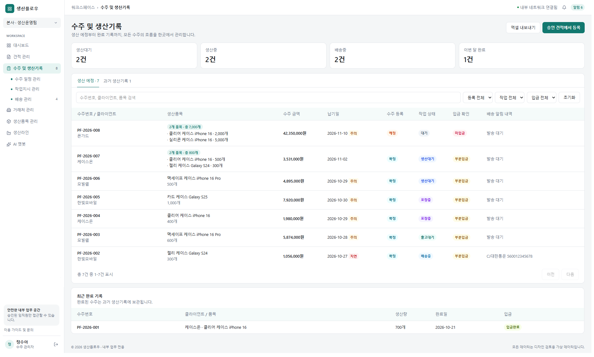

진행 중인 수주와 완료된 생산 기록을 한 목록에서 찾는 화면이다.

- 출력 데이터 항목 (Output Data):
    - 상단: 제목 `수주 및 생산기록`, 설명, `엑셀 내보내기`, `승인 견적에서 등록`.
    - 요약: 생산대기, 생산중, 배송중, 이번 달 완료 건수.
    - 탭: `생산 예정`, `과거 생산기록`.
    - 필터: 수주번호·클라이언트·품목 검색, 등록(예정·확정), 작업 상태, 입금, `초기화`.
    - 표: 수주번호·클라이언트, 생산품목, 수주 금액, 납기일, 수주 등록, 작업 상태, 입금 확인, 배송 알림 내역.
    - 하단: `총 N건 중 a-b건 표시`, `이전`·`다음`. 한 페이지 8건.
    - 최근 완료 기록: 수주번호, 클라이언트·품목, 생산량, 완료일, 입금. 최근 3건.
- 입력 데이터 및 검증 규칙 (Input Data & Validation):
    - 수주 내용은 저장하지 않는다.
    - `생산 예정`은 완료와 취소를 제외한다. `과거 생산기록`은 완료만 보여 준다.
- 화면 제어 및 동작 규칙 (Behavior Rules):
    - 수주번호는 수주 상세로 이동한다.
    - `승인 견적에서 등록`은 `/quotations?pending=1`로 이동한다. 승인됐지만 수주가 없는 견적만 보인다.
    - 납기가 임박하면 `주의`, 납기를 지났으면 `지연`이 납기일 옆에 표시된다.
    - 엑셀은 화면의 검색·필터와 관계없이 수주 전체를 CSV로 받는다.

### 9.2 수주 등록 화면(`/orders/new`)

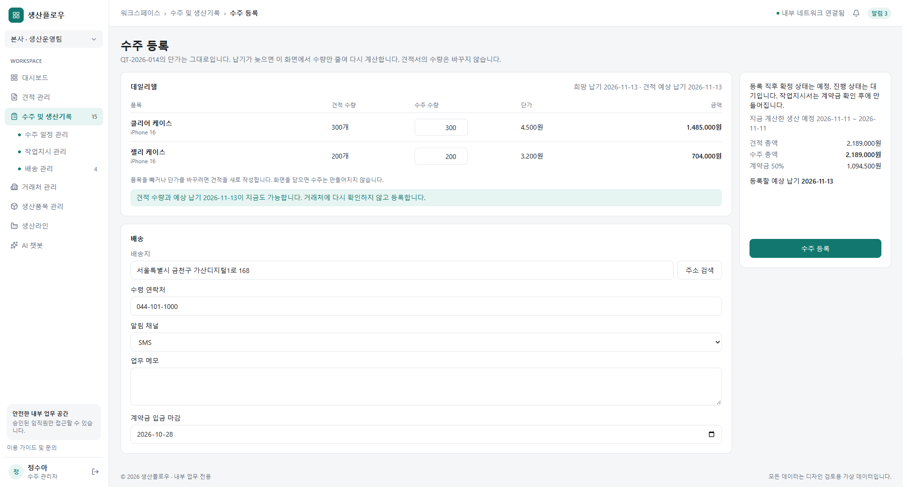

승인된 견적의 단가는 유지하고, 수량·납기·배송지·계약금 입금 마감을 확인한 뒤 수주를 만드는 화면이다.

- 출력 데이터 항목 (Output Data):
    - 상단: 제목 `수주 등록`, 원본 견적번호와 안내. 제목 아래에서 왼쪽 내용과 오른쪽 박스가 같은 높이로 시작한다.
    - 품목: 거래처, 희망 납기, 견적 예상 납기, 견적 수량, 수주 수량, 단가, 금액.
    - 납기 안내: 수량과 견적 예상 납기를 다시 계산한 결과 문장. 견적 예상 납기까지 만들 수 없을 때만 `납기 {날짜}` 버튼과 달력이 나온다.
    - 배송: 배송지, 수령 연락처, 알림 채널, 업무 메모, 계약금 입금 마감.
    - 오른쪽: 등록 후 상태 안내, 생산 예정 기간, 견적 총액, 수주 총액, 계약금 50%, 등록할 예상 납기, 거래처 동의 체크, `수주 등록`.
- 입력 데이터 및 검증 규칙 (Input Data & Validation):
    - 승인된 견적에서만 들어온다. 이미 수주가 있으면 새로 만들지 않고 기존 수주로 안내한다.
    - 품목을 빼거나 추가하지 않는다. 단가도 바꾸지 않는다. 품목이나 단가를 바꾸려면 견적을 새로 작성한다.
    - 수주 수량은 1개 이상, 견적 수량 이하다. 견적 수량보다 늘릴 수 없다.
    - 견적 수량과 견적 예상 납기가 그대로 가능하면 날짜를 고르지 않는다. 등록 납기는 견적 예상 납기다. 안내 문장은 "견적 수량과 예상 납기 {날짜}이 지금도 가능합니다. 거래처에 다시 확인하지 않고
      등록합니다."
    - 수량을 줄여 견적 예상 납기가 다시 가능하면 날짜를 고르지 않는다. 등록 납기는 견적 예상 납기다. 안내 문장은 "수량을 줄이면 견적 예상 납기 {날짜}이 가능합니다. 거래처가 이 수량에 동의한 뒤에
      등록합니다."
    - 견적 예상 납기까지 만들 수 없으면 가장 빠른 날 이후만 고른다. 처음 값은 가장 빠른 날이다. 안내 문장은 "견적 예상 납기 {날짜}은 이 수량으로 어렵습니다. {가장 빠른 날}부터 고를 수 있습니다.
      수량을 더 줄이거나, 거래처가 받은 날짜를 선택한 뒤에 등록합니다."
    - 배송지와 수령 연락처는 필수다. 계약금 입금 마감은 오늘 이후다.
    - 수량이 줄었거나 납기가 견적 예상 납기와 달라지면 동의 체크 없이 등록할 수 없다.
- 화면 제어 및 동작 규칙 (Behavior Rules):
    - 수주 담당과 최고 관리자만 들어온다.
    - 화면을 닫으면 수주는 만들어지지 않는다. 승인된 견적의 수량, 단가, 납기는 바꾸지 않는다.
    - 등록하면 수주 등록은 예정, 작업 상태는 대기이다. 작업지시서는 계약금 확인 후에 만든다.
    - 선택한 납기보다 일찍 생산해 보관하지 않는다. 생산 시작과 완료는 등록할 예상 납기에 맞춘다.
    - 계약금 입금 마감일까지 입금이 없고 작업 상태가 대기이면 수주는 취소된다.

### 9.3 수주 상세 화면(`/orders/{customerOrderId}`)

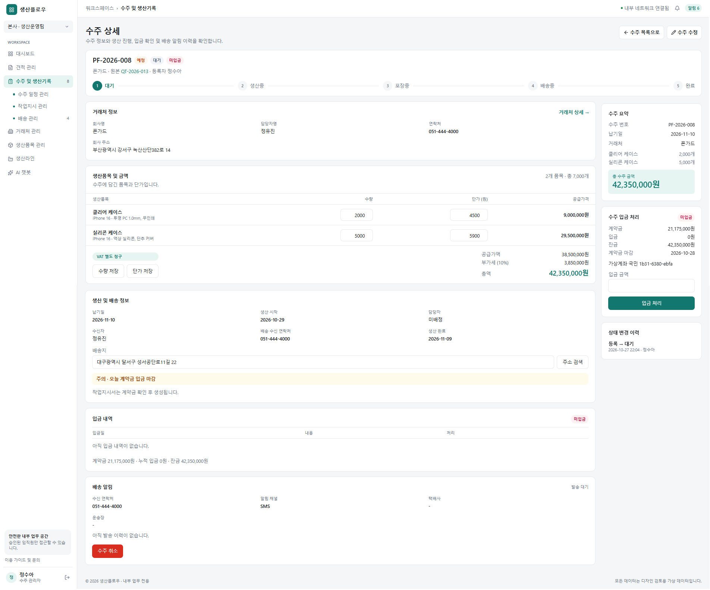

수주의 거래처, 품목, 납기, 배송, 계약금과 잔금, 상태 변경 이력을 보고 다음 작업을 처리하는 화면이다.

- 출력 데이터 항목 (Output Data):
    - 상단: 제목 `수주 상세`, 설명, `수주 목록으로`, `수주 수정`.
    - 요약: 수주번호, 예정·확정, 작업 상태, 입금 상태(미입금·계약금 입금·입금완료), 거래처, 원본 견적, 등록자.
    - 진행: 대기, 생산중, 포장중, 배송중, 완료.
    - 거래처 정보: 회사명, 담당자명, 연락처, 회사 주소, `거래처 상세`.
    - 생산품목 및 금액: 품목, 수량, 단가, 공급가격, 공급가액, 부가세, 총액. 수정할 수 있으면 저장 버튼.
    - 생산 및 배송 정보: 납기일, 생산 시작, 담당자, 수신자, 배송 수신 연락처, 생산 완료, 배송지, 희망 납기(견적 희망 납기와 다를 때만), 업무 메모, 지연·주의, 작업지시.
    - 입금 내역: 입금일, 내용, 처리, 계약금, 누적 입금, 잔금.
    - 배송 알림: 수신 연락처, 알림 채널, 택배사, 운송장, 발송 이력. 상태에 따라 `포장 완료`, `출고 대기`, `출고`, `배송 완료`, `수주 취소`.
    - 오른쪽: 수주 요약(번호, 납기, 거래처, 품목 수량, 총액), 수주 입금 처리(계약금, 입금, 잔금, 계약금 마감, 가상계좌, 입금 금액), 상태 변경 이력.
- 입력 데이터 및 검증 규칙 (Input Data & Validation):
    - 수량은 포장 전까지만 1개 이상으로 저장한다. 바꾼 수량으로 현재 납기까지 만들 수 없으면 가능한 날짜를 확인한 뒤에 저장한다.
    - 단가는 작업 상태가 대기일 때만 저장한다.
    - 입금 금액은 0원보다 크고, 아직 받지 않은 금액을 넘지 않는다.
    - 출고는 출고 대기에서 택배사와 운송장을 입력한 뒤에 한다.
    - 수주 취소는 입금 전이고 작업 상태가 대기인 수주만 가능하다. 취소 사유가 필요하다.
- 화면 제어 및 동작 규칙 (Behavior Rules):
    - `수주 수정`은 아래 품목 영역으로 이동한다. 별도의 수정 화면은 없다.
    - 상단에는 배송 시작 버튼을 두지 않는다. 출고는 배송 알림 영역에서 한다.
    - 계약금이 확인되면 수주 등록이 예정에서 확정으로 바뀌고 작업지시서가 만들어진다.
    - 계약금 마감은 잔금을 받는 날이 아니다. 계약금 50%를 받아야 하는 마감일이다.
    - 잔금은 배송 완료 후에 입금한다.
    - 상태 변경은 오른쪽 이력에, 입금은 입금 내역에 남는다.

## 10. 입금 관리 화면 (`/payments`)

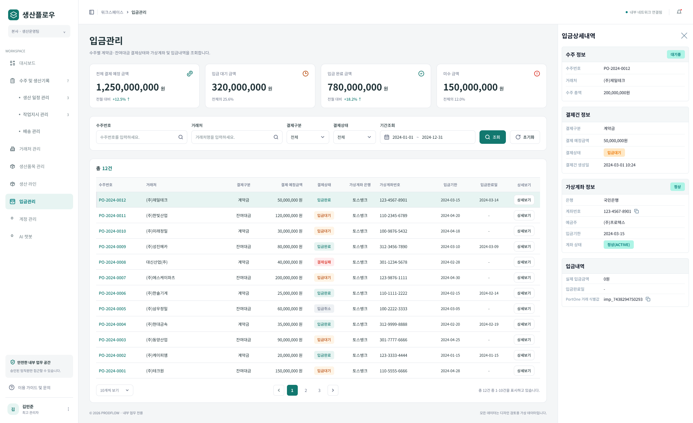

- 출력 데이터 항목 (Output Data)
  -
        1. 입금 현황 요약 카드

        - 전체 결제 예정 금액
        - 입금 대기 금액
        - 입금 완료 금액
        - 미수 금액
        - 전월 대비 증감률 및 증감 표시
    -
        2. 검색 및 필터 영역

        - 수주번호 검색 필드
        - 거래처 검색 필드
        - 결제구분 필터
            - 전체
            - 계약금
            - 잔여대금
        - 결제상태 필터
            - 전체
            - 입금대기
            - 입금완료
            - 결제실패
            - 입금취소
        - 기간조회 시작일 및 종료일
        - 조회 버튼
        - 초기화 버튼
    -
        3. 입금 목록 테이블

        - 수주번호
        - 거래처
        - 결제구분
        - 결제 예정금액
        - 결제상태
        - 가상계좌 은행
        - 가상계좌번호
        - 입금기한
        - 입금완료일
        - 상세보기 버튼
    -
        4. 페이지네이션

        - 페이지당 표시 건수
        - 현재 페이지 및 페이지 이동 버튼
        - 전체 조회 건수
- 입력 데이터 및 검증 규칙 (Input Data & Validation)
    - 수주번호는 해당 수주를 식별할 수 있는 값으로 검색한다.
    - 거래처명은 거래처명을 기준으로 검색한다.
    - 결제구분과 결제상태는 선택한 조건에 해당하는 데이터만 조회한다.
    - 기간조회는 시작일과 종료일을 기준으로 조회한다.
    - 시작일은 종료일보다 늦을 수 없다.
    - 검색 조건을 입력하지 않은 경우 다른 필터 조건에 해당하는 전체 데이터를 조회한다.
    - 검색 결과가 없는 경우 조회 결과가 없음을 안내한다.
- 화면 제어 및 동작 규칙 (Behavior Rules)
    - 입금관리 권한이 있는 사용자만 해당 화면에 접근할 수 있다.
    - 화면 진입 시 입금 현황 요약 카드와 입금 목록을 조회한다.
    - 요약 카드는 정의된 집계 기준에 따라 결제 예정, 입금 대기, 입금 완료 및 미수 현황을 표시한다.
    - 조회 버튼 클릭 시 입력한 검색 조건과 필터를 적용하여 목록을 갱신한다.
    - 초기화 버튼 클릭 시 검색 조건과 필터를 초기 상태로 되돌린다.
    - 결제구분 및 결제상태는 시스템에 저장된 결제 정보를 기준으로 표시한다.
    - 상세보기 버튼 클릭 시 해당 결제 건의 입금 상세내역 사이드 패널을 표시한다.
    - 페이지 이동 또는 페이지당 표시 건수 변경 시 해당 조건에 맞는 목록을 조회한다.
    - 결제상태가 변경된 경우 목록과 관련 요약 정보를 갱신하여 최신 상태를 표시한다.

## 11. 작업지시서

### 11.1 작업지시서 관리 화면(`/work-orders`)

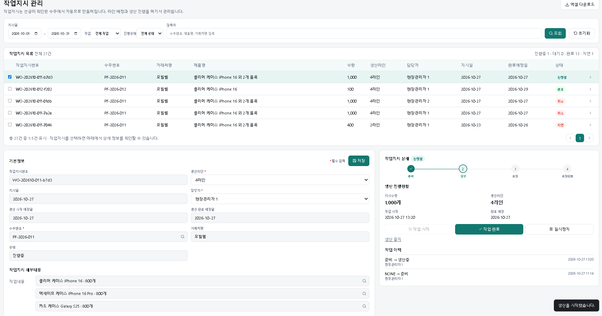

- 출력 데이터 항목 (Output Data):
    - 작업지시서 목록: 작업 지시 번호, 수주번호, 거래처명, 품목, 수량, 생산 라인, 담당자, 지시일, 완료 예정일, 작업 상태
    - 상세: 작업 기본 정보, 작업 내용, 작업 조건, 라인 배정 내역, 생산 진행 현황(준비·생산·포장·포장 완료)
    - 라인 배정 모달: 가동 가능하고 다른 작업에 배정되지 않은 라인 목록, 라인별 할당 수량
- 화면 제어 및 동작 규칙 (Behavior Rules):
    - 모든 역할이 조회 가능하며 라인 배정, 생산 시작·중지·일시정지·완료는 생산 현장 관리자, 최고 관리자만 가능.
    - 라인의 하루 생산량을 넘는 수량은 다른 비어 있는 라인에 나눠 배정 가능.
    - 생산 시작 시 작업 상태는 생산, 수주 상태는 생산중으로 변경.
    - 생산 단계에서 작업 완료시 포장 단계로 이동, 수주 상태는 포장중으로 변경
    - 포장 단계에서 작업 완료시 상태는 출고 대기 상태로 변경
    - 라인 고장 시 다른 가동 가능 라인으로 변경.
    - 예정보다 일찍 끝나면 남은 가용 생산량에 반영

## 12. 라인관리

### 12.1 생산라인 관리 화면(`/lines`)

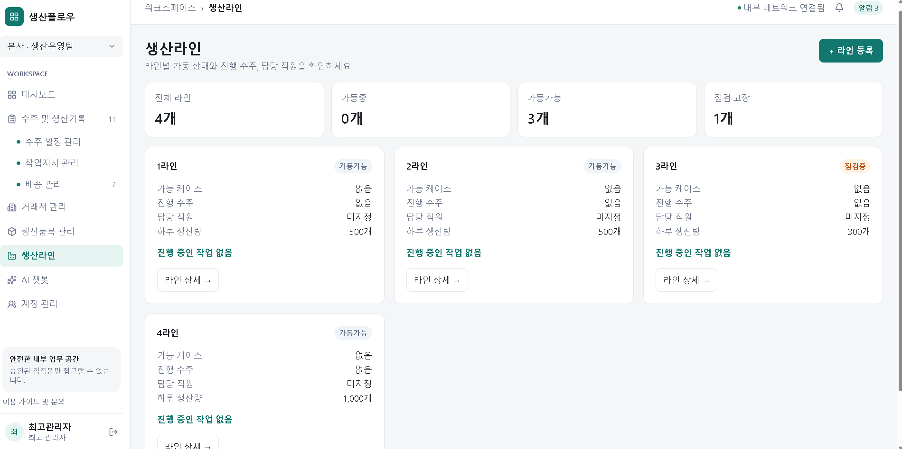

- 출력 데이터 항목 (Output Data):
    - 전체 라인 현황 카드: 라인명, 상태 뱃지(가동 가능/가동 중/점검/고장), 일일 생산 가능 수량, 현재 작업 중인 수주
    - 라인 상세: 라인 정보, 도입일, 현재·예정 작업지시서 목록, 담당 직원
    - 등록·수정 폼: 라인명, 일일 생산 가능 수량, 도입일
- 화면 제어 및 동작 규칙 (Behavior Rules):
    - 모든 역할이 조회 가능.
    - 라인 상태 변경은 생산 현장 관리자, 최고 관리자만 가능.
    - 라인 등록·정보 수정은 권한 매트릭스에 정해진 역할만 가능.
    - 작업중 상태 변경시, 다른 라인으로 배정 후 진행
    - 점검 또는 고장 상태 라인은 신규 배정 목록에서 제외.

### 12.2 생산 라인 등록 화면(`/lines/new)`

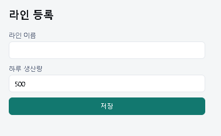

- 출력 데이터 항목 (Output Data):
    - 라인 이름: 빈 값, 텍스트 입력
    - 하루 생산량: 초기값 500, 숫자 입력
    - 저장 버튼
- 화면 제어 및 동작 규칙 (Behavior Rules):
    - 라인 이름이 비어있으면 안됨
    - 하루 생산량은 1 이상만 저장
    - 라인 이름은 중복 허용 안됨
    - 최고관리자에게만 등록 권한 부여

### 12.3 생산 라인 수정 화면(`/lines/edit)`

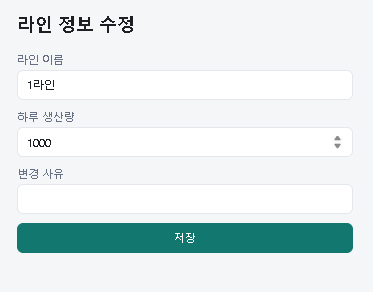

- 출력 데이터 항목 (Output Data):
    - 라인 이름: 현재 이름, 텍스트 입력
    - 하루 생산량: 현재 수량, 숫자 입력
    - 변경 사유: 빈 값, 텍스트 입력
    - 저장 버튼
- 화면 제어 및 동작 규칙 (Behavior Rules):
    - 라인 이름이 비어있으면 안됨
    - 하루 생산량은 1이상만 저장
    - 라인 이름은 중복 허용 안됨
    - 사유가 비어 있으면 안됨
    - 최고관리자에게만 수정 권한 부여

### 12.4. 생산 라인 상세 화면 (`/lines/{id}`)

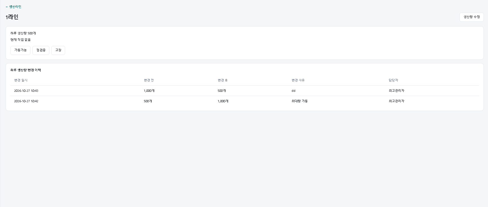

- **출력 데이터 항목 (Output Data):**
    - 라인 기본 정보: 라인명, 일일 생산 가능 수량, 현재 작업 여부
    - 라인 상태 변경 버튼: 가동 가능, 점검 중, 고장
    - 생산 능력 변경 이력: 변경 일시, 변경 전 생산 능력, 변경 후 생산 능력, 변경 사유, 변경 담당자
- 화면 제어 및 동작 규칙 (Behavior Rules):
    - 최고관리자만, 생산량 수정 가능하며, 변경 사유를 입력
    - 사용자는 라인 상세 정보와 생산 능력 변경 이력을 조회
    - 라인 상태 변경 시 현재 라인 상태를 갱신
    - 생산 능력 변경 이력은 수정하거나 삭제 불가

## 13. 캘린더

### 13.1 생산 일정 캘린더 화면(`/production/calendar`)

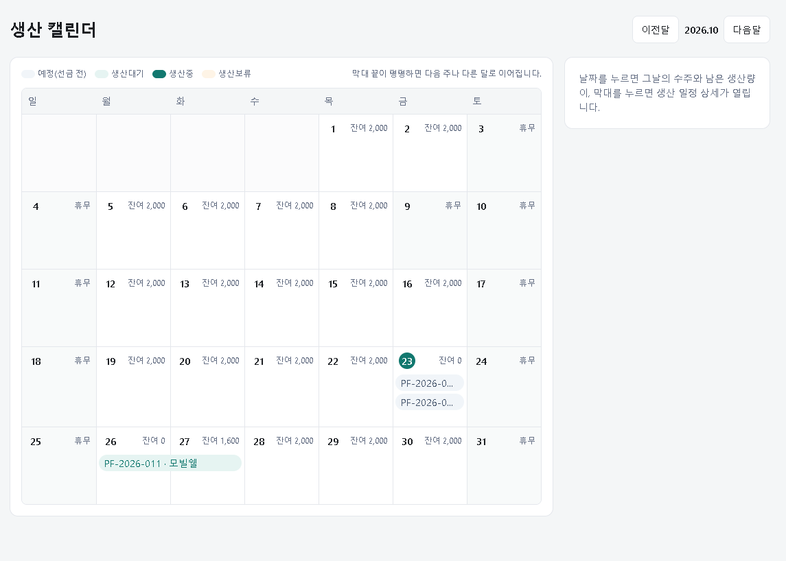

- 출력 데이터 항목 (Output Data):
    - 라인별 일정 막대(WBS): 작업지시서 시작 예정일부터 완료 예정일까지
    - 수주번호와 거래처명 표시
    - 가용생산량이 캘린더에 표시
- 화면 제어 및 동작 규칙 (Behavior Rules):
    - 모든 역할이 조회 가능.
    - 일정 막대 클릭 시 작업지시서 상세로 이동.
    - 납기 지연이 예상되는 작업은 강조 색상으로 표시.

## 14. 배송 관리 화면 (`/shipments`)

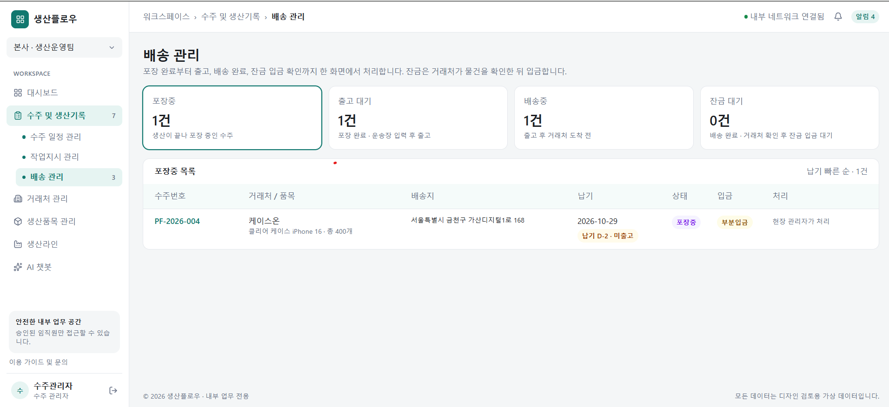

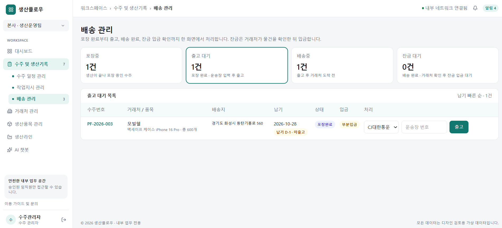

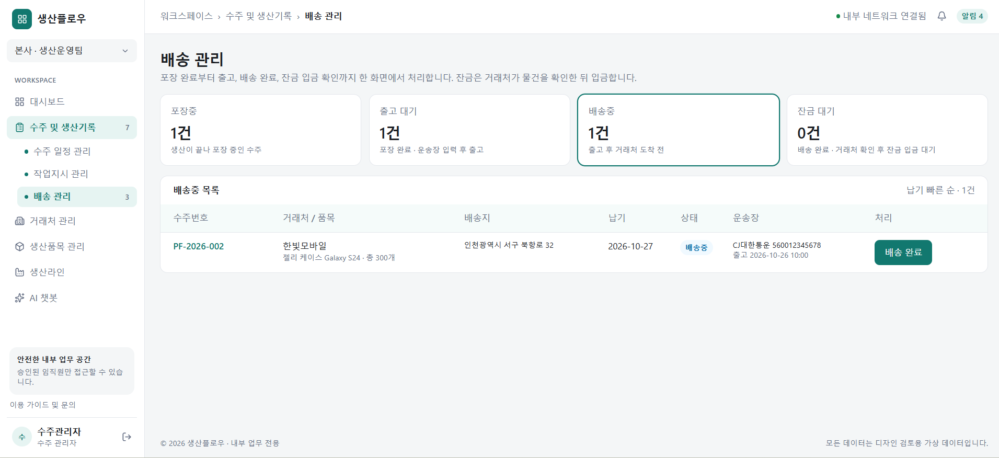

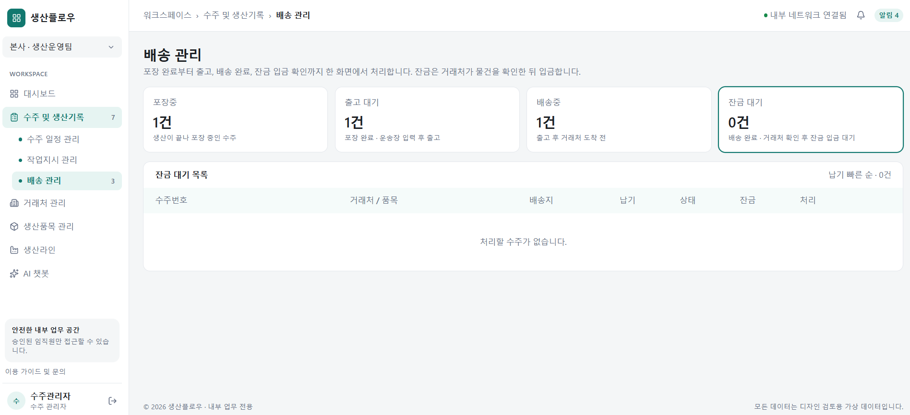

포장 완료부터 출고, 배송 완료, 잔금 입금 확인까지 한 화면에서 처리한다. 잔금은 거래처가 물건을 확인한 뒤 입금한다.

- 출력 데이터 항목 (Output Data):
    - 상단: 경로`워크스페이스 > 수주 및 생산기록 > 배송 관리`, 제목`배송 관리`
    - 상태 카드 4개: 포장중(생산이 끝나 포장 중인 건수), 출고 대기(포장 완료 후 운송장 입력·출고 대상 건수), 배송중(출고 후 도착 전 건수), 잔금 대기(배송 완료 후 잔금 입금을 기다리는 건수)
    - 목록 정렬 표시:`납기 빠른 순 · N건`
    - 포장중 목록: 수주번호, 거래처/품목(회사명, 품목명, 기종, 총 수량), 배송지, 납기(날짜와`납기 D-n · 미출고`뱃지), 상태(`포장중`), 입금(`부분입금`등 현재 입금 상태), 처리(
      `현장 관리자가 처리`)
    - 출고 대기 목록: 같은 열. 상태 뱃지는`포장완료`. 처리 칸은 택배사 선택, 운송장 번호 입력,`출고`버튼
    - 배송중 목록: 수주번호, 거래처/품목, 배송지, 납기, 상태(`배송중`), 운송장(택배사 이름, 운송장 번호, 집하 시각), 처리(`배송 완료`버튼)
    - 잔금 대기 목록: 수주번호, 거래처/품목, 배송지, 납기, 상태, 잔금, 처리. 잔금이 남은 배송 완료 수주만 보여 준다. 대상이 없으면`처리할 수주가 없습니다.`
- 입력 데이터 및 검증 규칙 (Input Data & Validation):
    - 출고 대기에서만 입력한다. 택배사와 운송장 번호가 모두 있어야`출고`버튼이 활성화된다.
    - 포장중, 배송중, 잔금 대기에는 운송장 입력 칸을 두지 않는다.
- 화면 제어 및 동작 규칙 (Behavior Rules):
    - 상태 카드를 누르면 아래 목록이 그 상태의 수주로 바뀐다. 목록은 납기 빠른 순으로 정렬한다.
    - 포장중 목록에는 출고 버튼을 두지 않는다.
    - `출고`를 누르면 운송장을 저장하고 수주 상태를`배송중`으로 바꾼다. 거래처에는 배송 출발 문자를 보낸다. 문자 발송이 실패해도 출고는 유지한다.
    - 배송 진행단계는 스마트택배 배송조회 API를 주기적으로 호출해 갱신한다. 조회 결과가 배송완료(level 6)이면 배송 완료 문자를 보낸다.
    - `배송 완료`를 누르면 해당 수주를 잔금 대기 쪽으로 넘긴다.
    - 잔금 입금과 수주 완료는 배송 상태와 따로 처리한다.
- 화면 제어 및 동작 규칙 (Behavior Rules):
    - 모든 역할이 조회 가능.
    - 기간 변경 시 모든 차트를 다시 조회.
    - 납기 위험 수주 클릭 시 수주 상세로 이동.

## 15. AI

### 15.1 AI 챗봇 화면 (`/ai`)

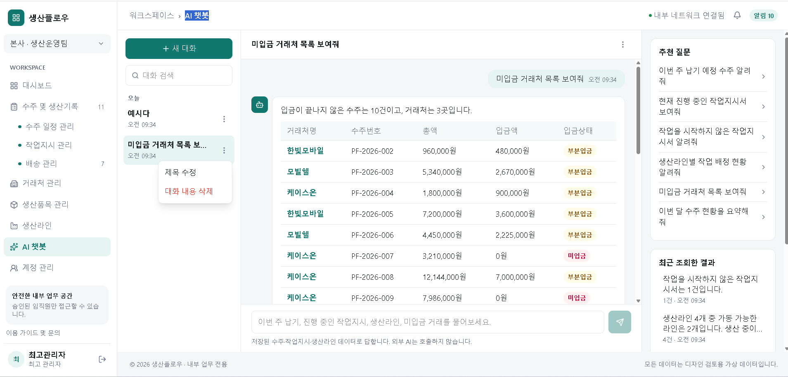

- 출력 데이터 항목 (Output Data):
    - 왼쪽 대화 목록: 새 대화 버튼, 대화 검색, 대화 제목과 시간, 대화 제목(수정·삭제)
    - 가운데 대화 영역: 대화 제목(수정·삭제), 사용자 질문 말풍선, AI 답변 말풍선, 답변 안의 조회 결과 표, 질문 입력창
    - 오른쪽 패널: 추천 질문, 자주 하는 질문, 예시 답변 미리보기 차트
- 화면 제어 및 동작 규칙 (Behavior Rules):
    - 권한 매트릭스에 정해진 역할만 접근 가능.
    - "이번 주 납기 예정 수주", "미입금 거래처 목록"처럼 자연어로 질문하면 조건을 해석해 조회 결과를 표로 응답.
    - 질문 의도와 답변 시점의 조회 결과를 메시지와 함께 저장해, 대화를 다시 열어도 같은 표를 보여 줌.
    - 추천 질문 클릭 시 해당 문장을 바로 전송.
    - AI는 조회와 요약만 수행하고 데이터를 수정하지 않음.
    - 입력페이지에서 벗어나면 대화 종료 상태로 변경

---

## 16. 전체 화면 와이어프레임 배치와 흐름도

### 16.1 전체 화면 와이어프레임 배치도

### 16.2 전체 화면 흐름도 및 내비게이션 구조

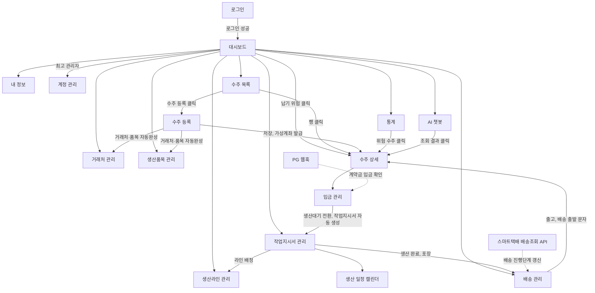