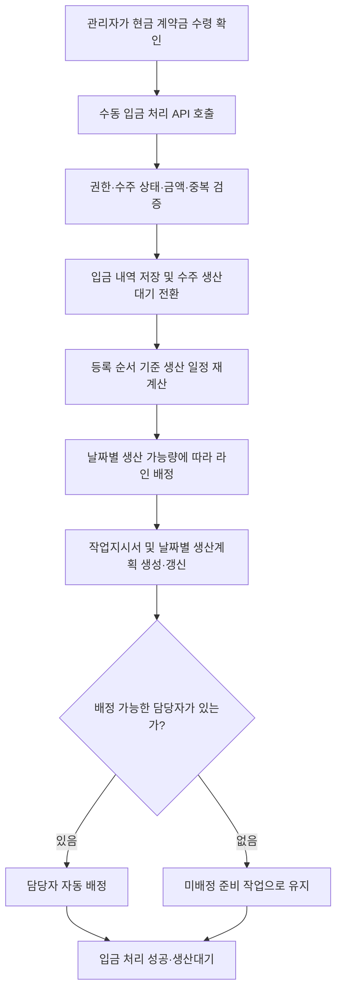

# 수주 입금 및 작업지시 자동 배정

- 작성일: 2026-11-08
- 목적: 팀원이 현금 계약금 확인부터 생산대기까지의 시스템 동작을 이해하기 위한 설명
- 기준: 현재 구현된 현금 계약금 수동 입금 처리 코드
- 범위: 수동 입금 검증, 상태 변경, 일정 재계산, 라인 배정, 작업지시서 생성, 담당자 배정

## 1. 전체 흐름

관리자가 실제로 받은 현금 계약금을 수주 상세 화면에서 등록하면 서버가 생산 준비까지 이어서 처리한다.



이 과정은 하나의 트랜잭션으로 실행한다. 담당자가 없는 상황은 정상 결과로 처리하지만, 라인·일정 배정 자체가 실패하면 입금 반영까지 함께 되돌린다.

입금 확인은 생산 준비를 확정하는 단계다. 실제 생산을 자동으로 시작하지 않는다.

## 2. 수주 등록과 생산 자리의 관계

수주 등록 시 기존 수주와 생산능력을 고려해 생산 시작·완료 예정일을 계산한다. 계약금 확인 전에는 작업지시서를 만들지 않는다.

| 항목 | 계약금 확인 전 |
|---|---|
| 수주 진행 상태 | `WAITING` — 대기 |
| 수주 입금 상태 | `UNPAID` — 미입금 |
| 작업지시서 | 없음 |
| 생산 일정 | 예정일을 계산하며, 이후 일정 계산에서도 생산 자리를 고려 |

생산 순서는 계약금 입금 순서가 아니라 수주 등록 순서가 기준이다. 미입금 수주의 생산 자리는 일정 계산 중 예약량으로 반영하며, 이 수주를 위한 실제 작업지시서와 생산계획 행을 미리 생성하지는 않는다.

예를 들어 A 수주를 먼저 등록하고 B 수주를 나중에 등록했다면, B가 계약금을 먼저 내더라도 A의 생산 자리를 무시하고 앞서 배정하지 않는다.

## 3. 현금 계약금 수동 입금 처리

### 3.1 API

```http
POST /api/v1/payments/deposit/manual
Content-Type: application/json
```

```json
{
  "orderId": 123,
  "amount": 500000
}
```

- `orderId`: 실제 수주의 숫자 ID
- `amount`: 수령한 현금 계약금 금액
- `receivedAt`: 선택 입력인 입금일시. 생략하면 서버의 한국 시간 현재 일시를 사용한다.
- 처리 직원은 로그인 정보로 확인한다. 프론트에서 담당 직원 ID를 전달하지 않는다.

이미 받은 현금을 기록하는 기능이므로 외부 결제 요청이나 가상계좌 발급·말소를 수행하지 않는다. 기존 가상계좌가 있더라도 이 API에서 변경하지 않는다.

### 3.2 처리 조건

서버는 다음 조건을 확인한다.

1. 처리자가 `SUPER_ADMIN` 또는 `ORDER_MANAGER`이다.
2. 처리자 계정이 `ACTIVE`이고 최초 비밀번호 변경을 완료했다.
3. 수주 진행 상태가 `WAITING`이다.
4. 입력 금액이 해당 수주의 계약금 예정액과 정확히 같다.
5. 이미 처리된 계약금이나 입금 내역이 없다.
6. 입금일시가 미래가 아니다.

계약금 예정액은 수주 총액의 50%이며 원 미만은 버린다. 예를 들어 총액이 1,000,001원이면 계약금은 500,000원이다.

현재 API는 계약금 전액을 한 번에 확인한다. 일부 계약금, 초과 입금, 잔금 수동 처리는 이 API의 범위가 아니다.

### 3.3 상태 변경과 기록

총액 100만 원인 수주에서 현금 계약금 50만 원을 확인한 예시다.

| 구분 | 처리 전 | 처리 후 |
|---|---|---|
| 계약금 결제 상태 | 입금 전 | `PAID` |
| 결제 방식 | 기존 방식 또는 미생성 | `MD` — 수동 입금 |
| 수주 진행 상태 | `WAITING` | `CONFIRMED` — 생산대기 |
| 수주 확정 상태 | 예정 | 확정 |
| 수주 입금 상태 | `UNPAID` | `PARTIALLY_PAID` — 계약금 입금 |
| 누적 입금액 | 0원 | 50만 원 |
| 잔금 | 100만 원 | 50만 원 |

계약금 결제의 `PAID`는 계약금 청구 건이 완납되었다는 의미다. 수주 전체는 잔금이 남아 있으므로 `PARTIALLY_PAID`다.

내부 계약금 결제 건이 없다면 생성하고, 있다면 검증 후 사용한다. 입금 내역과 함께 처리 직원, 금액, 입금일시를 포함한 수주 상태 변경 이력을 남긴다.

## 4. 등록 순서에 따른 생산 일정 재계산

계약금 확인 시 다음 상태의 수주를 등록일시, 수주 ID 순으로 조회해 생산 자리를 다시 계산한다.

- `WAITING`: 미입금 대기
- `CONFIRMED`: 생산대기
- `IN_PRODUCTION`: 생산중
- `ON_HOLD`: 생산보류

미입금 수주는 생산 자리만 계산한다. 계약금이 확인된 수주에는 계산 결과에 따라 작업지시서와 날짜별 생산계획을 생성하거나 갱신한다.

### 4.1 재배치할 수 있는 작업

현재 상태가 `PREPARE`이고 생산 진행 이력이 없는 작업이다. 이 작업은 아직 현장에서 생산을 시작하지 않았으므로 라인, 목표 수량, 예정일, 날짜별 생산계획을 다시 조정할 수 있다.

### 4.2 고정하는 작업

다음 작업은 기존 라인과 날짜별 계획을 유지하고, 이미 차지한 생산량을 제외한 나머지만 배정한다.

- 현재 상태가 `PREPARE`가 아닌 작업
- 현재는 `PREPARE`지만 과거에 `PRODUCE`, `SUSPEND`, `PACK`, `PACK_DONE` 상태를 거친 작업

즉, 생산을 시작했다가 준비로 돌아온 작업도 다시 옮기지 않는다.

한 수주의 입금 처리로 다른 수주의 준비 작업이 함께 재배치될 수 있다. 다만 이미 생산에 들어간 작업은 유지한다.

### 4.3 예정일과 납기일

배정 시작일은 기존 생산 시작 예정일, 계약금 마감일, 오늘 중 가장 늦은 날을 기준으로 한다. 주말과 등록된 휴일에는 생산량을 배정하지 않는다.

계약금을 일찍 냈다는 이유만으로 생산 시작 예정일을 앞당기지 않는다. 반대로 라인 용량이나 기존 일정이 달라지면 생산 완료 예정일이 늦어질 수 있다.

현재 구현은 다음 해 12월 31일까지 배정 가능 날짜를 탐색한다. 해당 범위 안에서도 수량을 모두 배정하지 못하면 실패한다.

납기일은 생산 완료 후 3영업일을 고려해 다시 계산하며, 기존 예상 납기보다 앞당기지 않는다. 따라서 일정 변경으로 생산 예정일과 납기일이 뒤로 바뀔 수 있다.

## 5. 생산라인 배정

배정 대상은 `AVAILABLE` 또는 `OPERATING` 상태의 라인이다. 가동 중인 라인도 미래 생산일에 여유가 있으면 배정할 수 있다.

날짜별 남은 생산 가능량은 다음과 같이 계산한다.

```text
남은 생산 가능량
= 라인의 하루 생산능력
- 유지된 기존 생산계획 수량
- 이번 재계산에서 먼저 예약한 수량
```

각 생산일에 남은 생산 가능량이 큰 라인부터 채우며, 같으면 라인 ID 순으로 결정한다. 한 날짜에 수량을 모두 배정하지 못하면 다른 라인과 이후 생산일로 나눈다.

따라서 라인 부족은 현재 사용 중인 라인 수만의 문제가 아니다. 해당 날짜들의 생산 가능량에서 기존 수주가 사용하는 수량을 제외하고도 주문량을 배정할 수 있는지가 기준이다.

## 6. 작업지시서와 날짜별 생산계획

작업지시서 한 장의 단위는 **수주 품목 하나 × 생산라인 하나**다.

한 품목 150개를 같은 날 A라인 100개, B라인 50개로 생산한다면 다음 두 장을 생성한다.

| 작업지시서 | 수주 품목 | 라인 | 목표 수량 | 초기 상태 |
|---|---|---|---:|---|
| 작업지시서 1 | 품목 X | A라인 | 100개 | `PREPARE` |
| 작업지시서 2 | 품목 X | B라인 | 50개 | `PREPARE` |

반면 같은 품목을 같은 라인에서 여러 날 생산한다면 한 장에 날짜별 생산계획을 연결한다.

```text
작업지시서: 품목 X / A라인 / 목표 150개
  ├─ 첫째 생산일: 100개
  └─ 둘째 생산일:  50개
```

- 작업지시서: 무엇을 어느 라인에서 총 몇 개 만들 것인지
- 생산계획: 그 작업을 날짜별로 몇 개씩 만들 것인지

작업지시서의 날짜별 계획 수량 합은 목표 수량과 같아야 한다. 수주의 작업지시서 목표 수량 합은 해당 수주의 주문 수량과 같아야 한다.

기존 준비 작업은 가능한 한 기존 ID를 유지해 수정한다. 같은 품목·라인의 기존 작업을 우선 재사용하고, 라인이 달라지면 같은 품목의 기존 준비 작업을 활용한다. 통합으로 남는 작업은 배정 이력에 작업지시번호를 보존한 뒤 제거한다. 라인·담당자 변경은 별도 이력으로 남긴다.

## 7. 담당자 자동 배정

### 7.1 후보 조건

다음 두 조건을 모두 만족하는 직원만 후보가 된다.

```text
role = PRODUCTION_MANAGER
status = ACTIVE
```

출근 여부와 현재 다른 작업을 생산 중인지 여부는 자동 배정 후보 선정에서 확인하지 않는다.

### 7.2 작업과 직원의 선택 순서

담당자가 없는 준비 작업 중 납기가 빠른 작업부터 배정한다. 납기가 같으면 수주 등록일시, 수주 ID, 작업지시서 ID 순으로 처리한다.

각 작업의 담당자는 다음 순서로 선택한다.

1. 다음 날 생산계획이 있는 작업지시서 장수가 적은 직원
2. 장수가 같으면 이름 순
3. 이름도 같으면 사용자 ID 순

다음 날은 처리일 기준 달력상의 다음 날이며 다음 영업일이 아니다. 비교하는 값은 생산 수량 합계가 아니라 작업지시서 장수다.

장수 계산은 다음 날 생산계획이 있는 `PREPARE`, `PRODUCE`, `SUSPEND` 작업을 대상으로 하며, 취소 수주는 제외한다. 같은 작업지시서에 여러 계획이 있어도 한 장으로 센다.

예를 들어 다음 날 작업이 김 직원 2장, 박 직원 1장이면 박 직원을 선택한다. 다만 새로 배정한 작업이 다음 날 생산계획을 갖지 않는다면 다음 날 장수는 늘지 않으므로, 전체 미래 작업량을 균등하게 나누는 방식과는 다르다.

기존 준비 작업의 담당자가 여전히 `ACTIVE`인 `PRODUCTION_MANAGER`라면 유지한다. 해당 조건을 만족하지 않게 되면 담당자를 비우고 다시 배정한다. 생산 이력이 있어 고정된 작업의 배정은 이번 준비 작업 재배치로 바꾸지 않는다.

### 7.3 담당자가 없는 경우

후보 직원이 없다면 미배정 상태로 저장하고 입금은 정상 반영한다.

| 항목 | 처리 결과 |
|---|---|
| 현금 계약금 | 정상 반영 |
| 수주 상태 | `CONFIRMED` — 생산대기 |
| 작업지시서 | 생성 |
| 라인·생산계획 | 배정 |
| 담당자 | 미배정 |
| 작업 상태 | `PREPARE` |

화면에서는 담당자가 없으면 `미배정`으로 표시한다. 미배정 상태에서는 생산을 시작할 수 없다.

나중에 직원이 생겼다고 이 흐름만으로 즉시 자동 배정되는 것은 아니다. 수동으로 배정하거나 이후 자동 배정 로직이 실행될 때 배정한다.

## 8. 실제 생산 시작은 별도 처리

```text
현금 계약금 확인
  → 수주 CONFIRMED / 작업 PREPARE
  → 담당자 배정 및 생산 시작 예정일 도래
  → 별도의 생산 시작 상태 변경
  → 작업 PRODUCE / 수주 IN_PRODUCTION
```

작업지시서가 생성되고 담당자가 지정되어도 생산이 자동으로 시작되지는 않는다. 실제 시작 시 권한과 담당자 배정 여부, 시작 예정일 등 생산 시작 조건을 별도로 검증한다.

## 9. 실패와 중복 처리

입금 기록, 수주 상태 변경, 생산계획 재계산, 작업지시서 생성·수정, 담당자 배정은 같은 트랜잭션으로 처리한다.

| 상황 | 결과 |
|---|---|
| 담당자 후보 없음 | 미배정 작업지시서를 생성하고 입금 성공 |
| 입력 금액 불일치 | 입금 반영 없이 실패 |
| 이미 처리된 계약금 | 중복 처리 없이 실패 |
| 가동 가능한 라인 없음 | 입금·일정·작업 변경을 함께 롤백 |
| 탐색 기간 안에 생산량 배정 불가 | 입금·일정·작업 변경을 함께 롤백 |
| 저장 중 예외 발생 | 해당 트랜잭션의 변경을 함께 롤백 |

수주와 라인 및 일정 계산에 필요한 잠금과 중복 검증을 사용한다. 여러 직원의 동시 처리나 버튼 중복 클릭으로 같은 계약금과 작업지시서가 중복 생성되는 것을 방지한다.

롤백은 시스템 기록을 되돌린다는 뜻이다. 실제로 수령한 현금이 반환되는 것은 아니므로 관리자는 오류 원인을 해결한 뒤 다시 기록해야 한다.

## 10. 프론트에서 해야 할 일

프론트는 입금 API를 호출하고 서버가 확정한 결과를 표시한다. 작업지시서 생성, 라인 선택, 담당자 선정, 일정 계산을 프론트에서 다시 구현하지 않는다.

성공 후 다음 정보를 다시 조회한다.

| 정보 | API |
|---|---|
| 수주 상세·생산 예정일·납기 | `GET /api/v1/orders/{orderId}` |
| 입금 내역·누적 입금액·잔금 | `GET /api/v1/payments?orderId={orderId}` |
| 작업지시서·라인·담당자 | `GET /api/v1/work-orders?orderId={orderId}` |
| 수주 상태 변경 이력 | `GET /api/v1/orders/{orderId}/histories` |

작업지시서 조회는 페이지 응답이므로 필요한 전체 페이지를 조회해 누락되지 않게 한다. 관련 캐시를 사용한다면 수주 목록과 일정 등도 갱신한다.

요청 중 중복 클릭을 막고, 서버 성공 전에 입금 완료로 표시하지 않는다. 입금 성공 후 재조회만 실패했다면 입금 실패로 안내하지 않고 화면 갱신 실패를 구분한다.

## 11. 기존 기획 문서와 현재 구현의 차이

[기획서의 작업지시 및 담당자 규칙](../01_planning/01_proposal.md#210-작업지시-및-담당자)에는 출근 여부, 현재 생산 작업 유무, 준비 작업 수량을 활용하는 이전 자동 배정 기준이 남아 있다.

현재 구현은 이후 합의한 다음 기준을 적용한다.

| 항목 | 기존 기획서 | 현재 현금 계약금 처리 구현 |
|---|---|---|
| 후보 | 출근 여부·현재 생산 여부도 고려 | `PRODUCTION_MANAGER`이면서 `ACTIVE` |
| 출근 여부 | 고려 | 고려하지 않음 |
| 현재 생산 중 여부 | 후보 선정에 고려 | 후보 선정에서 제외 조건으로 사용하지 않음 |
| 우선순위 | 준비 수량 및 출근자 부재 시 다음 날 장수 | 다음 날 작업지시서 장수 → 이름 → ID |
| 후보 없음 | 미배정 가능 | 미배정으로 생성하고 입금 정상 반영 |

이 문서는 현금 계약금 수동 처리의 현재 코드를 설명한다. 다른 입금 경로나 라인 변경·재배치 기능 전체가 동일하게 동작한다는 의미는 아니며, 해당 기능은 각 구현을 확인해야 한다. 이 문서 작성으로 기존 기획서나 API 명세를 변경하지는 않았다.

## 12. 참고 자료와 구현 위치

- [기획 배경과 기능 범위](../01_planning/01_proposal.md)
- [데이터 구조와 제약조건](02_erd.md)
- [업무 흐름과 처리 조건](../01_planning/04_business_process.md)
- [수동 입금 처리 서비스](../../src/main/java/net/likelion/bebc25/prodflow/payment/service/PaymentService.java): `recordManualDeposit`
- [작업지시서 생성·일정·라인·담당자 배정](../../src/main/java/net/likelion/bebc25/prodflow/work_order/service/WorkOrderService.java): `createForConfirmedOrder`, `allocateDepositItem`, `assignUnassignedPrepare`
- [고정 작업·미배정 작업·다음 날 작업 장수 조회](../../src/main/java/net/likelion/bebc25/prodflow/work_order/repository/WorkOrderRepository.java)
- [일정 계산 대상 수주와 등록 순서](../../src/main/java/net/likelion/bebc25/prodflow/quotation/repository/QuotationScheduleRepository.java)
